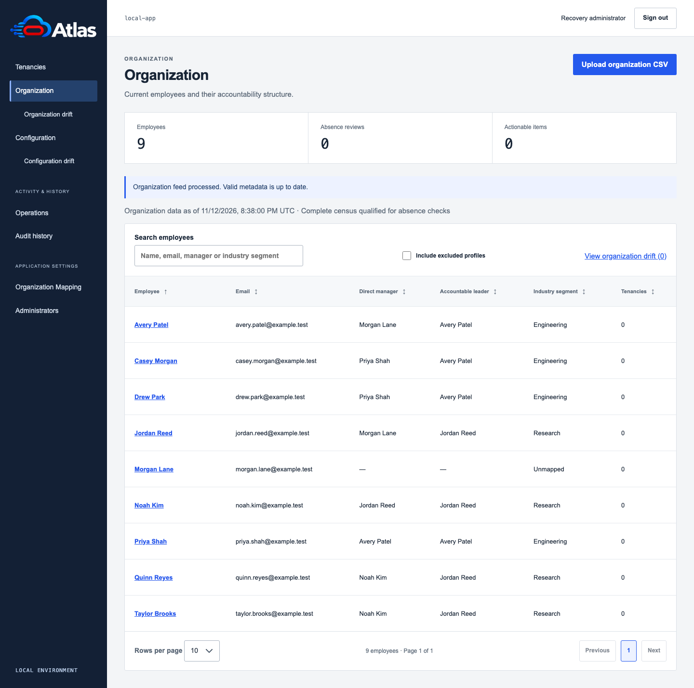
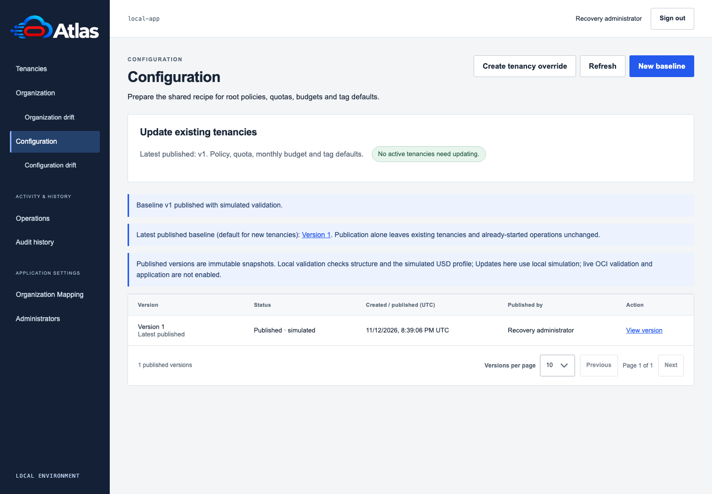
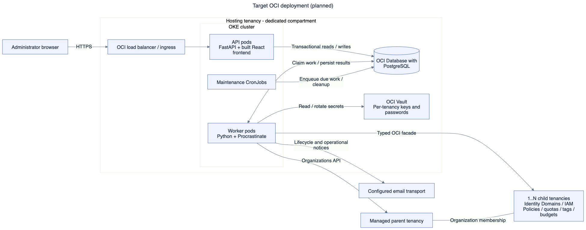
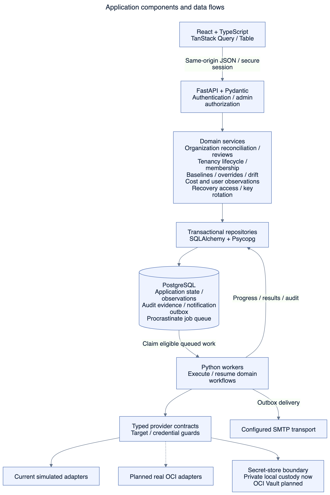
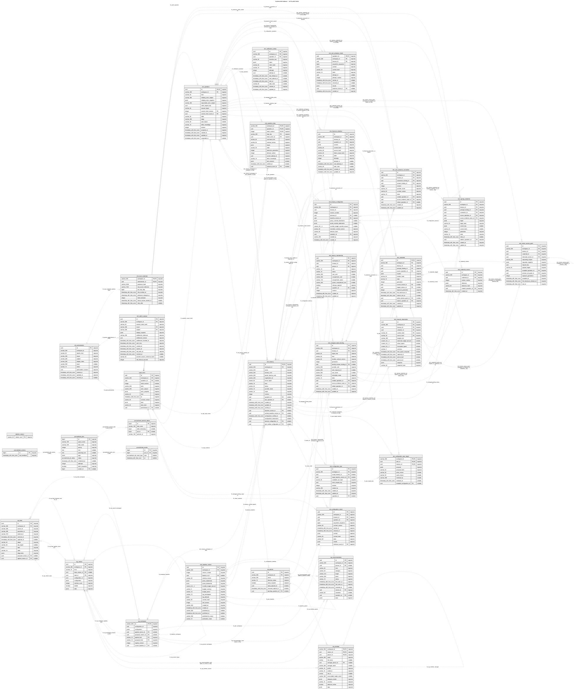

# OCI Tenancy Manager

**Independent tenancies. Central accountability. Automated operations.**

OCI Tenancy Manager helps administrators run a fleet of OCI child tenancies without losing track
of who owns them, where they sit in the organization, or which configuration they should have.
**Atlas** is the display branding of this instance; the application name and artwork are configurable.

[Documentation](docs/README.md) · [Local setup](docs/reference/local-application.md) ·
[Architecture](docs/architecture/README.md) · [Engineering design](docs/engineering-design/README.md)

## What it does

- **Connect people to tenancies.** Import organization CSVs, derive reporting/accountability chains,
  review arrivals and departures, and manage individual/shared tenancy ownership and membership.
- **Guide the lifecycle.** Create/import tenancies through durable, resumable operations with an
  explicit administrator handoff for OCI activation, then verify setup and remove temporary access.
- **Manage one configuration recipe.** Publish immutable baselines for root policy statements,
  quotas, monthly budgets and tag defaults; apply reviewed updates individually or in bulk, with
  explicit per-tenancy overrides and drift checks.
- **Bring visibility together.** Show inventory, ownership, baseline status and cached current-month
  budget/actual/forecast information; collect fresh provider observations on request.
- **Keep access accountable.** Record required-user checks, audited recovery-password access and
  managed signing-key rotation, with durable operation and administrative audit history.

**Current status:** the Python/React application runs locally with real authentication, PostgreSQL
persistence, durable workers and captured email. OCI provider effects are simulated. Real OCI
adapters, corporate SSO, OKE/managed-service deployment and daily hosted schedules still require
implementation and qualification. [The live-OCI test manifest](docs/how-to/real-oci-test-manifest.md)
tracks those boundaries; screenshots and architecture views are not deployment evidence.

## Application preview

These are captures of the actual application using a fresh, disposable database and entirely
fictional people with reserved `example.test` addresses. No private organization data was used.

### Organization and accountability

### Versioned configuration

[Capture provenance and image notes](docs/screenshots/README.md)

## OCI deployment architecture

The target deployment places API and worker pods on **OKE**, with **OCI Database with PostgreSQL**
for application state and the durable queue, and **OCI Vault** for tenancy credentials. The hosting
compartment can be in a different tenancy from the managed parent: OTM accesses the parent and
children through explicitly configured credentials and typed provider boundaries.

This view shows the OCI hosting architecture. Infrastructure provisioning belongs to Terraform;
API, worker and maintenance commands share the runtime image but run as distinct
workloads. CronJobs enqueue due work or perform bounded maintenance; Python workers execute the
durable workflows. Email transport is configured separately.

[Full-size SVG](docs/architecture/diagrams/oci-deployment.svg) ·
[Mermaid](docs/architecture/diagrams/oci-deployment.mmd) ·
[Excalidraw](docs/architecture/diagrams/oci-deployment.excalidraw) ·
[Platform and delivery design](docs/engineering-design/06-platform-and-delivery.md)

## Logical application architecture

The frontend calls the authenticated API. Domain services validate requests and commit state,
operation intent and queued work transactionally. Python workers claim work from PostgreSQL,
execute the domain workflows through provider contracts and persist results. Screens read stored
observations; navigating between screens does not require another provider call.

The provider boundary keeps simulated implementations separate from OCI adapters.
There is no automatic fallback from a failed real connection to simulation or recovery credentials.
The secret-store boundary covers private local custody and OCI Vault.

[Full-size SVG](docs/architecture/diagrams/logical-architecture.svg) ·
[Mermaid](docs/architecture/diagrams/logical-architecture.mmd) ·
[Excalidraw](docs/architecture/diagrams/logical-architecture.excalidraw) ·
[Operations/provider design](docs/engineering-design/02-operations-and-provider.md)

## Complete entity-relationship diagram

The complete implemented schema has **34 tables, 438 columns and 89 declared foreign keys**:
29 application tables, four Procrastinate tables and Alembic’s migration marker. This was reflected
from a freshly migrated disposable PostgreSQL database, not inferred from screenshots or the older
prototype. The separate production design dictionary also describes future tables.

[**Open the full-size ER diagram (SVG)**](docs/architecture/diagrams/implemented-full-er.svg) ·
[Table descriptions and complete column directory](docs/architecture/implemented-database.md) ·
[Mermaid source](docs/architecture/diagrams/implemented-full-er.mmd)

Show the complete ER diagram

For a readable feature-by-feature view, use the [focused data-model diagrams](docs/architecture/diagrams/README.md).
The complete SVG supports zooming; entities and relationships remain editable in Mermaid.

## Start exploring

| I want to… | Start here |
| --- | --- |
| Run the local application | [Local setup and enrollment](docs/reference/local-application.md) |
| Understand the product and design | [Documentation home](docs/README.md) and [engineering chapters](docs/engineering-design/README.md) |
| See tables and relationships | [Implemented database directory](docs/architecture/implemented-database.md) |
| Rehearse a synthetic demonstration | [Stakeholder demo guide](docs/how-to/stakeholder-demo.md) |
| Build and qualify the runtime image | [Container development](docs/how-to/container-development.md) |
| Contribute and checkpoint work | [GitHub checkpoint workflow](docs/how-to/github-checkpoints.md) |
| Understand remaining cloud validation | [Real-OCI qualification manifest](docs/how-to/real-oci-test-manifest.md) |

No default administrator is created. Enrollment uses an explicit private operator procedure.
Local state, feeds, credentials and unsanitized evidence stay outside version control. Changes use
feature branches and protected-master pull requests, with required tests and independent reviews.

| Location | Purpose |
| --- | --- |
| [backend/](backend/README.md) | Python application, contracts and frozen migrations |
| [frontend/](frontend/README.md) | React application and generated TypeScript contracts |
| [docs/](docs/README.md) | Current design, implemented references, procedures and historical checkpoints |
| [prototype/](prototype/README.md) | Retained organization lab; separate from the current runtime |

Follow the [test/merge policy](docs/engineering-test-plan.md), [security review policy](docs/security-review-policy.md),
[code documentation convention](docs/code-documentation-policy.md) and [UI baseline](DESIGN.md).

## Technology catalog

These are the direct application dependencies and the main development, testing and security tools.
Transitive package inventories and exact versions belong in [the backend manifest](backend/pyproject.toml),
[Python lockfile](backend/uv.lock), [frontend manifest](frontend/package.json) and
[npm lockfile](frontend/package-lock.json). Build/test tools are not all shipped in the runtime image.

### Backend and API

| Technology | How we use it |
| --- | --- |
| [Python](https://www.python.org/) | Backend business logic, provider boundaries, background workers and operator commands. |
| [FastAPI](https://fastapi.tiangolo.com/) | HTTP API routes and integration of validated requests/responses. |
| [Starlette](https://www.starlette.io/) | ASGI middleware, browser/authentication boundaries and static frontend delivery beneath FastAPI. |
| [Uvicorn](https://www.uvicorn.org/) | Runs the Python ASGI web application. |
| [Pydantic](https://docs.pydantic.dev/latest/) | Validates settings, request/response contracts and domain data; produces authoritative JSON Schema. |
| [JSON Schema](https://json-schema.org/) | Describes exported API/domain contract shapes for generated frontend types and consistency checks. |

### Database and durable jobs

| Technology | How we use it |
| --- | --- |
| [PostgreSQL](https://www.postgresql.org/) | Stores organization snapshots, tenancy associations, operations, audit history and durable job state; disposable containers support integration testing. |
| [SQLAlchemy](https://www.sqlalchemy.org/) | Defines database tables and builds parameterized SQL and transactional repository operations. |
| [Psycopg](https://www.psycopg.org/psycopg3/) | PostgreSQL driver, native database communication and connection pools, including Procrastinate connections. |
| [Alembic](https://alembic.sqlalchemy.org/) | Versions and applies frozen database schema migrations. |
| [Procrastinate](https://procrastinate.readthedocs.io/) | PostgreSQL-backed durable queue; Python workers execute asynchronous application operations. |

### Web frontend

| Technology | How we use it |
| --- | --- |
| [React / React DOM](https://react.dev/) | Renders the administrator interface and manages interactive screens. |
| [TypeScript](https://www.typescriptlang.org/) | Type-checks frontend code and the generated backend contracts. |
| [TanStack Query](https://tanstack.com/query/latest) | Fetches/caches API data and coordinates mutations, invalidation and refresh behavior. |
| [TanStack Table](https://tanstack.com/table/latest) | Builds application tables with controlled sorting and pagination. |
| [Vite](https://vite.dev/) and [its React plugin](https://github.com/vitejs/vite-plugin-react) | Development tooling and the production frontend build, including JavaScript/CSS bundling and minification. |
| [Node.js](https://nodejs.org/) and [npm](https://www.npmjs.com/) | Execute frontend build/test tooling and install locked JavaScript dependencies; not required in the final runtime image. |
| [json-schema-to-typescript](https://github.com/bcherny/json-schema-to-typescript) | Generates TypeScript interfaces from backend JSON Schema snapshots. |
| [DefinitelyTyped](https://github.com/DefinitelyTyped/DefinitelyTyped) | Supplies TypeScript declarations for Node, React and React DOM through the direct `@types/*` development packages. |

The interface uses custom CSS following [our design system](DESIGN.md); it does not depend on a
separate CSS component framework. HTML/CSS are web standards rather than additional package dependencies.

### Authentication, cryptography and secure parsing

| Technology | How we use it |
| --- | --- |
| [Argon2-cffi](https://argon2-cffi.readthedocs.io/) | Hashes and verifies the application's local recovery-administrator password. |
| [PyOTP](https://pyauth.github.io/pyotp/) | Implements independent TOTP MFA for that local application administrator. |
| [OpenSSL](https://www.openssl.org/) | Generates/parses local bootstrap RSA keys and development certificates; supports TLS through Python's SSL integration. |
| [PyYAML](https://pyyaml.org/) | Uses safe YAML loading in tooling tests to validate dependency-update configuration. |
| [defusedxml](https://github.com/tiran/defusedxml) | Parses test/coverage XML evidence with protections against unsafe XML features. |

### Testing and quality

| Technology | How we use it |
| --- | --- |
| [pytest](https://docs.pytest.org/) | Backend unit and disposable PostgreSQL integration tests. |
| [Coverage.py](https://coverage.readthedocs.io/) and [pytest-cov](https://pytest-cov.readthedocs.io/) | Measure complete-source, unit-only backend line coverage and enforce the 95% gate. |
| [Vitest](https://vitest.dev/) and [V8 coverage](https://vitest.dev/guide/coverage.html) | Frontend unit tests and the separate complete-source 95% line-coverage gate. |
| [Testing Library](https://testing-library.com/), [user-event](https://testing-library.com/docs/user-event/intro/) and [jest-dom](https://github.com/testing-library/jest-dom) | Test React behavior through user interactions and accessible DOM assertions. |
| [jsdom](https://github.com/jsdom/jsdom) | Provides a browser-like DOM for frontend unit tests. |
| [Playwright](https://playwright.dev/) / [Chromium](https://www.chromium.org/) | Exercise real browser journeys against disposable application/database environments. |
| [HTTPX](https://www.python-httpx.org/) | Exercises HTTP/ASGI API behavior in backend tests. |
| [Ruff](https://docs.astral.sh/ruff/) | Python linting and formatting. |
| [Mailpit](https://mailpit.axllent.org/) | Captures test/local lifecycle emails without sending them to real recipients. |

### Packaging and local containers

| Technology | How we use it |
| --- | --- |
| [uv](https://docs.astral.sh/uv/) | Manages locked Python dependencies/environments and installs the noneditable backend in the image build. |
| [Hatchling](https://hatch.pypa.io/latest/) | Builds the Python package, including explicitly packaged migration and settings assets. |
| [Docker Engine / Moby](https://mobyproject.org/), [BuildKit](https://github.com/moby/buildkit) and [Buildx](https://docs.docker.com/build/) | Build the multistage image and run owned disposable PostgreSQL/application/scanner containers. |
| [Alpine Linux](https://alpinelinux.org/) / [musl](https://musl.libc.org/) | Selected Linux base/C runtime for both Python build and final runtime stages. |
| [Debian](https://www.debian.org/) | Base of the temporary Node frontend-build stage; not copied into the final Alpine runtime. |
| [Rancher Desktop](https://rancherdesktop.io/) | Optional local container-engine environment used on the development laptop; not an application dependency. |

### Security and engineering workflow

| Technology | How we use it |
| --- | --- |
| [Trivy](https://trivy.dev/) | Scans the exact final image's OS/Python packages; HIGH/CRITICAL findings or unavailable/incomplete scans block qualification. |
| [Gitleaks](https://github.com/gitleaks/gitleaks) | Scans the publication candidate for exposed credentials. |
| [Bandit](https://bandit.readthedocs.io/) | Static security analysis of Python application source. |
| [pip-audit](https://pypi.org/project/pip-audit/) / [npm audit](https://docs.npmjs.com/cli/commands/npm-audit/) | Check locked Python/JavaScript dependency sets for known advisories. |
| [Git](https://git-scm.com/) | Source history, feature branches and reviewable checkpoints. |
| [Dependabot](https://github.com/dependabot/dependabot-core) | Proposes grouped image/scanner and CI-action update PRs; updates require tests and human review. |
| [gstack](https://github.com/garrytan/gstack) | Development/review/QA/documentation/shipping workflow used by the coding agent; not shipped in the application image. |

Project-owned publication, secret, contract, documentation and code-comment checks supplement these
tools. The main [documentation index](docs/README.md) links to their policies and operating guides.

### Retained organization prototype

The separate [prototype](prototype/README.md) reuses several Python tools above and adds
[openpyxl](https://openpyxl.readthedocs.io/) for historical XLSX feed experiments. It is not
installed in the production application image; current application intake uses CSV.

### Hosted services and planned infrastructure

These are deployment/service choices, not additional open-source runtime dependencies already
qualified by the local application:

| Technology or service | Status and intended use |
| --- | --- |
| [GitHub Actions](https://github.com/features/actions) | Current hosted CI service; runs the five required checkpoint jobs. The service itself is distinct from the open-source actions and runner projects. |
| [Kubernetes](https://kubernetes.io/) | Planned orchestration of API/worker pods and maintenance CronJobs; Kubernetes is open source. |
| [Terraform](https://developer.hashicorp.com/terraform) | Planned OCI infrastructure provisioning. [Current Terraform licensing](https://github.com/hashicorp/terraform/blob/main/LICENSE) is source-available, so it is not classified as an open-source dependency here. |
| [OCI OKE](https://www.oracle.com/cloud/cloud-native/container-engine-kubernetes/), [OCI Database with PostgreSQL](https://www.oracle.com/cloud/postgresql/) and [OCI Vault](https://www.oracle.com/security/cloud-security/key-management/) | Planned managed hosting, PostgreSQL and credential custody. These OCI services are not open-source projects or locally qualified integrations. |

For the built/runtime distinction and current image qualification limits, see
[container development](docs/how-to/container-development.md). Exact tool versions/digests live in
manifests and locks rather than being duplicated in this catalog.
