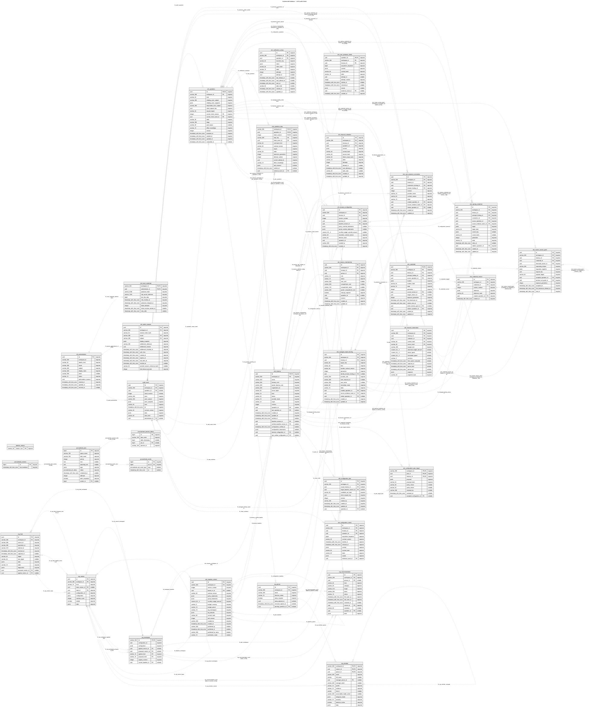

# Implemented database: complete ER and table directory

This reference describes the **implemented application schema**, not the retained prototype or the
larger proposed production model. It was reflected from a freshly migrated, empty disposable
PostgreSQL 16 database at source checkpoint `786f83b`. No saved database or employee data was read.

**34 tables · 438 columns · 89 declared foreign keys.** The inventory includes 29 application
tables, four Procrastinate-owned tables and Alembic’s migration marker.

[Full-size SVG](diagrams/implemented-full-er.svg) · [PNG](diagrams/implemented-full-er.png) ·
[Editable Mermaid source](diagrams/implemented-full-er.mmd)

## Reading the diagram

Every table and column is included. PK/FK mark actual database keys; nullable/required describe
column nullability. Edges are declared SQL foreign keys, including composite workspace/identity
guards and the deferred operation/intent relationship. Cardinalities reflect nullability and
unconditional unique keys; conditional indexes, checks and triggers add constraints not fully
expressible in an ER diagram. The links below list exact FK columns.

JSON payloads and OCID/subject strings can contain application-level relationships that are not SQL
foreign keys; no inferred relationships are drawn. JSONB fields are structured application contracts,
not omitted relational tables. The full schema is large: open the SVG to zoom, or use the focused
[feature diagrams](diagrams/README.md). Edit ER entities and relationships in Mermaid source.

## Table directory

| Table | Responsibility |
| --- | --- |
| [alembic_version](#alembic_version) | Alembic migration head. Operational schema bookkeeping, not a business entity. |
| [audit_event](#audit_event) | Immutable actor/intent/action/evidence history. JSON snapshots preserve human-readable historical context independently of later directory changes. |
| [org_feed](#org_feed) | One received organization snapshot, source/capture metadata, validation diagnostics and processing result. Manual uploads are separate deliveries. |
| [org_member](#org_member) | Employee metadata and derived hierarchy/mapping evidence within a specific organization version. |
| [org_person](#org_person) | Stable internal employee identity, directory/setup lifecycle and pending-operation guard. Person identity survives feed changes and tenancy transitions. |
| [org_recommendation](#org_recommendation) | Persisted organization review episodes, status, evidence and explicit resolution or operation handoff. |
| [org_version](#org_version) | Versioned organization representation, including provenance and configuration identity. Proposed and applied views can point to different versions. |
| [org_workspace](#org_workspace) | Organization settings plus pointers to the latest proposed and applied versions; contains the configured leader/segment/designee mappings. |
| [otm_admin_session](#otm_admin_session) | Active browser session credentials and expiration/revocation state, separate from immutable audit history. |
| [otm_administrator](#otm_administrator) | Application administrator grants, identity subject, display/contact information and authorization revision. |
| [otm_baseline_version](#otm_baseline_version) | Draft and immutable published baseline content: policy/quota statement arrays, monthly budget, namespace and defined-tag/default configuration. |
| [otm_configuration_check](#otm_configuration_check) | Recorded expected-versus-observed managed configuration and drift-check outcome for a tenancy. |
| [otm_configuration_plan](#otm_configuration_plan) | Reviewed single-tenancy or bulk configuration update plan and execution/acknowledgment state. |
| [otm_configuration_plan_target](#otm_configuration_plan_target) | A target tenancy within a configuration plan, including reviewed override decisions and target operation/result state. |
| [otm_credential](#otm_credential) | Recovery account credential custody reference and current preparation/rotation state; secret values live behind the secret-store boundary. |
| [otm_credential_version](#otm_credential_version) | Recovery credential version/evidence metadata and secret reference; not a plaintext password archive. |
| [otm_financial_collection](#otm_financial_collection) | One asynchronous cost-collection attempt and its target/configuration/credential context. |
| [otm_financial_observation](#otm_financial_observation) | Persisted current-month budget, actual/forecast amounts, currency and freshness evidence. Historical budget reporting is not V1 functionality. |
| [otm_human_access_grant](#otm_human_access_grant) | Audited recovery-password request/disclosure window, requester identity, fixed deadline and cleanup/rotation work. |
| [otm_local_credential](#otm_local_credential) | Local application recovery-administrator password verifier, MFA seed reference, failure counters and enrollment state. Passwords and MFA seeds are not displayed by this documentation. |
| [otm_managed_object_binding](#otm_managed_object_binding) | Exact OCI object identifiers and metadata for OTM-managed tenancy objects/identities. These bindings support later readback and drift checks. |
| [otm_notification_outbox](#otm_notification_outbox) | Durable email delivery work, recipient/message evidence, retries and delivery result. Lifecycle failures route to the responsible administrator. |
| [otm_operation](#otm_operation) | Durable application workflow identity, current intent revision, responsible administrator, stage/state and replay guard. This is distinct from the native queue job. |
| [otm_operation_step](#otm_operation_step) | Per-operation execution attempts, target/credential context, normalized outcomes and provider evidence. |
| [otm_signing_credential](#otm_signing_credential) | Managed API-signing credential generation, custody/public-key metadata, rotation schedule and retirement/retry state. |
| [otm_tenancy](#otm_tenancy) | Registered child-tenancy inventory, OCI identity/name/home region, accountable owner and lifecycle state. Deleting a tenancy does not offboard employees. |
| [otm_tenancy_configuration](#otm_tenancy_configuration) | Immutable accepted configuration revisions/content, including full-list policy/quota and amount-only budget overrides. Selected/verified head pointers and verification time live on otm_tenancy. |
| [otm_tenancy_membership](#otm_tenancy_membership) | Individual/shared tenancy-person associations and their identity/compartment references. Owners count as members; membership removal does not delete resources. |
| [otm_user_presence_check](#otm_user_presence_check) | Required-user presence, assignment and recovery-policy observations tied to exact connection/check context. |
| [otm_user_presence_connection](#otm_user_presence_connection) | The exact identity-domain/automation connection and connection revision used for required-user checks; a connection revision is distinct from signing-credential generation. |
| [procrastinate_events](#procrastinate_events) | Native Procrastinate job-state event history. |
| [procrastinate_jobs](#procrastinate_jobs) | Native Procrastinate job queue: task arguments, schedule, locks, attempts and execution state. Python workers execute these jobs; SQL stores coordination state. |
| [procrastinate_periodic_defers](#procrastinate_periodic_defers) | Native periodic-task deferral deduplication records; this table alone does not deploy a scheduler. |
| [procrastinate_workers](#procrastinate_workers) | Native worker registration and heartbeat records. |

## Columns and declared relationships

Types below are PostgreSQL dialect-rendered reflection types, including timezone semantics. Exact defaults, named checks, triggers, indexes,
grants and migration history remain authoritative in [migration manifest](../../backend/migrations/sql/manifest.json)
and [SQLAlchemy definitions](../../backend/src/otm/storage/tables.py). The broader design dictionary
is [production data model](../engineering-design/11-production-data-model.md). It contains future
entities too; inclusion there does not imply a migrated table.

### alembic_version

Alembic migration head. Operational schema bookkeeping, not a business entity.

| Column | PostgreSQL type | Required | Key |
| --- | --- | --- | --- |
| `version_num` | `VARCHAR(32)` | Yes | PK |

### audit_event

Immutable actor/intent/action/evidence history. JSON snapshots preserve human-readable historical context independently of later directory changes.

| Column | PostgreSQL type | Required | Key |
| --- | --- | --- | --- |
| `id` | `UUID` | Yes | PK |
| `workspace_id` | `VARCHAR(256)` | Yes | FK |
| `operation_id` | `UUID` | No | FK |
| `intent_revision` | `INTEGER` | No | — |
| `actor` | `VARCHAR(256)` | Yes | — |
| `actor_subject` | `VARCHAR(256)` | Yes | — |
| `actor_snapshot` | `JSONB` | Yes | — |
| `kind` | `VARCHAR(64)` | Yes | — |
| `at` | `TIMESTAMP WITH TIME ZONE` | Yes | — |
| `contract_version` | `VARCHAR(64)` | Yes | — |
| `data` | `JSONB` | Yes | — |
| `data_hash` | `VARCHAR(64)` | Yes | — |
| `administrator_id` | `UUID` | No | FK |

Foreign keys:

- `workspace_id, administrator_id` → `otm_administrator(workspace_id, id)` (fk_audit_administrator).
- `workspace_id, operation_id` → `otm_operation(workspace_id, id)` (fk_audit_operation).

### org_feed

One received organization snapshot, source/capture metadata, validation diagnostics and processing result. Manual uploads are separate deliveries.

| Column | PostgreSQL type | Required | Key |
| --- | --- | --- | --- |
| `id` | `UUID` | Yes | PK |
| `workspace_id` | `VARCHAR(256)` | Yes | FK |
| `source_id` | `VARCHAR(256)` | Yes | — |
| `population_id` | `VARCHAR(256)` | Yes | — |
| `external_id` | `VARCHAR(512)` | Yes | — |
| `received_at` | `TIMESTAMP WITH TIME ZONE` | Yes | — |
| `captured_at` | `TIMESTAMP WITH TIME ZONE` | No | — |
| `digest` | `VARCHAR(64)` | Yes | — |
| `raw_digest` | `VARCHAR(64)` | No | — |
| `data` | `JSONB` | Yes | — |
| `state` | `VARCHAR(16)` | Yes | — |
| `diagnostics` | `JSONB` | Yes | — |
| `proposed_version_id` | `UUID` | No | FK |
| `applied_version_id` | `UUID` | No | FK |

Foreign keys:

- `workspace_id, applied_version_id` → `org_version(workspace_id, id)` (fk_org_feed_applied_version_id).
- `workspace_id, proposed_version_id` → `org_version(workspace_id, id)` (fk_org_feed_proposed_version_id).
- `workspace_id` → `org_workspace(id)` (fk_org_feed_workspace).

### org_member

Employee metadata and derived hierarchy/mapping evidence within a specific organization version.

| Column | PostgreSQL type | Required | Key |
| --- | --- | --- | --- |
| `workspace_id` | `VARCHAR(256)` | Yes | PK, FK |
| `version_id` | `UUID` | Yes | PK, FK |
| `person_id` | `UUID` | Yes | PK, FK |
| `email` | `VARCHAR(320)` | Yes | — |
| `full_name` | `VARCHAR` | No | — |
| `manager_person_id` | `UUID` | No | FK |
| `manager_email` | `VARCHAR(320)` | No | — |
| `profile` | `VARCHAR(16)` | Yes | — |
| `evidence` | `VARCHAR(16)` | Yes | — |
| `lob_id` | `VARCHAR` | No | — |
| `accountable_leader_email` | `VARCHAR(320)` | No | — |
| `designee_emails` | `JSONB` | Yes | — |
| `ancestry` | `VARCHAR(16)` | Yes | — |
| `absence_review` | `BOOLEAN` | Yes | — |
| `data` | `JSONB` | Yes | — |

Foreign keys:

- `workspace_id, version_id, manager_person_id` → `org_member(workspace_id, version_id, person_id)` (fk_org_member_manager).
- `workspace_id, person_id` → `org_person(workspace_id, id)` (fk_org_member_person).
- `workspace_id, version_id` → `org_version(workspace_id, id)` (fk_org_member_version).

### org_person

Stable internal employee identity, directory/setup lifecycle and pending-operation guard. Person identity survives feed changes and tenancy transitions.

| Column | PostgreSQL type | Required | Key |
| --- | --- | --- | --- |
| `id` | `UUID` | Yes | PK |
| `workspace_id` | `VARCHAR(256)` | Yes | FK |
| `email` | `VARCHAR(320)` | Yes | — |
| `directory_status` | `VARCHAR(16)` | Yes | — |
| `setup_required` | `BOOLEAN` | Yes | — |
| `setup_episode_id` | `UUID` | No | — |
| `removed_capture_at` | `TIMESTAMP WITH TIME ZONE` | No | — |
| `pending_operation_id` | `UUID` | No | FK |

Foreign keys:

- `workspace_id, pending_operation_id` → `otm_operation(workspace_id, id)` (fk_org_person_pending_operation).
- `workspace_id` → `org_workspace(id)` (fk_org_person_workspace).

### org_recommendation

Persisted organization review episodes, status, evidence and explicit resolution or operation handoff.

| Column | PostgreSQL type | Required | Key |
| --- | --- | --- | --- |
| `id` | `UUID` | Yes | PK |
| `workspace_id` | `VARCHAR(256)` | Yes | FK |
| `person_id` | `UUID` | No | FK |
| `kind` | `VARCHAR(64)` | Yes | — |
| `category` | `VARCHAR(24)` | Yes | — |
| `target` | `VARCHAR(512)` | Yes | — |
| `basis` | `VARCHAR(256)` | Yes | — |
| `status` | `VARCHAR(16)` | Yes | — |
| `first_seen_at` | `TIMESTAMP WITH TIME ZONE` | Yes | — |
| `last_seen_at` | `TIMESTAMP WITH TIME ZONE` | Yes | — |
| `resolved_at` | `TIMESTAMP WITH TIME ZONE` | No | — |
| `version_id` | `UUID` | Yes | FK |
| `resolution` | `VARCHAR(64)` | No | — |
| `operation_id` | `UUID` | No | FK |
| `data` | `JSONB` | Yes | — |

Foreign keys:

- `workspace_id` → `org_workspace(id)` (org_recommendation_workspace_id_fkey).
- `workspace_id, operation_id` → `otm_operation(workspace_id, id)` (org_recommendation_workspace_id_operation_id_fkey).
- `workspace_id, person_id` → `org_person(workspace_id, id)` (org_recommendation_workspace_id_person_id_fkey).
- `workspace_id, version_id` → `org_version(workspace_id, id)` (org_recommendation_workspace_id_version_id_fkey).

### org_version

Versioned organization representation, including provenance and configuration identity. Proposed and applied views can point to different versions.

| Column | PostgreSQL type | Required | Key |
| --- | --- | --- | --- |
| `id` | `UUID` | Yes | PK |
| `workspace_id` | `VARCHAR(256)` | Yes | FK |
| `kind` | `VARCHAR(16)` | Yes | — |
| `base_version_id` | `UUID` | No | FK |
| `feed_id` | `UUID` | Yes | FK |
| `configuration_id` | `UUID` | Yes | — |
| `configuration` | `JSONB` | Yes | — |
| `member_count` | `INTEGER` | Yes | — |
| `sealed` | `BOOLEAN` | Yes | — |
| `data` | `JSONB` | Yes | — |

Foreign keys:

- `workspace_id, base_version_id` → `org_version(workspace_id, id)` (fk_org_version_base).
- `workspace_id, feed_id` → `org_feed(workspace_id, id)` (fk_org_version_feed).
- `workspace_id` → `org_workspace(id)` (fk_org_version_workspace).

### org_workspace

Organization settings plus pointers to the latest proposed and applied versions; contains the configured leader/segment/designee mappings.

| Column | PostgreSQL type | Required | Key |
| --- | --- | --- | --- |
| `id` | `VARCHAR(256)` | Yes | PK, FK |
| `configuration_id` | `UUID` | Yes | — |
| `configuration` | `JSONB` | Yes | — |
| `applied_version_id` | `UUID` | No | FK |
| `proposed_version_id` | `UUID` | No | FK |
| `applied_kind` | `VARCHAR(16)` | Yes | FK |
| `proposed_kind` | `VARCHAR(16)` | Yes | FK |
| `registry_revision` | `INTEGER` | Yes | — |
| `current_baseline_id` | `UUID` | No | FK |

Foreign keys:

- `id, applied_version_id, applied_kind` → `org_version(workspace_id, id, kind)` (fk_org_workspace_applied_kind).
- `id, proposed_version_id, proposed_kind` → `org_version(workspace_id, id, kind)` (fk_org_workspace_proposed_kind).
- `id, current_baseline_id` → `otm_baseline_version(workspace_id, id)` (fk_workspace_baseline).

### otm_admin_session

Active browser session credentials and expiration/revocation state, separate from immutable audit history.

| Column | PostgreSQL type | Required | Key |
| --- | --- | --- | --- |
| `id` | `UUID` | Yes | PK |
| `workspace_id` | `VARCHAR(256)` | Yes | FK |
| `session_token_hash` | `VARCHAR(64)` | Yes | — |
| `issuer` | `VARCHAR(256)` | Yes | FK |
| `subject` | `VARCHAR(256)` | Yes | FK |
| `display_snapshot` | `JSONB` | Yes | — |
| `entitlement_reference` | `VARCHAR(256)` | Yes | — |
| `entitlement_revision` | `UUID` | Yes | — |
| `entitlement_checked_at` | `TIMESTAMP WITH TIME ZONE` | Yes | — |
| `auth_time` | `TIMESTAMP WITH TIME ZONE` | Yes | — |
| `created_at` | `TIMESTAMP WITH TIME ZONE` | Yes | — |
| `expires_at` | `TIMESTAMP WITH TIME ZONE` | Yes | — |
| `last_seen_at` | `TIMESTAMP WITH TIME ZONE` | Yes | — |
| `revoked_at` | `TIMESTAMP WITH TIME ZONE` | No | — |
| `provider_session_reference_hash` | `VARCHAR(64)` | No | — |
| `idle_timeout_seconds` | `INTEGER` | Yes | — |

Foreign keys:

- `workspace_id, issuer, subject` → `otm_administrator(workspace_id, issuer, subject)` (fk_session_administrator_identity).

### otm_administrator

Application administrator grants, identity subject, display/contact information and authorization revision.

| Column | PostgreSQL type | Required | Key |
| --- | --- | --- | --- |
| `id` | `UUID` | Yes | PK |
| `workspace_id` | `VARCHAR(256)` | Yes | — |
| `identity_kind` | `VARCHAR(32)` | Yes | — |
| `issuer` | `VARCHAR(256)` | Yes | — |
| `subject` | `VARCHAR(256)` | Yes | — |
| `display_name` | `VARCHAR(256)` | Yes | — |
| `email` | `VARCHAR(256)` | No | — |
| `status` | `VARCHAR(16)` | Yes | — |
| `authorization_revision` | `UUID` | Yes | — |
| `created_at` | `TIMESTAMP WITH TIME ZONE` | Yes | — |
| `updated_at` | `TIMESTAMP WITH TIME ZONE` | Yes | — |
| `revoked_at` | `TIMESTAMP WITH TIME ZONE` | No | — |

### otm_baseline_version

Draft and immutable published baseline content: policy/quota statement arrays, monthly budget, namespace and defined-tag/default configuration.

| Column | PostgreSQL type | Required | Key |
| --- | --- | --- | --- |
| `id` | `UUID` | Yes | PK |
| `workspace_id` | `VARCHAR(256)` | Yes | FK |
| `version_number` | `INTEGER` | Yes | — |
| `based_on_id` | `UUID` | No | FK |
| `schema_version` | `VARCHAR(32)` | Yes | — |
| `policy_statements` | `JSONB` | Yes | — |
| `quota_statements` | `JSONB` | Yes | — |
| `monthly_budget_amount` | `NUMERIC(20, 4)` | Yes | — |
| `budget_currency` | `VARCHAR(3)` | Yes | — |
| `budget_period` | `VARCHAR(16)` | Yes | — |
| `tag_namespace` | `VARCHAR(16)` | Yes | — |
| `tag_defaults` | `JSONB` | Yes | — |
| `content_hash` | `VARCHAR(64)` | Yes | — |
| `edit_revision` | `INTEGER` | Yes | — |
| `created_by` | `VARCHAR(256)` | Yes | — |
| `created_at` | `TIMESTAMP WITH TIME ZONE` | Yes | — |
| `published_by` | `VARCHAR(256)` | No | — |
| `published_at` | `TIMESTAMP WITH TIME ZONE` | No | — |
| `published_by_name` | `VARCHAR(256)` | No | — |
| `publication_mode` | `VARCHAR(16)` | No | — |

Foreign keys:

- `workspace_id, based_on_id` → `otm_baseline_version(workspace_id, id)` (fk_baseline_parent).
- `workspace_id` → `org_workspace(id)` (fk_baseline_workspace).

### otm_configuration_check

Recorded expected-versus-observed managed configuration and drift-check outcome for a tenancy.

| Column | PostgreSQL type | Required | Key |
| --- | --- | --- | --- |
| `id` | `UUID` | Yes | PK |
| `workspace_id` | `VARCHAR(256)` | Yes | FK |
| `tenancy_id` | `UUID` | Yes | FK |
| `operation_id` | `UUID` | Yes | FK |
| `acquisition_sequence` | `BIGINT` | Yes | — |
| `contract_version` | `VARCHAR(32)` | Yes | — |
| `started_at` | `TIMESTAMP WITH TIME ZONE` | Yes | — |
| `checked_at` | `TIMESTAMP WITH TIME ZONE` | Yes | — |
| `context` | `JSONB` | Yes | — |
| `context_hash` | `VARCHAR(64)` | Yes | — |
| `state` | `VARCHAR(32)` | Yes | — |
| `results` | `JSONB` | Yes | — |
| `evidence_event_id` | `UUID` | Yes | FK |

Foreign keys:

- `workspace_id, tenancy_id` → `otm_tenancy(workspace_id, id)` (fk_check_child).
- `workspace_id, operation_id, evidence_event_id` → `audit_event(workspace_id, operation_id, id)` (fk_check_evidence).

### otm_configuration_plan

Reviewed single-tenancy or bulk configuration update plan and execution/acknowledgment state.

| Column | PostgreSQL type | Required | Key |
| --- | --- | --- | --- |
| `id` | `UUID` | Yes | PK |
| `workspace_id` | `VARCHAR(256)` | Yes | FK |
| `scope_tenancy_id` | `UUID` | No | FK |
| `target_baseline_version_id` | `UUID` | No | FK |
| `candidate_set_hash` | `VARCHAR(64)` | Yes | — |
| `client_request_key` | `UUID` | Yes | — |
| `revision` | `INTEGER` | Yes | — |
| `created_by` | `VARCHAR(256)` | Yes | — |
| `created_at` | `TIMESTAMP WITH TIME ZONE` | Yes | — |
| `updated_at` | `TIMESTAMP WITH TIME ZONE` | Yes | — |
| `operation_id` | `UUID` | No | FK |

Foreign keys:

- `workspace_id, target_baseline_version_id` → `otm_baseline_version(workspace_id, id)` (fk_plan_baseline).
- `workspace_id, operation_id` → `otm_operation(workspace_id, id)` (fk_plan_operation).
- `workspace_id, scope_tenancy_id` → `otm_tenancy(workspace_id, id)` (fk_plan_scope_tenancy).
- `workspace_id` → `org_workspace(id)` (fk_plan_workspace).

### otm_configuration_plan_target

A target tenancy within a configuration plan, including reviewed override decisions and target operation/result state.

| Column | PostgreSQL type | Required | Key |
| --- | --- | --- | --- |
| `workspace_id` | `VARCHAR(256)` | Yes | PK, FK |
| `plan_id` | `UUID` | Yes | PK, FK |
| `tenancy_id` | `UUID` | Yes | PK, FK |
| `proposal` | `JSONB` | Yes | — |
| `proposal_hash` | `VARCHAR(64)` | Yes | — |
| `policy_choice` | `VARCHAR(32)` | No | — |
| `quota_choice` | `VARCHAR(32)` | No | — |
| `reviewed_by` | `VARCHAR(256)` | No | — |
| `reviewed_at` | `TIMESTAMP WITH TIME ZONE` | No | — |
| `accepted_configuration_id` | `UUID` | No | FK |

Foreign keys:

- `workspace_id, tenancy_id, accepted_configuration_id` → `otm_tenancy_configuration(workspace_id, tenancy_id, id)` (fk_plan_target_configuration).
- `workspace_id, plan_id` → `otm_configuration_plan(workspace_id, id)` (fk_plan_target_plan).
- `workspace_id, tenancy_id` → `otm_tenancy(workspace_id, id)` (fk_plan_target_tenancy).

### otm_credential

Recovery account credential custody reference and current preparation/rotation state; secret values live behind the secret-store boundary.

| Column | PostgreSQL type | Required | Key |
| --- | --- | --- | --- |
| `id` | `UUID` | Yes | PK, FK |
| `workspace_id` | `VARCHAR(256)` | Yes | FK |
| `tenancy_id` | `UUID` | Yes | FK |
| `principal_binding_id` | `UUID` | Yes | FK |
| `source_operation_id` | `UUID` | Yes | FK |
| `location` | `JSONB` | Yes | — |
| `location_hash` | `VARCHAR(64)` | Yes | — |
| `state` | `VARCHAR(16)` | Yes | — |
| `generation` | `INTEGER` | Yes | — |
| `current_version_id` | `UUID` | No | FK |
| `staged_version_id` | `UUID` | No | FK |
| `exposure_generation` | `INTEGER` | Yes | — |
| `first_disclosure_at` | `TIMESTAMP WITH TIME ZONE` | No | — |
| `rotation_due_at` | `TIMESTAMP WITH TIME ZONE` | No | — |
| `active_window_grant_id` | `UUID` | No | FK |
| `rotation_operation_id` | `UUID` | Yes | FK |
| `created_at` | `TIMESTAMP WITH TIME ZONE` | Yes | — |
| `updated_at` | `TIMESTAMP WITH TIME ZONE` | Yes | — |

Foreign keys:

- `workspace_id, id, current_version_id` → `otm_credential_version(workspace_id, credential_id, id)` (fk_credential_current).
- `workspace_id, id, staged_version_id` → `otm_credential_version(workspace_id, credential_id, id)` (fk_credential_staged).
- `workspace_id, id, active_window_grant_id` → `otm_human_access_grant(workspace_id, credential_id, id)` (fk_credential_window).
- `workspace_id, rotation_operation_id` → `otm_operation(workspace_id, id)` (otm_credential_workspace_id_rotation_operation_id_fkey).
- `workspace_id, source_operation_id` → `otm_operation(workspace_id, id)` (otm_credential_workspace_id_source_operation_id_fkey).
- `workspace_id, tenancy_id` → `otm_tenancy(workspace_id, id)` (otm_credential_workspace_id_tenancy_id_fkey).
- `workspace_id, tenancy_id, principal_binding_id` → `otm_managed_object_binding(workspace_id, tenancy_id, id)` (otm_credential_workspace_id_tenancy_id_principal_binding_i_fkey).

### otm_credential_version

Recovery credential version/evidence metadata and secret reference; not a plaintext password archive.

| Column | PostgreSQL type | Required | Key |
| --- | --- | --- | --- |
| `id` | `UUID` | Yes | PK |
| `workspace_id` | `VARCHAR(256)` | Yes | FK |
| `credential_id` | `UUID` | Yes | FK |
| `version_number` | `INTEGER` | Yes | — |
| `reference` | `JSONB` | Yes | — |
| `reference_hash` | `VARCHAR(64)` | Yes | — |
| `created_operation_id` | `UUID` | Yes | FK |
| `created_at` | `TIMESTAMP WITH TIME ZONE` | Yes | — |

Foreign keys:

- `workspace_id, created_operation_id` → `otm_operation(workspace_id, id)` (otm_credential_version_workspace_id_created_operation_id_fkey).
- `workspace_id, credential_id` → `otm_credential(workspace_id, id)` (otm_credential_version_workspace_id_credential_id_fkey).

### otm_financial_collection

One asynchronous cost-collection attempt and its target/configuration/credential context.

| Column | PostgreSQL type | Required | Key |
| --- | --- | --- | --- |
| `id` | `UUID` | Yes | PK |
| `workspace_id` | `VARCHAR(256)` | Yes | FK |
| `tenancy_id` | `UUID` | Yes | FK |
| `operation_id` | `UUID` | Yes | FK |
| `context` | `JSONB` | Yes | — |
| `context_hash` | `VARCHAR(64)` | Yes | — |
| `source_hash` | `VARCHAR(64)` | Yes | — |
| `failure_scope_hash` | `VARCHAR(64)` | Yes | — |
| `state` | `VARCHAR(16)` | Yes | — |
| `attempts` | `INTEGER` | Yes | — |
| `attempt_id` | `UUID` | No | — |
| `next_attempt_at` | `TIMESTAMP WITH TIME ZONE` | No | — |
| `safe_code` | `VARCHAR(64)` | No | — |
| `created_at` | `TIMESTAMP WITH TIME ZONE` | Yes | — |
| `updated_at` | `TIMESTAMP WITH TIME ZONE` | Yes | — |

Foreign keys:

- `workspace_id, tenancy_id` → `otm_tenancy(workspace_id, id)` (fk_financial_collection_child).
- `workspace_id, operation_id` → `otm_operation(workspace_id, id)` (fk_financial_collection_operation).

### otm_financial_observation

Persisted current-month budget, actual/forecast amounts, currency and freshness evidence. Historical budget reporting is not V1 functionality.

| Column | PostgreSQL type | Required | Key |
| --- | --- | --- | --- |
| `id` | `UUID` | Yes | PK |
| `workspace_id` | `VARCHAR(256)` | Yes | FK |
| `tenancy_id` | `UUID` | Yes | FK |
| `collection_id` | `UUID` | Yes | FK |
| `context_hash` | `VARCHAR(64)` | Yes | FK |
| `source_hash` | `VARCHAR(64)` | Yes | FK |
| `budget_ocid` | `VARCHAR(256)` | Yes | — |
| `observed_budget_amount` | `NUMERIC(20, 4)` | No | — |
| `actual_spend` | `NUMERIC(20, 4)` | No | — |
| `forecasted_spend` | `NUMERIC(20, 4)` | No | — |
| `currency` | `VARCHAR(3)` | No | — |
| `time_spend_computed` | `TIMESTAMP WITH TIME ZONE` | No | — |
| `captured_at` | `TIMESTAMP WITH TIME ZONE` | Yes | — |
| `period_start` | `TIMESTAMP WITH TIME ZONE` | No | — |
| `period_end` | `TIMESTAMP WITH TIME ZONE` | No | — |
| `snapshot` | `JSONB` | Yes | — |
| `snapshot_hash` | `VARCHAR(64)` | Yes | — |

Foreign keys:

- `workspace_id, tenancy_id` → `otm_tenancy(workspace_id, id)` (fk_financial_observation_child).
- `workspace_id, collection_id, tenancy_id, context_hash, source_hash` → `otm_financial_collection(workspace_id, id, tenancy_id, context_hash, source_hash)` (fk_financial_observation_collection).

### otm_human_access_grant

Audited recovery-password request/disclosure window, requester identity, fixed deadline and cleanup/rotation work.

| Column | PostgreSQL type | Required | Key |
| --- | --- | --- | --- |
| `id` | `UUID` | Yes | PK |
| `workspace_id` | `VARCHAR(256)` | Yes | FK |
| `tenancy_id` | `UUID` | Yes | FK |
| `credential_id` | `UUID` | Yes | FK |
| `disclosed_version_id` | `UUID` | Yes | FK |
| `requesting_subject` | `VARCHAR(256)` | Yes | — |
| `requester_snapshot` | `JSONB` | Yes | — |
| `request_key` | `UUID` | Yes | — |
| `payload_digest` | `VARCHAR(64)` | Yes | — |
| `accepted_operation_id` | `UUID` | Yes | FK |
| `window_root_grant_id` | `UUID` | Yes | FK |
| `exposure_generation` | `INTEGER` | Yes | — |
| `accepted_at` | `TIMESTAMP WITH TIME ZONE` | Yes | — |
| `first_disclosure_attempt_at` | `TIMESTAMP WITH TIME ZONE` | Yes | — |
| `due_at` | `TIMESTAMP WITH TIME ZONE` | Yes | — |

Foreign keys:

- `workspace_id, accepted_operation_id` → `otm_operation(workspace_id, id)` (otm_human_access_grant_workspace_id_accepted_operation_id_fkey).
- `workspace_id, credential_id, disclosed_version_id` → `otm_credential_version(workspace_id, credential_id, id)` (otm_human_access_grant_workspace_id_credential_id_disclose_fkey).
- `workspace_id, credential_id, window_root_grant_id` → `otm_human_access_grant(workspace_id, credential_id, id)` (otm_human_access_grant_workspace_id_credential_id_window_r_fkey).
- `workspace_id, tenancy_id, credential_id` → `otm_credential(workspace_id, tenancy_id, id)` (otm_human_access_grant_workspace_id_tenancy_id_credential__fkey).

### otm_local_credential

Local application recovery-administrator password verifier, MFA seed reference, failure counters and enrollment state. Passwords and MFA seeds are not displayed by this documentation.

| Column | PostgreSQL type | Required | Key |
| --- | --- | --- | --- |
| `workspace_id` | `VARCHAR(256)` | Yes | PK, FK |
| `administrator_id` | `UUID` | Yes | PK, FK |
| `password_hash` | `VARCHAR(2048)` | Yes | — |
| `totp_secret_reference` | `VARCHAR(1024)` | Yes | — |
| `last_totp_step` | `BIGINT` | Yes | — |
| `mfa_enrolled_at` | `TIMESTAMP WITH TIME ZONE` | Yes | — |
| `password_changed_at` | `TIMESTAMP WITH TIME ZONE` | Yes | — |
| `failed_attempts` | `INTEGER` | Yes | — |
| `failure_window_started_at` | `TIMESTAMP WITH TIME ZONE` | No | — |
| `retry_after` | `TIMESTAMP WITH TIME ZONE` | No | — |

Foreign keys:

- `workspace_id, administrator_id` → `otm_administrator(workspace_id, id)` (fk_local_credential_administrator).

### otm_managed_object_binding

Exact OCI object identifiers and metadata for OTM-managed tenancy objects/identities. These bindings support later readback and drift checks.

| Column | PostgreSQL type | Required | Key |
| --- | --- | --- | --- |
| `id` | `UUID` | Yes | PK |
| `workspace_id` | `VARCHAR(256)` | Yes | FK |
| `tenancy_id` | `UUID` | Yes | FK |
| `logical_key` | `VARCHAR(64)` | Yes | — |
| `kind` | `VARCHAR(32)` | Yes | — |
| `handler_contract_version` | `VARCHAR(64)` | Yes | — |
| `generation` | `INTEGER` | Yes | — |
| `identity_domain_binding_id` | `UUID` | No | FK |
| `provider_ocid` | `VARCHAR(256)` | Yes | — |
| `scim_resource_id` | `VARCHAR(256)` | No | — |
| `user_name` | `VARCHAR(256)` | No | — |
| `ownership_mode` | `VARCHAR(32)` | Yes | — |
| `state` | `VARCHAR(16)` | Yes | — |
| `created_operation_id` | `UUID` | Yes | FK |
| `source_evidence_event_id` | `UUID` | Yes | FK |
| `retired_operation_id` | `UUID` | No | FK |
| `created_at` | `TIMESTAMP WITH TIME ZONE` | Yes | — |
| `updated_at` | `TIMESTAMP WITH TIME ZONE` | Yes | — |

Foreign keys:

- `workspace_id, created_operation_id, source_evidence_event_id` → `audit_event(workspace_id, operation_id, id)` (fk_managed_binding_capture).
- `workspace_id, tenancy_id, identity_domain_binding_id` → `otm_managed_object_binding(workspace_id, tenancy_id, id)` (fk_managed_binding_domain).
- `workspace_id, retired_operation_id` → `otm_operation(workspace_id, id)` (fk_managed_binding_retirement).
- `workspace_id, tenancy_id` → `otm_tenancy(workspace_id, id)` (fk_managed_binding_tenancy).

### otm_notification_outbox

Durable email delivery work, recipient/message evidence, retries and delivery result. Lifecycle failures route to the responsible administrator.

| Column | PostgreSQL type | Required | Key |
| --- | --- | --- | --- |
| `id` | `UUID` | Yes | PK |
| `workspace_id` | `VARCHAR(256)` | Yes | FK |
| `operation_id` | `UUID` | Yes | FK |
| `transition_key` | `VARCHAR(64)` | Yes | — |
| `intent` | `JSONB` | Yes | — |
| `intent_hash` | `VARCHAR(64)` | Yes | — |
| `state` | `VARCHAR(16)` | Yes | — |
| `attempts` | `INTEGER` | Yes | — |
| `attempt_id` | `UUID` | No | — |
| `last_attempt_at` | `TIMESTAMP WITH TIME ZONE` | No | — |
| `next_attempt_at` | `TIMESTAMP WITH TIME ZONE` | No | — |
| `sent_at` | `TIMESTAMP WITH TIME ZONE` | No | — |
| `safe_code` | `VARCHAR(64)` | No | — |
| `created_at` | `TIMESTAMP WITH TIME ZONE` | Yes | — |
| `updated_at` | `TIMESTAMP WITH TIME ZONE` | Yes | — |

Foreign keys:

- `workspace_id, operation_id` → `otm_operation(workspace_id, id)` (fk_notification_operation).

### otm_operation

Durable application workflow identity, current intent revision, responsible administrator, stage/state and replay guard. This is distinct from the native queue job.

| Column | PostgreSQL type | Required | Key |
| --- | --- | --- | --- |
| `id` | `UUID` | Yes | PK, FK |
| `workspace_id` | `VARCHAR(256)` | Yes | FK |
| `kind` | `VARCHAR(64)` | Yes | — |
| `initiating_actor_subject` | `VARCHAR(256)` | Yes | — |
| `initiating_actor_snapshot` | `JSONB` | Yes | — |
| `responsible_actor_subject` | `VARCHAR(256)` | Yes | — |
| `client_request_key` | `UUID` | Yes | — |
| `request_digest` | `VARCHAR(64)` | Yes | — |
| `current_intent_revision` | `INTEGER` | Yes | FK |
| `current_intent_event_id` | `UUID` | Yes | FK |
| `state` | `VARCHAR(32)` | Yes | — |
| `stage` | `VARCHAR(256)` | Yes | — |
| `wait_reason` | `VARCHAR(32)` | No | — |
| `effect_knowledge` | `VARCHAR(16)` | Yes | — |
| `revision` | `INTEGER` | Yes | — |
| `accepted_at` | `TIMESTAMP WITH TIME ZONE` | Yes | — |
| `created_at` | `TIMESTAMP WITH TIME ZONE` | Yes | — |
| `updated_at` | `TIMESTAMP WITH TIME ZONE` | Yes | — |
| `completed_at` | `TIMESTAMP WITH TIME ZONE` | No | — |

Foreign keys:

- `workspace_id, id, current_intent_revision, current_intent_event_id` → `audit_event(workspace_id, operation_id, intent_revision, id)` (fk_operation_exact_intent).

### otm_operation_step

Per-operation execution attempts, target/credential context, normalized outcomes and provider evidence.

| Column | PostgreSQL type | Required | Key |
| --- | --- | --- | --- |
| `workspace_id` | `VARCHAR(256)` | Yes | PK, FK |
| `operation_id` | `UUID` | Yes | PK, FK |
| `intent_revision` | `INTEGER` | Yes | PK, FK |
| `step_key` | `VARCHAR(256)` | Yes | PK |
| `intent_event_id` | `UUID` | Yes | FK |
| `command_kind` | `VARCHAR(64)` | Yes | — |
| `contract_version` | `VARCHAR(64)` | Yes | — |
| `inputs` | `JSONB` | Yes | — |
| `state` | `VARCHAR(32)` | Yes | — |
| `execution_generation` | `INTEGER` | Yes | — |
| `attempt_number` | `INTEGER` | Yes | — |
| `current_attempt_id` | `UUID` | Yes | — |
| `effect_knowledge` | `VARCHAR(16)` | Yes | — |
| `last_outcome` | `JSONB` | No | — |
| `verified_at` | `TIMESTAMP WITH TIME ZONE` | No | — |
| `evidence_event_id` | `UUID` | No | FK |

Foreign keys:

- `workspace_id, operation_id, evidence_event_id` → `audit_event(workspace_id, operation_id, id)` (fk_step_evidence).
- `workspace_id, operation_id, intent_revision, intent_event_id` → `audit_event(workspace_id, operation_id, intent_revision, id)` (fk_step_exact_intent).
- `workspace_id, operation_id` → `otm_operation(workspace_id, id)` (fk_step_operation).

### otm_signing_credential

Managed API-signing credential generation, custody/public-key metadata, rotation schedule and retirement/retry state.

| Column | PostgreSQL type | Required | Key |
| --- | --- | --- | --- |
| `id` | `UUID` | Yes | PK |
| `workspace_id` | `VARCHAR(256)` | Yes | FK |
| `tenancy_id` | `UUID` | Yes | FK |
| `principal_binding_id` | `UUID` | Yes | FK |
| `connection_id` | `UUID` | Yes | FK |
| `source_operation_id` | `UUID` | Yes | FK |
| `source_evidence_event_id` | `UUID` | Yes | FK |
| `target` | `JSONB` | Yes | — |
| `target_hash` | `VARCHAR(64)` | Yes | — |
| `current_key` | `JSONB` | No | — |
| `current_hash` | `VARCHAR(64)` | No | — |
| `generation` | `INTEGER` | Yes | — |
| `state` | `VARCHAR(16)` | Yes | — |
| `retire_at` | `TIMESTAMP WITH TIME ZONE` | No | — |
| `rotation_operation_id` | `UUID` | Yes | FK |
| `created_at` | `TIMESTAMP WITH TIME ZONE` | Yes | — |
| `updated_at` | `TIMESTAMP WITH TIME ZONE` | Yes | — |

Foreign keys:

- `workspace_id, rotation_operation_id` → `otm_operation(workspace_id, id)` (otm_signing_credential_workspace_id_rotation_operation_id_fkey).
- `workspace_id, source_operation_id, source_evidence_event_id` → `audit_event(workspace_id, operation_id, id)` (otm_signing_credential_workspace_id_source_operation_id_so_fkey).
- `workspace_id, tenancy_id, connection_id` → `otm_user_presence_connection(workspace_id, tenancy_id, id)` (otm_signing_credential_workspace_id_tenancy_id_connection__fkey).
- `workspace_id, tenancy_id` → `otm_tenancy(workspace_id, id)` (otm_signing_credential_workspace_id_tenancy_id_fkey).
- `workspace_id, tenancy_id, principal_binding_id` → `otm_managed_object_binding(workspace_id, tenancy_id, id)` (otm_signing_credential_workspace_id_tenancy_id_principal_b_fkey).

### otm_tenancy

Registered child-tenancy inventory, OCI identity/name/home region, accountable owner and lifecycle state. Deleting a tenancy does not offboard employees.

| Column | PostgreSQL type | Required | Key |
| --- | --- | --- | --- |
| `id` | `UUID` | Yes | PK, FK |
| `workspace_id` | `VARCHAR(256)` | Yes | FK |
| `name` | `VARCHAR(200)` | Yes | — |
| `tenancy_ocid` | `VARCHAR(256)` | Yes | — |
| `parent_tenancy_ocid` | `VARCHAR(256)` | Yes | — |
| `organization_id` | `VARCHAR(256)` | Yes | — |
| `home_region` | `VARCHAR(64)` | Yes | — |
| `kind` | `VARCHAR(16)` | Yes | — |
| `status` | `VARCHAR(24)` | Yes | — |
| `provider_mode` | `VARCHAR(16)` | Yes | — |
| `origin` | `VARCHAR(16)` | Yes | — |
| `revision` | `INTEGER` | Yes | — |
| `operation_id` | `UUID` | No | FK |
| `last_operation_id` | `UUID` | No | FK |
| `created_at` | `TIMESTAMP WITH TIME ZONE` | Yes | — |
| `updated_at` | `TIMESTAMP WITH TIME ZONE` | Yes | — |
| `verified_at` | `TIMESTAMP WITH TIME ZONE` | No | — |
| `baseline_version_id` | `UUID` | No | FK |
| `verified_baseline_version_id` | `UUID` | No | FK |
| `configuration_verified_at` | `TIMESTAMP WITH TIME ZONE` | No | — |
| `configuration_observation` | `JSONB` | No | — |
| `desired_configuration_id` | `UUID` | No | FK |
| `last_verified_configuration_id` | `UUID` | No | FK |

Foreign keys:

- `workspace_id, baseline_version_id` → `otm_baseline_version(workspace_id, id)` (fk_tenancy_baseline).
- `workspace_id, id, desired_configuration_id` → `otm_tenancy_configuration(workspace_id, tenancy_id, id)` (fk_tenancy_desired_configuration_id).
- `workspace_id, id, last_verified_configuration_id` → `otm_tenancy_configuration(workspace_id, tenancy_id, id)` (fk_tenancy_last_verified_configuration_id).
- `workspace_id, verified_baseline_version_id` → `otm_baseline_version(workspace_id, id)` (fk_tenancy_verified_baseline).
- `workspace_id` → `org_workspace(id)` (otm_tenancy_workspace_id_fkey).
- `workspace_id, last_operation_id` → `otm_operation(workspace_id, id)` (otm_tenancy_workspace_id_last_operation_id_fkey).
- `workspace_id, operation_id` → `otm_operation(workspace_id, id)` (otm_tenancy_workspace_id_operation_id_fkey).

### otm_tenancy_configuration

Immutable accepted configuration revisions/content, including full-list policy/quota and amount-only budget overrides. Selected/verified head pointers and verification time live on otm_tenancy.

| Column | PostgreSQL type | Required | Key |
| --- | --- | --- | --- |
| `id` | `UUID` | Yes | PK |
| `workspace_id` | `VARCHAR(256)` | Yes | FK |
| `tenancy_id` | `UUID` | Yes | FK |
| `revision_number` | `INTEGER` | Yes | — |
| `previous_id` | `UUID` | No | FK |
| `baseline_version_id` | `UUID` | Yes | FK |
| `policy_override_statements` | `JSONB` | No | — |
| `quota_override_statements` | `JSONB` | No | — |
| `monthly_budget_override_amount` | `NUMERIC(20, 4)` | No | — |
| `resolution_contract_version` | `VARCHAR(32)` | Yes | — |
| `effective_hash` | `VARCHAR(64)` | Yes | — |
| `operation_id` | `UUID` | Yes | FK |
| `created_by` | `VARCHAR(256)` | Yes | — |
| `created_at` | `TIMESTAMP WITH TIME ZONE` | Yes | — |

Foreign keys:

- `workspace_id, baseline_version_id` → `otm_baseline_version(workspace_id, id)` (fk_configuration_baseline).
- `workspace_id, operation_id` → `otm_operation(workspace_id, id)` (fk_configuration_operation).
- `workspace_id, tenancy_id, previous_id` → `otm_tenancy_configuration(workspace_id, tenancy_id, id)` (fk_configuration_previous).
- `workspace_id, tenancy_id` → `otm_tenancy(workspace_id, id)` (fk_configuration_tenancy).

### otm_tenancy_membership

Individual/shared tenancy-person associations and their identity/compartment references. Owners count as members; membership removal does not delete resources.

| Column | PostgreSQL type | Required | Key |
| --- | --- | --- | --- |
| `id` | `UUID` | Yes | PK |
| `workspace_id` | `VARCHAR(256)` | Yes | FK |
| `tenancy_id` | `UUID` | Yes | FK |
| `person_id` | `UUID` | Yes | FK |
| `role` | `VARCHAR(16)` | Yes | — |
| `status` | `VARCHAR(16)` | Yes | — |
| `user_ocid` | `VARCHAR(256)` | No | — |
| `compartment_ocid` | `VARCHAR(256)` | No | — |
| `compartment_name` | `VARCHAR(100)` | No | — |
| `parent_compartment_ocid` | `VARCHAR(256)` | No | — |
| `cleanup_required` | `BOOLEAN` | Yes | — |
| `operation_id` | `UUID` | No | FK |
| `revision` | `INTEGER` | Yes | — |
| `created_at` | `TIMESTAMP WITH TIME ZONE` | Yes | — |
| `updated_at` | `TIMESTAMP WITH TIME ZONE` | Yes | — |

Foreign keys:

- `workspace_id, operation_id` → `otm_operation(workspace_id, id)` (otm_tenancy_membership_workspace_id_operation_id_fkey).
- `workspace_id, person_id` → `org_person(workspace_id, id)` (otm_tenancy_membership_workspace_id_person_id_fkey).
- `workspace_id, tenancy_id` → `otm_tenancy(workspace_id, id)` (otm_tenancy_membership_workspace_id_tenancy_id_fkey).

### otm_user_presence_check

Required-user presence, assignment and recovery-policy observations tied to exact connection/check context.

| Column | PostgreSQL type | Required | Key |
| --- | --- | --- | --- |
| `operation_id` | `UUID` | Yes | PK, FK |
| `workspace_id` | `VARCHAR(256)` | Yes | FK |
| `tenancy_id` | `UUID` | Yes | FK |
| `acquisition_sequence` | `BIGINT` | Yes | — |
| `context` | `JSONB` | Yes | — |
| `context_hash` | `VARCHAR(64)` | Yes | — |
| `state` | `VARCHAR(16)` | Yes | — |
| `attempt_id` | `UUID` | No | — |
| `attempt_number` | `INTEGER` | Yes | — |
| `started_at` | `TIMESTAMP WITH TIME ZONE` | No | — |
| `checked_at` | `TIMESTAMP WITH TIME ZONE` | No | — |
| `results` | `JSONB` | No | — |
| `evidence_event_id` | `UUID` | No | FK |
| `created_at` | `TIMESTAMP WITH TIME ZONE` | Yes | — |

Foreign keys:

- `workspace_id, operation_id, evidence_event_id` → `audit_event(workspace_id, operation_id, id)` (fk_presence_check_evidence).
- `workspace_id, operation_id` → `otm_operation(workspace_id, id)` (fk_presence_check_operation).
- `workspace_id, tenancy_id` → `otm_tenancy(workspace_id, id)` (fk_presence_check_tenancy).

### otm_user_presence_connection

The exact identity-domain/automation connection and connection revision used for required-user checks; a connection revision is distinct from signing-credential generation.

| Column | PostgreSQL type | Required | Key |
| --- | --- | --- | --- |
| `id` | `UUID` | Yes | PK |
| `workspace_id` | `VARCHAR(256)` | Yes | FK |
| `tenancy_id` | `UUID` | Yes | FK |
| `automation_binding_id` | `UUID` | Yes | FK |
| `domain_binding_id` | `UUID` | Yes | FK |
| `revision` | `INTEGER` | Yes | — |
| `provider_mode` | `VARCHAR(16)` | Yes | — |
| `contract_version` | `VARCHAR(64)` | Yes | — |
| `state` | `VARCHAR(16)` | Yes | — |
| `created_operation_id` | `UUID` | Yes | FK |
| `source_evidence_event_id` | `UUID` | Yes | FK |
| `retired_operation_id` | `UUID` | No | FK |
| `created_at` | `TIMESTAMP WITH TIME ZONE` | Yes | — |
| `updated_at` | `TIMESTAMP WITH TIME ZONE` | Yes | — |

Foreign keys:

- `workspace_id, tenancy_id` → `otm_tenancy(workspace_id, id)` (fk_presence_connection_child).
- `workspace_id, tenancy_id, domain_binding_id` → `otm_managed_object_binding(workspace_id, tenancy_id, id)` (fk_presence_connection_domain).
- `workspace_id, retired_operation_id` → `otm_operation(workspace_id, id)` (fk_presence_connection_retirement).
- `workspace_id, tenancy_id, automation_binding_id` → `otm_managed_object_binding(workspace_id, tenancy_id, id)` (fk_presence_connection_signer).
- `workspace_id, created_operation_id, source_evidence_event_id` → `audit_event(workspace_id, operation_id, id)` (fk_presence_connection_source).

### procrastinate_events

Native Procrastinate job-state event history.

| Column | PostgreSQL type | Required | Key |
| --- | --- | --- | --- |
| `id` | `BIGINT` | Yes | PK |
| `job_id` | `BIGINT` | Yes | FK |
| `type` | `procrastinate_job_event_type` | No | — |
| `at` | `TIMESTAMP WITH TIME ZONE` | No | — |

Foreign keys:

- `job_id` → `procrastinate_jobs(id)` (procrastinate_events_job_id_fkey).

### procrastinate_jobs

Native Procrastinate job queue: task arguments, schedule, locks, attempts and execution state. Python workers execute these jobs; SQL stores coordination state.

| Column | PostgreSQL type | Required | Key |
| --- | --- | --- | --- |
| `id` | `BIGINT` | Yes | PK |
| `queue_name` | `VARCHAR(128)` | Yes | — |
| `task_name` | `VARCHAR(128)` | Yes | — |
| `priority` | `INTEGER` | Yes | — |
| `lock` | `TEXT` | No | — |
| `queueing_lock` | `TEXT` | No | — |
| `args` | `JSONB` | Yes | — |
| `status` | `procrastinate_job_status` | Yes | — |
| `scheduled_at` | `TIMESTAMP WITH TIME ZONE` | No | — |
| `attempts` | `INTEGER` | Yes | — |
| `abort_requested` | `BOOLEAN` | Yes | — |
| `worker_id` | `BIGINT` | No | FK |

Foreign keys:

- `worker_id` → `procrastinate_workers(id)` (procrastinate_jobs_worker_id_fkey).

### procrastinate_periodic_defers

Native periodic-task deferral deduplication records; this table alone does not deploy a scheduler.

| Column | PostgreSQL type | Required | Key |
| --- | --- | --- | --- |
| `id` | `BIGINT` | Yes | PK |
| `task_name` | `VARCHAR(128)` | Yes | — |
| `defer_timestamp` | `BIGINT` | No | — |
| `job_id` | `BIGINT` | No | FK |
| `periodic_id` | `VARCHAR(128)` | Yes | — |

Foreign keys:

- `job_id` → `procrastinate_jobs(id)` (procrastinate_periodic_defers_job_id_fkey).

### procrastinate_workers

Native worker registration and heartbeat records.

| Column | PostgreSQL type | Required | Key |
| --- | --- | --- | --- |
| `id` | `BIGINT` | Yes | PK |
| `last_heartbeat` | `TIMESTAMP WITH TIME ZONE` | Yes | — |

## Maintaining this reference

When a migration changes tables, columns or foreign keys, update this inventory and diagram in
the same change. Reflect only a fresh disposable migrated database; never export row values or
catalogs from a saved/private organization. Re-render the Mermaid source and review the SVG at
full size, then update the asset hashes after independent publication review.
