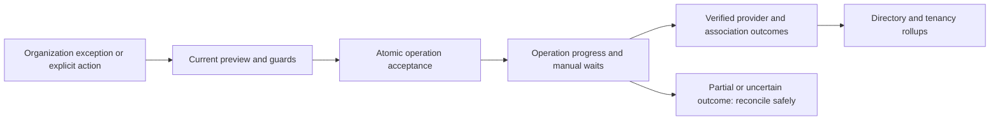
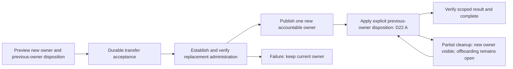

# 01: domain, workflows, data and screens

28 October 2026 | C1 design review candidate | Current journeys and chapter11 model; implementation qualification separate

[Design hub](README.md) · [Implemented ER](../../prototype/docs/organization-er-diagram.md) ·
[Current associations](../../prototype/docs/tenancy-associations.md) · [Product lifecycle](../product/oci-tenancy-manager-spec.md#6-tenancy-lifecycle-workflows)

## Current data-model contract — 21 October 2026

[Chapter11](11-production-data-model.md) now names the proposed registry identity/home-region fields,
association transitions, operation/step inputs, intent revisions and UI field sources. Preserve the
implemented organization model; production fields are proposals, not migrated tables.

## Binding baseline

Separate observed/source hierarchy from managed-directory eligibility and tenancy associations.
Stable people own zero/multiple individual or shared tenancies and may belong to other shared
tenancies. Reorgs change derived accountability, not provider topology or ownership by themselves.
Keep actual observed OCI identity/parentage and tenancy origin separate from organizational mappings.

The selected onboarding or explicit offboarding review closes on durable acceptance, not merely an
HTTP request. Standalone tenancy/member/ownership cleanup leaves independent absence reviews open.
Associations retire only after verified execution; directory offboarding completes only as part of
an explicitly confirmed absent-person offboarding plan. Failed/unknown work remains in Operations.
Fresh applied employee-row returns, exemptions, identity merges and shared-owner guards follow the
current implemented rules below.

## Workflow design worksheet

Every row needs actor/entitlement, preconditions, input/defaults, preview, idempotency key,
acceptance transaction, step graph, verification, postconditions, notifications, audit, compensation
limits, retry/cancel/resume rules and complete UI states. Rows below are inventory, not final flows.

| Journey | Existing commitment | Questions/details to close |
|---|---|---|
| Create individual/shared | Explicit admin initiation, real parent validation, human activation wait, permanent users/configuration and verified readiness | D18 accepted admin-led activation; provider-supported naming/home region/subscription; qualified bootstrap chain; owner handoff; exact mandatory checks |
| Import | Parent transfer external; verify actual child; permanent automation verified before temporary cleanup; preserve unrelated objects | Public-key handoff, domain discovery, collisions, incomplete setup, origin/deletion eligibility |
| Transfer owner | Keep tenancy/member history; eligible replacement; no ownerless shared tenancy | Accountability versus independent IAM access changes; old owner keep/remove scope; active-job conflicts |
| Add shared member | Existing active shared tenancy/owner; distinct person membership | Identity/group/compartment grant contract; pre-existing access; verification and duplicate requests |
| Remove shared member | D23: delete bound personal child user and group memberships; guide admin to ask owner for manual compartment cleanup | Exact identity/provider capabilities, residual access and guidance; no resource/compartment mutation |
| Offboard employee | Complete every association plan; delete/transfer/remove/keep; zero-link confirmation | Parent operation with per-association children, partial completion, source return during work, final directory eligibility |
| Delete tenancy | Registered eligible child only; protected hosting/control/parent targets blocked; manager/shared warnings | Origin-specific OCI permissions/state; D26 confirmed initiation and unknown effects; retained history; external deletion; provider Restore outside V1 |
| Access/configuration repair | Explicit preview/start with currently verified adequate automation | Missing identity/manual recovery, collisions, read-only/unsupported cases, partial effects |
| Return/exemption/identity merge | Adopt current tested behavior and no silent association loss | Pending operation references, concurrent feeds and production actor authorization |
| Baseline/overlay rollout | Publish does not execute; frozen explicit rollout | Rebase/collision/retirement semantics in chapter03 |
| Break glass and financial collection | See chapters04/05 | Never equate secret rotation to universal session revocation |

## Create activation refinement: D18 accepted

The initiating authenticated OTM administrator receives activation at their verified email and
performs the password/MFA and temporary bootstrap steps manually. Record their name/email and
stable application actor separately from the future owner. Collect requested tenancy name/home region
for the create API, then resolve the actual name/region from its verified OCID at resume. Preserve
request and observation separately; handle name conflicts without blindly creating a second child. Resume verifies child identity, actual parent and bootstrap access rather than
trusting supplied metadata. Provision and verify replacement access before removing temporary
child-local identities. See [the ordered flow and source evidence](04-identity-and-access.md#administrator-led-creation-d18).
D40 selects one recovery-password administrator-access flow with independent outside-app custody; temporary named support is deferred. D39 selects an MFA exemption limited to the bound recovery identity, subject to provider qualification.
Owner full administration stays. See the [name/discovery contract](04-identity-and-access.md#requested-name-and-verified-tenancy-identity).

## Onboarding detail and draft screens

The [create/import journey reference](07-onboarding-journeys.md) specifies stages, fields, acceptance
boundaries, manual waits, partial cleanup, proposed operation states and planned failure scenarios.
D20 A separates verified tool setup from first owner sign-in; no owner-confirmation wait is added. No production enums or routes are
approved by drawing these states. The existing prototype remains unchanged.

## State model to complete

Keep business state, operation state, provider lifecycle and observation freshness separate.
A tenancy may be registered/onboarding while OCI is active, an operation may wait on a human,
and last-known access may be stale. Avoid one overloaded status column. Exact enums/transitions
will be reviewed with C2; do not implement this prose as a state machine.

## Production prototype/data/ER work

Retain the proven person, source, revision, member, reconciliation and audit invariants. Extend the
registry with real tenancy/domain/parent OCIDs, origin and lifecycle evidence. Design pending
association transitions, workflow/step/attempt records, object bindings, desired configuration,
observations, credential references, grants and notification delivery before finalizing migrations.
These are logical concepts, not an approved table-per-concept prescription. Keep the physical
model readable; justify each table/JSON boundary, key, unique constraint, foreign key and index.

## Screen work

Reuse directories and association dialogs. Add focused create/import preview and activation-wait
steps, detailed tenancy/member access scopes, offboarding progress, Operations and entity history.
Each screen gets loading/empty/error/stale/unauthorized states. Async paths additionally cover lost
responses, browser closure, human waits, provider pending, partial and unknown outcomes.
Draft renders are separate from the working prototype and carry links to state/API contracts.

## Shared tenancy access design draft

This section applies accepted association/offboarding invariants to production IAM effects. D21 A
is accepted: explicitly selected profiles, compartment-scoped by default, with full administration
available as a deliberate choice. OTM must not turn a local membership row into proof of real access.
Engineer owners always retain full administration. Exact service/identity scope remains unqualified.

Separate four facts: organizational association, bound OCI identity, explicit managed grants and
optional resource/compartment scope. An identity can have other access not created by OTM. Removing
one association must not blindly delete that identity or shared resources. Conversely, deleting an
OTM group membership is not proof all OCI access ended. Exact session/key revocation is still C4 work.

### Add member

1. Select an existing managed shared tenancy with an accountable owner and an eligible person.
   The person may already own an individual tenancy or belong to other shared tenancies.
2. Inspect current identity/domain, existing membership, relevant bindings and automation capability.
   Never identify an OCI account by display name alone; resolve/review a pre-existing identity before
   adopting it. A matching email is a candidate, not authority to repurpose/delete an existing account.
3. Select and preview the D21 profile (default compartment-scoped, explicit full-administrator option),
   showing identity, exact permissions,
   compartment scope, shared dependencies and any known out-of-tool access. Profile schema and concrete
   grants are C3/C4 contracts, not arbitrary executable policy scripts.
4. Accept operation/pending association and linked review closure atomically. Use current target and
   context checks; a duplicate transport retry recovers the existing operation. No active association
   appears until the required grant/configuration result is verified.
5. Provision only explicit managed items in dependency order and verify their scoped grants. A scoped
   profile may need tenancy-level supporting permissions; do not label it a complete isolation boundary
   before service-specific qualification. Owner full administration remains unchanged.
6. Publish verified association/profile/bindings and history. Apply D20's separation for human first
   sign-in. Unsupported profiles/scopes block the automated action with an accurate explanation;
   they do not silently fall back to full administration or tracking-only success.

Oracle's [policy syntax](https://docs.oracle.com/en-us/iaas/Content/Identity/Concepts/policysyntax.htm)
and [common policies](https://docs.oracle.com/en-us/iaas/Content/Identity/Concepts/commonpolicies.htm)
support compartment and tenancy scopes. These mechanisms inform the accepted profile direction; they are not
a qualified service/permission matrix or proof that all effective access is captured by one policy.

### Transfer shared ownership

A transfer changes accountability and separately executes reviewed OCI access changes. The new
owner must receive full administration; a scoped shared-member profile is not enough for ownership.
D22 A is accepted: explicitly select Remove access or Remain a member with a D21 profile.
Offboarding defaults to Remove; standalone transfer requires an explicit disposition.

| Stage | Administrator view/action | State and failure rule |
|---|---|---|
| Preview | Select tenancy and replacement owner; show old/new owner, members, organization/LOB/designee changes and exact access effects | Current context, eligibility and actual child/access checked. D22 A requires explicit old-owner disposition; offboarding defaults to Remove |
| Accept | Confirm transfer with frozen target, owner IDs, current association revision and selected access intent | Operation/job/audit and pending transitions commit together; a stale ownership revision requires a refreshed preview |
| Establish replacement | Create/adopt only reviewed bindings, grant required full administration and verify | Current accountable owner remains until replacement grants are verified; failure preserves existing administration and does not claim transfer success |
| Publish accountability | Atomically replace the current owner; promote an existing member without duplicate current links; derive LOB/recipients from the new owner | At most one current accountable owner. Preserve tenancy OCID/origin, other members, baseline/overlays, resources and immutable history |
| Apply old-owner disposition | Remove the specific managed owner grant or establish the selected retained-member profile, according to D22 | Old relationship remains an outstanding transition/cleanup obligation rather than a second current owner. No early completed offboarding |
| Verify final result | Show new owner, final prior-owner relationship, grants changed, residual access and remaining cleanup | Only verified scoped effects become complete. Unknown provider writes reconcile before retry; partial failure remains in Operations |

Do not revoke old administration before replacement access is verified. Publishing new accountability
need not falsely imply the old owner's access is already gone. If old-access cleanup fails, show
Ownership transferred / Access cleanup requires attention, retain the outstanding association effect,
and keep that person's offboarding incomplete. Retry only the unfinished scope; do not repeat owner
promotion or create another tenancy. Exact storage transitions/API labels remain C2/data-model work.

A standalone ownership transfer and a person-level offboarding plan use the same underlying transfer
contract, with different explicit context/defaults under D22. No additional approver, mandatory Reason
or owner-confirmation flow is introduced. D20 means the new owner's first login does not block transfer
once mandatory owner grants/MFA enforcement and independent administration/recovery are verified.

The previous owner's OCI identity may also support retained obligations or out-of-tool grants.
Removing an OTM grant must not delete that identity indiscriminately. Surface known unmanaged access,
unsupported verification and manual cleanup honestly; never label a single group change as universal
revocation. Removing resources/compartments, reparenting, or moving resource billing scope is not an
implicit part of transferring accountability. Existing baselines do not change just because the new
owner has another LOB; D1/D9 explicit configuration assignment/rollout rules still apply.

The shared tenancy cannot become ownerless. Legacy unassigned ownership uses Assign owner and blocks
new members until accountability is restored. If the replacement owner is already a member, retire
or supersede the old member link within the ownership publication rather than counting that person
twice. Keep external identity/grant history when changing their association role.

### Previous-owner disposition: D22 accepted

| Selected result | Required access changes | Organizational result after verification |
|---|---|---|
| Remove access | Retire the explicitly managed owner grants; delete the bound personal identity only if owned, no longer required and safely qualified; surface other access/manual work | Previous ownership/retirement obligation ends after verified required cleanup; no replacement member association |
| Remain a compartment-scoped member | Establish/verify selected member scope, then retire broad managed owner grants; expose additional grants preventing a verified downgrade | One active scoped-member association, not a second owner; offboarding retains that explicit relationship |
| Remain an administrator member | Preserve or establish the reviewed full-administrator grants under the member assignment; reconcile old binding retirement without removing still-required grants | One active administrator-member association, distinct from accountable ownership |

Use the selected existing or newly established grant binding without blindly removing a group
membership that is also the required retained-member access. Promotion/demotion changes association
role and grant provenance, not merely the label of an unmanaged identity. Transfer history records
before/after role, profile, targets and verified outcomes. Repeated jobs must not duplicate grants.

If another association/known obligation needs the identity, preserve it and change only the reviewed
grant. If inspection cannot establish safe identity retirement, require manual resolution; do not
make an unregistered account disposable because its email matches the former owner. Required OTM
recovery/automation identities are never candidates for former-owner cleanup.

### Shared-member profile contract: D21 accepted

| Profile | Proposed scope to qualify | Required preview/verification |
|---|---|---|
| Compartment-scoped (default) | Assigned compartment plus explicitly permitted shared-service dependencies | Actual compartment binding, managed groups/policies, expected operations and any tenancy-level supporting access; no claim of complete isolation |
| Full tenancy administrator (explicit) | Reviewed full administrative access, including required IAM/domain administration | Prominent scope description; exact grants and verification; other members/resources can be affected |

Profiles are typed, versioned definitions instantiated for an association and consumed by the same
managed-item handlers used for baseline configuration. Record selected profile revision, parameters,
actual bindings, intended grants and verification evidence. Freeze them at operation acceptance;
editing/publishing a profile does not change already granted access or silently trigger rollout.
Do not introduce an automatic LOB inheritance layer or execute arbitrary profile scripts.

D24 A is accepted: default to Create new with an explicit Select existing alternative. For creation,
the administrator selects a parent from the existing hierarchy in this shared tenancy; no fixed
parent is assumed. Bind parent and resulting compartment by OCID. Names alone never authorize
adoption. If multiple people share an OCI group/policy, modifying one association must not silently
change everybody else's grant. Qualify scope-sensitive binding/retirement and service dependencies.
Owner-created identities/policies remain outside managed-object deletion unless explicitly adopted.
Bind the final compartment OCID and created-versus-adopted provenance. A person name/email change or
identity merge preserves that binding rather than selecting a similarly named compartment. Before
grants, verify tenancy/parent/scope and current access; a missing scope never falls back to root or
full administration. If an existing scope is shared, show that fact; binding a member does not make
the whole scope exclusively theirs. D23 prohibits automatic cleanup even for a tool-created scope.

Profile selection changes access, not accountable ownership. A member with full administration remains
an organizational member; a scoped member promoted to owner must receive and verify owner privileges.
D20's unconfirmed first-sign-in status remains separate for newly configured human access.

### Member compartment setup: D24 accepted

| Form field/state | Contract |
|---|---|
| Shared tenancy | Explicit registered shared target with accountable owner; parent selection is inside this child tenancy, not the OCI organization parent |
| Person/profile | Eligible person and D21 profile; compartment-scoped default. Full administrator selection shows the broad scope explicitly |
| Compartment mode | Create new (default) or Select existing; neither action silently switches the access profile |
| Parent compartment, Create new | Required explicit selection from existing eligible hierarchy. Show full path and OCID, including an explicitly selected tenancy root when authorized; no silently chosen root/default |
| New compartment name | Validate current provider syntax and uniqueness under selected parent; availability is not a reservation |
| Description | Supply the required OCI description from structured operation/person context; no mandatory free-text Reason field |
| Existing compartment, Select existing | Select an inspected active non-root target by full path/OCID; show shared usage/provenance without claiming exclusive ownership |
| Preview | Selected parent path/OCID, proposed child path or existing target, exact profile scope and intended identity/group/policy effects |
| Discovery status | Loading, empty hierarchy, no match, permission unavailable, stale/deleted/moved parent and name conflict have distinct generic messages |

Oracle's [creation model](https://docs.oracle.com/en-us/iaas/tools/python/latest/api/identity/models/oci.identity.models.CreateCompartmentDetails.html)
requires parent OCID, name and description. The [creation guide](https://docs.oracle.com/en-us/iaas/Content/Identity/compartments/To_create_a_compartment.htm)
supports choosing an existing parent and documents parent-scoped name uniqueness. Qualify service
limits, lifecycle/authorization and visibility rather than inventing a universal discovery guarantee.

Load the eligible tree through the OCI facade with pagination and permission-aware coverage. The UI
uses full paths/search or an accessible hierarchical picker; inaccessible branches are not empty
branches. A partial/stale catalog is clearly labeled. Preserve selection by OCID across refresh;
revalidate existence, same tenancy, lifecycle, path and permissions before writes. A deleted or
moved parent invalidates preview and requires reinspection; do not fall back to another parent.
If duplicate names occur on different branches, the path and OCID disambiguate them.

The tenancy root is an eligible parent only when deliberately selected and authorized: create a new
child scope there, not a root-wide grant. The member's scoped profile targets the new child OCID;
parent selection does not grant permissions to siblings, parent or unrelated shared resources.
Any required shared-service permissions are separate explicit profile dependencies. Preserve the
selected parent and child IDs in the frozen operation and binding history, not just display paths.

Execution: validate/accept intent; resolve or create the selected compartment; reconcile uncertain
create responses using persisted correlation and ownership evidence; verify actual parent/tenancy;
then establish/verify user/group/profile grants and publish the association. A same-name compartment
that appears after a failed/unknown request is not automatically safe to adopt. Repeated job delivery
must not create multiple scopes or silently rebind to another user's compartment.

If creation succeeds but subsequent identity/grants fail, record the actual compartment and partial
operation. Resume using that bound scope after fresh checks; do not delete it as compensation or
start another compartment automatically. D23 excludes automatic cleanup even for this tool-created
scope. Offboarding guidance uses the final bound compartment and current accountable owner.

If a hierarchy move/rename occurs after setup, preserve the compartment ID and update observed path
only after qualified discovery; changing the employee's name/email never renames or moves the
compartment automatically. Desired parent-change/drift treatment is still a C3 contract detail.

Planned scenarios: root chosen as parent versus existing root chosen as scope; nested parent;
duplicate branch names; stale moved/deleted/inaccessible parent; partial hierarchy; conflicting name;
create timeout after effect; created scope with failed group grant; repeated resume; and no resource
or compartment deletion on cancellation/member offboarding. No provider qualification is implied.

### Remove member / offboard

D23 custom answer is accepted: V1 removes the bound member user ID and group memberships, then
guides the administrator to direct the tenancy owner to manually clean the specified compartment.
OTM performs no workload or compartment deletion, including deletion of empty compartments. It does
not inspect workloads to certify cleanup, poll for an empty compartment, or require a cleanup-complete
acknowledgment. The scope of later workload automation remains a future design decision.

| Stage | Preview/action | Verification and outcome |
|---|---|---|
| Select relationship | Show exact person UUID, shared tenancy/association, accountable owner, bound child-local user ID and profile | Wrong target, protected/shared identity, or current owner without a completed transfer blocks member removal |
| Inspect identity | Check actual bound user, group memberships, dependency/other-role use and sufficient automation access | Missing/denied/unsupported observation is Unverified; a matching name/email is not authority to delete an arbitrary identity |
| Preview consequences | Show user/membership removal and retained resources; show owner and known personal compartment name/OCID for manual guidance | No resource selection/purge controls, no delete-compartment action; missing scope is explicitly Unknown and requires the admin/owner to identify it |
| Accept | Confirm identity/membership action; commit operation, audit/job, pending retirement and any linked review closure atomically | Freeze person/tenancy/user IDs and association/intent revision; stale context requires fresh preview |
| Remove memberships/user | Remove the selected user's applicable child group memberships and delete the bound personal child-local user | Preserve groups, other users, shared tenancy and all resources. Do not delete upstream IdP/corporate identities or protected OTM identities |
| Verify and finalize | Confirm required user/membership retirement using qualified provider evidence; publish completed association retirement | Unknown/failed identity changes remain in Operations. Verified identity removal completes this membership action; no resource-cleanup gate |
| Owner follow-up guidance | Show owner name, tenancy name/OCID and known compartment name/OCID with ready-to-copy instructions | Administrator directs owner manually. Guidance is persisted with action history; no claimed resource cleanup, automatic message or task-completion proof |

If the user is reused by a required remaining role/obligation, or is not a safely bound personal
child-local identity, stop for explicit identity review/manual handling. Do not silently preserve the
user and report it deleted, or delete an upstream corporate/federated identity. Exact supported local,
federated/shadow-user and domain retirement behavior is C4/provider qualification work. This does not
weaken D23's intended personal-user deletion; it prevents deleting the wrong identity.

If membership removal succeeds but user deletion fails, show Memberships removed / User deletion
requires attention. Keep the association retirement/offboarding unfinished until required identity
cleanup is verified. Retry reconciles known IDs/results and does not recreate the user or reverse
successful revocation. A user already confirmed absent can satisfy the corresponding idempotent step;
a query that cannot distinguish absence from denial cannot. Session and alternate-identity limitations
must remain accurately reported under C4.

When user/membership removal is verified, the association can retire and the final successful
association cleanup retires the relationship without offboarding the person or settling an independent absence decision. Manual resource cleanup does
not retain the former member or delay completed offboarding. If another association is kept or still
requires identity/tenancy work, the person remains visible under the accepted complete-plan rules.
The shared-tenancy owner remains accountable for resources and cost after the person leaves.

Suggested generic completion guidance (fields are record data, not hardcoded organizational text):

> Member user and group memberships removed. Ask the tenancy owner, {owner_name}, to review and
> manually clean resources in {compartment_name} ({compartment_ocid}) within {tenancy_name}.
> Resources and the compartment were left unchanged. OTM has not verified resource cleanup.

For an unknown compartment, display Scope not recorded — identify the relevant compartment with the
tenancy owner. Do not infer ownership from email, display name, a full-administrator profile or group
membership. A full-admin member's removal is not permission to clean the whole tenancy. No extra
approver, mandatory Reason, cleanup ticket or new task-tracking subsystem is introduced.

D21's desired member assignment must be retired/suspended appropriately before conflicting queued
profile applications or repairs can recreate its user/grants. Recheck current association intent
under per-tenancy mutation coordination. A stale job may not resurrect access merely because it
captured an older profile. A fresh applied actual employee row may restore an already-offboarded directory identity and one onboarding episode when needed, including from a partial feed and without an intervening absence cycle. This never restores the old infrastructure or grants; No tenancy required and retained outside-association decisions remain independently guarded.

Person-level offboarding still previews every association: individual-tenancy Delete/Transfer/Keep,
shared ownership Transfer/Keep with D22 disposition, and shared membership Remove/Keep. Publish verified
per-association outcomes independently; retain failed/uncertain operations. Source/reporting/history
survives directory removal. Feed return/identity merge during pending work must not silently replace
its person or provider target. Precise cancellation and stale-job fencing remain C2 work.

### Logical data and verification

Extend the existing association concept with pending/active/retiring transitions, operation reference,
selected grant-profile revision (D21 A), bound OCI principal IDs, managed group/policy/compartment
bindings and verification time/outcome. Reuse the generic managed-item binding model where appropriate;
this is not a table-per-field instruction. Separate owner/member role from IAM privilege so that a
full-administrator member is not accidentally promoted to accountable owner by a query.

Tests to design: user and memberships removed with compartment/resources unchanged; zero resource
or compartment mutation calls on member removal; no resource-inventory/emptiness check required for
completion; known/unknown compartment guidance; final association removal despite outstanding manual
owner cleanup; membership removed but user deletion fails; unsupported/reused/protected user blocks;
user absence versus permission denial; stale profile/repair cannot recreate revoked access; profile
downgrade blocked by residual grants; repeated member add; unmanaged identity collision; grant applied
then response lost; wrong shared target; owner replacement grant failure; partial old-owner revocation;
one person with individual ownership plus two shared memberships; source departure/return while an
operation is pending. These are planned tests, not new executed cases. No prototype behavior/schema
or real OCI resource changed in this design checkpoint.

### Person-level offboarding preview and D25 boundary

The preview contains every current association, role, target name/OCID and proposed disposition.
Each individual-owner row offers Delete, Transfer or Keep; a shared-owner row offers Transfer or
Keep with D22's previous-owner disposition; a shared-member row offers Remove member or Keep.
Transfer needs a replacement owner. Deletion displays existing target-specific warnings/guard results
and relies on the already-required offline value/retention review; no new approver or Reason field.
Never offer shared tenancy deletion merely because one member is departing.

D25 A is accepted: one complete person-plan confirmation may initiate all selected scoped actions,
including multiple individually owned-tenancy deletions. This refines the earlier no-bulk wording;
it does not introduce fleet-wide arbitrary deletion. The confirmation lists every target and action,
including per-target warnings. Existing deletion checks apply at acceptance and dispatch. No second
approver or mandatory Reason is added. Request-key recovery returns the already accepted plan after
a lost response; it must not create new deletions. The sample walkthrough remains an inert preview.

The result summary names each retained association, pending operation and resource-guidance recipient.
If any relationship is kept, explain that the person remains visible with outside-organization work.
If all required effects are verified and none is retained, remove them from the managed directory,
keeping source and history. D23 manual resource cleanup does not postpone that verified outcome.
Failed or unknown effects remain visible per association, with scoped resume rather than a fresh plan
that could repeat completed deletions. Parent/child operation storage is a [C2 review draft](02-operations-and-provider.md#candidate-operation-persistence-review-draft).

### Deletion completion: D26 accepted

OTM's job is to initiate termination. The user explicitly excluded waiting for or monitoring the
provider's later permanent deletion. This is a completion boundary for the selected deletion effect,
not permission to call a queued job a completed OCI action.

| Stage | Meaning and application behavior |
|---|---|
| OTM accepted | Intent/audit/initial work committed. Close organization review; show the operation in progress. Do not retire the association yet. |
| Termination initiated | Qualified provider confirmation for the exact target is persisted with correlation, actor and time. Complete this scoped operation and retire its association. |
| Rejected / failed | Keep the association/outstanding work visible and show the provider-qualified explanation. Resume only after current checks. |
| Unknown effect | Lost response/timeout cannot prove initiation or failure. Reconcile the same target/request before retry or retirement. Access failure, elapsed time or list absence alone is not success. |

Once every required association action is complete and none is kept, the person leaves the active
managed directory. Retain their immutable identity/association history and tenancy record with
last-known owner/accountability, actual OCID and the truthful result **Termination initiated**.
Do not claim **Permanently deleted**, zero cost or universal resource/access removal. The active
Tenancies view excludes terminated-intent records once initiation is confirmed; retain them in
history/operation detail. The archival label is the last confirmed OTM outcome, not live finality.

No 30-day polling, scheduled final-deletion follow-up, finality observer, suspended-state verification
or permanent-deletion gate is required. Existing unresolved-request reconciliation and restore-fence
rules still apply when initiation is unknown or local durable state was restored. A later feed
return never automatically restores a tenancy. Any provider restore remains outside this V1 flow.
Secret retirement is separately governed by C4; retaining history does not mean retaining credentials
indefinitely. No new policy to preserve credentials for finality monitoring is introduced.

Oracle's [organization deletion API](https://docs.oracle.com/en-us/iaas/tools/python/latest/api/tenant_manager_control_plane/client/oci.tenant_manager_control_plane.OrganizationClient.html)
is documented as initiating termination; its exact successful-response/reconciliation contract must
be qualified for supported tenancy origins before real dispatch. Oracle's
[deletion lifecycle](https://docs.oracle.com/en-us/iaas/Content/General/Tasks/deleting_tenancy.htm)
describes later permanent deletion, which D26 leaves outside OTM's operational responsibility.
Documentation checked 20 October 2026; no OCI runtime qualification performed.

The imported-origin feasibility conflict remains: some invited children require detachment before
deletion. No accepted D25/D26 action permits deleting a non-child or silently omitting that category.
Unsupported routes stay blocked with a visible manual/qualification explanation.

Planned tests: local acceptance without dispatch cannot retire the association; confirmed initiation
retires exactly its target and completes only that scoped effect; multiple deletions with mixed
outcomes preserve unfinished links; a retained link blocks final directory removal; request timeout
with later confirmed initiation; definite rejection; ambiguous/denied observations; duplicate delivery
and late worker result; restart/database restore during uncertain initiation; and no finality job or
30-day waiting gate after confirmed initiation. These are planned production tests, not executed code.

## Daily management versus activity/history

The accepted 30 October navigation keeps Tenancies, Organization/Organization drift and
Configuration/Baselines/Configuration drift as daily management contexts. Operations and Audit
History live under **Activity & history**; Administrators is under **Application settings**.
Operations supplies visibility and troubleshooting evidence. Remediation is initiated from the
relevant higher-level tenancy/org/config/access context, not a generic Operations Retry action.

The operation enum and `needs_attention` value do not change. Current simulated inspection detail
states **“Simulation ended with an issue. No action is required.”** Real future lifecycle issues
retain their contextual safety/verification requirements. Audit History will read the existing
immutable audit authority with safe search/category filtering; public field contracts are defined
by that implementation, and raw JSON/edit/export are not part of the first read slice.

## Production organization-domain extraction checkpoint

30 October2026. [The production organization core](../reference/organization-domain.md)
now implements strict four-column CSV parsing, canonical identity/configuration contracts, pure
ancestry/accountability reconciliation and review-condition rules without prototype imports.
A delivery receives a fresh observation identity even if its source-byte hash repeats; transport
retry retains its original intake. Positive presence, incoming profile/path coverage and qualified
complete census remain separate, so incomplete sources cannot manufacture departures.

Exclusions are evaluated through verified email aliases. A removed identity still needed by a
configured/reference edge makes the candidate unpublishable instead of silently creating a new
managed person. Temporary placeholders serve diagnostics only. This fixes an inherited defect in
the port and adds no new user-facing workflow. Source/configuration corrections remain necessary
before publishing that candidate.

This checkpoint does not implement database snapshot publication, recommendation history,
tenancy associations, operation-backed review closure or Organization UI routes. Those next
production boundaries must preserve the existing compare-and-publish, return/absence-episode,
identity-merge and accepted-operation invariants above. Prototype demos remain separate.

## Authorized organization storage checkpoint

The subsequent [snapshot storage](../reference/organization-storage.md) implements source
receipt/replay, explicit staging, automatic valid metadata application and scoped head reads under
current session/grant authority. It preserves original person anchors, separate raw proposals and
override-effective revisions, capture/receipt distinction, incoming census guards and immutable
source/version evidence. Workspace locks serialize processing; staged application also compares
exact applied/config/proposed heads. Both fatal source and effective-graph failures block publication.

This is backend storage, not completed organization workflows. Recommendation recurrence/resolution,
metadata-history UI, tenancy setup/offboarding and authorized intake/page routes remain next.
No prototype fake-success lifecycle actions, mailbox/OCI effects or reset endpoint are introduced.

### Accepted manual-upload source time

30 October2026. The production upload screen will require the administrator to confirm an
**Organization data as of** date/time, defaulting to current server UTC. This is an explicit
administrator attestation, not a timestamp inferred from a filename, CSV cell, browser clock or
receipt time. It maps to `Envelope.captured_at`, `org_feed.captured_at` and the revision source
capture time. `received_at` remains the independent server receipt clock. Normal scope, freshness,
census authority/completeness, incoming-profile coverage and source-order checks still apply;
the field does not authorize automatic deletion or turn partial data into a complete census.
The four-column CSV format is unchanged. This design decision is captured now; the upload UI
remains the next implementation slice.

## Tenancy-level deletion clarification — 31 October2026

Administrators may explicitly initiate termination of a registered individual or shared child from tenancy detail. Preview every affected owner/member and their remaining associations, with manager/shared impact warnings. Accepted work reserves all links; verified initiation retires them while preserving every person’s directory status and independent absence review. Source-present zero-link people can need a new onboarding episode. This is distinct from shared-member removal and employee offboarding. [Implemented local field/flow contract](../reference/tenancy-deletion.md); no real OCI qualification is implied.

## Explicit offboarding, fresh directory return and consent — source checkpoint

Standalone tenancy deletion, member removal and owner transfer preserve managed-directory status
and independent absence decisions, even for absent zero-link people. Only explicit offboard_person
for a currently absent employee may offboard; current actual employee rows hide/refuse that action.
An already-offboarded identity returns only from newly applied fresh actual-row evidence (full or
partial), not references/replay/staging/config-only work. It retains the stable UUID and history and
opens one setup episode when needed; no pending/exempt/merged resurrection, blanket role closure,
old association/user/tenancy recreation or automatic provisioning is implied.

New person actions offboard_person/delete_tenancy/remove_member/transfer_owner/merge require explicit
confirm_destructive consent in addition to existing impact warnings. False is omitted for historical
request-hash compatibility; authenticated exact committed replay precedes the new-admission guard.
Action/target/plan/preview changes reset the checkbox. Separate tenancy-level termination retains
its existing confirm_deletion consent; leaves_directory is always false. This source correction adds the one public OrganizationAction field above, with no database schema/table change or new authority model. Qualification and preview upgrade remain pending.

### Accept an employee without provisioning

**Keep in organization without a tenancy** accepts the current onboarding episode while retaining
the employee in the normal directory. It uses the existing setup_required flag, preserves episode
history, and never exempts the employee or closes independent mapping/role work. Later provisioning
remains available from the employee record. See the [implemented contract](../reference/organization-workflows.md#keep-in-organization-without-a-tenancy).

### Shared-tenancy member entry point

Current members on an active shared tenancy provides **Add member**, an employee-directory picker
that continues into the existing fresh shared-membership preview with this tenancy preselected.
There is no second admission service, workflow or persisted picker state. See the
[implemented entry point](../reference/organization-workflows.md#add-a-member-from-a-shared-tenancy).
