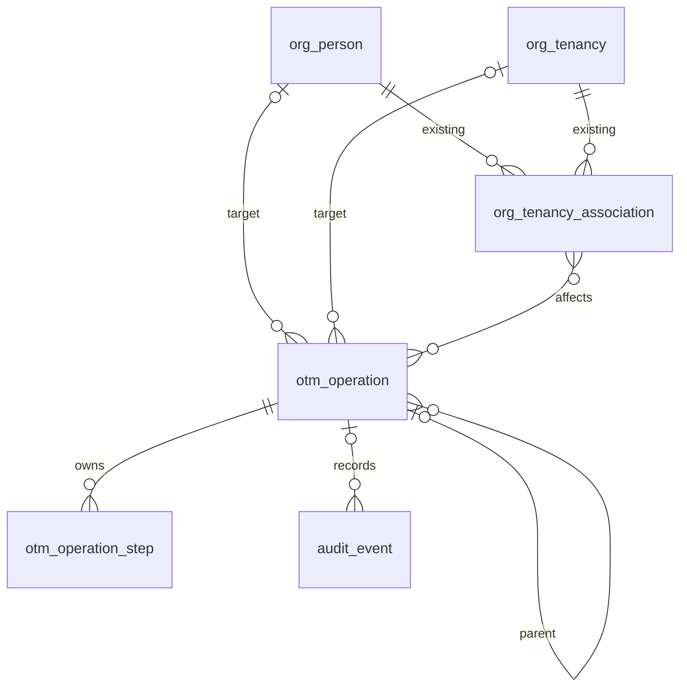

# 02: durable execution, OCI facade and simulator

28 October 2026 | C2 design review candidate | D2–D4/D10/D13 and current execution contracts retained; runner qualification separate

[Design hub](README.md) · [Accepted architecture](../decisions/engineering-review-decisions.md)

## Current detailed persistence contract — 21 October 2026

[Chapter11](11-production-data-model.md#operations-and-immutable-intent) expands the same two C2
tables with immutable intent events, captured-preview/command receipts, provider submission identity,
occurrence scheduling and restore fencing. Pure preview calculation/GET is read-only; explicit
capture-preview stores an immutable audit receipt without accepted work/provider effects. Earlier
conceptual diagrams below abbreviate these fields and do not define a competing schema.


## Accepted architecture

One modular Python application provides API and workers. Procrastinate is the selected PostgreSQL
runner. Native transaction/worker mechanics are locally qualified; the first production
[admission slice](../reference/admission.md) now uses atomic operation/audit/native-job COMMIT.
The [first registered simulated worker](../reference/worker.md) now persists a complete
inspection read; real authority/credential composition, worker recovery and deployment remain work. A single transaction must
accept operation intent, initial audit and initial job. CronJobs schedule recurring fan-out; operation
records own business progress. A human wait never occupies a worker indefinitely.

Serialize mutation steps per tenancy; allow bounded cross-tenancy concurrency, separately coordinate
shared parent objects, and preserve urgent credential-work capacity. Proposed statuses and exact
locks/leases/fencing, watchdogs, attempt budgets, backoff and cancellation points need review.

```text
UI / CLI -> API -> [operation + initial audit + initial task: one DB commit]
                                  |
CronJob -> bounded scheduling -> Python workers -> typed OCI facade
                                                  |             |
                                            stateful fake    real OCI SDK
                                  |
                          persisted observations -> dashboard
```

## Facade boundary

All OCI service access, including organization, IAM/identity domains, policy/quota/budget, usage,
Vault and work requests, stays behind application-facing typed contracts. Adapters use independent
hosting/parent/child access contexts. Domain workflows must not receive SDK clients or raw secrets
and must not interpret raw provider errors themselves. Some actions have manual prerequisites or
unsupported scopes: a generic interface must preserve those limits, not pretend they disappeared.

For each capability record request/target/schema, authoritative observation source, credential
scope, permissions, idempotency semantics, returned identifiers/correlation, work-request behavior,
read-after-write delay, definitive versus ambiguous errors, verification and recovery. OCI tenant
origin and identity-domain type are part of supported-capability qualification.

A timeout after a write is an uncertain outcome, not a known failure. Keep provider request/attempt
identity and reconcile before another potentially non-idempotent call. Duplicate task delivery must
not duplicate tenancies/users/budgets or grant disclosures. Do not claim exactly-once OCI effects.

## Provider contract and implementation files — 5 November 2026

Accepted decision: keep each functional area's typed facade/provider contract separate from its
simulated implementations now and future real OCI implementations when introducing those adapters. A facade is a Protocol
contract, not an additional forwarding object. Application composition explicitly injects the chosen
implementation; workflows depend on capabilities, not concrete SDK clients or simulated classes.
Inspection retains its existing `TenancyInspection` request/result validation wrapper.

Use a simple flat module layout, for example:

```text
providers/lifecycle.py             # LifecycleFacade and shared boundary types
providers/lifecycle_simulator.py   # SimulatedLifecycleFacade
```

Apply the same convention to configuration, budget and baseline qualification. The existing
inspection contract/simulator split is the starting pattern. Keep shared target checks and pure
request/result helpers in implementation-neutral modules; a real adapter must never import a
simulator to reuse validation. Shared credential/scope/error utilities may support multiple real
adapters, but do not add a universal facade, provider registry, plugin framework or forwarding layer
solely for implementation selection. Preserve exact target/context guards and normalized errors.

Current implementation: lifecycle, configuration, budget and baseline now separate contracts from
concrete simulators in corresponding `*_simulator.py` files. Composition and tests import concrete
classes explicitly from those files. Shared scope validation remains neutral; synthetic identity
restrictions remain simulator-only. See the [implemented layout](../reference/provider-layout.md).
Inspection and its validation wrapper are unchanged. Real OCI adapters remain future qualification
work; no empty adapter files, SDK dependency, forwarding layer, registry or fallback are added.

This is a small behavior-preserving cleanup within the active milestone. Request/result types,
deterministic synthetic object identities, hashes, target/credential guards and normalized errors
remain unchanged. The pure managed-object recipe retains its existing synthetic IDs and does not
qualify real identity allocation. Future adapters must not import simulators.
Extraction acceptance: update composition, simulator-to-simulator imports and tests; keep shared
contracts usable without importing simulations or loading credentials. Preserve public request and
result shapes, operation semantics and absence of OCI effects. Run the backend complete-source
unit coverage gate, appropriate database/UI regressions and required checkpoint checks before
milestone completion. Obtain the standing documentation and independent security reviews. No
deployed instance restart, saved-preview asset change or data migration is required by this layout.

## SDK call mapping checkpoint

[The call-design reference](08-oci-sdk-call-design.md) maps accepted journeys to pinned-source SDK
methods, credential contexts, inputs, confirmation evidence and recovery. Its [inventory](../contracts/oci-provider-call-inventory.json)
checks method/parameter existence without installing OCI or calling a tenancy. It does not freeze
facade wire schemas or qualify provider permissions. Create/bootstrap detail comes first; C3–C5
still own complete managed-item, credential and cost semantics. D26 completion remains confirmed
termination initiation, with no final-deletion monitoring.

## Internal execution contract checkpoint

[Chapter09](09-execution-contracts.md) now provides candidate message/result schemas, operation
state/stage/wait distinctions, create/import step graphs and guarded action/continuation rules.
The structural fixture checks (private historical evidence; not distributed)
validate shape and graph consistency only, not runtime behavior or the still-required atomic runner
integration. These internal review schemas do not replace D11 generated application API models.

## Simulator and test design

Use one facade contract suite against a stateful simulated adapter and qualified real adapter.
Unit mocks can inject typed outcomes; integration tests must exercise persistent provider state and
asynchrony rather than always returning immediate success. Fixtures should cover:

- Pending create/work request, manual activation, delayed visibility and pagination.
- Timeout after a side effect succeeded, lost responses, repeated delivery, crash at each boundary.
- Rate limits, permission loss, not-found-versus-not-authorized ambiguity and wrong actual parent.
- Imported-origin unsupported operations, collisions and pre-existing owner-managed objects.
- Partial policy/group creation, revoked automation identity, Vault publication failure after rotation.
- Unsupported or missing cost/forecast information and credential contexts that cannot inspect it.
- Database restore with provider state ahead of restored operation/credential records.

Freeze/advance simulator time and fail at named boundaries. Record the same safe diagnostic types,
correlation and observation freshness as real adapters. Tests cannot mock away the uncertainty
protocol. Real qualification remains required for permission, session and provider guarantees.

## Onboarding execution detail

[Create/import journeys](07-onboarding-journeys.md#operation-progress-and-recovery-contract) now trace
acceptance, human/provider waits, partial effects, uncertain outcomes, credential cleanup and safe
cancellation boundaries. Import inspection is distinct from durable onboarding acceptance and must
not close the organizational review. Exact enums/locks/leases and API schemas remain C2 work.

## Member compartment provisioning: D24

Scoped-member onboarding defaults to Create new with Select existing available. The facade exposes
qualified hierarchy listing/inspection and compartment creation with an explicit parent OCID from
that shared child tenancy. Normalize paginated/partial/unauthorized discovery separately from an
empty hierarchy. Validate parent scope/lifecycle/current permission before writes; preserve frozen
parent/child IDs and reconcile unknown create outcomes before retry/adoption. No silent root fallback.
A created compartment survives later grant failure and resumes by its known binding; cancellation
or member removal does not delete it. Parent creation scope is not a member permission grant scope.

## Shared-member removal scope: D23

The V1 facade/workflow for member removal deletes the bound child-local personal user and retires
applicable group memberships, with typed verification/failure outcomes. It must not invoke resource
purge, workload inventory to prove cleanup, or compartment deletion. Mock/simulator contract tests
assert those calls do not occur. The application generates administrator guidance naming the owner
and known compartment, not a new automatic outbound message or cleanup-verification workflow.

Retire the member's desired access assignment and fence stale apply/repair work so an older job cannot
recreate the deleted user. Partial membership/user outcomes stay resumable; manual owner workload
cleanup is independent from verified identity-removal completion. See [the shared removal contract](01-domain-and-journeys.md#remove-member--offboard).

## Local read-capability checkpoint — 28 October 2026

The [internal production inspection boundary](../reference/inspection.md) is implemented
with a stateful simulator and exact attempt/target/capture checks. This is the first read capability,
not the full simulator, a durable operation or real SDK integration. Permission/credential-generation
changes and delayed/unavailable reads are tested. Writes, rate limiting, provider pagination,
crash recovery and atomic runner integration remain subsequent slices.

## Native runner transaction/worker qualification

The [isolated runner experiment](../../prototype/experiments/runner/README.md) now proves the
accepted psycopg 3 / SQLAlchemy 2.0 path with Procrastinate's supported native connection hook.
Operation/audit/job fixture rows share a PostgreSQL transaction; real commit rejection and
pre/post-commit process death preserve all-or-none acceptance. Native retries, operation locks,
duplicate delivery, SIGTERM, SIGKILL, heartbeat-aware stalled discovery and explicit recovery are
exercised. A fresh worker alone does not retry stalled jobs.

There is no new custom connector/queue/coordinator, application table or production migration.
The 29-case experiment uses toy SQL effects and database-owner privileges in disposable PostgreSQL 16;
it does not qualify real OCI effects, production authorization/worker fencing, immutable audit,
managed PostgreSQL grants or runtime deployment policy. Production integration is the next slice.
See [development progress](../history/development-progress.md) for evidence and the reviewed cleanup fix.

## Deliverables

Operation/step/attempt schema and state transitions; atomic enqueue proof; tenancy coordination;
manual wait/resume/reconcile API; safe cancellation matrix; provider capability matrix; simulation
scenarios; per-flow success/failure sequence diagrams; UI operation list/detail variants.

## Candidate operation persistence: review draft

This is the next engineering-design slice, not a production migration or an approved final schema.
Keep organization source/revision/recommendation structures intact. Reuse the existing tenancy,
association and immutable audit concepts; do not introduce a second organization model. The first
operation-storage proposal needs two application tables, plus extensions to current references.
Runner-owned Procrastinate tables are additional implementation storage, not domain operation state.
Configuration, credential, binding and cost storage are still C3–C5 design work; this is not a claim
that the entire production app needs only two new tables.

| Candidate storage | Purpose and fields to review | Invariants and principal reads |
|---|---|---|
| `otm_operation` | ID; workspace; optional parent operation, tenancy and person IDs; kind; immutable versioned intent; authenticated subject and display snapshot; client request key/digest; consumed preview reference; state/stage/wait reason; intent and publication revisions; current progress/verification; business deadlines; timestamps | One accepted intent per workspace/actor/request key; conflicting payload reuse is rejected. Parent/child operations retain individual outcomes. All target references are scoped to the workspace |
| `otm_operation_step` | Operation ID + intent revision + stable logical step key; dependency/target references; immutable inputs/version; step status; current attempt number and correlation; due time; last safe outcome; execution generation | One logical step per operation/intent revision/key; amendment appends revised steps and explicit compatible evidence reuse, never overwrites verified history. Retry advances the attempt, not the business operation. UI queries persisted evidence, not SDK calls |
| Existing `audit_event`, extended | Optional operation/step/attempt references and structured actor/action/outcome evidence | Append-only attempt/transition history, separate from mutable progress. No passwords, private keys, factor material or activation links |
| Existing registry/association, extended | Known real tenancy IDs/origin; pending/active/retiring relationship intent; linked operation and current desired-access revision | Verified external outcomes gate relationship publication/retirement. Preserve one current accountable owner and pending cleanup without duplicate current owners |

Keep current attempt summaries on the step and append history into the existing audit stream instead
of requiring a table for every attempt/status/event type. If query/retention analysis later requires
separate attempt rows, justify it against measured needs and update the model explicitly. Avoid an
unbounded attempts JSON array rewritten on every retry. Secret references identify Vault versions;
only the provider credential resolver sees usable secret material.



This conceptual ER does not specify exact FK directions/columns, all workspace constraints or the
complete production model. The many-to-many association effect is conceptual, not a commitment to
an extra join table. Affected association IDs/roles are recorded in immutable intent/step targets;
exact normalized/reference constraints need physical review. The [implemented ten-table ER](../../prototype/docs/organization-er-diagram.md) remains the
truth for the running prototype; no new table has been created by this document.

### Transaction and execution boundaries

1. API preview is read-only and returns enough context to detect a stale confirmation. At acceptance,
   recheck entitlement and current guards, bind immutable intended IDs/versions and commit operation,
   initial audit, pending local effects, linked organization-review closure and first job together.
   Recover a lost response by its original request key, without accepting another intent.
2. A worker claims a bounded step through a short transaction and records its execution generation,
   expected current intent/association revision and provider attempt/correlation. Do not hold a DB
   transaction while invoking OCI or while waiting for a human/provider work request.
3. Call the typed facade outside that transaction. Each mutation must have a separately reconcilable
   effect boundary; a large SDK script cannot be treated as one atomic step. Per-item dependencies
   create/verify replacement administration before retiring old access. Suppress unsafe SDK retries.
4. Persist normalized outcome, step transition, linked local publication and audit with a current
   generation/revision check. If the worker lost ownership, its old result cannot overwrite newer
   progress; record/reconcile the possible external effect instead of pretending it never happened.
5. For an immediately runnable continuation, commit its enqueue together with outcome/progress/audit
   in the same application transaction, subject to the D3 runner-integration qualification. Deferred
   provider/human waits persist a wake/check condition and release worker capacity; a bounded durable
   scheduler recovers due work with an idempotent scheduling identity. Do not strand a completed step
   between progress commit and a nontransactional enqueue. Repeated delivery finds completed/current
   work instead of repeating external writes. Business deadlines remain visible if scheduling is late.

A database generation cannot fence an OCI request already sent by an old worker. An expired lease
is not proof the external call stopped. Retain an in-flight/unknown-effect guard until a qualified
reconciliation establishes a safe next action. Exact lock type/lease, step sizes, provider idempotency
and watchdog recovery must be validated before this becomes executable architecture. D4's per-tenancy
coordination and reserved credential capacity still apply; ordinary read-only checks do not waive it.

No destructive compensation is inferred from setup failure. A created child/compartment survives
failed subsequent configuration with a visible recovery path. D23 member removal does not invoke
workload or compartment deletion, including to undo an earlier partial setup.

### Parent operations for offboarding

A person-level plan records one disposition for every current association and references scoped
operations for deletion, transfer or member removal. D25 A accepts one complete person-plan
confirmation for all selected actions, including multiple owned-tenancy deletions. Acceptance freezes
every target/action and commits the plan, initial work, review closure and audit together. Existing
per-target deletion guards and independent outcomes remain required. No fleet-wide arbitrary bulk
delete is introduced. A choice of Keep explicitly preserves the outside-organization relationship.

Each scoped operation has independent step state and outcome. An update/failed call in one tenancy
is not a transaction rollback of verified effects in another. The UI shows per-association progress,
remaining obligations, completed outcomes and current guards. A parent summary is derived from those
records; it cannot invent global success because initial jobs were queued. Final directory removal
requires zero retained associations and all required association/identity/tenancy effects verified.
Manual owner workload cleanup under D23 is guidance, not one of those blocking operations.
D26 is accepted: the deletion effect completes at confirmed OCI termination initiation, not local
job acceptance, suspended-state verification or permanent deletion. Persist that evidence, retire
the scoped association and compute person completion from all remaining required effects/kept links.
The truthful result is Termination initiated. No 30-day monitoring/finality job is required; failed
or unknown initiation remains outstanding and must reconcile before redispatch or retirement.
See [D26 completion](01-domain-and-journeys.md#deletion-completion-d26-accepted).

Before dispatch, compare current desired/association revision and target guard state. A stale repair
or earlier profile assignment cannot recreate an identity being offboarded. Concurrent membership
addition/owner transfer against a submitted plan must be rejected or re-previewed under a qualified
conflict rule, not silently omitted. Feed metadata changes preserve stable people/bindings and cannot
change a frozen provider target or resurrect completed access.

### Simulator and verification cases for the candidate model

Plan PostgreSQL tests for acceptance rollback at each insert/enqueue boundary; request-key races and
payload conflict; crash before/after external effect and before outcome commit; old execution generation
returning late; provider pending/human wait without occupied transaction; per-tenancy conflicting writes;
credential deadline under fleet load; stale grant repair versus retirement; owner publication followed
by failed cleanup; a partially completed multi-association parent; and DB restore with provider state
ahead of local history. Existing simulator and real facade must preserve the same unknown outcomes.

Index candidates follow actual screens: workspace/state/updated operation list; parent operation
children; tenancy plus live mutation state; actor/request-key uniqueness; operation/step lookup and
due-work scheduling; audit operation/time and association obligations. Verify FK/index selection,
queue connection/pool budget and EXPLAIN behavior during physical-schema review. JSONB is not a reason
to index every field, and no latency/throughput guarantee has been measured for this proposal.

## Operations read visibility checkpoint — 30 October 2026

The [implemented Operations guide](../reference/operations.md) now maps two guarded GET routes
and real React list/detail pages onto `otm_operation`, `otm_operation_step` and `audit_event`.
Each read uses one `READ ONLY`/`REPEATABLE READ` PostgreSQL snapshot, exact current-intent binding/hash
checks and closed public projections. Detail limits steps to the current intent and returns the
newest 50 operation-wide events with `events_limited`; older immutable history remains stored.

The public mode is fixed `simulated` for the current inspection kind/worker, not real OCI evidence.
A successful inspection is not adoption/configuration, and native job completion is not business
success. This slice adds no table/migration, fake activity, admission HTTP, configured worker process
or start/retry/OCI write. It completes read visibility only; the full P1 and onboarding milestones
remain incomplete. Session scope, query/field mappings and final test evidence are linked in the guide.

## Local simulated submission/worker checkpoint

The [simulation guide](../reference/simulation.md) now documents a real UI/HTTP admission →
atomic operation/intent/native job → separate foreground Procrastinate worker → recorded result path.
Current session/actor scope and typed file policy choose only configured virtual children. The
workspace-hashed `otm.sim.<32 hex>` queue is shared by admission/worker and fits the native NOTIFY
limit; workspace/actor/target checks remain required. Setup defines scenarios only, never activity.

Healthy, access-denied, timeout, unsupported and unobservable scenarios reuse the qualified simulator.
Pause/config/grant changes block dispatch or stale publication. Receipt uncertainty reuses a known
request key; browser key memory lasts only while the list form is mounted, so reload requires
checking Operations before new work. No real OCI call/adoption/write, generic retry/resume/cancel,
new table/migration or full-MVP completion follows. The earlier read-only checkpoint remains dated
history; explicit local admission and worker processes are now implemented separately.

## In-progress organization parity implementation

The current [workflow field guide](../reference/organization-workflows.md) describes authored
`organization_action` intent/outcome and the native simulated lifecycle task beside `inspect_import`.
Review handoff closes at durable acceptance; verified local bindings govern association activation/
retirement. Registry mutations and simulator effects share one local transaction only because no OCI
network is involved. Real external-effect reconciliation, short-transaction dispatch, credentials,
activation and supported provider contracts remain qualification work. Local cancel is limited to
unverified simulated work and is not a real OCI compensation/retry design. Final gates are pending.


Actionable Operations navigation count, 2 November 2026: raw needs_attention alone is not actionable
work. attention_count remains a read-only projection over waiting/needs_attention organization
workflows with a matching current intent and stable person's pending-operation pointer, and a
supported guided handoff/review/retry or the current simulator's safe no-effect cancellation.
Read-only inspection diagnostics and unsupported/orphaned work remain in history at count0. Do not
delete, dismiss, force-success or rewrite records merely to clear a badge. The counter is a workspace
action hint, not command authorization or a guarantee a retry succeeds. Existing live authority/
context guards still apply. No new table, state, acknowledgment, migration or generic retry control
is introduced. See the [Operations guide](../reference/operations.md) for capabilities.
