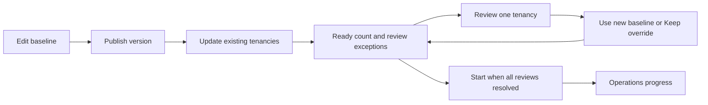

# 03: managed root objects, baseline versions and tenancy overrides

28 October 2026 | C3 design review candidate | D30 object model; D31 batch review gate; D34 shared navigation; D35 protected required-access section accepted

[Design hub](README.md) · [Explicit database fields and examples](10-configuration-data-model.md#explicit-configuration-values-and-created-object-identities) · [Specification](../product/oci-tenancy-manager-spec.md#baseline-publication-and-rollout)

## Current local implementation boundary

The validated baseline/pinning/update foundation is now extended by the qualified local 0016 override
checkpoint. [The exact current guide](../reference/tenancy-overrides.md) and
[implemented ER](../architecture/diagrams/tenancy-overrides-implemented.mmd) map immutable accepted
baseline+override revisions, owner-scoped draft plans and staged whole-list reviews. Three new tables
make 18 in the qualified schema; both saved-instance upgrades and local qualification pass. The runtime
is still local simulation: required-policy composition/rendering, real OCI objects/permissions,
continuous drift, access credentials and full production qualification below remain future work.
The preserved ten-table prototype remains separate. Historical walkthrough-only statements describe
their original checkpoint, not the now-integrated production-source UI.

## Resolution model already accepted

The user selected a statement-oriented baseline, not individual resource-limit form fields. Maintain
one versioned baseline lineage. Every managed child tenancy has exactly one OTM-managed root IAM
policy, one OTM-managed root quota policy, one monthly root budget without alert rules, and one root
tag namespace named OTM. The namespace contains the baseline-defined keys, with one root tag-default
object per key/static value. Tag defaults are individual OCI objects, not one combined namespace field.
Other OCI-owned/owner-created policies, quotas, budgets and namespaces may coexist and are preserved.

| Category | Baseline editor | Tenancy override |
|---|---|---|
| Policy | Complete administrator-authored IAM statement list; required access shown separately/read-only | Replace the authored list only; retain captured generated required statements in the same OTM policy |
| Quota | List of complete quota statement strings in one quota policy | Copy assigned baseline list, edit statements, replace the complete list |
| Budget | One monthly amount; currency from qualified billing context; no alert rules | Monthly amount only |
| Tags | Fixed OTM namespace; list of defined-tag keys and static values; defaults at root | None in V1 |

No per-rule numeric quota editor or arithmetic substitution in policy text. The statement array itself
is typed as a list of strings; provider grammar/service constraints need separate validation. Policy
and quota are independent override choices. Budget may be overridden without overriding either list.
Identity users, groups, bootstrap, emergency recovery and shared-member workflows remain mandatory;
they do not become arbitrary baseline-editor user definitions. Required-access integration must
respect the single root policy binding described below rather than creating hidden policy objects.

## Baseline versions and new-tenancy selection

Published versions are immutable. Publishing a new version makes it current for future create/import
starts without mutating existing OCI objects. Capture that version once at operation acceptance;
activation waits and retries never substitute latest. Existing tenancies retain assigned versions
until an explicit previewed/confirmed bulk or individual update. An older version is **Update available**,
not drift. Drift compares actual bound objects against the assigned baseline plus accepted overrides.

A new baseline can add/change policy statements, quota statements, monthly amount or tag defaults.
D31 simplifies the bulk review to the ready-tenancy count and a list of unresolved review exceptions.
Every conflict in the batch must be resolved before Start update is enabled. Do not start the ready
subset while other candidates still need review. Independent target execution/failure handling applies
only after the complete reviewed batch is accepted; it is not an atomic fleet-wide OCI transaction.
Desired, applied and fully verified assignment remain separate states.

## Configuration navigation and issue resolution: D32

D34 clarification: the working organization prototype remains authoritative for Organization and
Organization drift page bodies. Their configuration-walkthrough samples are placeholders only.
Organization menu entries are non-clickable in the current design shell; old direct routes show an
explicit placeholder, not invented records or an empty-success queue. All current walkthroughs share
the same menu structure. See [the authority map](../ui-screen-authority.md).

D33 names the people area **Organization** and its review submenu **Organization drift**, matching
**Configuration drift**. This is navigation terminology; actionable and informational review
behavior is unchanged. Legacy `#employees` and `#organization-exceptions` links redirect to the
canonical `#organization` and `#organization-drift` routes.

Configuration opens on a **baseline history dashboard**, not a draft editor. Its table shows
published version, publication date/actor, current-for-new status and tenancy assignment counts.
Label counts by their meaning; queued or desired assignment is not fully verified application.
**New baseline** starts a new editable draft copied from the current published version. Opening a
historical version is read-only and must not change current-for-new, tenancy assignments or an
existing bulk plan's target. History does not introduce rollback or downgrade behavior.

Provide **Create tenancy override** on this dashboard, opening a tenancy chooser. Also expose it
from the Tenancies inventory and each tenancy's detail page. These entry points open the selected
tenancy's assigned-baseline override flow and return to their originating context. Do not put an
override action on the baseline creation form or implicitly upgrade a tenancy while editing its
override. Publication still leads to **Update existing tenancies**, retaining the D31 review gate.

| Navigation | Purpose and default contents |
|---|---|
| Tenancies | Active managed inventory; linked tenancy details and issue indicators |
| Organization → Organization drift | Organization actionable reviews and informational/history categories |
| Configuration → Baselines | Published history, new baseline and single-tenancy override entry |
| Configuration → Drift | Confirmed Missing/Different managed-object observations only |
| Tenancy issue detail | One tenancy/object's evidence, expected configuration and appropriate resolution |

Keep issue types separate. A version upgrade available is not drift. A pending baseline conflict
review belongs to its bulk plan and does not prove observed OCI drift. Failed, denied or incomplete
inspection is **Unable to verify**, shown as a check/access issue, not a confirmed Missing object.
Healthy objects and check failures do not appear in the default confirmed-drift queue. Organization
reviews appear under Organization → Organization drift; they do not become a mixed configuration work queue.

The Tenancies table adds **Assigned baseline** and **Configuration issues** to the approved prototype inventory, preserving its other fields and controls. Show the recorded assignment, with pending application/verification distinguished from completion. It shows accessible exception indicators with text/tooltip and meaningful counts.
A single issue opens its exact detail. Multiple issues open a list filtered to that tenancy, from
which each detail is reachable. Counted issues must remain reachable, including check failures that
are excluded from the confirmed-drift queue. Healthy rows have no exception alert. A separate checks
passed indicator must retain its limited meaning and freshness, never imply security certification.

Issue details show the tenancy, issue type, managed object/binding, assigned baseline and accepted
override, expected versus observed facts, check timestamp/coverage and automation capability. Show
Repair only when sufficient automation is verified and a fresh guarded preview is possible; otherwise
show manual recovery guidance. Queueing repair is not completion. Confirmed drift remains unresolved
until a subsequent authorized observation verifies the current desired configuration; there is no
generic Dismiss button that hides a persistent difference. Preserve unrelated owner-created objects.

Routes must preserve tenancy/issue/version identity on reload and return navigation. Unknown IDs
show a visible not-found state rather than silently selecting the first tenancy or latest version.
This checkpoint changes the inert design walkthrough only. The local organization application's
implemented three-menu navigation and ten-table schema remain unchanged pending development.

## Full-list overrides and inheritance

Selecting Override copies the assigned baseline's authored policy or complete quota list into an editable draft.
The copy is a starting point, not a live link to baseline or a copy of possibly drifted OCI contents.
The stored model is a list of complete strings, including embedded whitespace within a statement.
The current editor uses one policy textarea and one quota textarea, each accepting up to50 complete
nonblank physical statement lines, with 2,000 characters per item. Visual wrapping is not a new entry;
there are no per-statement Add/Remove widgets or OCI grammar parsing. An override block exactly equal
to its joined original preserves the original array boundaries, including legacy embedded newlines;
a changed block splits LF/CRLF/CR and omits blank lines while preserving other whitespace/order.
The API still stores bounded complete-string arrays. Display the full result and provenance in
Preview changes; Cancel/reopening do not rewrite stored lists.

An accepted override wholly replaces the baseline list for that category. Never append missing
baseline statements, merge matching rows, infer numeric quota fields or silently incorporate later
baseline additions. Clearing the override discards that draft/override and inherits the selected
baseline list. The UI must clearly distinguish this content reset from deleting the OCI object.
Empty/null/malformed lists have no implicit disable/delete meaning; V1 authoring rejects empty policy
or quota lists until explicit empty-object behavior is qualified. No raw code/template expressions.

**Replacement means content update:** use the existing bound policy/quota OCID and replace its
`statements` array. Do not delete/recreate the object every time an override changes. OCI exposes
statement lists on [UpdatePolicyDetails](https://docs.oracle.com/en-us/iaas/tools/python/latest/api/identity/models/oci.identity.models.UpdatePolicyDetails.html)
and [UpdateQuotaDetails](https://docs.oracle.com/en-us/iaas/tools/python/latest/api/limits/models/oci.limits.models.UpdateQuotaDetails.html).
Preserve immutable names/scopes/bindings and use conditional updates where supported. Missing objects
need an explicitly previewed create/repair; unknown write outcomes reconcile before retry.

Budget remains simpler: baseline200 can be overridden to500; a baseline increase to300 leaves that
explicit500 intact. Clearing it inherits300. Currency/period/root target cannot be redirected through
an amount override. Use exact monetary validation; the bounded examples exercise positive whole units.

## Review of overrides during baseline updates

Accepted 21 October: a changed baseline policy/quota with a full-list override requires administrator
review before updating that tenancy. Show **old baseline / new baseline / current full override**.
D31 conflict resolution has exactly two choices: **Use new baseline** or **Keep override**.
Editing an override remains a separate single-tenancy action and invalidates affected pending reviews.
The tool never merges, drops or silently refreshes the override. Keeping it does not add new baseline
statements: the review explicitly acknowledges that the whole retained list remains authoritative.

Only affected blocks need review. A change to tags/budget alone does not require a policy review;
a budget-only override does not block statement updates. Budget amount survives while period/currency
and financial scope remain compatible. Changing those meanings requires a separate reviewed migration.

Freeze the reviewed baseline/override revisions, exact statement arrays, values, target set and prior
assignment context at acceptance. Record actor, time and review choice in immutable history. Review
is tied to the exact proposed content; editing the override, changing target version or stale context
requires renewed preview/review. A reusable checkbox or boolean is not sufficient authorization.
D31 supersedes the earlier ready-subset behavior: before every required batch review is resolved,
**no tenancy in that bulk plan starts**. Decisions are staged in the plan; saving one does not apply
an override, clear a live override or advance any desired assignment. This is configuration review,
not another approver or a Reason field.

## Single policy ownership and required-access integration

D35 A is accepted. Keep one canonical OTM policy binding: administrator-authored statements plus a
visible read-only required-access section. Baseline `policy_statements` and tenancy
`policy_override_statements` contain the authored list only. A policy override replaces that authored
list; required grants are generated from accepted access intent and cannot be removed in the editor.
Quota full-list replacement, budget amount override and baseline-only tags remain unchanged.

The immutable tenancy configuration captures a typed required-policy manifest/profile/renderer
version. Baseline and access workflows both coordinate through the same current configuration,
policy binding and C2 tenancy mutation guard. A required root-policy manifest change creates a new
tenancy configuration revision with the same baseline/overrides; it does not publish a new baseline.
Pure user/group membership changes need no unnecessary root-policy mutation. Pending additions and
safe owner-transfer overlap are explicit accepted obligations, not inferred only from current active
associations. No per-profile policy object or hidden appended statement is permitted.

Global baseline screens show a clearly labeled per-tenancy example of required grants; they cannot
claim to have final bindings for every child. Per-tenancy override/detail/repair previews show the
combined final statement list and source provenance. Use the exact captured manifest and resolved
bindings for drift; a missing required statement is policy drift. Policy matching does not certify
identity-domain roles, signer health, MFA or every effective permission.

[Explicit manifest and rendering fields](10-configuration-data-model.md#d35-required-policy-manifest-and-rendered-evidence)
record stable entry/contributor identities, complete rendered statement arrays and binding context.
Rendering uses pinned registered templates, stable ordering and exact-text deduplication with retained
provenance; it never semantically merges arbitrary IAM statements. Changes to required intent invalidate
stale bulk/override/repair context. Unknown policy writes require reconciliation. Built-in/owner-created
policies stay outside OTM ownership and are never adopted by name.

Exact domain/group references, IAM grammar, direct domain roles and capability verification remain
C3/C4 provider qualification. The composition model is selected; available calls or a nonempty list
do not prove permission correctness. Preserve independent recovery and verified replacement access
through changes. Owner cloud administration remains unchanged.

## OTM namespace, defined tags and root defaults

Create/bind one namespace named OTM in the child root, then create/bind each baseline key in that
namespace and a root default referring to its verified tag-definition OCID. Use the baseline's static
string value and static-default mode (`is_required=false`). Never treat tags on the namespace object
itself as tag definitions or defaults. Namespace name/root location and key/default bindings are
managed facts. A same-name unbound namespace/key/default is a collision requiring explicit import
review; do not overwrite or silently adopt it.

Namespace → key → default is the creation order. Adding a key requires both its definition and default;
changing a value updates its default. A removed baseline key schedules removal of its eligible bound
default only after reviewed rollout. Preserve namespace/key definitions and historical resource tags
in V1; retained definitions are displayed as retained, not repeatedly reported as missing deletions.
No cascading namespace/key deletion or resource-retagging operation is authorized. A renamed key is
an explicit new key/default plus removal of the old default, not an invisible rename of identity.

Tag keys are case-insensitive; values are case-sensitive. Validate duplicate/invalid names and static
values. Root default capacity is shared with existing defaults, so inspect the whole root list and
check limits before accepting writes. The documented limit is 20 per compartment; do not assume OTM
owns all slots. Existing Oracle defaults stay untouched.
[Tag concepts](https://docs.oracle.com/en-us/iaas/Content/Tagging/Tasks/managingtagsandtagnamespaces.htm) ·
[Tag-default behavior and limits](https://docs.oracle.com/en-us/iaas/Content/Tagging/Tasks/managingtagdefaults.htm).

Root defaults apply at future resource creation, including descendants; changing a default does not
retag existing resources. Authorized owners can override resource tag values, so defaults are not
immutable enforcement over every resource. V1 drift verifies configuration objects, not universal
resource-tag compliance. No tag overrides are exposed through OTM in V1.

## Root monthly budget without alerts

Create one dedicated OTM budget owned in the child root and targeting that same root using the
budget API's compartment target, with monthly recurrence and the configured amount. No OCI alert
rules are created. A budget is a soft spending threshold, not hard enforcement. The budget API models
ownership separately from target; verify both rather than treating it as an IAM policy object.
[Oracle budgets](https://docs.oracle.com/en-us/iaas/Content/Billing/Concepts/budgetsoverview.htm) ·
[CreateBudgetDetails](https://docs.oracle.com/en-us/iaas/tools/python/latest/api/budget/models/oci.budget.models.CreateBudgetDetails.html).

The child-root-owned model is the V1 requirement. Qualify billing/subscription permissions in C5;
if unavailable, report the limitation and block that financial setup rather than silently creating a
parent-owned budget instead. Updating a budget amount uses the same bound budget. Verify amount,
period, currency context, owning/root target and a complete alert-rule observation. Unexpected alerts
are visible drift/review; lack of permission to enumerate them is Unable to verify. Creating alerts
is V2/out of this V1 configuration contract. Do not blindly delete manually added alerts as repair.
Operational tool notifications remain separate from budget alert-rule provisioning.

## Extensible item contract

Use registered typed facade handlers internally; do not expose a generic arbitrary-item composer in
this editor. Each category has schema/version, scope/capabilities, validation, plan/apply/observe/verify,
retirement and safe diagnostics. Secrets, credential selection and target bindings stay outside the
editable baseline. Statements are data in OCI's language, not executable code plugins. Local structure
checks and SDK model acceptance are not proof of valid OCI grammar, valid group references, effective
permissions or successful application. Surface provider errors per object and preserve partial state.

## Symbolic intent and verified OCI bindings

Freeze lists/values and any explicit qualified references before work. A child/root/group OCID not
yet created must be supplied by verified onboarding bindings, never guessed by name/email or expanded
through arbitrary expression evaluation. Display the exact rendered list before dispatch where binding
resolution is required. Late binding records generation/hash and cannot silently change the intent.
The precise safe reference authoring contract remains to specify, not an implied new template language.

## Managed-object removal: D28 accepted

Apply the final resolved diff, not remove-all/recreate. D28 retirement rules still protect unrelated
objects and active access. Statement removal updates the policy/quota array in place, rather than
retiring a separate object per statement. Clearing an override leaves the canonical object. V1 does
not silently omit/delete these fixed managed objects; a future object retirement needs explicit intent
and eligibility. Tag-default removal has the narrower boundary above. No workload/compartment cleanup
or tenancy termination is introduced by configuration edits.

## Rollout and partial completion

Two entry points stay distinct. **Edit tenancy override** previews/applies a single-tenancy change
against its assigned baseline. It does not select a newer baseline or open a fleet update.
**Update existing tenancies** is the version-upgrade journey below. User-facing terminology is Override;
legacy `#overlay` and `#rollout` links remain compatible.

### D31: baseline publication to existing-tenancy update

The walkthrough must connect these steps with real buttons, not require the screen selector:

1. Edit the draft baseline and choose **Publish baseline**. In the inert walkthrough this publishes
   an immutable in-memory example only. Real publication records the immutable version/current-for-new
   pointer and audit history, without accepting a rollout or writing to existing tenancies.
2. The published-version view shows **Update existing tenancies**. It captures the older-version
   managed candidate set for this update plan. Newly created tenancies already using the target
   version are not candidates. Keep the plan's membership and revisions explicit/frozen.
3. The update page shows the **ready-tenancy count** and the **exceptions needing review**. There
   is no full eligible-fleet table, canonical-object explanation table, skip-conflict option or target
   deselection path that bypasses reviews. A tenancy with several pending blocks counts once as an
   exception; the individual block decisions remain explicit.
4. Click an exception to open that tenancy's review view. Show **Old baseline**, **New baseline**
   and **Current override** in parallel, stacked on narrow screens. For each affected block choose
   **Use new baseline** or **Keep override**, then **Save decision and return**. Cancel leaves the
   review unresolved. Do not add inline editing, a Reason field or a separate approver.
5. Saving stages the exact choice in the bulk plan. It removes a resolved tenancy from the exception
   list and increases the ready count. It does not change active assignments/overrides, call OCI or
   queue execution. Use new baseline drops the block override only in the proposed target assignment;
   Keep override preserves the complete explicit list and its reviewed provenance.
6. **Start update** stays disabled until all reviews are resolved and ordinary execution guards pass.
   The service must enforce this gate independently of the button. The ready subset cannot start
   early. Once enabled, confirmation accepts the complete frozen plan and queues durable work.
7. Show the accepted operation and independent per-target progress in Operations. Acceptance is not
   verified completion. The inert walkthrough reports simulated queued work only, not successful OCI
   application. A local demo reset may restore its initial state without touching the organization lab.

The initial sample has ready tenancies and separate policy/quota review exceptions. Resolve one:
the counts change, but Start remains disabled. Resolve the last: Start becomes enabled for the full
candidate set. Budget-only overrides can carry forward without a statement review when compatible;
that does not exempt the batch from waiting for other tenancies' unresolved conflicts.

### Review freshness and durable acceptance

Bind every staged decision to tenant/assignment/override revisions, source baseline, target baseline
and exact block content. New draft edits cannot modify a published target version. Selecting/publishing
a different target or editing a candidate's active override invalidates the relevant pending plan/
reviews and requires refreshed counts. A stale browser tab or replayed request cannot bypass the gate.
A changed candidate set must be shown/reviewed again; no silently omitted conflict or partial payload.

At acceptance re-read the authoritative stored plan and complete candidate set, not just submitted
rows or an `all_resolved` client flag. Validate every review and normal target/permission guard before
committing the batch intent, initial audit and initial durable job under D3. No target dispatch/jobs
or desired-assignment changes can escape an unaccepted/blocked plan. Exact SQL/API transactions still
need implementation qualification; this is the required application boundary, not a migration.

After acceptance, apply per object through the facade and verify. A target failure does not roll back
already successful OCI changes elsewhere; progress/unknown outcomes/retries stay independent under C2.
This post-start behavior does not permit bypassing the pre-start global review gate. Last fully
verified version advances only after all required objects and planned retirements verify. Do not
silently change target versions on retry, claim fleet success at enqueue or blindly replay writes.

## Shared-member profiles: accepted D21 direction

Shared-member additions select a versioned access profile: compartment-scoped by default or full
administration explicitly. Reuse typed managed-item handlers/bindings for identity, group and policy
work. Capture profile version/parameters and intended scope with the association's operation; do not
resolve mutable definitions during retries or infer a new profile from an LOB reorganization.
Publication alone does not change existing member access. A later profile change requires an explicit
previewed operation, verified grant/retirement and accurate partial state.

Profiles do not weaken mandatory automation/recovery access and do not change engineer owners' full
administration. D24 accepts create-new/select-existing compartments and explicit parent selection
from the existing child-tenancy hierarchy. Bind parent/child OCIDs and preserve partial creation
without automatic cleanup. Service dependency permissions, discovery/capability limits, safe shared
group/policy changes and drift evaluators remain schema/qualification work. Compare actual managed
access with the recorded profile assignment; inability to observe is Unverified, not Missing.
See [shared journey details](01-domain-and-journeys.md#shared-member-profile-contract-d21-accepted).

## Member retirement: D23 scope

Removing a shared member retires their desired access assignment so later checks/queued repairs do
not recreate the removed user or memberships. Verify personal-user and group-membership removal;
preserve shared group objects/policies and other people's grants. Retiring these grants does not
retire the compartment or its workloads in V1. Workload/compartment cleanup is manual owner follow-up,
not an item-removal cascade or baseline drift-repair action. Qualify conflicting queued profile
applications against the current assignment revision before side effects.

## Daily drift observations and repairs

5 November 2026: the user explicitly deferred the drift-detection CronJob until the staging
environment/Kubernetes deployment. The daily observation objective remains accepted. Current
checks are explicit on-demand read-only acquisitions; no local drift CronJob or simulator control
is introduced. This does not change the separate session-cleanup schedule/manifests.

Read exact registered bindings at least daily and compare to the stored effective assignment:

| Managed surface | Compare |
|---|---|
| One IAM policy | Correct OCID/root and complete expected statement list |
| One quota policy | Correct OCID/root and complete expected quota statement list |
| One budget | Bound owner/root target, monthly amount/period, currency context and absence of alert rules |
| OTM namespace and keys | Bound root namespace name/state, required key definitions present and active; retained legacy keys explicitly classified |
| Root tag defaults | Each current OTM key's bound default points to the correct definition with expected static value/mode; removed-default intent verified |

Use documented handler normalization only. Do not lowercase policy text, reorder arbitrary quoted
values or claim a semantic parser exists. Conservative exact differences may need review rather than
unsafe automatic normalization. Statement ordering/equivalence normalization requires provider tests.
Exclude provider-generated fields not controlled by OTM. Preserve unrelated objects and extra owner
configuration outside these bindings; unexpected content inside an OTM-owned object is a difference.

Matching, Missing, Different, Unable to verify and Conflict remain distinct. Missing requires
complete authorized observation; timeouts/denials are not absence. Record assigned revision, binding
generation, evidence/time/coverage and freshness. Old observations cannot make a new assignment green.
Update available is separate from drift. Expected in-progress writes are progress, not new alert spam.

Repairs are explicit current previews, require verified sufficient automation, recheck protections,
apply only the assigned effective config and independently verify results. No automation access means
manual recovery guidance, no misleading Repair button. Owner administration and extra users remain
allowed. Daily scans do not silently write changes or create security-findings workflows; V2 security
scope is unchanged. Access/MFA/session verification still needs C4 capability qualification.

## Worked configuration checkpoint

The [walkthrough](../walkthroughs/configuration-walkthrough.html) now contains actual
statement-list authoring, copied full-list overrides, budget amount and static key/value tags. It is
inert and performs no API/OCI writes. D29 history (private historical evidence; not distributed)
preserves the superseded numeric-limit design.

Six current [fixtures](../contracts/configuration-examples/baseline-v1.json) describe the fixed objects,
[full policy/quota replacement](../contracts/configuration-examples/grant-overlay.json),
[a shared budget500 override](../contracts/configuration-examples/team-overlay.json) and
[a newer baseline](../contracts/configuration-examples/baseline-v2.json). The
[reference checker](../../scripts/design/check-configuration-resolution.py) and
21 October receipt (private historical evidence; not distributed)
cover 9 positive, 34 negative and 7 invariant checks. These exercise complete replacement rather than
append, review gating and stale-review rejection, inheritance, malformed list/value rejection and
baseline-only static tags. They do not implement OCI grammar validation, required-access composition,
canonical-object mutation coordination, drift execution or production API authorization.

## Candidate readable storage, not implemented tables

The [configuration data-model catch-up](10-configuration-data-model.md) now proposes eight C3
tables, field/scope constraints, indexes, transaction boundaries, screen/API mappings and a separate
production ER. It keeps baseline+overrides together per accepted tenancy revision. That grouping
is a review proposal, not an accepted migration or a change to the ten-table prototype. Its
observation/issue and plan/acceptance contracts make the screen semantics explicit.

The current [ER model](../../prototype/docs/organization-er-diagram.md) remains ten implemented prototype tables.
Retain immutable baseline/override revisions, one current-for-new pointer, per-tenancy assignment
and canonical managed-object bindings/observations. Full-list overrides store arrays and source/review
baseline references, not one override row per quota numeric field. Tag key/default bindings remain
individual child records within the OTM namespace. Review evidence includes actor/time/content context;
final SQL tables/indexes/API contracts follow unified physical design. No migration in this checkpoint.

## Validation and remaining exit criteria

D30 settles the object/override model; D31 requires every batch review resolved before bulk start;
D32 defines baseline history, override entry points and separate organization/drift navigation. C3
remains in progress: qualify the selected D35 required-access integration, safe reference
resolution, provider syntax/normalization, full tag lifecycle qualification, child-root financial
scope and durable preview/review/acceptance transactions. Runtime/failure-injection and real OCI
qualification remain required. The example checker and responsive renders are design evidence only.

D31 evidence is tracked separately from the earlier D30 structural checks: the bulk-gate reference
checks and browser journey establish the intended review/start boundary without implementing the
production runner or OCI mutations. See the current [configuration walkthrough](../walkthroughs/configuration-walkthrough.html)
and batch-gate receipt (private historical evidence; not distributed).

D32 navigation evidence: UI review (private historical evidence; not distributed),
browser receipt (private historical evidence; not distributed)
and prior D31 walkthrough (private historical evidence; not distributed).
These are local in-memory design checks, not provider or production-runtime qualification.

Whole-unit budget authoring, 2 November 2026: administrator-entered monthly budget amounts use
positive whole currency units (whole dollars forUSD), including future per-tenancy budget overrides.
This is an authoring rule, not a conversion of actual/forecast cost observations. Keep exact decimal
storage and historical content; display integral budget values without decimal padding. Existing
fractional recipes remain readable but require an explicit whole amount before a later save; never
round or rewrite them automatically. The implemented SaveBaselineDraft command enforces this rule.

Statement-count authoring bound, 2 November 2026: each policy block and quota block independently
accepts up to50complete statements (formerly20), with2,000characters per statement unchanged.
The UI remains one newline-separated editor per category. The browser allows105,000raw characters
per block; authenticated JSON saves remain stream-bounded at2MiB. Stored arrays, field shapes,
version/hash format and whole-unit budget behavior are unchanged; no SQL migration is required.

## Latest-only default correction — 3 November 2026

The latest published baseline automatically governs every new create/import operation. There is
no separate selection, adoption or rollback choice. Older versions remain read-only history and
can be retained by already-accepted operations; a draft changes nothing until publication.
Existing published versions need no additional action to become the new-operation default.

Publication retains the workspace lock/revision fence. Admission freezes that exact latest recipe;
later publication cannot retarget an activation wait, retry or original acceptance replay. Baseline
application/read-back, effective configuration, protected policy composition and drift remain later
checkpoints. See the implemented baseline guide for current fields and qualification.

## Authored overrides and staged reviews local qualification

The source implements the D31 two-choice/full-batch gate with explicit local draft plans. Save review
records exact proposal/choice/actor/time and changes no live head/job; all conflicts/blockers must
clear before atomic acceptance creates new immutable tenancy configurations, desired heads, full
operation intent and native queued work. The same-baseline override path stays on the assigned
publication, with independent whole-unit budget and no tag/currency/scope override. Old accepted
intents/digests and null new heads retain compatibility. Later provider execution remains per child,
with full verification separate from selected baseline/configuration.

[Current field dictionary and manual review](../reference/tenancy-overrides.md) covers 10 new
DTOs / 55 effective fields, updated 12 rollout DTOs / 76 fields, 35 new table columns and 2 nullable registry heads.
It is the exact qualified local subset of the broader design here; unit/database/browser,
independent review and preserved-instance upgrade qualification pass. No real OCI proof or
full P3 completion is implied.

Local qualification passes: 985 backend unit tests cover 6,311 of 6,576 executable lines
(95.9702%) across all 88 source modules. The 251 frontend unit tests cover 1,484 of 1,525 lines
(97.3115%) across 28 files. All 1,212 combined backend/PostgreSQL/HTTPS-browser cases pass without
failures, errors or skips, including native worker execution. Unit-only coverage is measured
separately from database/browser execution. All 59 schema exports, 233 purpose-comment files,
208 formatted Python files, Ruff and document links pass. Dependency audits, Bandit and scoped
Gitleaks report zero findings. Independent security, documentation and final actual-screen UI
reviews pass.

Both saved installations are upgraded from 0015 to 0016 with private 0600 backups. All existing
columns and rows across the 15 pre-existing application tables retain identical fingerprints;
baselines, pins and history are unchanged. There are now 18 application tables and 20 baseline
columns. The three new tables are empty and both new configuration heads remain null on existing
rows: no synthetic revision or assignment was backfilled. Current assets, liveness/direct-route
HTTP 200 responses and protected new-API HTTP 401 checks pass on both ports. No reset, seed,
credential change, real OCI call or Git publication occurred.

Local qualification receipt (private historical evidence; not distributed) · Independent review (private historical evidence; not distributed).

## Onboarding application refinement — 3 November 2026

New guided onboarding version 2 uses the already-frozen published baseline to apply/read back the
four simulated authored categories, then freshly verifies automation/required access before retiring
temporary identities. This replaces selection-only behavior for new create/import; version 1 and
legacy operations are not rewritten. Existing observation/verified-baseline fields hold partial/full
category results; no new configuration revision, override, tag exception or real OCI binding is
fabricated. [Runtime mapping](../reference/tenancy-onboarding.md) and the
[manual review](../how-to/tenancy-refinements-runbook.md) describe this slice, qualified locally and installed in both saved instances.

## On-demand configuration drift checkpoint — 3 November 2026

Local implementation qualified and installed in both saved instances. This implements the observation/visibility part
of the daily-drift design above through explicit asynchronous checks only. Configuration →
Configuration drift separates confirmed Missing/Different from Checks, where unknown, conflicting,
unchecked, stale and in-progress context remain visible. Four complete authorized local category
results are required to confirm or clear drift. A later failed/partial read retains prior same-
context confirmed drift and its original evidence age; old assignment generations cannot go green.

Checks compare the assigned immutable baseline plus accepted authored overrides, never latest
publication or a mutable draft. They record evidence without applying configuration, advancing
verified heads or changing fake-cloud observations. The local four bundles do not qualify the full
required-policy/tag-definition/default/budget-alert inventory. Daily infrastructure, repair, emails
and real OCI reads remain separate implementation/qualification.

[Exact runtime fields and limits](../reference/configuration-drift.md) ·
[Implemented local ER](../architecture/diagrams/configuration-drift-implemented.mmd) ·
[Disposable-fixture manual review](../how-to/configuration-drift-runbook.md).
