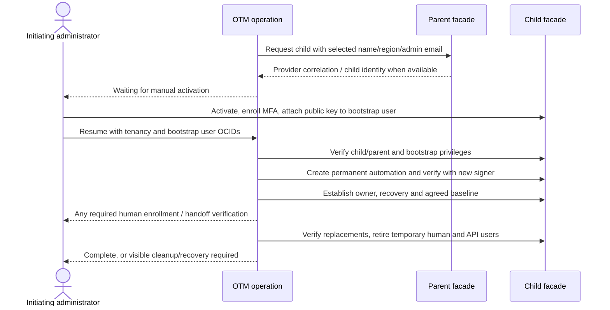

# 04: identities, credentials, access and break glass

28 October 2026 | C4 design review candidate | D40 single recovery-access flow; D39 recovery-only MFA exemption; provider qualification open

[Design hub](README.md) · [Access/break-glass specification](../product/oci-tenancy-manager-spec.md#7-access-monitoring-and-break-glass)

## Current proposed data model — 21 October 2026

[Chapter11](11-production-data-model.md#identity-access-and-credential-model) specifies access
contexts, credential heads/immutable Vault references, access assignments, human grants and SSO
sessions; shared binding/check records distinguish OCI OCIDs from SCIM/relationship IDs. No secrets
are stored in application tables. This closes the field-inventory gap, not recovery-exemption enforcement, independent custody,
session revocation or provider permission qualification. No prototype/database change.

## Current V1 choice: D40

D40 adopts one human administrator-access flow: retrieve the unique Vault-held password of the
persistent child-local recovery account. Temporary named support provisioning, enrollment and
account cleanup are deferred to V2. D40 supersedes the V1 named path in D19/D37; it does not remove
D18 activation/bootstrap cleanup or owner/member local accounts. D39 exempts only the exact recovery
identity from MFA. Owners/members retain MFA. Corporate SSO remains the ordinary application sign-in path; D58 adds
a separate local application recovery administrator requiring a strong password plus independent MFA.

Every authorized retrieval is audited and notified. The first authorized disclosure attempt opens
a four-hour rotation window, even if its response is lost; later retrievals share that deadline.
Stage a candidate in Vault before changing the child password, reconcile/verify both sides and
promote the exact usable version. Unknown state blocks release. Recovery outside OTM remains required
when the application or automation cannot operate. Rotation is not universal logout, and checkout
audit cannot attribute every subsequent action performed with this shared account.

## P0.9 local request-boundary checkpoint

[Session verification and field map](../reference/authentication.md) implements the existing
proposed session table, hashed-cookie lookup, expiry/revocation checks and required current
administrator entitlement. Optional configured HTTP composition exposes only protected session
context; the default remains liveness-only. This is request verification, not qualified SSO/login:
maintained provider/session-library integration, secure issuance, corporate revocation semantics,
CLI authentication and production proxy/TLS composition remain open. No engineer ownership or
client identity header confers administrator access, and no tenancy-management route is enabled.
The [local application](../reference/local-application.md) now adds the real React sign-in,
authenticated administrator listing and ordinary-grant revocation; corporate identity integration
and ordinary administrator add/regrant remain unimplemented.

## Configurable session policy and cleanup

[Central application settings](../reference/application-settings.md) now specify initial
30-minute idle and eight-hour absolute limits, pinned into sessions at issuance. Explicit activity
refreshes only a still-live row; polling does not. Logout invalidates the presented handle without
requiring available SSO/current entitlement, while retaining origin guards. A bounded cleanup command
and daily UTC CronJob renderer remove expired/revoked rows independently of immediate enforcement.
No scheduler is deployed by this settings implementation. The subsequent
[local authentication slice](../reference/local-authentication.md) now enables explicitly
composed password/TOTP sign-in; corporate SSO remains future qualification.

## Binding choices

Application access is administrator-only. [D58](19-administrator-provisioning.md) selects OTM-managed
grants, corporate SSO for ordinary administrators and an independent local recovery administrator.
Engineer ownership is not an application entitlement. Owners retain full child administration and may create other identities. The tool
manages/monitors its bound operational identities and objects rather than every user in a child.
Hosting tenancy/compartment, organization parent and each child are independent access contexts.
Qualified workload identity and Vault-held parent credentials remain supported design directions.

Required V1 identities are emergency/break-glass and automation. Audit/governance-user capability
and security-findings auditing remain V2. The automation private API key and per-tenancy strong
emergency password belong in Vault; application tables contain references/version/fingerprint and
nonsecret metadata, not secret plaintext. The app must not expose private automation keys in UI,
logs, exports, template bodies, task payloads or notifications.

D40's persistent recovery account has a unique password per tenancy, with exact Vault-version
references and audited/notified disclosure. Four-hour deadlines survive restarts/restores; a restored
DB cannot prove that later disclosure/rotation did not occur. D39 recovery-only MFA policy scope and
precedence require provider qualification. The old named-support account flow is not a V1 requirement.

## Supported identity model: D27

The user confirmed all existing tenancies use OCI IAM identity domains. V1 standardizes user,
group, membership, API-key, capability and password management on the identity-domain adapter;
no standalone legacy-IAM identity adapter is required. Retain IAM calls for tenancy/domain metadata,
compartments and root policies. Imports still discover and validate their actual domain, identity
bindings and permissions. This does not assert every tenancy uses Default, shares a domain or has
identical federation. Unsupported identity models remain visible and blocked, never silently switched.

## Administrator-led creation: D18

Accepted: use the logged-in initiating administrator's verified name/email for activation ownership.
These are profile fields, not delegated passwords or SSO tokens. Parent API calls use the configured
parent credential context. Keep the app actor, initial child-local human, temporary API user,
permanent automation user and intended engineer owner as distinct recorded identities.

Oracle's [create model](https://docs.oracle.com/en-us/iaas/tools/python/latest/api/tenant_manager_control_plane/models/oci.tenant_manager_control_plane.models.CreateChildTenancyDetails.html)
requires parent tenancy OCID, tenancy name, home region and administrator email. It has no administrator
full-name input. Preserve the name in OTM history; collect any activation name fields manually.
The home region must be subscribed by the parent. Select a requested name/region before app-initiated
creation. These are provisional intent: resolve and display actual provider metadata on resume,
without requiring the administrator to retype the final name. Preserve both sets in history.
The [creation guide](https://docs.oracle.com/en-us/iaas/Content/General/organization/child-tenancy-create.htm)
documents the activation email and human password/MFA setup. OTM does not automate that web flow.

The following is the proposed execution order implementing D18; exact capability/readiness contracts
remain design work; D40 uses persistent recovery and D39 selects its narrowly scoped MFA exemption:

1. Preview target parent, intended owner/type, proposed tenancy name/home region, subscription,
   initiating administrator and frozen configuration. Commit operation/audit/job atomically.
2. Request creation through the parent facade. Track returned provider identifiers/work requests;
   after an ambiguous response, reconcile before retrying creation. Wait durably for activation.
3. Administrator activates in OCI, sets their own password and enrolls their own MFA. OTM never
   asks them to paste those credentials or MFA material into its form.
4. OTM generates an operation-specific bootstrap key pair and places the private key in Vault.
   Show a suggested temporary username and **public PEM only**. The administrator creates the
   temporary API identity, grants the necessary IAM/domain administration and uploads that public key.
5. Resume supplies bootstrap user OCID and confirms child tenancy OCID. Resolve its actual name/home
   region; preserve any requested/final difference and validate the handoff as specified below. Discover the default-domain
   OCID/endpoint where authorized; request missing nonsecret identifiers if discovery is unavailable.
   Verify actual parent, region, identity, key fingerprint and required permissions before writes.
   Prefer provider-resolved values over unchecked pasted metadata.
6. Bootstrap creates a distinct permanent automation identity/key and required enabling grants.
   Probe through that new identity before switching execution. Configure the owner, agreed recovery
   identity, groups, policies and remaining baseline through the permanent automation context.
7. Verify mandatory state, replacement tenant/domain administration, configured owner grants/MFA and
   a recovery path that does not depend on the temporary administrator. Verify recovery-only MFA
   exemption scope while preserving owner/member MFA. Enrollment is a human step when required; configuring a policy does not prove enrollment or console access works. Under
   accepted D20 A, owner first sign-in does not block setup, and its status remains separately visible.
8. Using the verified permanent identity, remove the recorded initial child-local human account and
   temporary bootstrap user/key; verify retirement, then retire the Vault bootstrap secret under the
   secret-retention policy. Never delete the operator's corporate SSO or parent identity.
   Incomplete cleanup remains visible and retryable; do not claim onboarding is fully complete.

[API signing requirements](https://docs.oracle.com/en-us/iaas/Content/API/Concepts/apisigningkey.htm)
include user OCID, tenancy OCID, public-key fingerprint and a private PEM signing key. A username
alone is insufficient. Temporary means a bounded workflow lifetime: an API key is not inherently
single-use and remains usable until revoked. Expiry/abandonment cleanup needs durable scheduling.

The [Identity Domains API](https://docs.oracle.com/en-us/iaas/Content/Identity/api-getstarted/api-get-started.htm)
supports user/group, password and domain configuration operations with API-key or OAuth authorization.
This supports the proposed automation direction; it does not prove that any arbitrary tenancy-admin
group grants every domain API operation. Qualify both IAM policies and directly assigned domain roles.
Use the correct identity-domain adapter, not an assumed interchangeability with legacy IAM APIs.

Two independent safeguards constrain cleanup. OCI requires a member of the default Administrators
group and at least one directly assigned identity-domain administrator; verify both
([default domain](https://docs.oracle.com/en-us/iaas/Content/Identity/domains/the_default_domain.htm)).
Oracle also prohibits deleting oneself and the last domain administrator
([user deletion](https://docs.oracle.com/en-us/iaas/Content/Identity/users/delete-user-accounts.htm)).
The permanent automation identity therefore performs temporary-user retirement; do not design a
bootstrap identity that deletes itself. Actual API/role combinations still require pilot verification.

## SDK identity mapping and password constraints

[Chapter08](08-oci-sdk-call-design.md#identity-key-and-grant-primitives) now maps the concrete calls.
The accepted bootstrap handoff still supplies an OCI user OCID. For identity domains, resolve and
verify the corresponding SCIM user ID, domain OCID/endpoint and returned OCI OCID before SCIM writes;
never use the supplied OCID directly in a domain user path or match authoritatively by email.
Signing/public-key and domain resource identifiers remain separate recorded bindings.

The [credential call map](08-oci-sdk-call-design.md#credentials-break-glass-and-rotation) distinguishes
legacy one-time console/reset-link behavior from a domain known-password change. Do not implement
Vault password rotation by calling `create_or_reset_ui_password` and assuming a steady password was
set. Actual domain roles, password-policy/notification/forced-change behavior and session revocation
remain qualification gates. Separate default OCI Administrators and directly assigned domain-admin
checks still precede removal of temporary identities.

## Requested name and verified tenancy identity

The user reports that global name conflicts may require a different final name during activation.
Support that handoff without treating a typed name as a tenancy identifier. The exact point of
validation and whether this creation/activation path can change the name remain OCI pilot cases.

For app-initiated creation, keep a requested name because the provider create API requires it.
A local syntax check cannot guarantee global availability or reserve the name. A definitive
provider name rejection becomes an actionable naming step; accept a replacement and record a new
attempt under the same operation, preserving the original request. Do not retry after an uncertain
outcome until discovery/reconciliation establishes whether creation took effect.

At resume, the admin supplies/accepts the tenancy OCID and bootstrap user OCID, not a manually
maintained final tenancy name. Through the facade, call the equivalent of
[GetTenancy](https://docs.oracle.com/en-us/iaas/tools/python/latest/api/identity/client/oci.identity.IdentityClient.html#oci.identity.IdentityClient.get_tenancy).
Its [Tenancy response](https://docs.oracle.com/en-us/iaas/tools/python/latest/api/identity/models/oci.identity.models.Tenancy.html)
contains the OCID, actual name and home-region key. Resolve region keys through qualified provider
metadata; they are not assumed to be SDK region identifiers. Bootstrap endpoint discovery and
permission requirements still need qualification; ask for missing region/domain context only if needed.

Logical information to retain, with physical schema pending: immutable create-attempt inputs and
correlation; verified tenancy OCID/name/home region plus observed-at; any supplied/resolved identifiers,
requested-versus-observed differences and the authenticated handoff actor. Display the verified name
in the registry and operation header after binding. Keep previous requested names in operation history.

GetTenancy does not establish organization parentage. The separate parent-context organization check
must prove the tenancy is a child of the configured parent. Compare against any OCI identity already
resolved for this operation; block silent OCID substitution, wrong-parent/protected targets, duplicate
registry bindings or a tenancy claimed by another onboarding operation. A different supplied OCID
requires explicit reconciliation/adoption before writes, not automatic retargeting. A different name
on the same verified OCID updates observed metadata; it does not trigger another create. A home-region
mismatch needs review rather than silently moving the operation to a different region.

Omitting the initial name is only compatible with manual/external initial creation (or a separately
qualified provider path that supplies it). That is a distinct initiation mode, not the selected default.
Create and import can reuse discovery/bootstrap after handoff while preserving their origin/operation
history and eligibility checks. The tenancy OCID is the authoritative provider identity in both modes.

## Support and emergency access proposal: D19

This historical heading preserves existing links. D40 supersedes D19's two-path V1 model: the
persistent recovery account is the single human administrator-access flow; temporary named support
is V2. The current identity requirements are:

| Identity | Purpose | Authentication / lifetime | Current status |
|---|---|---|---|
| Engineer owner | Full child administration, including creating other users | Local identity-domain account with MFA; private password stays with the user | Required; first sign-in separate from setup completion (D20/D36) |
| Shared member | Explicit scoped or full-admin membership profile | Local identity-domain account with MFA; no recovery exemption inheritance | Required when assigned; D21–D24 safety/retirement rules unchanged |
| Automation | Persistent SDK administration and checks/repairs | Per-tenancy private API key in Vault; disable unused console capabilities | Required; verify signer and domain/resource privileges separately |
| Recovery administrator | Single human administrative access and independent recovery | Persistent local account, unique per-tenancy Vault password, recovery-only MFA exemption (D39); first authorized disclosure attempt starts four-hour rotation | Required D40; qualify exact policy scope, login and independent custody |

Parent membership alone is not child authority. Automation cannot create a replacement identity after
it loses its own permissions. Independent credential custody/runbook must remain usable without
OTM, SSO or the automation account. A full child administrator can still alter recovery settings;
monitor loss and do not promise an immutable backdoor or universal recovery after any change.

Bind the MFA exemption to the exact recovery identity, or a dedicated group containing only that
identity. Never exempt the general Administrators group, app administrators, owners or members.
Verify all relevant sign-on policies and actual restoration tasks; My Profile/My Apps may have their
own MFA requirements. No domain-wide MFA removal or unsupported workaround is authorized. Corporate
SSO gates OTM retrieval; it is not a factor added to direct recovery-account console sign-in.

Capture each requester, exact target/version, audit/notifications and original deadline before release.
Every new authorized retrieval has its own evidence and joins the existing exposure window. Request
retry/lost response cannot extend it. At/after due time or during unknown rotation, deny disclosure
until qualified reconciliation/rotation. Verify the child password and corresponding Vault publication;
writing Vault alone does not prove rotation. Use manual independent recovery when automation is lost.

Password rotation does not prove all existing console sessions, derived tokens or newly created
credentials ended. Record unsupported/unknown effects honestly. Oracle's
[clear-session action](https://docs.oracle.com/en-us/iaas/Content/Identity/users/clear-signed-in-sessions-for-users.htm)
covers Keep Me Signed-In sessions, not universal logout. Checkout audit identifies the requester,
not every later shared-account action. Never describe the deadline as a verified four-hour access cutoff.

## Custodial MFA qualification: historical open question, superseded by D39

Earlier factor/custodied-FIDO proposals are historical. D39 selects recovery-only MFA exemption;
D40 uses that persistent account for V1 human access. Qualification now concerns exact exemption
scope/precedence, secure independent password custody, fresh-console recovery and rotation behavior.
Owner/member MFA and OTM SSO remain required. No shared TOTP service, selected hardware factor or
additional MFA requirement for this recovery identity is introduced by the old discussion.

## Qualification and simulation cases

Before accepting a production create/recovery contract, cover these in the facade contract suite
and qualify provider-specific behavior with a disposable approved tenancy:

- Existing/delayed activation, wrong parent or home region, unknown creation outcome and resume retries.
- Global name conflict at request/activation; replacement requested name; final-name discovery without
  retyping; same-OCID name mismatch versus conflicting/wrong/already-managed OCID handoff.
- Wrong bootstrap user/fingerprint/domain, revoked key, missing domain role, delayed grant propagation.
- New automation exists but cannot manage domain users; safe failure before retiring temporary access.
- Owner activation/MFA incomplete, last-admin protection and self-deletion rejection.
- Partial baseline or temporary-user/key deletion; cleanup retried without recreating the tenancy.
- Initial admin leaves the company during activation; explicit admin reassignment/manual recovery.
- Automation removed; no automatic self-repair/rotation claim; independent recovery used without the app.
- Recovery-only exemption precedence and fresh login; owner/member MFA preserved; owner-created access and missing required accounts.
- Secret/key publication failure, failed/late cleanup, DB restore and already-revoked credentials.
- Session/token survival after rotation or account changes; report unsupported/unknown bounds honestly.

No real OCI qualification has occurred. Documentation establishes available mechanisms, not a tested
end-to-end permission set. No new accounts, secrets, provider resources or prototype behavior changed.

## Shared-member identity retirement: accepted D23

Delete only the inspected/bound personal user in the child and remove their group memberships;
verify each required result. Unrelated/shared groups, upstream corporate identities and required
OTM automation/recovery identities are protected. Qualify reused identities, federated/shadow users,
credential/session effects and absence-versus-permission-denial evidence. Inability to safely delete
is visible manual attention, not successful removal. No resource/compartment deletion is implied.
User deletion must use the permanent automation context, not the identity being retired.

## Detailed design to close

- D18 actor is accepted; finish manual instructions, evidence, abandonment/reassignment and resume.
- D40 single recovery-access model and D39 recovery-only exemption are accepted; qualify policy enforcement, independent custody and session effects.
- Local owner/member enrollment under D36; exact admin grants and identity-domain permissions. Temporary named support is V2.
- Import: tool-generated key pair, only public-key handoff, temporary-access checks, permanent
  automation verification and safe temporary-user/key retirement. Handle incomplete cleanup visibly.
- Permission matrix for API, worker, scheduler, DB migrator, operator, Vault reader/writer and CI.
- API key creation/rotation overlap, secret version publication, probes and rollback/unknown states.
- Emergency disclosure authorization, non-cacheable presentation, notification intent and original
  deadline; concurrent requests, lost responses, failed rotation and manual-recovery path.
- Prevent recovery circularity: tool/hosting/SSO outage cannot make the tool the sole break-glass path.
- Daily presence/status/membership/policy and actual automation-use checks; sufficient permissions
  rechecked before repair; no claim a read probe proves all administrator powers.
- Production sessions, CLI authentication, entitlement revocation and audit export authorization.

No required free-text Reason form is reintroduced. Record authenticated actor, exact intent, context,
selected targets, before/after facts, outcome and provider correlation automatically. Optional notes,
if later requested, do not replace structured evidence or become a new approval requirement.

## Access-health and repair contract — 21 October 2026

[Chapter12](12-access-health-and-repair.md) defines current evidence, coverage, repairability,
recreation/unknown-outcome handling and every field in the Required access walkthrough. It keeps
identity presence, API signing, required privileges and console/MFA readiness separate. The page
shows recovery readiness as unqualified while custody remains unresolved. D35 A is accepted: policy overrides replace the authored block only, while generated required
statements remain visible/read-only in the same managed policy. Exact profiles/MFA still require
qualification; chapter10 pins the full required manifest and immutable rendered evidence.

## D36 local sign-in and human-access journeys

D36 owner/member local identity-domain sign-in remains valid; OTM corporate SSO is separate.
[Chapter13](13-local-support-and-emergency-access.md) now specifies D40's single recovery retrieval/
rotation flow. D37 temporary named-support timing is historical and applies only if that deferred
feature is later designed. D39's exact recovery-only exemption is accepted, not an open factor choice.

## Access profiles and secret boundaries — C4 checkpoint, 24 October 2026

The access-screen presentation was approved on 24 October. This approves the app-shaped interaction,
not a deployable IAM policy or provider qualification. D40 retains one persistent recovery-account
flow, with D39 recovery-only exemption and first-authorized-disclosure+4h rotation. The following matrix refines existing contracts;
it adds no account type, table, permission grant or implemented operation.

| Identity/context | Intended access | Credential custody | Creation, verification and retirement |
|---|---|---|---|
| OTM administrator | Corporate SSO app administration; engineer ownership is not app entitlement | SSO tokens/session handled by application authentication; no delegation of corporate passwords into OCI | Check current entitlement on accepted human actions; leaving the company cannot cancel already accepted system cleanup |
| Hosting context | Only the app's deployment/runtime dependencies and authorized secret operations | Qualified workload identity, or separately managed signer where required | Hosting compartment/tenancy is independent of parent/child; same identity is not implicitly authorized in all three |
| Organization-parent context | Selected organization membership/create/termination or usage operations, as required by each call | Qualified workload identity or a parent API key in Vault | Capture actual parent target and capability receipts; parent membership is not child administrator authority |
| Per-operation bootstrap | Temporary authority to establish permanent child access and required configuration | Private PEM only in Vault; admin receives public PEM and exact temporary username | Verify exact child/domain/principal/key before use. Retire the temporary user/key only after required replacement authority and recovery checks; no name-based adoption |
| Permanent child automation | Accepted full administration needed for bound identities/configuration; exact domain roles and credential capabilities remain provider-qualified | API private PEM in Vault; no interactive console/password requirement | Separate signer authentication from authorization to create users, change domain roles, set policy or rotate a password. Protect this identity during all cleanup |
| Engineer owner | Full child administration, including creating other users, as accepted | Private password and MFA established directly with the provider, not retrieved through OTM | Local domain user plus exact bound grants. D20 does not require successful first login to infer all setup complete; show login separately and retain required checks |
| Scoped shared member | Explicit selected compartment/profile, default scoped rather than full administration | Local human password/MFA outside OTM | Verify exact selected grants and compartment. Remove only safely bound personal user/memberships; owner cleans resources manually |
| Full-admin shared member | Explicit full-administration profile chosen by an administrator | Local human password/MFA outside OTM | Same identity boundaries; membership is not ownership. Removal cannot delete the shared tenancy or unrelated grants/resources |
| Recovery administrator | Persistent local administrator for V1 human access and independent recovery | Unique per-tenancy Vault password; exact recovery-only MFA exemption; outside-app custody | Bound recovery identity and scoped exemption/login verified. Each retrieval audited/notified; rotate child password and Vault version after the original four-hour exposure window |

"Full administration" is an accepted product requirement, not executable policy grammar. OCI resource
policy, identity-domain app roles, credential capabilities, sign-on policy and MFA enrollment are
separate controls. The pinned [SDK call map](08-oci-sdk-call-design.md#permission-qualification-matrix)
remains the method/permission qualification authority. Do not infer any domain operation from a
successful all-resources read or signer probe. Keep the global baseline's authored policy and the
D35 generated required-access section in the one managed policy.

### Secret access matrix

| Material | Who may consume it | Never expose through |
|---|---|---|
| Corporate/owner/member password, OTP, activation link, MFA seed | Human and approved identity provider/custody procedure | OTM form, audit/history, ordinary API, DB record, support agent, notification or log |
| Automation/bootstrap private PEM | Authorized signer/rotation runtime through exact Vault references | Browser, template statement, ordinary task result, export, public-PEM handoff |
| Bootstrap public PEM/fingerprint | Initiating administrator and verified registration flow | Never label public key material as a private credential or as proof registration succeeded |
| Recovery current password | Authorized exceptional disclosure after committed audit/notifications/deadline; qualified independent custodians during an app outage | Ordinary operation JSON, telemetry, URL, browser persistence, exports, email/Slack message or screenshot |
| Candidate/prior password references | Reconciliation runtime and qualified custody procedure, as nonsecret exact-version metadata | "Current password" UI or historical fallback while the provider outcome is unknown |

The backend must not proxy a Vault password merely because the browser requests it. Require current
app entitlement, exact tenancy/recovery binding, qualified custody/readiness, a reconciled usable
version and the committed disclosure obligation. A Vault write role alone is not child password-change
authority. Runtime/service role splitting and network access are C6 deliverables; this is not a claim
that the final infrastructure grants have been deployed.

### Mandatory cleanup/rotation when dependencies fail

| Condition | Required behavior | Evidence needed before closure |
|---|---|---|
| Retrieval response lost | Preserve the first authorized attempt and original rotation deadline; never assume the password was unseen | Original request/window audit, same exact version and durable rotation obligation |
| Requester loses SSO/app access | Deny further OTM disclosure; accepted system rotation still runs | Credential/C2 rotation evidence; app deprovisioning alone does not revoke a disclosed password |
| Candidate Vault staging fails | Do not send a child password write without a recoverable staged value | Known no-dispatch evidence; retry same accepted work safely |
| Child password write times out | Keep current/candidate references, block disclosure and uncorrelated reset | Qualified reconciliation of the original attempt; GET metadata is not password verification |
| Provider accepts write, local publication fails | Reconcile exact candidate, provider attempt and Vault/DB heads; no second independent write | Known effect and successful consistent head publication under the original generation |
| Automation is lost before due rotation | Preserve original due_at and raise attention; use approved independent recovery/manual procedure | Qualified named-custodian provider evidence and exact Vault-version reconciliation before release; a clicked acknowledgment is insufficient |
| OTM/database is unavailable at deadline | Outside-app custody/runbook must remain reachable. Recover fenced state, treat overdue obligations as urgent, reconcile before normal actions resume | D12 restore/release evidence and actual account/credential state; no claim an unavailable worker enforced the deadline |
| Previous password is known in Vault but child state is uncertain | Do not offer it as a current/historical fallback | A qualified current-state determination, not merely a version label |

There is no promise that OTM can rotate a child password through an automation identity that has lost
authority. The independent custodian restores that authority or follows the approved manual rotation
procedure, then records structured evidence and reconciles exact Vault versions. The four-hour deadline
is not silently extended or marked successful during an outage. The procedure and permissions for this
manual recovery are pilot gates, not an implemented "Mark complete" button. Password rotation also
does not prove all console sessions or independently created credentials have stopped working.

### Provider qualification and facade test catalog

These are planned assertions against typed simulator/real-adapter contracts, not executed tests:

| Case | Inputs/fault | Required observable result |
|---|---|---|
| C4-A01 | Signer authenticates; user creation/domain-role operation denied | Unsupported/denied capability, no provisioned/verified claim, no unrelated user adoption |
| C4-A02 | Recovery account exists but sign-on exemption scope/precedence is unknown | Separate unverified policy/login evidence; no domain-wide exception or false ready state |
| C4-A03 | First disclosure response lost, then same/new requester retrieves again | Original version/window/deadline retained; distinct authorized retrievals audited/notified, no extension |
| C4-A04 | Two active owner/member/operational contributors share a required statement | Removing one retains the other contributor and exact statement provenance |
| C4-A05 | Secret staged; child password write effect unknown | No disclosure/promotion/blind reset; original-attempt reconciliation with exact references |
| C4-A06 | Automation removed before four-hour deadline | No fake automatic recovery; overdue alert plus independent manual-recovery path, original obligation retained |
| C4-A07 | Database restored before a later disclosure/rotation | External recovery fence blocks disclosure; reconcile surviving Vault/child effects before admin release |
| C4-A08 | Full child owner alters recovery user, MFA or grants | Drift/access loss with honest completeness; no immutable-backdoor or universal-recovery guarantee |

Oracle's [emergency account guidance](https://www.oracle.com/sa/a/ocom/docs/security/oci-iam-emergency-access-accounts-v1.8.pdf)
describes a local custodied account, hardware-factor options and sign-on exemptions. Product support
for those options does not establish a practical 250-tenancy custody model. A recovery-account-only
exemption remains an explicit posture choice, never a default for all owner/admin users. Sources
rechecked 24 October 2026; no live OCI endpoint/credential or new SDK dependency was used.

D39 now selects an MFA exemption for only the bound recovery identity. Prior candidate-factor
discussions are historical; actual sign-on policy/identity behavior still needs qualification.
D40 defers temporary named support provisioning/enrollment/cleanup to V2. C4 remains in progress;
C5 financial screens and C6 handoff can proceed independently while provider qualification is tracked.

## D39: V1 recovery authentication and workflow scope

24 October 2026. The user selects an MFA exemption for only the persistent recovery user, with
one distinct OCI Vault secret/password per managed tenancy and rotation in both the child user
and corresponding secret after use. Ordinary named human accounts keep MFA. No central federation
or shared TOTP custody service is adopted for V1. This is an accepted design direction, not a live
sign-on policy change or proof that every identity-domain page supports the same exemption.

Bind the exception to the exact managed recovery identity, or a dedicated group restricted to that
identity. Never exempt the general Administrators group, all OTM admins or all users. Observe its
policy scope/precedence and group membership as managed access intent/drift. Qualify console access
and actual automation-restoration tasks: My Profile/My Apps have separate MFA enforcement. No
unsupported workaround or domain-wide MFA removal is authorized by this choice.

Preserve the accepted per-tenancy first-authorized-disclosure exposure window and four-hour rotation
obligation; this message specifies no replacement timer. Stage a candidate Vault version before the
child password write; reconcile and publish the exact usable version only through qualified evidence.
A Vault update alone is not a child-password update; partial/unknown effects block further disclosure.
Manual independent recovery is still required when automation cannot perform the rotation.

Historical D39 scope comparison is resolved by D40: temporary named support is deferred to V2.
The accepted V1 flow retrieves the persistent per-tenancy recovery password, audits/notifies each
retrieval and rotates child/Vault state four hours after the first authorized attempt. No new table,
production account, actual password or runtime mutation is introduced by these design edits.

## D54 normal recovery-password resolution — 26 October 2026

Use the stable bound Vault secret OCID and `stage="CURRENT"` for ordinary password retrieval.
Record the returned version for audit; do not select an old password from a restored DB version
pointer. Exact staged candidates and API signing-key version/fingerprint checks remain. Interrupted
rotation or an unexpected CURRENT change in an active exposure window blocks disclosure pending
reconciliation. Database restore follows [the simple manual procedure](17-recovery-and-release.md),
including revoked restored app sessions; the external recovery coordinator/journal is withdrawn.

## Internal presence boundary — 6 November 2026

The [implemented required-user presence foundation](../reference/required-user-presence.md)
provides closed exact-subject reads and result pairing for automation/recovery users. It does not
yet persist permanent account bindings, acquire durable checks or add an access screen. Present
is not proof of usable signing, privileges, console access, MFA or recovery readiness. All broader
access/credential workflows above retain their implementation and qualification requirements.
