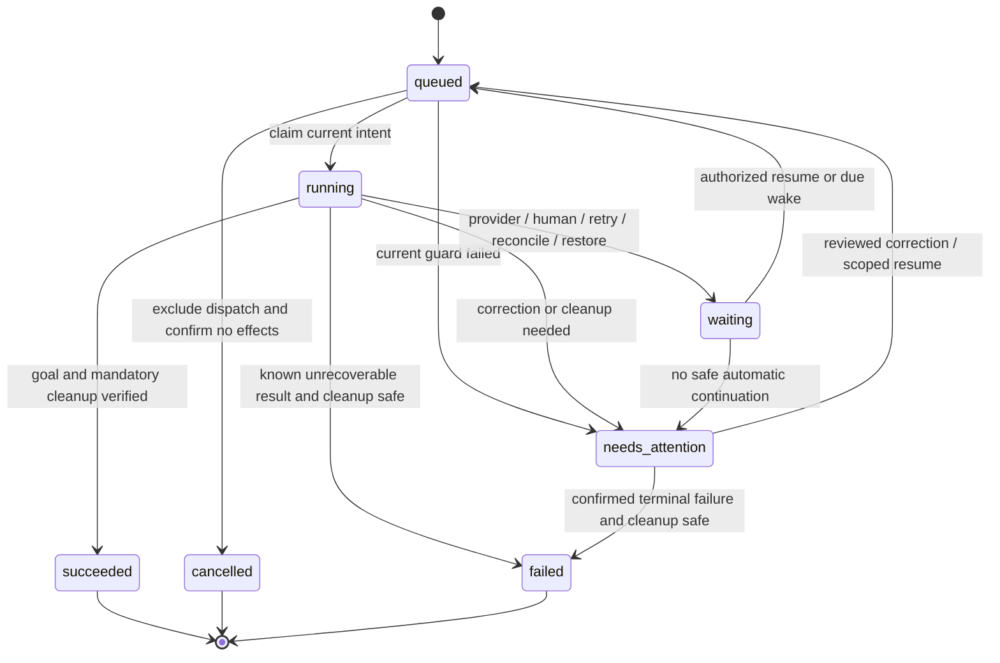
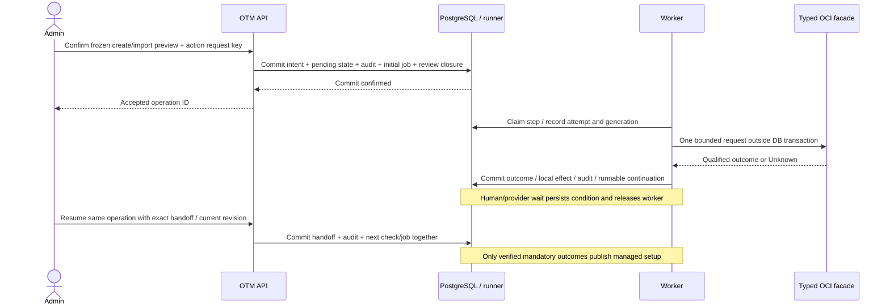

# 09: facade messages and durable onboarding execution

20 October 2026 | C2 contract review draft | D1–D27 retained; not production implementation

[Design hub](README.md) · [Execution/storage](02-operations-and-provider.md) ·
[SDK call map](08-oci-sdk-call-design.md) · [Create/import journeys](07-onboarding-journeys.md)

## Checkpoint and limits

This pass makes create/import execution precise enough to review: internal request/result shapes,
operation states, stage graphs, acceptance/resume/amend/stop boundaries and failure scenarios.
The [design schema](../contracts/oci-execution.schema.json), [message examples](../contracts/oci-execution-examples.json)
and [scenario catalog](../contracts/oci-execution-scenarios.json) are review artifacts. They are not
handwritten production HTTP schemas, a new runtime workflow engine or migrations. Implemented
Python application models will generate the reviewed OpenAPI and client bindings under D11;
these files must not become a competing hand-maintained production wire-model source.

The schema covers six initial facade commands, seven normalized result families and an operation
snapshot. C3/C4 still specify complete identity/managed-item payloads, credential publication and
MFA/capability profiles. Their references here reserve boundaries, not pretend those details are
finished. No OCI client or durable runner was installed in the application. The existing prototype,
its database and 134 runtime tests remain unchanged.

Design validation checks message shape and graph consistency, not real effects: 27 valid examples,
26 negative controls and 10 state-graph examples. The 28 production scenarios are plans, not executed
workflow tests. See the check receipt (private historical evidence; not distributed).

## Local implementation checkpoint — 28 October 2026

The [production inspection slice](../reference/inspection.md) now implements one internal
read capability and its confirmed/unobservable/unsupported result subset, with a stateful simulator.
Authoritative Python models generate the structural runtime schemas under `backend/contracts`.
Its tenancy facts use chapter11's separate raw `home_region_key` and nullable qualified
`home_region_identifier`; the older draft pack's `home_region` shorthand is not the runtime shape.
Custom validators and request/result pairing remain runtime checks beyond generated JSON Schema.
That first inspection slice added no HTTP route, real OCI adapter, durable operation, migration,
write or SDK qualification; later admission/worker/session slices are documented separately.
The counts above describe the dated design pack; current runtime results live in
[development progress](../history/development-progress.md).

## Three distinct contracts

| Boundary | Completion evidence | Application consequence |
|---|---|---|
| OTM accepts intent | One committed operation/initial job/audit/pending local transition and linked review closure where appropriate | Work leaves organization review for Operations. No active ownership or OCI success implied |
| Provider effect | A qualified response/observation establishes the requested milestone for the bound target | Persist step evidence or a wait/uncertain outcome; a successful create request is not verified onboarding |
| Business completion | Every mandatory effect/check/cleanup for that operation's goal is verified | Atomically publish the intended active association/setup result. D26 termination has a different, narrower completion predicate |

An import inspection can finish successfully without starting import. Its goal is inspection only:
no organization-review closure, active association or configuration dispatch. The later explicit
Start import is a distinct accepted operation linked to that inspection/draft. This also means a
completed inspection cannot be relabeled Setup verified just because both operations say succeeded.

## Internal facade request fields

Every command carries `contract_version`, a discriminating `kind`, a closed `context` and a typed
`payload`. This is internal backend-to-provider traffic; the browser cannot submit arbitrary worker
contexts, credential references, SDK kwargs or service endpoints.

| Field | Meaning and validation |
|---|---|
| `workspace_id`, `operation_id`, `step_key` | Stable application scope and logical step, loaded from committed intent |
| `attempt_id` | Unique execution attempt; append attempt history rather than creating a new business operation |
| `intent_revision` | Exact accepted immutable inputs being executed; amendments append a new revision |
| `execution_generation` | Current worker ownership generation. Checked before dispatch and on publication; not a fence for an OCI call already sent |
| `access_binding_id`, `credential_generation` | Authorized parent/bootstrap/permanent binding resolved immediately before this attempt; exact selected secret version is recorded internally |

Freeze target, configuration and intended effect, not an obsolete credential forever. Key rotation
between attempts may resolve a newer authorized generation on the same access binding. Record it
as a new attempt; never silently substitute a different tenancy, person or privilege profile.
Credential resolution alone does not change business intent or disclose a secret. Backend context
checks are required even when a JSON message validates structurally.

| Command kind | Payload | Result scope |
|---|---|---|
| `create_child` | Configured organization/parent, requested name/home region, initiating verified email, provider retry token, immutable effective-configuration reference | Accepted request, pending/unknown/rejected/unsupported status; no fabricated child identity |
| `inspect_tenancy` | Configured organization/parent plus exact child OCID | Verified actual child facts, or honest unobservable/rejected/unsupported result |
| `inspect_bootstrap_identity` | Child OCID, supplied bootstrap user OCID, optional previously verified domain binding | Verified domain/SCIM/OCI identity binding; no OCI OCID used blindly as a SCIM resource ID |
| `verify_signer_access` | Verified identity binding and versioned permission-profile reference | Evidence for the selected safe, qualified profile under this signer; not proof of arbitrary write permissions |
| `observe_provider_request` | Known provider operation ID and original attempt reference in the configured organization | Status/evidence for that exact attempt; does not itself authorize another create/delete |
| `request_termination` | Registered child/parent, current guard receipt, original request token and optional qualified ETag | D26 confirmed initiation, rejection or uncertainty; no final-deletion wait |

For provider request reconciliation, the original attempt reference resolves the immutable command,
expected target and existing correlations in the database. It is not a free-text identifier that
can attach another operation's result. A matching name/email/time window alone cannot safely adopt
a resource or prove creation did not happen. With no qualified correlation/observation path, remain
Needs attention; do not fabricate a provider retry-token lookup API.

Identity creation/key upload/grant/removal use the domain primitives in chapter08. They are bounded
steps with typed inputs/results and exact object bindings, not one opaque provisioning script.
Their full schema registry is a C3/C4 deliverable; no `dict[str, any]`, arbitrary SDK method name,
script upload or user-provided executable policy handler is approved by this draft.

## Result families and allowed consequences

All results include attempt identity, capture time, safe enumerated diagnostic code, optional
provider request/work-request correlations and references to sanitized evidence. Returned SDK
objects, raw logs, activation URLs, private keys, passwords, factor material and OAuth tokens are
excluded. Closed fields reject unknown keys; semantic redaction/content controls are still needed
because a string field can contain inappropriate content. Schema validation is not a secret scan.

| `kind` | Meaning | Workflow consequence |
|---|---|---|
| `confirmed` | Qualified evidence proves a named milestone: tenancy inspected, bootstrap identity verified, signer profile verified or termination initiated | Complete only that scoped milestone; verify returned target/binding and original request relationship before local publication |
| `accepted` | Provider accepted a child-creation request | Persist request evidence, then observe/discover/wait for activation. No active tenancy association |
| `pending` | Known provider work has not reached its required milestone | Persist next observation time; release worker/DB transaction |
| `rejected` | Qualified contract establishes no effect was applied for this bounded request | Manual correction, or bounded same-request retry only for a classified safe transient rejection |
| `unknown` | The mutation may have happened, including response loss | Reconcile original effect first; no blind retry, retarget, amendment or terminal success |
| `unobservable` | Read evidence is denied, partial, unavailable or insufficient | Never convert to Missing/Verified. Retry a qualified transient read or surface needed access/context |
| `unsupported` | The requested capability/configuration is outside the qualified adapter | Explain the unsupported capability; do not fall back to legacy identity management or stronger privileges |

The draft result schema does not by itself enforce request/result pairing or authorization.
Normative checks additionally require: the response belongs to the original attempt; target and
identity fields match verified bindings; the milestone is permitted for that command; evidence is
fresh/complete enough for its declared meaning; and the current intent/generation still owns
publication. An observer may resolve an original create/termination outcome only through its
qualified operation-specific evidence. It cannot invent a stronger completion milestone.

Successful root-policy reads or an uploaded API-key fingerprint alone cannot establish the entire
automation privilege profile. Qualify safe probes plus actual role/grant evidence and validate
requested effects as they run. Do not create/delete disposable resources merely to test permission
in an engineer tenancy. Only pilot tests use explicitly approved disposable resources.

## Operation state, stage and wait reason

Use one small operation-state set. Stage describes the business step; wait reason explains why it
is not progressing. Provider lifecycle, owner first-login, credential health and managed-directory
status remain separate. UI text is derived from operation kind and stage, not another stored status.

| State | Meaning | Transition rule |
|---|---|---|
| `queued` | Durable runnable work exists | Claim into running with current guard/generation; cancellation only with dispatch exclusion |
| `running` | A bounded step or reconciliation read is executing | Persist outcome and continuation/wait atomically; no transaction across OCI |
| `waiting` | No worker needs to remain allocated | Persist administrator, provider, retry, reconcile or restore-fence reason; due wake is idempotent |
| `needs_attention` | Invalid input, unsupported capability, failed verification or unresolved cleanup needs administrator intervention | Keep context and partial bindings. Resume existing scope after current checks; no fresh create shortcut |
| `succeeded` | This operation's complete goal is verified | Terminal historical result; future drift is a separate observation/repair operation |
| `cancelled` | No-effect intent was withdrawn before dispatch, with race exclusion established | Terminal; not an OCI rollback or proof a partially created resource was deleted |
| `failed` | A known unrecoverable outcome is recorded, with no unknown effect or unattended mandatory credential cleanup | Terminal scoped failure; preserve partial resources/bindings and audit, never label them fully managed |

`effect_knowledge` concerns target business mutations: none means no target mutation is in flight
or applied, known means recorded target effects, and unknown means a target effect may have occurred.
Cancelled requires none plus dispatch exclusion; it cannot hide a known partially created tenancy.
Separately staged Vault/bootstrap material retains its own cleanup obligation and cannot be discarded.

A failed/cancelled goal can leave desired steps unfulfilled; only succeeded requires zero
unfinished mandatory steps. Terminal failure still cannot hide unknown external effects or
unattended credential cleanup. Recoverable issues stay Needs attention and resume this operation.
A genuinely terminal failure keeps its history; any later recovery requires a separately reviewed,
linked operation using retained bindings, not reopening history or issuing another create blindly.

Human/restore waits need a durable condition and monitoring rather than a guessed timer. Provider,
retry and reconciliation waits need a due check or explicit attention state when automated evidence
is impossible. Numeric retry limits, backoff, stale-check thresholds, bootstrap lifetime and
activation reminders remain configurable-policy decisions to close; no invented TTL auto-deletes
a tenancy, retires the last administrator or abandons temporary access.



The graph catalog includes guarded cancellation edges from claimed/no-effect waiting/attention
states. They are legal only if dispatch exclusion and no-effect proof hold; diagrams do not waive
them. If an external effect is unknown, only reconciliation or recording stop intent is allowed.
A worker running a reconciliation read does not gain permission to issue a second mutation.
`available_actions` is computed by the server from actual entitlement/guards and rechecked on POST;
valid enum strings are not authority. A request to refresh a page never starts OCI work.

## D49 notification consequence of existing states

D49 selects email for administrator action or terminal failure in lifecycle workflows. A persisted
human-action `waiting` reason or actionable `needs_attention` opens a deduplicated attention notice;
known terminal `failed` opens its one failure notice. Provider/retry/automatic-reconcile waits,
queued/running, succeeded and cancelled have no routine lifecycle email. An unknown provider effect
cannot become `failed` to obtain a notification. Commit the current guarded transition, source event
and outbox intent atomically; delivery remains outside the transaction. [Chapter15](15-collection-and-operational-events.md#d49-accepted-lifecycle-email-only-for-action-or-terminal-failure)
uses operation/intent/step/attention-episode references for deduplication. It adds no state or graph
edge. D50 selects the current responsible administrator only, with no all-admin fallback. Explicit audited takeover changes responsibility; frozen email intents and uncertain outcomes retain their evidence. Other required operational notices keep their recipient rules.

## Worked create/import step graph

| Step key / stage | Input / required evidence | Advance / safe failure behavior |
|---|---|---|
| `validate_context` | Current actor, eligible person, configured parent, region and frozen configuration | Refresh preview on material changes; no automatic organization approval added |
| `request_child` (create only) | Committed intent and original provider request identity | Accepted -> observe/human wait; Unknown -> reconcile; definitive no-effect name rejection -> amend |
| `wait_activation` (create) | Human activation/password/MFA and bootstrap public-key setup | Present instructions even if the create response has no child OCID/work-request ID. Persist operation and collect actual OCIDs at handoff; public PEM only |
| `inspect_target` | Original qualified correlations when available and/or explicit handoff; actual child OCID/parent/home region | Mandatory before configuration. Optional early discovery may precede human wait; missing correlation never prevents showing activation/handoff instructions |
| `inspect_bootstrap` | Verified supplied bootstrap OCID and required profile; separately verify create-only activation administrator OCID/domain/SCIM binding | Missing/insufficient/ambiguous or protected identity -> Needs attention; no guessed user adoption or cleanup |
| `establish_automation` | Frozen permanent identity, public key, grants and staged private-key secret | Separate reconcilable item steps; persist each known binding. Do not recreate on uncertain response |
| `verify_automation` | Independent new signer plus qualified OCI/domain privilege evidence | Failure retains bootstrap access and partial bindings; do not retire initial administration |
| `configure_required` | Versioned owner/recovery/managed items in dependency order | Partial state persists; no destructive compensation or implicit latest-template substitution |
| `verify_required` | D20 owner grants/MFA enforcement, D19 independent recovery and all mandatory items | Owner first sign-in may remain unconfirmed; unresolved required recovery is not success |
| `retire_temporary` | Permanent signer verified; safe replacement/last-admin checks | Retire recorded bootstrap/key and initial local human for create; import preserves unrelated humans. Retry only incomplete cleanup |
| `publish_setup` | Required checks/cleanup complete and current ownership/generation guards | Atomically activate local association/configuration and operation success/audit; SDK writes already have their own recorded evidence |

The table is a dependency graph, not a requirement to discover a child OCID before the human sees
activation instructions. With a correlated ID, early read-only discovery may run; otherwise enter
activation/handoff wait, then inspect the supplied target and bootstrap identity on resume. The
qualified parent/target check still gates every subsequent configuration mutation.

### Step records and amendments

A step has pending, running, waiting, needs_attention, verified, not_required or failed status.
Pending means dependencies are not yet satisfied or its runnable job has not been claimed;
runner-job state is separate. Only current dependency-satisfied steps dispatch. Waiting releases
the worker and persists its condition; unknown outcomes remain guarded regardless of worker lease.
Verified means that step's specific evidence predicate holds, not that the entire setup is ready.
Not_required must have a frozen flow/dependency reason, not hide a failed mandatory check.

Use logical uniqueness `(operation_id, intent_revision, step_key)` for immutable step inputs.
An amendment appends a new intent revision and affected steps; it never rewrites an old verified
result. Compatible unchanged steps may reference prior qualified evidence/bindings explicitly after
fresh guard checks; their mutation is not replayed. Changed create payloads need a new submission
identity/token only after the earlier no-effect outcome is established. The submission identity
survives transport/worker retries; an attempt ID is not a license to generate a new create token.
This refines the candidate two-table model without introducing a table per state or attempt.

Actual item substeps have stable keys such as `establish_automation.user`, `.public_key`, `.group`
and `.role`, identified by frozen item keys, not mutable display names or queue job IDs. Templates
and profiles define their dependency order. A failed policy application must not rerun a completed
user creation, and multiple templates cannot independently bind the same OCI object by accident.

Import starts with a durable audited inspection and bootstrap preparation, then explicit acceptance
of import configuration; it skips `request_child`/activation and reuses verified target/identity
inspection through setup publication. Inspection success does not dispatch configuration. Fresh
observations at Start must detect context/target/collision drift since inspection.



## Acceptance, resume, amendments and stop

| Command concept | Required inputs and transaction | Conflict / retry behavior |
|---|---|---|
| Preview | Owner/person ID, individual/shared, requested region/name or exact imported OCID, configuration versions | Read-only business preview; authenticated actor/context/expiry bound to a server-issued preview reference |
| Accept create/import | Preview reference, current expected intent/context revisions, stable client action key | Revalidate entitlement/material context; atomically commit operation/audit/review closure/pending links/initial job. No accepted response on rollback |
| Recover lost response | Same actor/action key and canonical payload | Return same accepted operation; conflicting payload reuse fails without OCI dispatch. A consumed preview identifies one acceptance even if transport keys differ |
| Resume handoff | Operation ID, expected revision, action key, exact child/bootstrap user OCIDs, and create-only `activation_administrator_user_ocid` | Persist audited input and schedule verification together. No active association yet; no implicit retargeting; repeat key returns same handoff acknowledgment |
| Resume after attention | Operation ID, expected revision and explicit unfinished scope | Recheck current entitlement/access/intent. Already verified steps remain complete; unknown effects reconcile rather than replay |
| Amend provider inputs | Refreshed preview, explicit changed fields and expected revision | Only after definitive no-effect rejection/safe boundary. Append intent revision/attempt history; changed provider payload gets a new submission identity/token. Unknown old writes block amendment |
| Request stop | Operation ID, expected revision and action key | Audit stop intent; exclude new non-cleanup dispatch. Before effects, prove no dispatch then cancel. After effects, leave Needs attention with retained resources and required safe cleanup; no automatic rollback/delete |

Use a signed/opaque preview reference and record its accepted ID on the operation; exact preview
storage/signing/expiry mechanism remains physical/API design work, not a new required table.
Names are not uniqueness locks. A deliberate second tenancy for a person uses a new reviewed
preview; do not impose a one-tenancy-per-person constraint. Once known, a child OCID has a unique
current onboarding/mutation binding and guarded operation scope.

Action-key uniqueness is scoped to workspace/authenticated subject/command intent. Check payload
consistency and operation ownership before recovering a duplicate. Another authorized admin may
resume through audited responsibility reassignment (already accepted in chapter07), without
changing original actor/email/MFA custody. It does not take over the original activation mailbox.
A browser timeout does not cancel an accepted operation.

A feed manager/name change may update organizational metadata without approval as agreed; compare
whether actual frozen provider intent changed. Do not require approval merely for metadata drift.
If changed owner contact/access inputs affect OCI writes, refresh/amend the operation explicitly;
no silent new owner or mutable-template substitution. Source absence prompts visible review, never
automatic creation/deletion/ownership change during a pending workflow.

Stop during uncertainty records the desire to stop, then reconciles before claiming cancellation.
Credential retirement already required for the operation remains supervised; stop does not revoke
the only administrator or silently remove emergency access. Partial-resource ownership and recovery
instructions remain visible. Do not add a complete/cancel button that discards those obligations.

## Scheduling, concurrency and recovery obligations

- Initial acceptance and every immediately runnable continuation use the accepted atomic enqueue
  transaction. Procrastinate/SQLAlchemy/psycopg same-transaction integration remains unqualified;
  the schema/preview does not prove it. Do not implement a second custom job runner to bypass D2.
- Job payloads carry operation/step IDs and expected generation, not secret material or mutable full
  desired objects. Freeze canonical intent separately; load it after claim and recheck current guards.
- One mutation at a time per child and separately coordinated shared parent objects; read-only
  observations declare their capture time and cannot certify stability across concurrent writes.
  Provider create before a child OCID exists uses its operation/submission identity plus parent
  coordination. Parent service limits bound fan-out; do not serialize all fleet work needlessly.
- Claim/publication transactions are short; network calls are outside them. CAS publication checks
  generation/revision. A stale worker may have changed OCI, so audit/reconcile its possible effect
  instead of allowing a new worker to blindly repeat the mutation.
- Durable guards for uncertain effects and desired retirement survive worker lease expiry. Wake
  idempotency prevents duplicate runnable continuations; due checks also recover scheduling gaps.
  Numeric pool/lease/concurrency/backoff choices need runner/DB qualification and measured sizing.
- D12 database restore fences ordinary dispatch until reconciliation/release. Process restart is
  not a restore fence. Urgent credential deadlines retain reserved capacity and visible failures;
  they cannot preempt an OCI call already in progress.
- D26 termination uses this common infrastructure but completes when OCI confirms initiation. It
  does not inherit a final-deletion stage from create's provider waits. Retire its association and
  aggregate D25 offboarding only after each selected scoped action meets its own boundary.

## Simulator boundary and handoff tests

The fake owns separate persistent provider state: organizations, child targets, domains, SCIM/OCI
IDs, users/groups/grants/key fingerprints, work requests, permissions, visibility lag and clock.
A new worker object must not reset that state after simulated crash/response loss. Put faults at
named boundaries: before send, after remote effect, before response, before local commit, after
commit before enqueue acknowledgment, and after an old generation loses claim. Reads can be paged,
partial or denied. The same application workflow uses fake and real facade contracts; no domain
branch such as `if fake: succeed` is allowed.

Use scenario IDs CX01–CX28 in the [catalog](../contracts/oci-execution-scenarios.json). They cover
acceptance rollback/lost responses, wrong scope, dual-ID binding, privilege gaps, permanent-key
verification, first-login separation, temporary cleanup, import inspection/adoption, duplicate
queue delivery, late workers, feed interleavings, stop races, restore, mixed offboarding, continuation
atomicity and credential-generation changes. The catalog distinguishes future DB/worker/fake tests
from permission/session/provider qualification that a mock cannot establish.

No schema result proves its claimed evidence is true. Production tests must additionally assert
request/result pairing, current target/actor/generation, no duplicate OCI mutations, no forbidden
resource/compartment cleanup (D23), no legacy adapter (D27), no finality job (D26), no active
association before verified readiness, and rollback of acceptance/continuation on enqueue failure.

## Reproduce the design checks

From the repository root, use an isolated validator rather than adding a production dependency:

```bash
uv run --no-project --isolated --with jsonschema==4.26.0 python scripts/design/check-execution-contracts.py docs/contracts
```

The checker validates the JSON Schema, message examples and graph adjacency. It does not execute
CX01–CX28, simulate OCI, test PostgreSQL transactions or prove operation guards. Those tests remain
part of implementation. The validation uses [JSON Schema2020-12](https://json-schema.org/draft/2020-12/json-schema-core)
and the [validator's documented API](https://python-jsonschema.readthedocs.io/en/stable/validate/).

## Review and next checkpoint

The [separate Operations walkthrough](../walkthroughs/operations-walkthrough.html)
illustrates queued, human wait, uncertain create, configuring, cleanup attention and verified setup.
Its controls only navigate local samples. It is not a live workflow, and it does not change the
existing prototype or onboarding walkthrough. Proposed state labels are not approved DB enums.

After review: finalize physical keys/constraints/indexes and atomic runner integration qualification;
complete C3 item schemas/overlays and C4 MFA/secret-version lifecycle; then freeze generated API/CLI
models and executable adapter/workflow tests. The current docs/schema/UI checkpoint does not mark
C1/C2 complete or authorize live destructive tests.


## D54 recovery boundary — 26 October 2026

[Manual restore](17-recovery-and-release.md) replaces the unapproved C6-A external control/journal
proposal. No extra mandatory recovery envelope, per-dispatch Object Storage write or installation
manifest is required. Deployment maintenance and stopped processes prevent automatic post-restore
execution; restored active work is held in existing states until administrator review/resumption.
Ordinary C2 transaction, concurrency, target, intent/generation and unknown-effect guards remain.
Normal password reads use stable Vault secret OCID plus CURRENT; exact candidate versions remain in
rotation operations. This changes no operation-state enum or runtime prototype implementation.

## Implemented local application API checkpoint

The [local application HTTP/model map](../reference/local-application.md#implemented-http-and-model-boundary)
documents the current guarded session, password/TOTP, administrator directory and revocation APIs.
The directory request has bounded page/size, allowlisted sort/direction and literal name/email search;
responses contain existing grant projections and whole-workspace statistics, never credentials.
Revocation sends only the displayed expected revision and reuses fresh transactional authority.

There are 23 exported runtime schemas, including typed simulation and Audit History projections. The frontend generates administrator/operation/query/session types
from authoritative Pydantic models; TypeScript assertions do not replace runtime server checks.
These routes do not expose the design pack's tenancy commands or OCI execution contexts. The default
app remains liveness-only; local UI/assets and authenticated APIs require explicit composition.
No new table, provider call or durable operation kind is created for these directory projections.

## Operations read API and public contracts

[The Operations field map](../reference/operations.md#public-dto-and-ui-field-map) documents
`OperationQuery`, `OperationDirectory`, `OperationDetail` and their summary/step/event projections.
Two GET routes use current session workspace scope, bounded literal search and allowlisted sorting;
foreign and absent operation UUIDs share the same 404 response. Raw intent/provider JSON stays private.

List counts/rows and detail state/current steps/history are coherent within one read-only repeatable
snapshot per call. The exact current intent is hash/actor/scope checked. Newest-50 event display uses
an explicit truncation flag without deleting prior evidence. Current mode remains simulated and
inspection success does not imply adoption. These are read routes, not the design pack's admission/
resume/retry actions; no configured worker process or new operation kind is introduced.

## Implemented simulated-submission contracts

[Simulation HTTP/model map](../reference/simulation.md#http-and-atomicity) adds authenticated
`GET /api/inspection-sandbox` and guarded JSON `POST /api/operations/inspect`. `InspectionSubmission`
contains only request UUID and virtual child OCID. `SandboxCatalog` exposes fixed mode, pause and
configured target OCID/name/scenario; `SandboxConfig` privately owns exact policy and target rules.
These three added exports bring structural schemas to 21 without another table or operation kind.

A 202 receipt means operation/intent/native job committed together. Compatible key replay precedes
policy reload after fresh authorization. Unknown/paused configuration is 503, invalid command/target
is 400 and conflicting key reuse is 409. The UI preserves uncertain retries only within its mounted
form; backend stored idempotency remains durable for a known key. The separate native worker and
current authority/policy checks execute only simulated reads. The broader design pack's real OCI
mutation/resume/stop contracts remain unimplemented qualification work.

## Audit History read contract

[Audit History](../reference/audit-history.md) adds current-session-scoped `GET /api/audit-history`
with `AuditQuery`, `AuditDirectory` and nested `AuditEntry`: six bounded query fields, nine safe
entry fields and five directory fields. Categories derive from existing event kinds. Returned actor
shape/key and data hash are checked; only closed inspection outcomes contribute a safe code.
Historical worker rows use their existing worker representation and generic label rather than
being misattributed to an administrator. Failed sign-ins show no verified actor.

The shared read-only/repeatable snapshot helper preserves existing Operations semantics. No raw JSON,
edit/delete route or new history table is added. The later export slice adds one guarded POST
with closed `AuditExportQuery`, CSV output and a closed `audit_export` preparation event. Operations/Audit
History share Activity & history navigation; contextual remediation is outside a generic operation
Retry action, and current simulated issues explicitly require no action with state unchanged.


## Filtered audit export contract

Audit query/export share optional aware-UTC `from_at` and `to_at`; `[from_at,to_at)` bounds must
be ordered. Export accepts category/search/sort/direction plus these dates, excluding pagination
and client-selected authority. A filtered export includes all matching rows within a coherent
transaction, bounded at10,000; over-limit, malformed evidence or commit failure releases no file.
The immutable export evidence is `{contract_version: audit-export-1, row_count, query_digest}`.
The digest covers the canonical query; raw search text and CSV bytes are not copied into history.
Only server-verified administrator identity supplies the actor and administrator FK.


## Organization storage result and history contracts

The implemented repository returns closed `OrganizationOutcome`: acquisition `snapshot_id`,
`state`, optional `proposed_version_id`, applied `revision_id`, duplicate `original_state`, and
typed diagnostics. These are internal service results, not newly exposed HTTP routes.
`OrganizationEvidence` is the shared immutable-audit payload with version `organization-1`,
source/population/configuration correlation, optional feed/proposed/applied IDs and person/finding
counts. No source rows, configuration document or credential material enters public history.
The dictionary/ER and transaction/authorization boundaries are
[documented together](../reference/organization-storage.md). Initial configuration is create-once
or exact replay; no generic configuration overwrite/source-trust bypass is introduced.

## In-progress organization workflow contracts

See the [complete current contract field map](../reference/organization-workflows.md) for
OrganizationContext/Action, frozen association intent, real application receipts, simulated lifecycle
outcome and all review/registry DTOs. Authoritative runtime Pydantic models/generated schemas are
separate from the broader design-only OCI commands. New writes require exact current org/config/
registry context, fresh same-transaction admin authority and workspace+actor request replay. Safe
history adds one bounded subject display field; CSV has ten safe columns. Source/intent/SDK payloads
are not public arbitrary JSON. Full tests/export checks and independent reviews remain pending.

## Guided local execution checkpoint — 31 October2026

[Implemented field/state mapping](../reference/tenancy-onboarding.md#existing-storage-no-new-tables) reuses operation/steps/audit with no new coordinator or tables. Manual waits end their jobs; guarded handoff/setup commands atomically append evidence and enqueue the same operation. Verified prefixes survive retries. The pure simulator has atomic local phases; real network dispatch/reconciliation remains unqualified.


## Explicit guided responsibility and continuation authority — source checkpoint

4 November 2026 · Local qualification and both saved-instance upgrades pass. Take responsibility is a real application decision, not
provider dispatch. It locks the existing operation, compares expected revision, updates responsible
subject/revision/time and appends operation_responsibility_changed atomically; no queue job or
provider intent amendment is created. Eligible scope is waiting/needs_attention organization_action
create/import with guided version 1/2.

A later worker still verifies original stored intent bytes/hash and creator identity. Without a
claim it retains original frozen grant checks. With a valid latest claim, it resolves captured
replacement administrator/authorization revision, matching responsible subject and exact typed
original intent-event context, then rechecks that live grant. Numeric operation revision orders
claims; tied clocks cannot select stale authority. Revocation/regrant blocks old snapshots. All
existing source/parent/policy/target/effect/baseline guards remain. No execute-as-any-admin fallback
or rewriting of creator/mailbox/provider inputs is permitted.

[Two command fields, twelve evidence fields and replay rules](../reference/responsibility.md).
Original intent revisions and the new mutable operation responsibility revision remain distinct.
