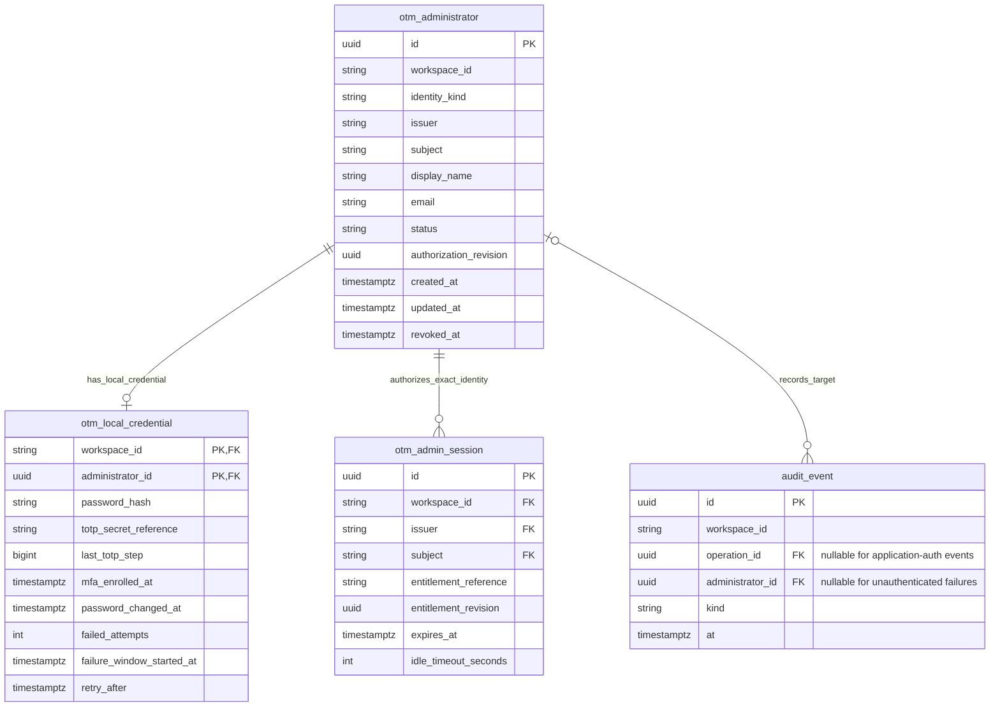

# 19: application administrators and local recovery sign-in

29 October 2026 · D58 accepted direction · D58 local backend implemented; operator/production custody and UI qualification remain

[Design hub](README.md) · [Identity design](04-identity-and-access.md) ·
[Implemented session boundary](../reference/authentication.md)

## Accepted product direction

OTM owns application administrator grants. Corporate SSO supplies the ordinary administrators'
identities; its group membership is not the selected application grant store. The initial
administrator is instead a persistent **local OTM recovery administrator**, independent of corporate
SSO. Implement this local path first so development/testing can proceed before corporate SSO is
registered. Once SSO is enabled, retain local recovery for an SSO outage.

This account signs into the OTM application. It is separate from the recovery accounts inside child
OCI tenancies governed by D39/D40. The child-account MFA exemption does not select the application's
recovery MFA policy. It also does not replace out-of-band hosting/database recovery when OTM itself
is unavailable.

## Bootstrap and identity boundaries

- Provide a restricted operator/deployment command to establish the initial recovery administrator;
  no first-visitor registration or default password. Bootstrap must have a qualified operator-access
  boundary and audit attribution; an untrusted command/header actor label is insufficient.
- Keep a stable local identity, clearly distinguished from corporate issuer/subject bindings.
  Authentication source must be selected explicitly. An invalid or unavailable SSO attempt cannot
  automatically fall back to accepting local credentials under a corporate identity.
- Store only a salted, memory-hard password verifier in the application database. Use a maintained
  password library with Argon2id, following [OWASP password-storage guidance](https://cheatsheetseries.owasp.org/cheatsheets/Password_Storage_Cheat_Sheet.html).
  No reusable password enters source, Terraform state, logs, command-line arguments or audit payloads.
- Production credential custody/retrieval must work outside OTM and without depending on the failed
  corporate SSO path. Exact approved Vault/operator custody is a deployment qualification item.
- A persisted local user is a real authenticated administrator with an OTM grant, not the previous
  prototype's local actor shortcut. Keep HTTPS, safe session cookies, current grant checks, bounded
  login attempts and audited security events. SSO unavailability must not be queried as a prerequisite
  for a local recovery login.

## Administrator management

Use one Administrator role initially. Provide an Administrators screen and corresponding services to
list administrator grants and grant/revoke ordinary administrator access. Names/emails are display
or identity-lookup information; durable corporate identity binding uses verified issuer/subject.
The exact identity lookup/enrollment flow needs qualification with the later SSO provider.

Protect the dedicated local recovery identity from ordinary deletion/disable operations. Credential
reset/recovery must be an explicit protected procedure. Record bootstrap, grants/revocations, local
recovery use and credential changes in immutable history, without credential values. A shared local
account identifies that recovery principal, not a proven individual human; retain independent
credential-custody/operator evidence where available and never invent human attribution. Access revocation
and credential reset must invalidate affected OTM sessions; a later regrant cannot reactivate old
sessions. Apply concurrency-safe last-administrator protection where appropriate.

The detailed design below adds two application tables, one for grants and one for the local
credential. It reuses sessions and administrative audit. The full proposed model is now 30 tables;
the A1 production implementation now has six, with the two new tables added by migration0005.
[The implementation guide](../reference/administrators.md) distinguishes the current grant/revocation
foundation from the [implemented local bootstrap/sign-in slice](../reference/local-authentication.md) and
future administrator screens/corporate qualification.

## Session lifecycle implementation checkpoint

[Central settings/session maintenance](../reference/application-settings.md) now implement
the agreed configurable idle/absolute policy, explicit activity, logout and bounded invalid-session
cleanup. This supports the forthcoming local/SSO issuer and does not itself create credentials or
administrator grants. The initial defaults are 30 minutes idle and eight hours absolute. Each new
session must pin them through the shared lifetime helper; cleanup and revocation never erase audit.

## Accepted MFA policy and implementation order

The user selected a **strong password plus MFA independent of corporate SSO** for the application's
local recovery administrator. Apply the real password-plus-MFA path from the start of local testing;
there is no password-only development shortcut. The child-tenancy recovery exemption remains a
separate earlier decision.

Authenticator-app TOTP is the starting implementation approach. It does not require corporate SSO
or a shared physical key. Exact custody/enrollment/recovery and a maintained library must be
qualified in the next detailed design. OTP seeds are reusable secrets: keep them behind an approved
secret-store boundary, never in source, raw database fields, logs, ordinary HTTP URLs/query strings or retained screenshots.
Authenticator enrollment needs explicit protected setup and successful code verification before the
account becomes usable. Generate any enrollment QR locally, without sending the provisioning secret to an external QR service.
An `otpauth` provisioning URI is permitted only inside the protected, non-cacheable enrollment
exchange; it must not become a logged HTTP URL, analytics event or saved browser artifact. No seed
sharing/enrollment distribution is assumed to be automated. The [PyOTP documentation](https://pyauth.github.io/pyotp/)
provides the standards/library reference; selecting this factor does not qualify a production
secret store or dependency version.

1. Finish the shared administrator-grant, local-credential, session and audit schema and the actual
   bootstrap/sign-in/management flows, including MFA setup, rate limits and atomic OTP replay handling.
2. Build real local bootstrap and password-plus-MFA login/session lifecycle first, with current
   grants, safe errors, secure cookies, logout/revocation and audit. Test against disposable PostgreSQL.
3. Provide administrator-management UI/services against that same authorization model.
4. Add corporate SSO using the qualified maintained library/provider. Preserve the independent local
   recovery path; do not replace it with a permanent development bypass.

Acceptance cases include explicit bootstrap only, repeated/concurrent bootstrap, wrong credentials,
unknown identity, disabled grant, session revocation/reset, protected recovery identity, unavailable
corporate SSO with successful authorized local sign-in, rejected cross-provider identity confusion,
password/secret redaction and normal administrator management authorization. MFA tests must also
cover wrong/expired/replayed codes, enrollment not yet verified, unavailable secret custody and
concurrent code reuse. No session is issued before both password and MFA verification succeed.

## Detailed checkpoint: two new tables, existing sessions and audit

This is the proposed implementation contract for the next slices. It does not change the prototype
organization model, make employee email an authentication identifier or create a second employee
directory. Application administrators are an independent, very small access list. The initial V1
local path has one protected recovery principal per workspace; additional administrators use the
corporate issuer when that integration is qualified.

The [diagram source](../architecture/diagrams/application-administrators-proposed.mmd) is a focused extension
of the existing core/access model. Arrows show same-workspace references. A session is temporary;
a revoked grant and its immutable history remain available after session cleanup.

### `otm_administrator`: authority, not session history

| Field | Type / purpose |
|---|---|
| `id` | UUID primary key; stable grant identity |
| `workspace_id` | Workspace scope; composite unique `(workspace_id, id)` |
| `identity_kind` | Closed enum `local_recovery` or `corporate_sso`; recovery protection is derived from this value, not a separately editable flag |
| `issuer` | Exact configured authentication namespace; the local issuer is installation-specific, distinct from any corporate issuer |
| `subject` | Stable opaque subject in that namespace; local subject is the grant UUID as text; never an employee email |
| `display_name` | Required bounded display text; escaped in UI, not an authority |
| `email` | Optional display/contact address; no identity binding or automatic link by email |
| `status` | `active` or `revoked`; no pending enrollment row is required |
| `authorization_revision` | UUID replaced on grant/regrant, revocation or credential reset; old sessions cannot become valid again after regrant |
| `created_at`, `updated_at`, `revoked_at` | UTC timestamps; active requires null `revoked_at`, revoked requires a timestamp |

Unique `(workspace_id, issuer, subject)` prevents duplicate grants. A partial unique index on
`workspace_id WHERE identity_kind='local_recovery'` establishes one persistent local recovery
principal per workspace, including after reset. An application service never revokes or deletes
that principal through ordinary administrator management. Recovery credential resets require the
restricted operator procedure; recovery rows/history are not removed to rebootstrap.

Ordinary grants are soft-revoked, not deleted. Regrant uses the same identity and a fresh revision.
Every current-entitlement check loads the active exact issuer/subject/workspace grant. Sessions must
match **both** `entitlement_reference=str(grant.id)` and `entitlement_revision=authorization_revision`.
The session service now enforces that exact reference/revision comparison in A1; checking only
that a currently active subject exists is insufficient.

### `otm_local_credential`: password verifier and MFA metadata

| Field | Type / purpose |
|---|---|
| `workspace_id`, `administrator_id` | Composite primary key and same-workspace FK to the protected local grant; exactly one credential row for that principal |
| `password_hash` | Encoded Argon2id verifier including salt/parameters; never a recoverable password or ordinary API/export field |
| `totp_secret_reference` | Immutable exact-version reference into the approved secret-store adapter; no TOTP seed in the DB |
| `last_totp_step` | Greatest accepted TOTP time step, nonnegative integer; enrollment consumes its code so it cannot immediately be reused to log in |
| `mfa_enrolled_at` | UTC successful enrollment time; no usable credential is committed before proof of possession |
| `password_changed_at` | UTC password establishment/reset time |
| `failed_attempts` | Nonnegative failed-login count in the current bounded window |
| `failure_window_started_at` | Nullable UTC start of that window |
| `retry_after` | Nullable UTC end of a temporary cooldown; never a permanent lock flag |

Only the credential service can read this table. An ordinary administrator list/export does not
join password/MFA fields. A credential can only reference `identity_kind=local_recovery`; enforce
this invariant under the same locked transaction used for creation/reset. No generic local account
registration is introduced. A SQL function/constraint implementation must preserve this invariant
without an extra roles table.

For local TOTP, `totp_secret_reference` pins an immutable secret version (Vault secret OCID plus
exact version encoded by the adapter, or an immutable local-store handle). Never resolve a mutable
CURRENT alias for this seed: out-of-band changes must not bypass the DB revision/material check.
This differs deliberately from D54 child recovery-password retrieval. Reset uses a new immutable
reference and compares the old one before commit; no additional secret-version table is needed.

Both added tables have workspace-scoped keys. The credential FK reuses the grant primary key; the
existing session's `(workspace_id, issuer, subject)` references the grant's exact unique identity.
No `grant_id` column is added to sessions because their entitlement reference already names it.
Migration0005 discards pre-grant operational session rows before enforcing
that FK; no default grant or identity is inferred for existing synthetic sessions. Tests use fresh
Docker databases; a real deployed upgrade requires an explicit session-invalidation release note.

### Audit extension: reuse `audit_event`

Local bootstrap/sign-in and grants are not OCI lifecycle operations. Do not create a fake tenancy
operation or another security audit table for them. Extend the existing append-only event table:
`operation_id` becomes nullable for a closed family of application-authentication event kinds.
Its operation FK and exact intent constraints remain mandatory for all existing operation kinds.
Add nullable `administrator_id` with a same-workspace grant FK. Kind-specific checks require the
appropriate operation/grant target; unauthenticated failure events may have neither and do not
store the attempted username, password, OTP, seed or raw request body.

Use versioned closed event data for `administrator_bootstrapped`, `administrator_granted`,
`administrator_revoked`, `administrator_regranted`, `local_credentials_reset`,
`local_sign_in_succeeded`, `local_sign_in_failed`, and `session_logged_out`. Include grant/session
UUIDs where applicable, server time, safe outcome code and old/new authorization revisions for
management changes. Audit the local recovery **principal**; do not claim to identify the human
custodian who used a shared credential. A failed credential check has no authenticated human actor.
Aggregate rate-limited failure observations to avoid an unbounded event stream during an attack;
never drop successful sign-in or administrative mutation evidence.

Grant changes, revision changes, affected-session revocation and their audit event commit together.
A successful local login commits consumed TOTP step, new session and success audit together before
the cookie is sent. Failure to persist required audit rolls back the security change. Logout still
works without SSO; its revocation/event commit uses the local database. Browser cookie clearing on
storage failure remains the existing behavior, with no false success claim.

## Restricted bootstrap and credential reset

Bootstrap runs as an explicitly authorized operator command, not an HTTP endpoint or first-visitor
registration flow. Production execution uses the deployment/operator access boundary and dedicated
bootstrap database privileges; normal API pods cannot invoke that operator path. Record verified
execution-context evidence, including database `session_user` and approved operator correlation.
The API database role must be unable to insert a `local_recovery` grant/credential or update
`password_hash`/`totp_secret_reference`; bootstrap/reset require separate operator privileges.
It may update only the replay/throttle metadata needed for login and manage ordinary grants through
qualified constrained operations. A real disposable-PostgreSQL negative test must attempt these
forbidden writes using the actual API role, even when the operator command ships in the same image.
Do not treat missing HTTP routes as a sufficient operator boundary.

A caller-supplied `--actor` string is not proof of a named human. Local tests use an explicit test
operator context; this must not become a production bypass. The accepted cloud execution procedure
is the [temporary Kubernetes operator pod](#accepted-cloud-operator-procedure--30-october-2026)
below. It preserves this authentication/transaction contract without using an ordinary API pod or
assuming the laptop file-secret adapter is suitable for production.

1. Require an explicit workspace, settings file and secret-store configuration. Confirm no local
   recovery grant exists. Prompt for a strong password twice using a hidden terminal prompt; never
   accept passwords/seeds as CLI arguments, committed config, logs or shell-history commands.
2. Generate a random TOTP seed using the maintained library, place it in the secret-store adapter
   and display enrollment only in the protected interactive terminal. Show an enrollment code/URI
   locally; no external QR renderer, browser URL, saved screenshot or telemetry receives it.
3. Verify a fresh authenticator code. Only then, in one transaction, create the protected grant,
   credential, consumed TOTP step and bootstrap audit. The unique local-grant constraint handles
   concurrent attempts; a losing attempt must not update the winner's credential.
4. Report nonsecret success and direct the operator to the normal sign-in screen. Bootstrap never
   creates a preauthenticated browser session or bypasses MFA on first login.

If setup fails definitively before commit, no usable administrator is created. Attempt cleanup of a staged seed;
if a process crashes, an operator may remove the unused secret after verifying it has no credential
reference. A connection error/timeout during COMMIT is an uncertain result: inspect the current
grant/credential reference before deleting either seed; it may already back a usable administrator.
This rare case uses a documented manual procedure, not a bootstrap journal/coordinator.
A repeated bootstrap finds the existing principal and refuses; it never rotates or prints credentials.

Credential reset is a separate restricted operator command. It stages/re-enrolls a new seed and
password, then atomically swaps the reference/hash, records the new verified enrollment step in
`last_totp_step`, resets throttle fields, changes the grant
revision, revokes its sessions and appends reset audit. Compare the original revision under lock so
concurrent resets cannot overwrite one another. Keep the old seed until the DB change is known to
have committed; then retire it. An uncertain commit requires operator inspection of the current
reference before removing either secret. No automatic reset when SSO fails, emailed passwords,
password-only recovery link or self-service MFA disable is added in V1.

The implemented laptop test secret adapter uses an explicitly selected private directory with owner-only access and no
symlink traversal; tests use temporary synthetic stores. Production will use OCI Vault through the secret
facade and an independently usable operator identity. The application hosting credential must be
able to read its configured seed without corporate SSO; access and recovery custody require a live
deployment drill. Do not place enrollment seeds in Kubernetes ConfigMaps or Terraform state.

## Local sign-in and replay-safe session issuance

The first screen has a clearly labeled **Recovery administrator sign-in** form with username,
password, authenticator code and a single **Sign in** button. A later **Corporate sign-in** choice
is separate; it is unavailable until its provider is configured. No SSO failure silently changes
identity source. The local recovery username is a fixed application identifier `recovery-admin`
within the selected deployment/workspace, not an employee address.

Proposed HTTP contract: `POST /api/auth/local/sign-in` accepts a bounded closed JSON body containing
`username`, `password`, `totp_code`. The route is public only with respect to the session requirement:
it still requires the existing HTTPS, exact Host, same-origin and `X-OTM-Request` protections. It
cannot accept a client-selected issuer, subject, grant ID, actor, session expiry or redirect target.
Return minimal session context and a new host-only Secure/HttpOnly/SameSite=Lax cookie; never put
a session handle in JSON, browser storage, an HTTP URL or logs. Responses are `Cache-Control: no-store`.

Check the Argon2id verifier and TOTP using maintained libraries. Bound input before expensive work.
Use an equal-cost dummy password verification for unknown local usernames; generic authentication
failures do not distinguish unknown identity, bad password or wrong/replayed code. Secret-store or
DB failure returns a fixed unavailable result without issuing a cookie. No challenge table or
partial-authentication cookie is needed: all factors are submitted in one request.

Verify password/secret retrieval outside a long-held database lock. Then lock the exact grant and
credential, recheck unchanged authorization revision and credential material, active status, current
UTC time and throttle eligibility; atomically consume a valid TOTP step greater than `last_totp_step`.
For the initial TOTP implementation use the library's 30-second period, six digits and a one-step
clock-skew window. Never invent/compare OTP strings using custom cryptography. Concurrent reuse of
one code permits at most one successful transaction. Consuming an adjacent accepted step also
prevents it from being used later as the clock advances.

Mint a fresh cryptographically random 32-byte URL-safe opaque handle only for a verified login;
store its SHA-256 digest using the existing 43-character handle contract. Pin the current configured
session lifetime. Commit TOTP consumption, session and required audit before setting the cookie.
Recheck active grant/revision in the final transaction. An older browser handle, if present, is
revoked/replaced; no credential from a preauthentication browser request is reused as the handle.
On a lost response the code remains consumed: retry with the next code, rather than minting a second
session with the same proof. Local sign-in resolves only the local OTM grant and never calls SSO.

### Initial bounded login policy

These defaults are now implemented in the optional `[local_auth]` settings section: five failures in a five-minute window trigger a 60-second cooldown.
Attempts during cooldown do not extend it. After it expires the legitimate administrator may retry;
there is no permanent lock or dependency on another administrator to unlock recovery. Return the
same generic authentication failure for account cooldown as other local failures, without exposing
an existence-dependent Retry-After value. Record counters atomically so multiple API pods share the
limit. The independent edge/IP limiter applies to every submitted username, including unknown ones.

Bound password-verification concurrency per process and ingress request rate before expensive
verification. The edge limiter's authenticated client-IP handling must be qualified behind the
actual proxy; arbitrary forwarded headers are untrusted. The local test adapter must exercise
limits rather than disable them. Parameter names/bounds become typed nonsecret application settings
when implemented; require validation and test the new schema. This is a starting low-volume policy
to profile, not a claim that a counter alone prevents distributed denial of service.

Password policy starts at 15 characters, accepts at least 64 (initial input bound 128 characters
and 512 UTF-8 bytes), permits passphrases and avoids silent trimming/truncation. Tune maintained
Argon2id defaults on the actual pods while meeting at least the current OWASP minimum. Never
silently lower hash strength to meet a latency target. TOTP verification/replay protection and login
throttling follow [PyOTP](https://github.com/pyauth/pyotp), [OWASP authentication](https://cheatsheetseries.owasp.org/cheatsheets/Authentication_Cheat_Sheet.html)
and [OWASP password storage](https://cheatsheetseries.owasp.org/cheatsheets/Password_Storage_Cheat_Sheet.html).
Exact dependency versions/advisory checks and production rate limits remain implementation gates.

## Administrators screen and service contracts

Add **Administrators** under application settings. Its table shows Name, Email, Sign-in source,
Status and Actions, with the same search, sorting, pagination, empty/error/loading states and responsive
layout as the rest of the app. Recovery has a visible **Protected recovery account** badge and no
ordinary revoke/delete control. The credential verifier, MFA secret reference, seed, codes and
session handles never appear on this screen or its exports. V1 does not add a global session viewer.

| Proposed service | Behavior |
|---|---|
| `GET /api/administrators` | Current-admin-only paginated list with allowlisted sort/filter fields; return display fields and expected revision only |
| `POST /api/administrators` | Current admin grants verified corporate issuer/subject resolved by the qualified identity adapter; no email-only binding or free-form provider namespace |
| `POST /api/administrators/{id}/revoke` | Compare expected authorization revision, reject local recovery target, revoke ordinary grant, replace revision, invalidate its sessions and append audit atomically |
| `POST /api/administrators/{id}/regrant` | Same identity, current verified corporate binding and fresh revision; old sessions stay revoked |
| Restricted bootstrap/reset CLI | Qualified operator only; absent from ordinary browser routes |

In the local-first slice the screen lists the recovery account. Adding ordinary SSO administrators
is unavailable with an explanatory generic message until corporate identity resolution is configured.
Do not implement a placeholder that accepts arbitrary email/subject values as a production grant.
Each management mutation rechecks the actor's current exact grant/revision inside its transaction.
Use the protected recovery row as the common per-workspace authorization-change lock so concurrent
revocations cannot leave a stale authorizer able to grant access. Take locks in deterministic order;
there is no general distributed lock service. Protected local recovery remains usable if the last
ordinary SSO grant is revoked; V1 has no operation that can revoke the last protected principal.

## Development slices and acceptance checkpoint

| Slice | Deliverable | Required evidence |
|---|---|---|
| A: grants and security audit | Two-table schema, audit extension, current OTM grant authority, reference/revision session checks and atomic revocation | Unit-only complete source >=95%; fresh PostgreSQL migration/schema/constraints; revoke/regrant and concurrency/audit rollback tests |
| B: local bootstrap/sign-in | Argon2id/TOTP dependency qualification, secret adapters, operator setup/reset, real MFA issuance and login throttling | Wrong/expired/replayed/future code, two-pod replay race, generic errors, unavailable custody, log/secret scan, failed-commit no-cookie tests; no SSO needed |
| C: application UI | Actual sign-in and Administrators screens using the selected original A design | Playwright desktop/mobile, keyboard/focus/errors, authorization failure and no credential leakage in normal artifacts |
| D: corporate provider | Maintained protocol library and verified issuer/subject resolution for ordinary grants | Redirect/state/nonce/PKCE, callback/session binding, revocation/provider outage and local recovery independence qualification |

A and B are sequential because they share authority/schema/security transactions. After those
contracts stabilize, UI and corporate-provider integration can be developed separately against the
same services. This does not require multiple engineers, multiple new services or parallel schema
owners. Continue with one implementation flow unless concurrent work has a clear independent boundary.

A1 now implements the grant/credential table shapes, current grant authority, exact session
reference/revision checks and ordinary-grant revocation with audit. The later B/local-UI checkpoints
below describe the additionally implemented flows; ordinary grant creation/regrant and corporate
provider integration remain proposed. A1 created no login route or usable recovery administrator. The later [local authentication slice](../reference/local-authentication.md)
now implements the accepted operator bootstrap/reset and explicitly composed password/TOTP endpoint.
It creates no real account by default; only disposable test databases were seeded during validation. Before enabling sign-in, complete independent security review of the implementation,
including audited transactions, secret adapters, current grants and all existing request guards.

## Local backend implementation checkpoint — B

The [local authentication guide](../reference/local-authentication.md) documents the implemented
restricted operator command and immutable laptop custody. It also covers Argon2id/PyOTP proof,
atomic replay/cooldown/session/audit transactions and the optional guarded HTTP route. First logout revocation
and `session_logged_out` evidence now commit together; a failure clears the browser cookie but
reports server revocation unavailable. Bootstrap can never double as reset, and an issuer change
cannot silently rebind/reset an existing protected identity. No new table or coordinator was added.

Maintained locked libraries are Argon2-cffi25.1.0 and PyOTP2.9.0. Testing uses the same hash/MFA path;
there is no development password-only flag. The file adapter is explicitly laptop-only, uses owner
0700/0600 permissions, rejects symlinks/hardlinks and verifies its immutable content digest. Production
will use qualified exact-version OCI Vault custody through the same facade, without a local fallback.

The local frontend is now implemented in the checkpoint below. Ordinary grant creation/regrant and
corporate protocol/status integration remain later slices. Infrastructure must keep the recovery path reachable without an outer corporate SSO gate,
while retaining approved network access controls, HTTPS and ingress rate limits. No production Vault,
network/operator custody, deployed DB role, OKE resource or actual human administrator was created
by this backend validation. See development progress for measured test/review evidence.

## Local HTTPS and administrator UI checkpoint

The [runnable local application](../reference/local-application.md) now provides original-A React
sign-in, logout, verified-session handling, input-only idle activity and the administrator directory.
The directory has real server search/sort/pagination and whole-workspace statistics; ordinary active
corporate grants can be revoked with displayed-revision confirmation. Protected recovery rows remain
operator-managed. Add/regrant stay disabled/unimplemented until qualified corporate identity binding.

The default factory remains health-only. An explicit local composition serves public nonsecret
shell/assets and protected directory/revoke APIs with the existing session, HTTPS/Host, Origin and
custom-header guards. Twenty-one generated backend schemas, including Operations reads and simulation configuration/submission, and generated frontend types describe the
actual subset. No table/migration or OCI workflow is added by the UI. The sample application settings
now have 14 scalar keys, including optional local-server origin.

`otm-local setup`, private human-terminal `bootstrap` and foreground `start` preserve independent
laptop application state and the organization prototype. Setup never creates a default administrator;
reset remains an explicit operator action. Owner/API database credentials differ, but their private
state is readable by the same OS user: production process isolation is not implied. Production Vault,
ingress/IP controls, corporate SSO, managed PostgreSQL/OKE and hosted CI remain qualification work.
Current test/security results belong in development progress after the full gate run. No Git or
publication approval follows from this local checkpoint.

## Accepted cloud operator procedure — 30 October 2026

Cloud bootstrap/reset will run interactively in a temporary operator pod using an approved image
pinned by digest. This is an accepted infrastructure requirement, not an implemented deployment.
Kubernetes RBAC must separately authorize creating/entering the operator pod; ordinary API service
accounts and application administrators receive no such privilege merely through OTM. The operator
must have a qualified Kubernetes authentication/recovery path independent of OTM and the failed
corporate SSO path. Retain authentication and network controls during recovery rather than disabling
them to obtain a shell.

The operator pod receives separately qualified database operator privileges and access to the
production OCI Vault secret adapter. API pods retain their restricted runtime database identity.
The current protected-grant ownership/membership checks must be exercised on managed PostgreSQL;
no superuser assumption or production role grant is inferred from the laptop setup. Vault/operator
custody must remain usable when the app or corporate identity provider is unavailable.

The cloud runbook will:

1. Verify workspace, installation issuer, approved image digest, operator RBAC and database/Vault
   targets using nonsecret deployment metadata. Create the temporary operator pod through the
   approved infrastructure procedure, not through an application HTTP action.
2. Enter it with an interactive TTY through the qualified `kubectl` operator path. Run the reviewed
   cloud operator entrypoint for bootstrap or explicit credential reset. Password/confirmation and
   TOTP proof are entered at hidden terminal prompts; enrollment material appears only in that
   private terminal. No factor goes into pod YAML, arguments, shell history, ConfigMaps, Terraform
   state, logs, CI output, terminal recordings or retained screenshots. The approved session-capture
   policy must exclude factor material while retaining nonsecret operator/context evidence.
3. Preserve one-time bootstrap refusal and reset semantics: verify both factors; retain the same
   protected identity; change its authorization revision; revoke affected sessions; commit required
   audit atomically. `reset-local` means resetting the **OTM-local identity**, including when OTM
   runs in OCI. It does not mean the command is restricted to a laptop or resets a child tenancy.
4. Report only nonsecret completion metadata. For an uncertain commit, inspect committed grant and
   exact credential references before retiring either secret version. Pod removal is not permission
   to delete staged or previously referenced Vault secrets. No new recovery journal is required.
5. Close the session and remove the temporary operator pod when finished, including the approved
   failure/abandonment cleanup path. Retain required immutable application and Kubernetes operator
   evidence without credential values. Database `session_user` identifies a database principal;
   correlate qualified Kubernetes operator evidence rather than claiming it proves a named human.

The shipped `otm-local` wrapper manages laptop Docker/files/TLS and is not the cloud runbook.
The current `otm-admin` CLI still requires `--secret-directory` and constructs `DirectorySecrets`;
production must first provide a reviewed Vault-backed operator composition. Copying that laptop
command into an API pod, mounting seed files or supplying an arbitrary actor label does not qualify
cloud bootstrap. No operator pod, cluster RBAC, Vault adapter or cloud credential has been deployed
by this documentation change.

Infrastructure acceptance must prove unauthorized pod creation/exec and API-role protected writes
are denied; a repeated/concurrent bootstrap cannot replace the recovery identity; reset preserves
identity, changes revision and invalidates old sessions; app/SSO outage does not prevent an
independently authorized operator reset; unavailable Vault/DB and uncertain commit never yield false
success or unsafe secret deletion; factor values are absent from manifests, logs, CI artifacts and
retained captures; and temporary operator pods are removed. Use synthetic factors for qualification.

## Operations read visibility checkpoint

The previously selected next application slice now has [implemented Operations list/detail](../reference/operations.md)
over existing `otm_operation`, `otm_operation_step` and `audit_event`. It uses current session/workspace
authority and allowlisted projections of committed intent/state/current steps and recent evidence.
An empty database shows an honest empty state; there is no fake activity or in-memory success history.

No OCI write, operation kind, start/retry/resume/cancel action or table is added. Successful simulated
inspection and native job completion cannot be presented as tenancy adoption. This completes read
visibility only at that checkpoint. The subsequent [simulation slice](../reference/simulation.md)
now provides bounded local admission and a separate native worker, without OCI mutation or full
tenancy lifecycle/MVP completion.
Current API/UI/persistence test results are recorded in development progress after the final run;
cloud operator-pod qualification remains independent and its accepted procedure above is unchanged.
