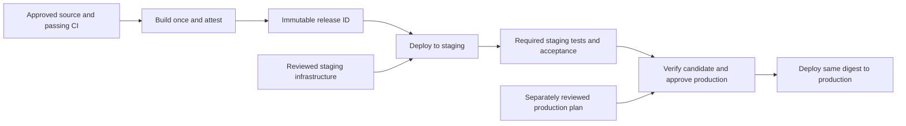

# 24: isolated environments and build-once promotion

16 November 2026 · Immutable build source and targeted checks pass · Staging/production deployment remains design-only; no publication/cloud changes

[Design hub](README.md) · [Platform and backups](06-platform-and-delivery.md) ·
[Application/settings releases](18-database-ci-and-build-order.md#application-and-configuration-deployment-paths) ·
[Email release guards](21-environment-email-policy.md)

## Two hosted environments

Staging and production are the two persistent hosted release environments, initially in
`us-ashburn-1`. Staging has its own OCI parent tenancy and managed children, completely separate
from production's parent and children. Laptop simulation, laptop development against real non-production OCI, and disposable CI fixtures
are development tools, not another hosted release environment. Temporary isolated restore-drill systems do not
constitute a DR site or another persistent environment.

Each environment has separate hosting resources, OKE cluster/node pools, namespaces/service
accounts, database/queue/session data, Vault secrets/keys, backup resources, Terraform state bucket
and locks, DNS/TLS endpoints, application identity registrations/grants and deployment identities.
No shared runtime database, state backend, secret, child, networking/peering or automatic credential
fallback connects staging to production. Hosting may be in a dedicated compartment of a tenancy
other than that environment's managed parent, preserving the accepted hosting flexibility, but no
hosting tenancy or privileged runtime/deployment identity is shared across the two environments.
Corporate IdP infrastructure may be common while application registrations and grants stay separate.

Use synthetic/sanitized approved staging data and the mandatory operator-owned test email
destination. Never copy production secrets or raw production database/feed content into staging as
an automatic deployment step. Production rejects testing overrides. Production-data restore drills
remain in a restricted production recovery compartment, with outbound effects fenced, rather than
using the staging environment or its identities.

One repository, approved source revision and trusted build-artifact store are intentionally shared
delivery infrastructure; neither holds runtime data or grants staging authority over production.
Environment-specific resource identifiers, endpoints and contacts remain private deployment inputs,
not public repository examples or public workflow artifacts.

## Workflow entry points and ownership

Each environment supplies the [shared inbound allowlist](06-platform-and-delivery.md#shared-inbound-source-allowlist--13-november-2026)
through `OTM_ALLOWED_SOURCE_CIDRS`. One validated value feeds both the app load-balancer restriction
and recovery-console settings; do not hardcode operational addresses or maintain divergent copies.
Network and application/settings delivery must qualify both consumers before enabling hosted access.

After initial rollout, application-only promotion is the expected routine update. Infrastructure
changes are less frequent and separately planned, including OKE/node and PostgreSQL upgrades,
security fixes, capacity and networking when required. An ordinary application release must not
invoke Terraform or change engine/cluster versions as a side effect. Maintain
[human-readable operator runbooks](../how-to/hosted-administration.md) for application-only,
infrastructure-only, combined and settings updates plus backup/restore. Replace design-stage workflow
references with actual tested links/inputs during implementation and qualify operator walkthroughs
before go-live; familiarity with the implementation is not a substitute for usable instructions.

The build workflow now exists as [source](../reference/artifact-releases.md); hosted execution and
publication qualification remain pending. The other names below remain proposed entry points, not
implemented deployment claims. Environment entry points stay separate and bind one fixed target.

| GitHub workflow / current scope | Responsibility / authority |
| --- | --- |
| `build-application.yml` — implemented source, not yet hosted-qualified | Follows exact successful master-push Checkpoint; builds/scans two ARM64 images, binds SBOM/public-source/schema metadata and standard attestations. No staging/production mutation authority |
| `infra-staging.yml` | Validate/plan/apply reviewed Terraform source against staging state using staging-only infrastructure identity |
| `infra-production.yml` | Plan that tested Terraform source against production state; require review/approval of this production plan before apply using production-only infrastructure identity |
| `deploy-staging.yml` | Select the trusted build's release ID, deploy its exact image/deployment bundle, apply compatible migrations and run required staging acceptance; record pass/fail against the exact deployed candidate |
| `promote-production.yml` | Select only a staging-qualified release ID; verify provenance, evidence, compatibility and current security policy; obtain production approval and deploy the same artifact bytes, without rebuilding |
| `deploy-settings-staging.yml` / `promote-settings-production.yml` | Separately qualify and promote reviewed compatible nonsecret settings/maintenance definitions using the deployed application image; no image rebuild |

Identity/remote-state bootstrap remains a separately reviewed privileged operator procedure in each
tenancy. A workflow cannot bootstrap its own unrestricted production trust. Infrastructure and
application deployers have different least-privilege roles. Application-deployment identities have
no routine Terraform, backup-delete or IAM-bootstrap authority; neither production deployment
identity is available to a staging job or an ordinary PR/build job.

Use GitHub Environments `staging` and `production`, with environment-scoped OCI federation trusts,
OAuth clients/secrets where required, target configuration and approvals. Bind trust to the exact
repository, approved workflow and environment/subject, using the supported OCI claim-validation
mechanism; issuer/audience validation alone is insufficient. Pin third-party Actions and tools.
Untrusted PR/fork code must never execute with release publication or deployment credentials.
Privileged follow-on workflows must verify the triggering repository, source SHA, branch, workflow
identity and successful conclusion; an arbitrary run/artifact ID is not trusted release evidence.

One job holds credentials for only one environment. Independently validate the selected tenancy,
parent, cluster, namespace and application target against that protected environment's configuration
before mutation. Cloud IAM and Kubernetes RBAC constrain the identity even if a request supplies a
different target. GitHub OIDC/token exchange is separate from Docker-registry authentication: qualify
registry push/pull access explicitly instead of assuming an OCI API token is a Docker login token.

## Immutable application promotion

Infrastructure version inputs are [protected environment variables](../how-to/platform-versions.md):
`OTM_OKE_KUBERNETES_VERSION` for the exact patch and `OTM_POSTGRESQL_VERSION` for the managed major.
OKE image discovery intersects version/ARM options with shape/OS images and resolves a unique newest
candidate during planning. Production requires the complete staging-qualified image selection rather
than re-resolving a different newest image. Saved plans pin resolution; workflow provenance and live
qualification remain separate gates. The managed PostgreSQL module now consumes its major input with configuration/shape discovery,
Vault-referenced provisioning credentials, backup/PITR policy and replacement protection; actual
upgrade/recovery and runtime-role qualification remain pending. The
[Vault custody foundation](../how-to/vault-foundation.md) now runs in separate fixed security roots
before private ingestion and platform creation; its DB-reader IAM grants no runtime or federation
authority and never places secret content in Terraform.
The implemented offline `otm.image_handoff` converter extracts the accepted staging cluster output
into private production `qualified_node_image` tfvars, validating the target binding without exporting
endpoints or state. Until protected workflow transfer/provenance is implemented, an authorized operator
must verify and retain staging acceptance evidence and pass that file to the production plan.

The owner-selected Kubernetes API is public with source-restricted TCP6443. Human sources reuse
`OTM_ALLOWED_SOURCE_CIDRS`; a separate deployment NSG reserves owned job `/32` admission without
widening app/recovery access. Deployment authentication/RBAC, cleanup and actual workflow qualification
remain pending. The [OKE guide](../how-to/oke-foundation.md) specifies the required per-environment
`OTM_WORKER_CLOUD_INIT` secret and private renderer. Infrastructure releases must validate that script
without executing or publishing it, then review the exact secret-bearing plan. Cloud-init updates
require worker replacement/cycling and staging sensor verification, not an application image rebuild.

The installed runtime image already contains the compiled frontend and migration assets. API,
workers, maintenance and migration jobs select their commands from that same qualified image;
there is no independent frontend rebuild or mutable JavaScript deployment during promotion.
Promote by digest, never by resolving `latest`, a moving branch or a mutable release tag at deploy time.
ARM staging must exercise the exact ARM platform manifest later selected in production; a passed
amd64 run does not qualify an untested ARM variant of a multi-platform image index.

Keep a small immutable release descriptor in trusted delivery metadata/artifact storage and use
existing GitHub workflow/deployment records for evidence. This is not a new application table,
release service, custom signing protocol or external recovery journal. Standard artifact provenance
attestation binds build identity and image digest. Record only safe nonsecret fields:

| Field | Meaning / promotion check |
| --- | --- |
| Release ID and source commit | Exact candidate identity from a trusted successful build, reachable from approved protected source |
| Build workflow/run identity | Repository, workflow revision/run and successful required CI associated with that source; not a requester-supplied pass flag |
| Image index/platform digests | Exact immutable artifact and qualified architecture; validate provenance and registry identity |
| Deployment bundle hash | Exact reviewed chart/manifests and migration/command definitions used in staging |
| Schema revision/compatibility | Embedded migration target and allowed old/new API/worker compatibility; current production DB checked before deploy |
| Settings contract and profile revisions | Shared supported settings schema and approved nonsecret staging/production profile/template hashes; sensitive environment bindings remain private |
| Staging acceptance reference | Trusted deployment/run linked to this candidate, deployed artifact identities, applicable automated/manual acceptance and result |

Use one canonical candidate without OCI environment credentials in the build job. The implemented
[source publisher](../how-to/application-releases.md) selects GHCR for two immutable ARM64 images,
without introducing a third OCI environment. Hosted publication/access/attestation and consumer
verification still require qualification. If each tenancy requires its own
OCIR repository, copy the selected artifact without rebuilding or format conversion and verify
destination manifest/platform digest equality. Promotion preserves provenance evidence and needs
no production access to staging runtime resources or staging registry credentials. If the selected
registry cannot preserve the qualified identity, stop and qualify a new candidate rather than
silently treating different digests as the same tested release. Private pull access, credential
lifetime/rotation and restricted repository permissions require explicit qualification.

Production accepts a release ID, resolves it through trusted records and rejects unknown/unqualified
candidates, failed/incomplete acceptance, mismatched source/digests/bundle/platform and unreviewed
settings. A staging result for candidate A must never authorize candidate B. Concurrent or late
results remain attached to their exact release/deployment; do not infer qualification from the last
green staging job. A prior staging-qualified release can remain eligible if current compatibility,
configuration and security checks still pass; staging need not stay permanently frozen on it.
Manual acceptance must identify that release and its relevant deployment/configuration, not a
blanket approval for all future commits. Changed artifacts require a new staging deployment/test.
Re-scan the selected artifact under current security policy before production promotion; a new
blocking vulnerability stops promotion without silently rebuilding the tested image.

## Infrastructure and settings promotion

Test common Terraform/module source and provider lockfiles in staging first. Production uses the
same reviewed source, with isolated tenancy/resource IDs,
DNS, identity and secret references. Staging must match production capacity, node/database topology,
backup policy, versions and deployment/security behavior. **Never apply a staging plan to production.** Generate
and review a production plan against production state and its current protected inputs; bind apply
to that exact plan/source/input/state context. If context changes, re-plan and re-review. Keep
secret-bearing plan/state files out of public logs and CI artifacts. Protect and version each
tenancy's separate remote state, retain locking and guard destructive replacements/deletions.

Do not give Terraform and application deployment overlapping ownership of the same Kubernetes
fields. Terraform owns platform resources and foundation boundaries; the application/settings
delivery path owns reviewed runtime Deployments, ConfigMaps and schedules as agreed in chapter 18.
State/output contracts pass only necessary references, without sharing environment state files.

Settings releases preserve the deployed image and validate with its supported schema. Qualify the
shared change and staging profile in staging, then validate and approve the production profile from
the same reviewed configuration revision. Environment-specific values intentionally differ: never
copy staging's email override, identities, OCIDs, endpoints or secret bindings into production.
Changing the image, shared settings behavior or deployment bundle beyond the accepted release
requires renewed staging acceptance. Record the actual effective nonsecret configuration revision
at deployment; private inputs cannot change unnoticed between approval and apply. Secret rotation
remains an explicitly controlled environment operation, not a new image build.

## Production gate, rollout and rollback

Require human production approval, protected deployment branches and tightly controlled workflow
changes. Recommend an independent approver/prevent-self-review once an eligible second maintainer
is assigned; do not configure a gate with no possible approver or claim two-person control while
only one maintainer can approve. Reviewer membership and GitHub plan support must be verified during
setup. Do not routinely bypass protection rules. Earlier authorization to build/design is not
approval to provision or release production.

Serialize mutating infrastructure/application/settings work per environment. Recheck the installed
release and current state when a queued job starts, so an older delayed deployment cannot overwrite
a newer release. Never cancel an in-flight apply, migration or worker-drain phase merely because a
new commit arrived. Deployments include readiness, bounded graceful API/worker drain, migration
ownership, expand/contract compatibility and post-deploy smoke checks. Preserve capacity for node
loss/rolling surge and qualify two-worker and DB-failover behavior in staging using the identical
production topology and sizing before promotion. Both environments target two API pods and two
one-slot workers. Do not reduce staging capacity or change its adapter/security/deployment behavior
relative to production; isolated credentials/endpoints and safe testing email redirection remain
necessary environment differences.

Rollback selects a previously staging-qualified immutable release, with current schema/settings
compatibility checked. Rolling back an image does not rewind the database, Vault or OCI changes.
Unknown external effects stay held under existing workflow rules. Database restore remains the
separate fenced manual recovery procedure; neither routine promotion nor rollback replays old jobs.

All standard CI/test/coverage/security gates remain unchanged. Add deterministic promotion-contract
negative tests, rendered Kubernetes/Terraform validation and isolated staging acceptance alongside
implementation. Actual tenancy isolation, federation, registry pulls, approvals, plan ownership and
promotion must be proven in the [live qualification manifest](../how-to/real-oci-test-manifest.md),
not inferred from this design. No live deployment or hosted configuration change occurs here.

References: [GitHub deployment environments](https://docs.github.com/en/actions/how-tos/deploy/configure-and-manage-deployments/manage-environments),
[artifact provenance](https://docs.github.com/en/actions/how-tos/secure-your-work/use-artifact-attestations/use-artifact-attestations),
[OCI workload federation](https://docs.oracle.com/en-us/iaas/Content/Identity/api-getstarted/token_exchange_grant_type_workload_id-federation.htm),
[OCI registry prerequisites](https://docs.oracle.com/en-us/iaas/Content/Registry/Concepts/registryprerequisites.htm).

## Single hosting compartment — owner decision, 13 November 2026

All infrastructure in each environment lives in one existing compartment selected by the protected GitHub Environment variable `OTM_HOSTING_COMPARTMENT_OCID`. Bootstrap/security/platform roots consume the same required flat input; no child compartments are created. Staging and production still use separate tenancies. Separate Vaults and exact Vault-ID IAM conditions retain credential scope without compartment proliferation. See the [input contract](../how-to/hosting-compartment.md).

## Disabled Kubernetes workload source — 13 November 2026

The [workload bundle guide](../how-to/kubernetes-workloads.md) records the first offline renderer:
strict independently selected environment, one pinned digest, separate role identities/credential
references, immutable content-addressed settings, hardened ARM64 pod templates, internal-only Service,
OCI NSG networking and suspended release-specific migration Job. All workloads are held and
API/worker replicas are zero pending complete Vault/OCI launch composition and staging qualification.
Startup/readiness/migration mechanics are now implemented in the source foundation linked below.
The render command has no activation option or apply/cloud authority. Namespace admission, live
network allows, registry/identity/Vault/DB integration, active topology protection and trusted hosted
startup remain required follow-ups. Native strict schema checks plus a rejection control enter the
existing required CI job; no new runtime framework, application table or controller is added.

## Hosted startup source boundary — 13 November 2026

Both environments use the same [startup contract](../how-to/hosted-startup.md), pool/drain bounds and two-API/two-worker topology. Workloads remain disabled pending real composition and staging qualification. The owner approved brief maintenance for schema-changing V1 releases: drain API/workers, migrate once, start the matching release and reopen after readiness. Unchanged-schema releases roll normally. See the [release runbook](../how-to/hosted-administration.md#schema-changing-application-release); staging rehearsal remains pending.

## Real-OCI laptop development — 14 November 2026

The owner selected explicit named API-key profiles in `~/.oci/config`, not browser sessions, for
laptop OCI development. [The implementation/runbook](../how-to/laptop-oci-development.md) separates
execution location, simulated/OCI provider mode and platform authentication. Staging/production
remain workload-identity-only. Development uses a sibling compartment and its own application Vault
and HSM key, while application/PostgreSQL remain local. No third OKE/managed DB stack is required.
Development and staging share the non-production parent but own independent child inventories in
their PostgreSQL databases. No global registry, new collision service or cross-environment baseline
coordinator is added. Existing target and credential guards remain in force. Terraform state,
Vaults, API keys and test email routing remain separate; no shared child management is intended.

## Scoped workload Vault access — 14 November 2026

The [workload identity source](../how-to/oke-workload-identity.md) composes read-only Vault IAM after each exact OKE cluster is known. Platform input `application_vault_ocid` selects the existing security-root application Vault. API and worker grants bind cluster, namespace, service account, compartment and Vault; migration has no grant. Explicit OCI-mode bundles project bound tokens/CA only into API/worker containers while automatic mounting remains disabled. Identical behavior applies to staging and production. The later NSG-only decision removes NetworkPolicy; commands/replicas remain held pending real composition and qualification.

## NSG-only V1 decision — 14 November 2026

The owner approved [NSGs only for V1](../how-to/nsg-only-networking.md), superseding the earlier source default-deny NetworkPolicy intent. No Calico/Cilium or pod policy engine is installed; deployment bundles emit no NetworkPolicy. Staging/production share this exact model. Pods share a network group; role isolation comes from database privileges, scoped IAM and application controls, not pod network separation. Explicit optional relay-only SMTP rules are additive to existing OCI/CNI allowances. Workloads remain held pending live network and launch qualification.

## Caddy HTTPS ingress — 14 November 2026

The owner selected [external DNS and Caddy-managed Let's Encrypt HTTP-01 certificates](25-https-ingress-and-certificates.md). No OCI DNS zone or Terraform-managed external DNS is required. The [implemented held source](../how-to/caddy-ingress.md) permits only active challenges on public port 80, returns ordinary HTTP 404 and preserves CIDR-restricted 443 through the exact edge NSG handoff. Staging/production have separate names and certificate/account state; the cluster-scoped StorageClass belongs to infrastructure authority. Local Pebble protocol tests pass. On 15 November the owner approved two exact official-Caddy DoS exceptions with continuous update checks; the policy-specific native rerun passed with two accepted and zero blocked findings, while full milestone/hosted/live gates remain separate. No hosted resource or saved app is changed.

## Immutable ARM64 build source — 16 November 2026

The [release contract](../reference/artifact-releases.md) and [review procedure](../how-to/application-releases.md)
implement only candidate construction/publication source. One candidate binds exact source/CI/build
identity, two image digests/SBOMs, installed migration/settings contract and deterministic public
source. The source archive is not a private environment render or standalone installer. Standard
provenance/SBOM attestation steps and a four-file 90-day upload are defined; no hosted run is claimed.
Targeted unit/native source checks and a real ARM64 installed-contract probe pass; the full
milestone/hosted publication gates have not run for this slice. Long-term artifact/attestation custody
still requires qualification. The pure matching helper only
compares an already authenticated candidate fingerprint; it neither verifies provenance nor grants
staging acceptance. Trusted acceptance, staging deployment, production promotion and OCI identity
remain future implementation/qualification work. No application DB/schema change or saved app update.
