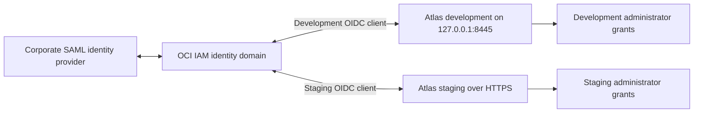

# 26: Atlas administrator sign-in through OCI IAM federation

Proposed · 24 November 2026 · Cloud registration and implementation require design approval.

[Administrator grants and recovery](19-administrator-provisioning.md) ·
[Implemented authentication boundary](../reference/authentication.md) ·
[Environment isolation](24-environments-and-promotion.md)

## Recommendation

Use the hosting tenancy's OCI IAM identity domain as Atlas's OpenID Connect (OIDC) provider.
OCI IAM brokers authentication to the existing corporate SAML identity provider. Each Atlas
installation uses its own confidential OIDC client. Atlas owns the Administrator grant in each
installation's database. OCI tenancy roles, application assignment, and a successful SSO login
do not create Atlas grants.

Start implementation and the first live SSO pilot on the existing [OCI-connected laptop
development environment](../how-to/laptop-oci-development.md) at `https://127.0.0.1:8445`.
Use a development-only OIDC client and development secret custody. Qualify the flow there before
bringing it to hosted staging. Keep the saved review instance on port 8443 on its existing
configuration.

| Boundary | Laptop development | Hosted staging |
| --- | --- | --- |
| Redirect | Candidate `https://127.0.0.1:8445/api/auth/sso/callback`, exact registration and desktop HTTPS trust to be qualified | Exact callback on the registered staging HTTPS origin |
| OIDC and custody | Development client and secret, read from development custody by the approved laptop identity | Staging client and secret, read only by the staging API workload from staging custody |
| Eligibility | App-only group such as `Atlas_Users_Development` | App-only group such as `Atlas_Users_Staging` |
| Atlas authority | Local database, workspace, grants, and host-only cookies | Separate staging database, workspace, grants, and host-only cookies |

Enable **Enforce grants as authorization** on each confidential app. Assign only its dedicated
group, identify the app and group by their immutable IDs, and check for broad or direct grants
that would bypass the group. These groups carry only Atlas app assignment. OCI resource policies,
identity-domain admin roles, and Vault/OKE permissions remain independent. A new user can have
a domain account and authenticate with Oracle SSO without receiving OCI resource permissions.
An existing user's separately granted OCI access is preserved. Review tenancy and compartment
policies, including inherited and `any-user` or `any-group` grants, automatic groups such as
All Domain Users, app roles and managed federation mappings. Evaluate both a newly provisioned
user and the exact membership change for an existing user. If creating an account or adding the
Atlas group would grant OCI resource access, block the affected path pending an approved IAM
correction. Preserve separately granted access. Confirm the resulting effective policy with a
newly provisioned test user.
[Managing Identity Domains groups](https://docs.oracle.com/en-us/iaas/Content/Identity/groups/managinggroups.htm)

Keep the Atlas HTTP and session-check identities read-only in OCI. An environment-specific provisioning
identity handles approved changes through a server-side Identity Domains SDK adapter. Qualify
permission to look up the target account, create a federated account when missing, and update
membership in exactly its configured Atlas group. Keep the credential separate from browser OIDC,
tenancy automation and operator credentials. The laptop operator profile is a qualification tool.
The runtime identity must be denied writes to another environment's group, privileged groups,
existing user settings and credentials, app registrations, federation, and policies. Oracle
documents `CreateUser` and `PatchGroup`, but the API's availability does not establish that
the needed narrow authorization is available. If safe membership-only delegation is available,
automate grants for already provisioned users. For missing users, use an approved corporate
provisioning integration if narrow create authority cannot be demonstrated in the shared domain.
Keep any unsupported write disabled and surface the provisioning blocker. Do not grant Atlas
domain-wide administrator access to work around it.
[Identity Domains user API roles](https://docs.oracle.com/en/cloud/paas/iam-domains-rest-api/api-identity-users.html) ·
[Group update API](https://docs.oracle.com/en/cloud/paas/iam-domains-rest-api/op-admin-v1-groups-id-patch.html)

A compartment scopes OCI resources and custody. Sharing an identity domain still shares user
objects, upstream sign-in and the domain administration boundary. Both environments can have
different administrators. A domain-level disable, outage, or federation change can affect both.

**Capacity prerequisite.** Oracle publishes Free-domain limits of two non-Oracle apps and five
policies of each of the identity-provider and sign-on types. An existing workload client may
consume an app slot. Confirm effective headroom and feature eligibility, including any separate
directory-read client if needed. The Atlas apps can share an Atlas-only IdP policy and maintain
independent app assignments. If only one browser registration fits, pilot laptop development first
and use local recovery in staging
until an operator approves additional capacity in the same domain. Reuse the existing federation
and preserve the workload client. Keep distinct audiences and credentials. [OCI IAM domain types and limits](https://docs.oracle.com/en-us/iaas/Content/Identity/sku/overview.htm) · [Changing a domain's type](https://docs.oracle.com/en-us/iaas/Content/Identity/domains/to-change-identity-domain-type.htm)

## Add and manage an administrator

### Enrollment fields

The administrator enters the candidate's **work email** or **exact corporate username**. Atlas
looks up that value through the approved corporate directory and pre-fills the confirmation.
The other fields come from verified directory data or server configuration.

| Field | Requirement and use |
| --- | --- |
| Work email | Used for lookup and shown for confirmation. Use the verified work address as the contact address when creating an OCI domain account. Require it for new account creation. |
| Corporate username | Required for the SAML mapping and OCI `userName`. Resolve the exact upstream value. If the login differs from the work email, keep both values. |
| First name | Use the verified given name as OCI `name.givenName` when present. A missing given name is acceptable. |
| Last name | Use the verified family name as OCI `name.familyName`. Require it when creating a domain account. If absent, hold provisioning for a directory correction. |
| Display name | Use the verified display name or the available verified name parts. For an existing account with no display name or name parts, show its verified username. |
| Environment and role | Show the target environment from the running Atlas installation and the fixed **Administrator** role. The server selects the environment's configured domain, app and group IDs. |
| Identity IDs | Server-only. Bind the confirmation to the immutable upstream principal and record the verified OCI domain GUID on the Atlas grant. |

Trim lookup input, validate address and provider field limits, preserve supported Unicode name
characters and escape display text. Reject missing, ambiguous or mismatched directory results
before any provider write. An existing account needs only a verified identity and the metadata
required by the Atlas grant. Adding it leaves its OCI profile and credentials intact. The form
collects no password, MFA secret, OCI role, or group choice.
[OCI user-create schema](https://docs.oracle.com/en/cloud/paas/iam-domains-rest-api/op-admin-v1-users-post.html)

### Organization feed independence

A person can be an Atlas administrator whether or not they appear in the organization feed.
Corporate SSO establishes identity, and the environment's Atlas grant authorizes administration.
Someone can hold that grant and also have an employee record. The records have independent
lifecycles. Feed additions, absences, offboarding, returns, merges and email changes leave the
administrator grant and its identity binding intact. Removing Atlas access leaves the employee
record and its tenancy associations intact. Corporate account disablement, loss of app
eligibility and explicit Atlas revocation still deny administrator access.

### Add flow

1. The operator registers the environment's OIDC client, app-only group and delegated service
   identity once. Routine additions and removals are initiated in Atlas. Keep the existing
   upstream SAML federation and OCI Console policy. Just-in-time provisioning remains disabled.
2. An existing Atlas administrator chooses **Application Settings → Administrators → Add
   administrator**. Resolve an exact active corporate identity with an approved authority and
   show its verified display name, username and target environment for confirmation. Accept
   confirmation through the authenticated, CSRF-protected API. Bind the accepted intent to the
   immutable upstream principal and target environment. Reuse the recorded intent and its
   OCI retry token for retries of the same create request. A changed principal or target
   requires fresh confirmation. For a matching existing domain account, reuse its immutable
   GUID after verifying federation and
   activity. If absent, the qualified provisioning adapter creates a federated record with
   the verified username and no local console password, IAM roles or API credentials, then
   reads back its GUID. After an ambiguous create response or create conflict, resolve the
   exact domain username and verify its binding to the approved corporate identity before
   assigning membership or attempting another create. Hold the request for reconciliation
   if the binding cannot be verified. Preserve an uncertain or shared domain record.
   Stop on ambiguous, disabled, deleted or local-only matches. A manually
   typed address or an imported people record does not prove an active corporate identity.
   Qualify the mapping from the upstream SAML NameID and the retirement process. A reassigned
   upstream username must not inherit an existing domain record or Atlas grant.
3. Atlas adds the exact GUID to the environment's app-only group and reads back membership and
   effective assignment. Then, in a single database transaction, recheck the actor's current
   grant and revision, serialize grant changes using the protected recovery row, write the local
   administrator grant and append the audit event. The OCI operation and database transaction
   can fail independently. If the group update times out, read back exact membership before
   retrying. If local grant creation fails, report incomplete onboarding and reconcile group
   membership without granting access. An app assignment by itself leaves Atlas access denied.
   Retries must reuse the verified GUID and avoid duplicating accounts, memberships or grants.
   Recheck the initiating admin's current authorization and revision before accepting intent
   and immediately before every create or membership write for add/regrant. Serialize execution
   for the same identity and environment and recheck the latest approved intent before retries
   and the final transaction. Use existing admission, audit and retry mechanisms where suitable.
4. The new administrator uses **Sign in with Oracle SSO** on that Atlas instance. There is no
   Atlas password for a corporate administrator. With SSO unavailable, the protected local
   recovery administrator can still sign in with password and TOTP and revoke Atlas grants.
   Add/regrant needs live directory verification. Keep the existing protected reset procedure.

### Remove administrator access

1. On **Application Settings → Administrators**, choose **Remove Atlas access** for an ordinary
   administrator. Show the name, work email or username, and target environment. Require explicit
   confirmation that the person's Atlas sessions will end there and their OCI account and other
   access will be kept. The protected local recovery administrator has no removal action.
2. Use the existing revoke contract with a CSRF-protected request and the displayed grant revision.
   Recheck actor authorization, target workspace, identity kind, and expected revision in the
   transaction. Atomically mark the grant revoked, rotate its revision, invalidate its sessions,
   and record the audit event. The committed revoke ends Atlas access immediately.
   During an identity-provider outage, the protected local recovery administrator can
   revoke access while the Atlas database and independent MFA custody are available.
3. Remove the exact OCI user GUID from the configured app-only group for that environment. The
   adapter exposes only a member-level update for this step. Preserve the domain user, their
   credentials, every other group member, and every other membership, including the tenancy
   `Administrators` group and the other Atlas environment. Apply the same rule when Atlas created
   the user or the user belongs to no other group. A missing membership is already clean.
   Read back the exact membership after uncertain writes. Show **Access revoked** and a separate
   cleanup status when OCI removal needs a retry. Fence each retry against the latest requested
   state. Regrant is explicit and requires restoring eligibility for the same verified identity
   and issuing a fresh Atlas grant revision.

Reuse `otm_administrator`, `otm_admin_session`, and `audit_event`. Use the verified immutable
OCI domain user ID as the internal corporate subject, with a configured namespace unique to the
identity domain and the existing workspace scope. Validate the provider's actual OIDC `iss`
separately from that internal namespace. Oracle documents that its default wire issuer can be
shared across domains and that its login-ID `sub` and GUID `user_id` are separate. Before enabling
enrollment, prove that the signed stable user claim matches the SCIM user ID, survives a username
change, and changes on deletion/recreation. Do not bind by email or login ID or accept an arbitrary
subject from the browser. If the stable mapping is unavailable, keep corporate enrollment disabled
until a supported claim or mapping is qualified. [Oracle issuer settings](https://docs.oracle.com/en-us/iaas/Content/Identity/oauth/update-oauth-settings.htm) · [Oracle ID token claims](https://docs.oracle.com/en/cloud/paas/identity-cloud/idcsa/IdentityToken.html) · [OCI domain user schema](https://docs.oracle.com/en/cloud/paas/iam-domains-rest-api/op-admin-v1-users-id-get.html)

## Protocol, session and offboarding

- Compose corporate sign-in alongside the existing local routes. Use a maintained OIDC library
  on the backend and Authorization Code with S256 PKCE. Register only exact HTTPS callbacks.
  Start login with expiring, single-use state, a nonce and a PKCE verifier bound to the browser,
  client and installation. Use shared short-lived storage for staged replicas and reuse an
  existing suitable store if available. Do not keep upstream tokens in Atlas session storage.
- Replace the verifier's single trusted issuer with explicit dispatch for the local and
  corporate namespaces. Verify the matching grant kind. The local route uses the existing
  database grant and independent MFA custody. Only the corporate route invokes OCI directory
  checks. Load corporate discovery, secrets and provider clients on the corporate path so local
  sign-in and logout still work after a cold restart during a corporate provider outage.
- Pin the configured domain-specific discovery, token exchange and signing-key endpoints, the
  actual wire issuer and the exact client audience. Verify signature, algorithm, issuer, audience,
  authorized party where applicable, expiry, nonce and the stable subject mapping. Verify that a
  staged callback reaches either API replica safely. Issue the existing opaque Atlas session
  cookie only after current directory eligibility, exact workspace grant and successful session
  and audit commit. Do not put credentials, claims, tokens, state, verifiers or callback query
  strings in access logs, browser analytics or audit payloads.
- Give both clients an explicit IdP policy selecting only corporate SAML. Attach an Atlas-only
  sign-on policy that allows the configured authenticating IdP and denies all other matches.
  Keep the OCI Console policy separate. Prove that fresh native-domain password login and reuse
  of a pre-existing native-password domain session cannot satisfy Atlas SSO. Qualify the policy,
  any signed provider provenance and effective corporate MFA assurance. Keep Atlas SSO disabled
  if the provider restriction cannot be demonstrated. [Oracle Authorization Code flow](https://docs.oracle.com/en-us/iaas/Content/Identity/api-getstarted/AuthCodeGT.htm) · [App-specific IdP selection](https://docs.oracle.com/en-us/iaas/Content/Identity/idppolicies/add-apps-idp-policy.htm) · [OCI sign-on rules](https://docs.oracle.com/en-us/iaas/Content/Identity/signonpolicies/add-more-rules-policy.htm) · [Confidential app authorization](https://docs.oracle.com/en-us/iaas/Content/Identity/applications/add-confidential-application.htm)
- Keep existing session lifetime, revocation and current-grant checks. Check live domain
  enabled/federated status and environment eligibility for corporate requests at the existing
  entitlement boundary, with bounded timeouts and no cross-request positive cache in the pilot.
  Fail closed on unavailable verification for corporate sessions; local recovery and Atlas logout
  stay independent. Measure latency, API limits and repeated checks before adopting a caching
  policy. A domain check sees an upstream corporate disable only once the status reaches that
  authority. Qualify enterprise offboarding propagation and document the operational Atlas
  revoke path before enabling the first ordinary administrator. Atlas logout ends the Atlas
  session. Upstream global logout and cancellation of already accepted jobs are separate.
- Register the corporate namespace for human-authorized worker dispatch alongside the local
  namespace. Use the same read-only status authority where the existing dispatch contract
  rechecks the actor. Preserve the behavior of accepted system-owned cleanup. Workers have no
  need for browser OIDC client secrets.

## Implementation and acceptance

1. Qualify domain capacity, registration, the exact port 8445 callback and trusted certificate,
   staging origin, actual issuer/key/claims, Oracle-only sign-in, assignment enforcement and the
   least-privilege directory, provisioning and secret-read paths. Verify exact username lookup, fetch by GUID,
   account status and effective entitlement to the precise active app and group. Test group
   detachment, app disable and membership removal, as well as provider authorization failure,
   throttling and timeout. Register only after approval. Begin with a
   deliberately selected federated pilot user and leave console and workload federation intact.
2. Implement the server-owned identity lookup and corporate grant, revoke and regrant transactions,
   then compose OIDC and current-status checks with existing HTTP/session boundaries. Add the confirmation UI
   and the separate sign-in methods. Keep both features disabled for an installation without
   qualified configuration. Cover new configuration fields under the existing documentation rule.
3. Qualify with synthetic unit/contract tests, disposable PostgreSQL and Playwright, then run live
   development and staging pilots. Prove development-only versus staging-only access, wrong
   client/issuer/domain, replay/wrong state, local-domain password denial, rename/recreate, exact
   assignment removal, grant/revoke/regrant races, audit rollback, provider outage, and local
   recovery use from a cold restart with database and independent MFA custody available.
   Test a new Atlas-only user signing into the OCI Console and being denied OCI resource access.
   Verify that adding an existing OCI user preserves their separately granted access. Exercise
   partial OCI writes, retries, revoke/regrant ordering, and cross-environment and privileged
   group denial under the actual provisioning signer. Submit
   a human-authorized operation as a corporate admin and verify worker acceptance and the
   dispatch behavior after revocation. In staging also verify cross-replica callback and secret rotation without changing
   client identity. Test SAML identity disable through Atlas access denial and record observed
   propagation. Only promote the feature once these negative cases are verified.

### Required unit tests

Use synthetic identities and fake directory, provider and transaction boundaries. Assert
both returned state and the exact writes or absence of writes. Cover backend services and
the frontend enrollment, removal and retry states under the existing unit coverage gates.

| Scenario | Required assertions |
| --- | --- |
| Enrollment fields | Email or exact username resolves one verified identity. Different login and contact values are retained. Missing optional given name is accepted. Missing required data for creation, invalid bounds, ambiguous results and a changed confirmation target cause no write. Supported Unicode names are preserved. The API cannot override the verified names or server-selected IDs, group and role with request fields. |
| Existing tenancy admin | Reuse the verified OCI GUID. Add one member to the selected Atlas group and create one Atlas grant. OCI account fields, tenancy admin membership and all unrelated permissions inputs stay unchanged. |
| Organization feed independence | Grant access to an eligible corporate identity absent from the feed and to one that also has an employee record. Feed addition, absence, offboarding, return, merge or email change leaves the grant and its corporate identity binding unchanged. Atlas revocation leaves the employee record and tenancy associations intact. A matching feed record alone authorizes no administrator access. |
| New Atlas-only admin | Verify the exact federated-user payload and server-selected group. No OCI admin role, unrelated membership or local credentials are granted. A timeout or create conflict resumes only after exact identity verification. |
| Remove existing tenancy admin | Commit revocation and session invalidation before provider cleanup. Assert exactly one membership removal by user GUID and configured group ID. Preserve the OCI account, tenancy admin membership, the other Atlas environment and other members of the selected group. |
| Remove Atlas-created or final-member user | Preserve the domain account even when the Atlas assignment was their only explicit membership or they were the group's final member. Treat an absent target membership as clean. Assert there is no user-delete, user-disable or group-delete call. |
| Authorization and concurrent changes | Reject unauthorized, protected recovery, cross-environment, stale-revision and invalid CSRF requests with no writes. Verify duplicate submissions, revocation during retry and regrant racing with cleanup. Older intents must preserve newer decisions, and regrant must not revive old sessions. |
| Failure and UI feedback | A failed removal transaction or audit rolls back local changes and makes no OCI call. OCI cleanup failure leaves Atlas access revoked and reports cleanup pending. Verify exact confirmation details, cancel with zero mutation requests, and independent retry feedback. |

Unit tests verify Atlas's commands and state changes. Disposable PostgreSQL must also prove
transactional revocation and session fencing, and Playwright must cover the confirmation flow.
Live OCI qualification must prove that the constrained signer can remove only the intended
membership and that the expected tenancy access is preserved.
