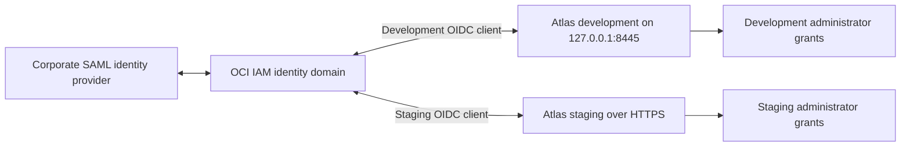

# 26: Atlas administrator sign-in through OCI IAM federation

Proposed · 24 November 2026 · Cloud registration and implementation require design approval.

[Administrator grants and recovery](19-administrator-provisioning.md) ·
[Implemented authentication boundary](../reference/authentication.md) ·
[Environment isolation](24-environments-and-promotion.md)

## Recommendation

Use the hosting tenancy's OCI IAM identity domain as Atlas's OpenID Connect (OIDC) provider.
OCI IAM brokers authentication to the existing corporate SAML identity provider. Each Atlas
installation uses its own confidential OIDC client. Atlas owns the Administrator grant in each
installation's database. OCI tenancy roles, application assignment, and a successful SSO login
do not create Atlas grants.

Start implementation and the first live SSO pilot on the existing [OCI-connected laptop
development environment](../how-to/laptop-oci-development.md) at `https://127.0.0.1:8445`.
Use a development-only OIDC client and development secret custody. Qualify the flow there before
bringing it to hosted staging. Keep the saved review instance on port 8443 on its existing
configuration.

| Boundary | Laptop development | Hosted staging |
| --- | --- | --- |
| Redirect | Candidate `https://127.0.0.1:8445/api/auth/sso/callback`, exact registration and desktop HTTPS trust to be qualified | Exact callback on the registered staging HTTPS origin |
| OIDC and custody | Development client and secret, read from development custody by the approved laptop identity | Staging client and secret, read only by the staging API workload from staging custody |
| Eligibility | App-only group such as `otm-development-users` | App-only group such as `otm-staging-users` |
| Atlas authority | Local database, workspace, grants, and host-only cookies | Separate staging database, workspace, grants, and host-only cookies |

Enable **Enforce grants as authorization** on each confidential app. Assign only its dedicated
group, identify the app and group by their immutable IDs, and check for broad or direct grants
that would bypass the group. These groups carry only Atlas app assignment. OCI resource policies,
identity-domain admin roles, and Vault/OKE permissions remain independent. A new user can have
a domain account and authenticate with Oracle SSO without receiving OCI resource permissions.
An existing user's separately granted OCI access is preserved. Review tenancy and compartment
policies, including inherited and `any-user` or `any-group` grants, automatic groups such as
All Domain Users, app roles and managed federation mappings. Evaluate both a newly provisioned
user and the exact membership change for an existing user. If creating an account or adding the
Atlas group would grant OCI resource access, block the affected path pending an approved IAM
correction. Preserve separately granted access. Confirm the resulting effective policy with a
newly provisioned test user.
[Managing Identity Domains groups](https://docs.oracle.com/en-us/iaas/Content/Identity/groups/managinggroups.htm)

The Atlas HTTP sign-in path needs no OCI directory reader credential. An environment-specific provisioning
identity handles approved changes through a server-side Identity Domains SDK adapter. Qualify
permission to look up the target account, create a federated account when missing, and update
membership in exactly its configured Atlas group. Keep hosted authorization separate from browser OIDC and scope it to the OKE workload's
cluster, namespace and service account. Pilot permissions on the isolated development laptop
using a dedicated identity and its named OCI profile before translating them to hosted policy.
The hosted runtime identity must be denied writes to another environment's group, privileged groups,
existing user settings and credentials, app registrations, federation, and policies. Oracle
documents `CreateUser`, `AddUserToGroup` and `RemoveUserFromGroup`, but API availability
does not establish that
the needed narrow authorization is available. If safe membership-only delegation is available,
automate grants for already provisioned users. For missing users, use an approved corporate
provisioning integration if narrow create authority cannot be demonstrated in the shared domain.
Keep any unsupported write disabled and surface the provisioning blocker. Do not grant Atlas
domain-wide administrator access to work around it.
[Identity Domains user API roles](https://docs.oracle.com/en/cloud/paas/iam-domains-rest-api/api-identity-users.html) ·
[Native group membership API permissions](https://docs.oracle.com/en-us/iaas/Content/Identity/policyreference/iampolicyreference.htm#permissions-required-for-each-api-operation)

A compartment scopes OCI resources and custody. Sharing an identity domain still shares user
objects, upstream sign-in and the domain administration boundary. Both environments can have
different administrators. A domain-level disable, outage, or federation change can affect both.

**Capacity prerequisite.** Oracle publishes Free-domain limits of two non-Oracle apps and five
policies of each of the identity-provider and sign-on types. An existing workload client may
consume an app slot. Confirm effective headroom and feature eligibility, for the registrations and app policies. The Atlas apps can share an Atlas-only IdP policy and maintain
independent app assignments. If only one browser registration fits, pilot laptop development first
and use local recovery in staging
until an operator approves additional capacity in the same domain. Reuse the existing federation
and preserve the workload client. Keep distinct audiences and credentials. [OCI IAM domain types and limits](https://docs.oracle.com/en-us/iaas/Content/Identity/sku/overview.htm) · [Changing a domain's type](https://docs.oracle.com/en-us/iaas/Content/Identity/domains/to-change-identity-domain-type.htm)

## Add and manage an administrator

### Enrollment fields

The administrator enters a corporate work email. Atlas preserves the spelling after trimming
surrounding whitespace and looks up the exact OCI `userName` in the configured identity domain.
The email is the proposed federated login. The approved Oracle SAML provider must resolve that
same identifier before an Atlas session can be issued. No separate corporate directory or
organization feed participates in this flow.

| Field | Requirement and use |
| --- | --- |
| Work email | Required. Used as the exact OCI login and, for a new account, its primary work contact. Show the complete address for confirmation. |
| Display name | Show the existing OCI display name if present and fall back to the email. Preserve the existing profile. |
| First and last name | Require both only when the exact login is absent. Use them as the OCI given and family names and combine them for the new display name. The email remains the federation login. |
| Environment and role | Show the running environment and fixed **Administrator** role. The server selects the configured domain, app and group IDs. |
| Identity IDs | Server-only. Bind the confirmation to the entered email and exact matching OCI account if present. Store the confirmed OCI domain GUID on the Atlas grant. |

Check the full address before confirming. A typo that matches a different real employee can
grant access to that person. Oracle SSO provides identity proof during sign-in. Apply the
corporate address reassignment and retirement procedure to revoke stale grants before reuse.
[OCI user-create schema](https://docs.oracle.com/en/cloud/paas/iam-domains-rest-api/op-admin-v1-users-post.html)

### Organization feed independence

A person can be an Atlas administrator whether or not they appear in the organization feed.
Corporate SSO establishes identity, and the environment's Atlas grant authorizes administration.
Someone can hold that grant and also have an employee record. The records have independent
lifecycles. Feed additions, absences, offboarding, returns, merges and email changes leave the
administrator grant and its identity binding intact. Removing Atlas access leaves the employee
record and its tenancy associations intact. Corporate account disablement, loss of app
eligibility and explicit Atlas revocation still deny administrator access.

### Add flow

1. The operator registers the environment's OIDC client, app-only group and delegated service
   identity once. Routine additions and removals are initiated in Atlas. Keep the existing
   upstream SAML federation and OCI Console policy. Just-in-time provisioning remains disabled.
2. An existing Atlas administrator chooses **Application Settings → Administrators → Add
   administrator**. Look up the email as an exact OCI login. Show the email, environment and
   whether Atlas will reuse or create the federated account. Confirm through the authenticated,
   CSRF-protected API. For an active exact match, reuse its GUID and preserve its existing sign-in options. An
   existing OCI account can support both native credentials and Oracle SSO. Atlas only
   accepts a corporate-federated session. Reject ambiguous, disabled, deleting and differently
   spelled matches. With creation enabled, an absent
   login can be created with the submitted first and last name as a federated account with notification bypass and no local password,
   API credentials, roles or explicit group memberships. Use the same provider retry key for
   the same domain and payload. Match the exact returned domain, email login and GUID before
   assigning membership. An ambiguous create or conflict can be resolved only with a successful
   exact OCI readback. An unresolved write stays fenced across restarts on the laptop.
3. Atlas adds the exact GUID to the environment's app-only group and reads back membership.
   The laptop requires separate operator evidence of the effective group-to-app assignment before
   allowing enrollment. Then, in a single database transaction, recheck the actor's current
   grant and revision, serialize grant changes using the protected recovery row, write the local
   administrator grant and append the audit event. The OCI operation and database transaction
   can fail independently. If the group update times out, read back exact membership before
   retrying. If local grant creation fails, report incomplete onboarding and reconcile group
   membership without granting access. An app assignment by itself leaves Atlas access denied.
   Retries must reuse the verified GUID and avoid duplicating accounts, memberships or grants.
   Recheck the initiating admin's current authorization and revision before accepting intent
   and immediately before every create or membership write for add/regrant. Serialize execution
   for the same identity and environment and recheck the latest approved intent before retries
   and the final transaction. Use existing admission, audit and retry mechanisms where suitable.
4. The new administrator uses **Sign in with Corporate SSO** on that Atlas instance. There is no
   Atlas password for a corporate administrator. With SSO unavailable, the protected local
   recovery administrator can still sign in with password and TOTP and revoke Atlas grants.
   Add/regrant needs an exact live identity-domain lookup. Keep the existing protected reset procedure.

### Remove administrator access

1. On **Application Settings → Administrators**, choose **Remove Atlas access** for an ordinary
   administrator. Show the name, work email or username, and target environment. Require explicit
   confirmation that the person's Atlas sessions will end there and their OCI account and other
   access will be kept. The protected local recovery administrator has no removal action.
2. Use the existing revoke contract with a CSRF-protected request and the displayed grant revision.
   Recheck actor authorization, target workspace, identity kind, and expected revision in the
   transaction. Atomically mark the grant revoked, rotate its revision, invalidate its sessions,
   and record the audit event. The committed revoke ends Atlas access immediately.
   During an identity-provider outage, the protected local recovery administrator can
   revoke access while the Atlas database and independent MFA custody are available.
3. Remove the exact OCI user GUID from the configured app-only group for that environment. The
   adapter exposes only a member-level update for this step. Preserve the domain user, their
   credentials, every other group member, and every other membership, including the tenancy
   `Administrators` group and the other Atlas environment. Apply the same rule when Atlas created
   the user or the user belongs to no other group. A missing membership is already clean.
   Read back the exact membership after uncertain writes. Show **Access revoked** and a separate
   cleanup status when OCI removal needs a retry. Fence each retry against the latest requested
   state. A database revision cannot fence a request that is still in flight at OCI. The adapter
   must settle ambiguous cleanup before a regrant can update membership, and use a strict total
   deadline for provider calls that hold an administration lock. Regrant requires restoring eligibility
   for the same verified identity
   and issuing a fresh Atlas grant revision.

Reuse `otm_administrator`, `otm_admin_session`, and `audit_event`. Use the verified immutable
OCI domain user ID as the internal corporate subject, with a configured namespace unique to the
identity domain and the existing workspace scope. Validate the provider's actual OIDC `iss`
separately from that internal namespace. Oracle documents that its default wire issuer can be
shared across domains and that its login-ID `sub` and GUID `user_id` are separate. Before enabling
enrollment, prove that the signed stable user claim matches the SCIM user ID, survives a username
change, and changes on deletion/recreation. Do not bind by email or login ID or accept an arbitrary
subject from the browser. If the stable mapping is unavailable, keep corporate enrollment disabled
until a supported claim or mapping is qualified. [Oracle issuer settings](https://docs.oracle.com/en-us/iaas/Content/Identity/oauth/update-oauth-settings.htm) · [Oracle ID token claims](https://docs.oracle.com/en/cloud/paas/identity-cloud/idcsa/IdentityToken.html) · [OCI domain user schema](https://docs.oracle.com/en/cloud/paas/iam-domains-rest-api/op-admin-v1-users-id-get.html)

## Protocol, session and offboarding

- Compose corporate sign-in alongside the existing local routes. Use a maintained OIDC library
  on the backend and Authorization Code with S256 PKCE. Register only exact HTTPS callbacks.
  Start login with expiring, single-use state, a nonce and a PKCE verifier bound to the browser,
  client and installation. Use shared short-lived storage for staged replicas and reuse an
  existing suitable store if available. Do not keep upstream tokens in Atlas session storage.
- Replace the verifier's single trusted issuer with explicit dispatch for the local and
  corporate namespaces. Verify the matching grant kind. The local route uses the existing
  database grant and independent MFA custody. Load corporate discovery and the client secret
  only on the corporate sign-in path so local
  sign-in and logout still work after a cold restart during a corporate provider outage.
- Pin the configured domain-specific discovery, token exchange and signing-key endpoints, the
  actual wire issuer and the exact client audience. Oracle may also list its issuer as an audience.
  Accept the client alone or a two-item audience containing the client and exact pinned wire
  issuer in either order. Verify signature, algorithm, issuer, audience, expiry, nonce and stable
  subject mapping, and require a supplied authorized-party value to equal the configured client. Verify that a
  staged callback reaches either API replica safely. Issue the existing opaque Atlas session
  cookie only after signed group membership, exact workspace grant and successful session
  and audit commit. Do not put credentials, claims, tokens, state, verifiers or callback query
  strings in access logs, browser analytics or audit payloads.
- Give both clients an explicit IdP policy selecting only corporate SAML. Attach an Atlas-only
  sign-on policy that allows the configured authenticating IdP and denies all other matches.
  Keep the OCI Console policy separate. Prove that fresh native-domain password login and reuse
  of a pre-existing native-password domain session cannot satisfy Atlas SSO. Qualify the policy,
  any signed provider provenance and effective corporate MFA assurance. Keep Atlas SSO disabled
  if the provider restriction cannot be demonstrated. [Oracle Authorization Code flow](https://docs.oracle.com/en-us/iaas/Content/Identity/api-getstarted/AuthCodeGT.htm) · [App-specific IdP selection](https://docs.oracle.com/en-us/iaas/Content/Identity/idppolicies/add-apps-idp-policy.htm) · [OCI sign-on rules](https://docs.oracle.com/en-us/iaas/Content/Identity/signonpolicies/add-more-rules-policy.htm) · [Confidential app authorization](https://docs.oracle.com/en-us/iaas/Content/Identity/applications/add-confidential-application.htm)
- Request `openid get_groups` and require an entry whose signed `groups[].id` equals the
  installation's immutable OCI group GUID. Keep OCI app-grant enforcement enabled. A missing
  or non-array claim, or an array without the exact signed ID, denies session issuance. A dual-mode OCI account
  qualifies through the exact signed corporate IdP and immutable user ID. A native-password
  session by itself does not supply that proof.
- Keep existing idle and absolute timeouts. Check OCI membership only when starting a new
  Atlas session. An OCI-only group removal takes effect at the next sign-in. Atlas continues to
  check its own active grant and revision for each request. Atlas grant revocation invalidates
  existing sessions immediately, including when OCI is unavailable. Use Atlas revocation for
  offboarding that must take effect immediately. Atlas logout ends the Atlas session independently
  of upstream logout. Do not store upstream tokens or signed group lists in Atlas.
- Register the corporate namespace for human-authorized worker dispatch alongside the local
  namespace. Recheck the current Atlas grant wherever dispatch already rechecks the actor.
  Preserve accepted system-owned cleanup. Workers have no browser OIDC client secrets.

## Development Terraform ownership

The target is Terraform ownership of all OTM-created infrastructure. The existing upstream corporate identity
federation is an external dependency. Reference its existing binding without taking ownership
of the corporate federation. During migration, development bootstrap verifies the existing GitHub exchange client by immutable GUID. The released provider cannot safely import that confidential client, so it remains reference-only pending qualified adoption or an approved cutover.

| Terraform owner | Scope |
| --- | --- |
| Local operator bootstrap | Development compartment, state bucket, GitHub token-exchange client and trust configuration, scoped IAM, and the shared non-production domain signing-key setting. Reconcile the existing development laptop enrollment IAM in its owning state. |
| Development infrastructure GitHub Actions workflow | One development root and state for the Vault and software key, Atlas OIDC app, app-only assignment group, group-to-app grants, app-specific identity-provider and sign-on policies and their rules. |
| Atlas runtime | Administrator grants in PostgreSQL and individual membership in the Terraform-owned app-only group. |

Keep the post-bootstrap root at `infra/environments/development/infrastructure` and its existing
`custody/development/terraform.tfstate` key. Adopt existing OTM groups, app grants and policies
by immutable ID after qualifying their provider import and refresh behavior. Preserve the group
and its members, existing app assignments, Atlas grants, and the client currently serving
8445 throughout qualification. Terraform manages group configuration and group-to-app grants.
Atlas add, remove and regrant operations remain the normal path for individual membership changes.

The current source manages the state bucket and scoped IAM in bootstrap, and the Vault and
software key in the development root. Candidate development source also declares the group,
inactive client, group assignment, app-specific policies and rules, using the existing corporate
IdP reference. Bootstrap declares the compartment, GitHub trust resources and domain setting.
Adoption and the required live permission and trust checks remain pending. Verify that existing
resources can be reconciled without replacement,
disassociation, credential persistence, or membership changes. The prior limited app-and-assignment
plan is superseded. Adopt the [common environment layout](24-environments-and-promotion.md#terraform-layout-for-each-environment)
without migrating the existing development state key.

An inactive replacement client remains a candidate when provider import would expose the original
client credentials. Qualify the replacement with the locked provider and the complete ownership
plan. Activation, private runtime credential handoff, and retirement remain independently
reviewed steps. Follow the [development runbook](../how-to/laptop-oci-development.md#development-infrastructure-through-github-actions).

## Terraform ownership for signing keys

Development and staging share one non-production identity domain. Assign its existing shared
Settings singleton to the operator bootstrap as the single owner. Production uses its own
domain and bootstrap owner. The environment builds reference the shared setting and own their
respective clients, groups, grants and callbacks.

Use OCI integrated application display names `otm-sso-development`,
`otm-sso-staging`, and `otm-sso-production`. The shared description is
“Corporate single sign-on for OCI Tenancy Manager.” Use app-only assignment groups
`otm-development-users`, `otm-staging-users`, and `otm-production-users` with the shared
description “Users assigned to corporate sign-in for OCI Tenancy Manager.” Use the Terraform
[application registration module](../../infra/modules/application-registration/main.tf)
for both sets of metadata. Bind app assignments and runtime checks to the group's immutable ID
so changing a display name cannot change membership or authorization.
A display name or description change must preserve the generated OAuth client ID and existing
bindings. OCI default app reads can return the active client secret. Before adopting the
`oci_identity_domains_app` resource, prove that ordinary reads, imports and plans exclude client
credentials with the locked provider.

Import each existing Settings object into the domain owner's `oci_identity_domains_setting`
resource and set `signing_cert_public_access = true`. Adoption of the qualified non-prod setting
must show no remote changes. For production, review the plan against the current setting and
approve any change before applying it. Check for replacement and unrelated domain-setting changes.
After adoption or a change, verify that each configured discovery document points to its own
domain's JWKS endpoint and that an unauthenticated HTTPS request retrieves the public signing keys.

This setting also makes SAML federation metadata readable without authentication. Clients still
verify signatures and the exact installation authorization. Disabling public access blocks
unauthenticated key retrieval for both development and staging at once. The development test
confirmed that an OCI API-key-signed request can fetch the same verification keys with the setting
disabled. That tested operator credential is outside the Atlas runtime. Leave public access
enabled under this design.
[OCI domain setting](https://docs.oracle.com/en-us/iaas/Content/Identity/defaultsettings/set-access-signing-certificate.htm) · [Terraform provider Settings resource](https://docs.oracle.com/en-us/iaas/tools/terraform-provider-oci/latest/docs/r/identity_domains_setting.html)

## Local milestone and hosted handoff

The local milestone covers the OCI-connected laptop on port 8445. Continue developing the
remaining OCI provider features there before starting the hosted SSO milestone. The laptop uses
its existing development client and dedicated local enrollment profile. The saved 8443 review
instance and hosted sign-in composition stay on their existing authentication paths.

The [manual acceptance record](../how-to/real-oci-test-manifest.md#atlas-administrator-sso-and-onboarding)
records the operator's local smoke test and the cases deferred to staging. In particular, a
second, newly created federated user has not been verified signing in or having no OCI resource
access. Qualify that path in staging with a consenting test identity and independent recovery.

The hosted milestone retains the separate client, group and grants per environment, environment
Vault secret retrieval and rotation, OKE Workload Identity and operation-level qualification,
cross-replica callback handling, and Terraform adoption of the staging and production
identity-domain resources. [Development adoption](#development-terraform-ownership) extends the
single development build independently of hosted rollout.
Development and staging share the non-production domain setting. Keep hosted corporate sign-in
and enrollment disabled until staging qualification and the relevant approvals are complete.

## Implementation and acceptance

1. Qualify domain capacity, registration, the exact port 8445 callback and trusted certificate,
   staging origin, actual issuer/key/claims, Oracle-only sign-in, assignment enforcement and the
   least-privilege identity-domain lookup, provisioning and secret-read paths. Verify exact username lookup, fetch by GUID,
   account status and effective entitlement to the precise active app and group. Test group
   detachment, app disable and membership removal, as well as provider authorization failure,
   throttling and timeout. Register only after approval. Begin with a
   deliberately selected federated pilot user and leave console and workload federation intact.
2. Implement the server-owned identity lookup and corporate grant, revoke and regrant transactions,
   then compose signed group checks and Atlas grant checks with existing HTTP/session boundaries. Add the confirmation UI
   and the separate sign-in methods. Keep both features disabled for an installation without
   qualified configuration. Cover new configuration fields under the existing documentation rule.
3. Qualify with synthetic unit/contract tests, disposable PostgreSQL and Playwright, then run live
   development and staging pilots. Prove development-only versus staging-only access, wrong
   client/issuer/domain, replay/wrong state, local-domain password denial, rename/recreate, exact
   assignment removal, grant/revoke/regrant races, audit rollback, provider outage, and local
   recovery use from a cold restart with database and independent MFA custody available.
   Test a new Atlas-only user signing into the OCI Console and being denied OCI resource access.
   Verify that adding an existing OCI user preserves their separately granted access. Exercise
   partial OCI writes, retries, revoke/regrant ordering, and cross-environment and privileged
   group denial under the actual provisioning signer. Submit
   a human-authorized operation as a corporate admin and verify worker acceptance and the
   dispatch behavior after revocation. In staging also verify cross-replica callback and secret rotation without changing
   client identity. Test SAML identity disable through Atlas access denial and record observed
   propagation. Only promote the feature once these negative cases are verified.

### Required unit tests

Use synthetic identities and fake provider and transaction boundaries. Assert
both returned state and the exact writes or absence of writes. Cover backend services and
the frontend enrollment, removal and retry states under the existing unit coverage gates.

| Scenario | Required assertions |
| --- | --- |
| Enrollment fields | An exact email selects one matching active domain account or the new-account path. Invalid email, ambiguous results and changed confirmation data cause no write. New accounts require both names. Existing accounts reject submitted names. The API cannot override the server-selected domain, group or role. |
| Existing tenancy admin | Reuse the verified OCI GUID. Add one member to the selected Atlas group and create one Atlas grant. OCI account fields, tenancy admin membership and all unrelated permissions inputs stay unchanged. |
| Organization feed independence | Grant access to an eligible corporate identity absent from the feed and to one that also has an employee record. Feed addition, absence, offboarding, return, merge or email change leaves the grant and its corporate identity binding unchanged. Atlas revocation leaves the employee record and tenancy associations intact. A matching feed record alone authorizes no administrator access. |
| New Atlas-only admin | Verify the exact federated-user payload and server-selected group. No OCI admin role, unrelated membership or local credentials are granted. A timeout or create conflict resumes only after exact identity verification. |
| Remove existing tenancy admin | Commit revocation and session invalidation before provider cleanup. Assert exactly one membership removal by user GUID and configured group ID. Preserve the OCI account, tenancy admin membership, the other Atlas environment and other members of the selected group. |
| Remove Atlas-created or final-member user | Preserve the domain account even when the Atlas assignment was their only explicit membership or they were the group's final member. Treat an absent target membership as clean. Assert there is no user-delete, user-disable or group-delete call. |
| Authorization and concurrent changes | Reject unauthorized, protected recovery, cross-environment, stale-revision and invalid CSRF requests with no writes. Verify duplicate submissions, revocation during retry and regrant racing with cleanup. Older intents must preserve newer decisions, and regrant must not revive old sessions. |
| Failure and UI feedback | A failed removal transaction or audit rolls back local changes and makes no OCI call. OCI cleanup failure leaves Atlas access revoked and reports cleanup pending. Verify exact confirmation details, cancel with zero mutation requests, and independent retry feedback. |

Unit tests verify Atlas's commands and state changes. Disposable PostgreSQL must also prove
transactional revocation and session fencing, and Playwright must cover the confirmation flow.
Live OCI qualification must prove that the constrained signer can remove only the intended
membership and that the expected tenancy access is preserved.
