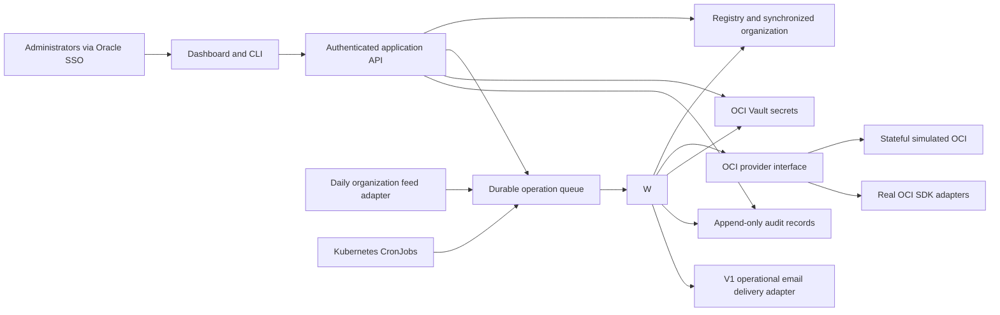

# OCI Tenancy Manager

Consolidated design review candidate | 28 October 2026 | Historical engineering intake v0.4 dated 12 October retained

Current association/offboarding design addendum adopted 19 October 2026; historical decisions are retained below.

## Selected visual direction — D57

28 October 2026. The user selected **original A / Field Console (left)** after the A/A2 comparison.
[DESIGN.md](../../DESIGN.md) defines navy navigation, cobalt actions, cool light surfaces, crisp
3px corners and technical typography. The rounded variant is not selected. Approved workflows,
fields, accessibility and security remain binding; whole-package approval remains separate.

## Application administrator provisioning — D58

29 October 2026. OTM manages its own administrator grants. The initial administrator is a local,
non-SSO application recovery account, implemented first for testing and retained for corporate SSO
outages. Ordinary administrators use corporate SSO when it is added. Provide restricted operator
bootstrap plus administrator-management UI/services, current authorization, session revocation and
immutable audit. This is distinct from child-tenancy break glass. Application recovery requires a strong password plus MFA independent of corporate SSO;
[chapter19](../engineering-design/19-administrator-provisioning.md) records the scope and open decision.

### Configurable application sessions

Accepted 29 October 2026: initial 30-minute idle and eight-hour absolute limits, configurable through
[the versioned application settings file](../../backend/config/application.toml). Pin issued policy into
each session; polling cannot refresh idle time. Logout invalidates the session immediately and clears
its secure cookie. Daily bounded cleanup removes expired/revoked operational session rows without
erasing audit or administrator identity. Enforcement never waits for housekeeping. Runtime policy,
manual cleanup and the daily UTC CronJob renderer are [documented here](../reference/application-settings.md);
local installation is now [documented here](../reference/local-application.md), while production
issuance/deployment remain separate work. Credentials do not belong in this file.

## Approval and engineering status

The design targets an administrator-operated application for approximately 250 engineering tenancies
under one OCI organization parent. Individual child tenancies provide the normal isolation boundary,
with centralized ownership, organizational accountability, required access, managed configuration,
cost visibility and lifecycle operations.

This document records product requirements and engineering decisions, including capabilities not yet
implemented or qualified against real OCI. Current implementation is described by the reference guides
and executable tests. Source checkpoints were authorized on 5 November 2026 after publication review;
that authorization does not authorize production deployment or live tenancy mutations. Feasibility
questions in section 12 must be resolved before affected real-OCI behavior is considered validated.

Revision note: the September 22 review supersedes the earlier requirement to approve every organization-feed change. Valid employee metadata changes now apply automatically with audit. Absence raises an ownership exception; tenancy deletion still requires explicit administrator initiation and confirmation. The later-release ideas in section 2 do not expand the MVP.

The September 23 revision adds the seven-field organizational feed contract, full-name handling, reference-only manager records, separate source territory and configured LOB fields, and explicit completeness checks. A complete feed is expected to include an employee row for every person, including managers. Missing profiles must be represented explicitly and cannot silently qualify absence conclusions. See the [generic feed contract](../../prototype/docs/organizational-feed-contract.md).

The October 12 revision supersedes the earlier V1/V2 boundary. Security auditing and security-findings workflows move to V2; administrative action history stays in V1. V1 adds configurable managed policies, quotas and budgets with verification, monthly spend/forecast visibility, and a stateful simulated OCI provider. Daily organization synchronization uses a canonical internal contract while the production feed remains TBD. The agreed stack and milestone review intake are in the [engineering review plan](../decisions/engineering-review-decisions.md).

### Current human-access scope — D40, 24 October 2026

V1 has one human administrator-access flow using the persistent local recovery account and its
unique per-tenancy Vault password. D39 exempts only that exact recovery identity from MFA;
owner/member humans retain MFA and OTM administrators retain corporate SSO. Each authorized retrieval
is audited/notified. The first authorized disclosure attempt starts the shared four-hour rotation
window, including lost responses; repeat retrievals cannot extend it. Unknown child/Vault state
blocks release. Independent manual recovery is required when automation or OTM cannot operate.
Temporary named support provisioning/enrollment/cleanup is deferred to V2, superseding the V1
named path in D19/D37. Rotation is not hard logout or exact attribution of shared-account actions.

### Adopted association/offboarding model — 19 October 2026

The user approved the association-aware model, now implemented and tested in the local prototype.
The current model below
supersedes earlier descriptions that treated tenancy deletion and person cleanup as unrelated
Resolve/Remove actions. It does not silently qualify the prototype as production or change the
requirement for administrator-initiated OCI mutations. See the [current association contract and
walkthrough](../../prototype/docs/tenancy-associations.md), [ten-table ER model and descriptions](../../prototype/docs/organization-er-diagram.md)
and [detailed organization design](../../prototype/docs/organization-detailed-design.md#adopted-current-model--19-october-2026).

### Later adopted UI/return refinement — 19 October 2026

The automatic qualified-return rule in section 6.4 supersedes the earlier manual-return-only rule
for completed zero-association offboarding. No-tenancy exemptions and retained associations keep
their distinct explicit-return behavior. UI action dialogs no longer require free-text Reason;
the server records factual descriptions with actor/action/context/outcome. API/CLI reasons remain
optional. Tenancies is the first navigation destination with inventory-specific summary counts;
its people count includes the owner. These refinements add no physical table or autonomous OCI
mutation and do not weaken confirmation, authorization or audit requirements.

## 1. Problem and intended outcome

Today, administrators manually create child tenancies, complete activation and internal approvals, add users and policies, and clean up tenancies. There is no reliable maintained mapping between each tenancy, its accountable employee, that employee's management chain, and the designees responsible for security follow-up. Required administrative access can be missing or removed without timely detection.

The organization needs to demonstrate governance outcomes independently of physical tenancy consolidation. The proposed application maintains a flat parent/child structure and overlays the current synchronized management hierarchy. A reorganization changes accountability records and notification routing; it does not by itself require moving workloads or changing OCI organization membership.

The management case depends on measurable controls, not on tenancy count alone. Separate tenancies provide distinct identity and policy boundaries, while creating management overhead. The application is intended to reduce that overhead. Consolidating tenancies does not by itself remediate resource misconfigurations; neither unchanged finding counts nor automatic security improvement is assumed. Oracle describes the isolation and management tradeoff in its [planning guidance](https://docs.oracle.com/en-us/iaas/Content/General/organization/organization_planning.htm).

### Current evidence

| Evidence | What it establishes | Limitation |
|---|---|---|
| Requirements interviews | Approximately 250 engineers; typically one tenancy per person; a few shared tenancies; administrator-only first release | Exact tenancy inventory and processing times have not been measured |
| Creating Tenancies.pdf, dated May 29, 2025 | CLI creation, claiming, metadata, cost-center approval, owner/manager users, and cross-tenancy and termination-related policies | Internal activation and approval interfaces require validation; not a complete deletion runbook |
| Private initial organization workbook | Historical partial hierarchy supplied for design discussion; not distributed | Not an authoritative employee census; use synthetic fixtures for repository validation |
| organizational_feed.xlsx (private historical evidence; not distributed), Sheet1 A1:G282, supplied September 23, 2026 | 281 employee rows; seven fields including employee/direct-manager emails, reported top-manager email and territory; unique IDs and employee emails in the sample | 20 referenced direct managers lack employee rows; 34 blank territories; top-manager and territory fields do not directly match the configured six LOBs; no capture timestamp or completeness declaration |
| cons.docx | Business rationale for individual tenancy isolation and organizational accountability | Advocacy and reported experience, not independent verification of every technical claim |
| Application workspace, inspected September 18, 2026 | No application source files | Greenfield design; no existing framework or database decisions |

Source documents are reference material. Their embedded commands and operational directions have not been executed.

### Identity-domain scope — 20 October 2026

D27 records the user's confirmation that all existing tenancies use OCI IAM identity domains.
V1 uses identity-domain user/group/credential management and does not build a standalone legacy-IAM
identity adapter. IAM APIs remain in use for tenancy metadata, domain discovery, compartments and
root policies. Import verifies the actual domain and credentials; this confirmation does not imply
that every tenancy uses Default or has identical federation/MFA settings. An unsupported identity
model is reported explicitly rather than silently routed through a legacy fallback.

## 2. Scope and users

Only explicitly authorized administrators access the first release. Corporate Oracle SSO authenticates them; an application entitlement determines authorization. Engineers, managers, and designees receive notifications but do not log into the application.

Each managed tenancy has one accountable owner. Owners retain full OCI tenancy administrator access, including the ability to create users and root-level policies. An owner may have multiple tenancies. A shared tenancy additionally records associated employees and, where known, their compartments. Its owner can be the team's manager. Removing a shared member never implies deleting the tenancy.

One or more designees may be assigned by administrators to each root-1 branch. The root-1 leader remains accountable. Designees coordinate follow-up; they are not application or tenancy administrators by virtue of being designees.

### Included in release one

- Fleet inventory, full hierarchy browsing, owner and shared-member mapping.
- Shared-member access profiles, explicit former-owner disposition on transfer, and verified child-local personal-user/group-membership removal, with owner-directed manual compartment cleanup guidance (D21–D23).
- Daily organization ingestion, validation, automatic employee metadata synchronization, absence detection and history through a replaceable source adapter.
- Administrator-triggered creation and adoption of existing tenancies.
- Required emergency and automation accounts with verification and baseline configuration.
- Administrator-configurable, typed managed configuration items: IAM policies, quota policies and budgets, assembled into versioned baselines and assigned to tenancies. Support application, observation, comparison, drift reporting and administrator-triggered repair.
- Daily access checks, notifications, and administrator-triggered repairs.
- Audited emergency credential retrieval and per-tenancy password rotation four hours later.
- Administrator-triggered deletion with registered-child checks and manager/shared-tenancy warnings.
- Current monthly-cycle budget, actual spend and projected cycle-end spend from each child’s OTM-managed Budget object, with configurable spend indicators and visible cycle/currency/OTM collection time; OCI computation time remains available in technical source detail and internal qualification (D41/D45).
- Indefinite, non-editable audit history and administrator export.
- Equivalent authorization and workflow behavior through UI, API, and CLI.
- A stateful simulated OCI provider for development without a test parent, using the same application-facing contracts as the real OCI provider.
- Reproducible OCI hosting infrastructure through Terraform, with declarative Kubernetes resources and repeatable application build/migration/deployment stages.

### Excluded or deferred

- Historical budget/cost reporting, prior-month selection, trends, historical backfill and parent Usage API financial reporting are post-V1 (D41). Retained collection/audit evidence does not imply a historical-reporting feature.

- Engineer self-service, designee application access, and periodic owner attestation.
- Temporary named-support account provisioning, enrollment and cleanup (D40); V1 human access uses the persistent recovery account.
- Security/governance auditing, the associated audit-user capability, and security findings import/routing/remediation workflows are V2. Existing external tooling covers the current security workflow. The tool's own administrative action history is required in V1.
- Automatic tenancy creation, access repair, or tenancy deletion based on feed events.
- Automatic transfer between OCI parents, workload migration, and cost-center remapping.
- Automated workload or compartment cleanup/deletion during shared-member removal, including empty compartments. D23 includes bound child-local personal-user and group-membership removal in V1; exact identity behavior still requires provider qualification and must not be inferred from simulated registry updates. Resource cleanup is manual tenancy-owner follow-up.
- Agent-assisted activation as a prerequisite. It is an optional research task; a manual activation pause is acceptable.

### V2 and later candidates

- Additional configuration categories and tag overrides/resource-retagging after the V1 root policy/quota/budget and OTM namespace/key/default handlers.
- Add richer security-finding workflows such as assignments, acknowledgment, due dates and remediation status.
- Verify coverage of expected nightly shutdown automation and flag missing coverage. Implementing shutdown schedules remains external or a separately designed later feature.

Root policy/quota/budget, OTM namespace/defined-tag/default configuration and cost visibility are V1 requirements. Other candidates remain future work; no claim is made that every control is inherited automatically by children.

## 3. Proposed application architecture

The application runs in OCI. At this scale, one modular application service and a durable background worker are sufficient architectural building blocks. The stack direction below is accepted; exact versions, runner integration and deployment sizing remain engineering decisions.

The accepted stack direction is React/TypeScript with Vite, Tailwind/shadcn UI components and TanStack Query/Table; Python/FastAPI/Pydantic with SQLAlchemy, psycopg and Alembic; OCI Database with PostgreSQL for production; OKE and Terraform. API and Python worker are separate deployments from one modular backend. Kubernetes CronJobs trigger recurring work; Procrastinate dispatches PostgreSQL-backed durable individual tasks, selected in engineering decision D2. Adoption requires a prototype of the exact database integration, duplicate dispatch and worker-crash recovery; selection is not evidence of successful qualification. Local/CI disposable PostgreSQL supports development before OCI access; managed-service compatibility is qualified separately.



The registry stores ownership and workflow state. OCI remains authoritative for actual tenancy membership, lifecycle, accounts, and policies. Successfully validated and applied organization relationships are the application authority for routing and hierarchy views. Valid metadata changes apply automatically. Structurally invalid or stale snapshots preserve trusted state. A structurally valid partial feed can supply explicit metadata and relationships while unresolved ancestry remains visible; it cannot establish absences or fabricate missing links. Absence processing requires a complete authoritative snapshot for the same declared population.

Jobs persist their progress, including OCI work-request identifiers and manual prerequisites. Browser closure, process restart, or API timeout must not lose an operation. Retrying the same request must resume or return the existing operation rather than duplicate a tenancy or account.

Application operation records remain authoritative for workflow stages and verified outcomes; a finished queue job alone does not establish completed OCI work. Manual activation waits release the worker and persist the prerequisite. Procrastinate recovery of stalled jobs must be configured and tested, alongside graceful shutdown and abrupt termination. D3 selects one PostgreSQL transaction for operation intent, initial audit and job insertion. D4 selects mutation coordination per tenancy; the exact recovery implementation still requires qualification in the [engineering review plan](../decisions/engineering-review-decisions.md).

Engineering decision D10: simulated and real providers return common typed application observations and mutation outcomes. Real adapters contain OCI SDK model/exception interpretation; workflows use the application contract. Distinguish confirmed presence/absence from unable-to-verify, and accepted/pending requests from verified completion, known failure and unknown outcome. Retain target/access context, observation coverage/time, application correlation, known OCI identifiers and safe diagnostic codes; exclude secret-bearing payloads. An ambiguous NotAuthorizedOrNotFound response or incomplete inspection cannot prove a managed object is missing. Unknown writes require reconciliation before retry; qualify SDK retry/idempotency behavior per operation so generic retry settings cannot bypass the operation ledger. Shared simulator/adapter-fixture tests verify the contract, with real OCI qualification separately required.

Engineering decision D8: deploy the application into a dedicated compartment of a configurable hosting tenancy, which may or may not be the organization parent. Configure hosting tenancy/compartment and organization-parent OCIDs independently. Terraform/deployment configuration supports either placement without changes to business logic; the actual hosting tenancy remains an organizational deployment decision.

A narrowly authorized parent-side identity handles organization and financial operations where required. Parent authentication supports qualified OKE workload identity or a dedicated parent API identity whose private PEM is stored in Vault. Reuse the secure credential-resolution mechanism already required for child API keys, while keeping parent and per-child identities and permissions separate. Workload identity is not assumed to cover every service or cross-tenancy arrangement; validate supported calls for the eventual deployment.

Hosting-resource access, parent access and each child access context separately identify the target tenancy, region/endpoint, credential method and non-secret identity/secret references. Hosting access retrieves Vault secrets independently of parent API credentials, avoiding a circular bootstrap dependency. Do not infer the parent from the hosting tenancy, reuse a child's signer for parent calls or silently switch credentials after an authorization failure. Missing/revoked parent access blocks the affected operations with an explicit diagnostic; hosting or other child access may remain usable. Keys stay out of jobs, logs, exports and routine UI. Required permissions, key rotation, recovery and identity-domain administration must be validated for each operation.

The hosting tenancy, organization parent, and any control tenancy containing the application's data or secrets must be protected from application-driven deletion. Application deployment uses private data and secret access paths where available. Any OCI VM launched for this application must have IMDSv1 disabled.

Terraform owns the tool's hosting infrastructure. The application owns the child-tenancy objects it explicitly manages. Do not give Terraform and the runtime reconciler competing ownership of the same child policy, quota or budget. A managed item's owning tenancy and its target tenancy are distinct: future provider models may support parent-owned budgets, but D30 V1 requires the single OTM budget owned/targeted at the child root; do not silently substitute parent placement.

## 4. Information model

These are logical entities, not a finalized database schema.

| Entity | Required information and relationships |
|---|---|
| Person | Internal record ID; full source display name; optional preferred display name and first/last names; unique current email; optional source record ID; current manager; employee-row/reference/configuration provenance; last known managerial status |
| Person observation | Source snapshot and row; employee-row or reference-only evidence; last observed profile/reference times; reported top-manager email and nullable source territory |
| Reporting relationship | Person and direct manager; feed or administrator-supplemented provenance; effective history; complete/incomplete/conflicting ancestry status |
| LOB configuration | Stable internal LOB ID, display label, accountable leader, configured source mappings and history; separate from raw territory |
| Organization snapshot | Source identifier and schema version; capture and import timestamps; byte/content digests; declared population/root; completeness and manager-coverage status; normalized records and validation results |
| Applied organization revision | Successfully published snapshot/change set, starting organization/configuration revisions, publication time and coherent effective reporting/LOB/routing state; distinct from received or rejected snapshots |
| Organization change | Before/after values; affected people and derived tenancy views; source snapshot; application result, service or administrator actor, time, and explanation |
| Branch designee assignment | root-1 leader, one or more designee people, assignment history, administrator, validity/review state |
| Tenancy | Unique OCI tenancy OCID, observed name, home region, identity-domain identifiers, configured and observed parent, accountable owner through an active association, individual/shared designation, origin, lifecycle, management status |
| Tenancy association | Stable person ID, registered tenancy, owner/member role, active/retired state, optional compartment OCID associations and effective history; multiple associations per person |
| Required access | Account purpose, OCI user identifier, expected groups/roles/policies, required access-profile version, credential secret references, last verification and result |
| OCI access context | Hosting, organization-parent or specific-child purpose; target tenancy and region/endpoint; configured credential method; identity/secret references and verification result; no private key in the record |
| Managed configuration definition | Stable logical item ID, type, schema version, validated desired fields, schema-controlled overridable fields, owning/target scope and version history |
| Managed object binding | Managed item, owning and target scopes, actual OCI object OCID, creation/replacement history and applied/verified item version; dedicated object, distinct from unrelated owner configuration |
| Baseline version | Immutable complete root-policy/quota statement lists, root budget and OTM namespace/key/default intent in one lineage; publication history and current-for-new pointer; required-access profiles remain separate |
| Baseline assignment | Tenancy, pinned desired baseline version, full policy/quota-list and budget-amount override revision and resolved values/provenance, effective history; last fully verified version separately recorded |
| Baseline rollout | Immutable published version, administrator, previewed target set and resolved parameters, request identifier, start time and aggregate progress |
| Rollout target | Tenancy, expected prior assignment, requested assignment, operation correlation, per-item application/verification outcomes and retry/error state |
| Configuration observation | Managed item and tenancy, actual OCI identifiers, normalized observed fields, check time, result and drift differences |
| Cost observation | Child tenancy and bound budget OCID/generation, current budget cycle, qualified currency/profile, observed budget/actual/forecast amounts from one read, OCI computation time, OTM retrieval time and per-field availability/outcome |
| Budget association | Desired and observed budget, owning tenancy, target tenancy, amount/currency and monthly period; no OCI alert-rule provisioning in V1; tool-side spend indicators are separate |
| Operation | Type, target, requesting administrator, request identifier, confirmation/warning context where applicable, stage, timestamps, OCI request identifiers, retry and error information |
| Break-glass grant | Administrator, tenancy, reason, disclosed secret version, start time, four-hour deadline, notification records, rotation outcome and any separately qualified session observations |
| Drift item | Category, affected entity, observation, last known state, first/last detection, review and resolution history |
| Notification | Event or finding batch, resolved recipients and routing version, channel, delivery attempts, provider result |
| Security import (V2) | File fingerprint, validation results, tenancy/compartment references, finding text, batch grouping, preview and send history |
| Audit event | Actor, action, target, UTC timestamp, reason, before/after non-secret values, operation correlation, result |

Emails are the source matching key by user decision. Proposed normalization trims whitespace and uses case-insensitive comparison, without stripping aliases or guessing identity from names. A changed email is an administrator-reviewed identity reconciliation; it must not silently transfer ownership. Internal record IDs preserve history through applied metadata changes and explicit identity corrections. Routine changes to an unambiguously matched person need no approval; ambiguous identity reconciliation is a data-quality exception. Reuse of a previously departed person's email requires review.

The sample's `ID` is stored as a source-scoped string identifier. Its meaning and stability across exports/email changes are unconfirmed; it does not replace email matching or authorize an automatic identity merge. `ECA_NAME` provides a full name, not separate first and last names. Accept it directly and leave structured name parts unset rather than guessing how to split names.

Reconstruct arbitrary-depth hierarchy from `ECA_EMAIL` → `ECA_MANAGER_EMAIL`; the feed provides no full paths. root-1 identifies the first descendant below the configured root in a resolved chain. A configured LOB leader owns tenancies in their own LOB even when their own source top-manager field names the configured root. Membership at depth one does not automatically imply managerial status: direct-report IC and root-owned tenancy routing may require explicit administrator configuration.

Represent missing manager profiles as reference-only people keyed by email. Preserve reported names, known edges and last-known role; never invent their source ID or upstream manager. Enrich the same internal person when a full row arrives. These records expose sample/data-quality gaps and do not relax the intended complete production census. A person named as a direct manager is known to be managerial; no observed direct reports in an incomplete feed does not prove IC status.

Store `ECA_TOP_MGR_DIR_MINUS_3` and `ENG_TERRITORY` independently from derived ancestry and configured LOB. The sample contains 15 reported top managers, eight nonblank territory labels and 34 blank territories. Until mappings and field semantics are confirmed, preserve the requested LOB configuration and surface unresolved branches; do not silently remap designees or force all source classifications into the original six labels.

Tenancy OCIDs and compartment OCIDs are distinct typed identifiers. Shared members may have zero or multiple associated compartments; the application must not invent a compartment for a user whose resources occupy the whole tenancy.

### 4.1 Adopted tenancy associations and managed-directory scope

**Source/reporting organization** and **managed directory** are separate projections. Source
profiles, reporting relationships, applied/proposed versions and immutable feed history persist
independently of whether a person still needs to appear in the active tenancy-manager directory.
The directory contains baseline people awaiting classification, pending onboarding and people
with retained tenancy associations. A baseline/new employee starting with zero tracked associations
must not disappear without an explicit administrator decision.

A stable person UUID can have multiple associations: owner of one or more individual/shared
tenancies and member of one or more shared tenancies. Every active tenancy has an accountable
owner; unknown legacy ownership is exposed for repair rather than assigned to an invented person.
One active person/tenancy relationship and at most one active owner per tenancy are enforced.
Shared owners and members are distinct roles. Changes in the reporting chain update accountability
and routing; they do not silently transfer these ownership or membership relationships.

The working prototype now has **ten physical tables**: the eight organization/evidence tables
plus `org_tenancy` and `org_tenancy_association`. The [ER guide](../../prototype/docs/organization-er-diagram.md) describes
each table. These registry rows represent **simulated** tenancies; their UUIDs are not OCI OCIDs.
They establish and test the application relationship model, not OCI provisioning evidence or the
complete production schema. Production must add qualified operation/provider/authentication state
and migration design. The SQL source views remain source-oriented; the web registry/API supplies
live association counts and managed-directory filtering.

Managed-directory exclusions, explicit pending onboarding, retained outside-organization state
and registry initialization are recorded by stable person ID in versioned configuration in this
prototype. These decisions survive repeated feeds. Hiding a person does not remove manager edges
or make source/configuration warnings disappear. Person-level absence and LOB-mapping work is
suppressed for explicitly unmanaged profiles; leader/designee configuration and source validity
remain separately accountable.

### 4.2 Identity continuity

With no guaranteed employee ID in the current four-column CSV, normalized email remains the
matching key. A name-only change is routine metadata. A changed name and email may initially
produce an absent profile and a new profile; an administrator confirms a one-way identity merge.
The absent person's stable UUID survives and receives the new source metadata. All sole/shared
ownership and membership relationships persist, including relationships on the provisional new
identity that must be reconciled. Current email changes; original feed/revision/association and
audit evidence remain historical. No automatic name matching or silent identity reassignment is
permitted. Production OCI identity/access changes are separately verified operations.

The production [Organization integration guide](../reference/organization-screens.md) records the
30 October local directory/CSV/as-of/current-drift implementation and its tested boundaries. This
increment does not yet implement association-aware setup/closure, identity-merge commands or full
informational history; the requirements below remain the go-forward authority for that work.

## 5. Organization synchronization and accountability

The existing [sample feed contract](../../prototype/docs/organizational-feed-contract.md) supplies an initial XLSX adapter and validation fixture with `ID`, `ECA_NAME`, `ECA_EMAIL`, `ECA_MANAGER`, `ECA_MANAGER_EMAIL`, `ECA_TOP_MGR_DIR_MINUS_3` and `ENG_TERRITORY`. The production source, delivery format and delivery metadata remain open. The canonical internal people/reporting/snapshot model must work independently of that format; source adapters normalize records before reconciliation.

1. Receive the daily feed or an administrator-submitted development file through a source adapter, recording source, schema, capture/receipt times, scope, declared completeness and checksum. A sample's receipt date is not its source capture date.
2. Validate identity fields, duplicate emails/IDs, self-management, cycles, the configured root and freshness. Flag referenced managers that lack employee rows as profile/coverage gaps; preserve those references without inventing ancestry. The intended production source includes managers' own rows.
3. Build employee and reference-only people, reconstruct known manager edges, and compare with the last successfully applied state using email matching. Keep observed top-manager/territory attributes separate from resolved ancestry and LOB mappings.
4. Stage valid new person records and metadata changes to unambiguously matched people, including names and manager relationships, against the current trusted revision. Validate the candidate effective graph before publication. No approve/reject/defer queue is required for these changes.
5. Calculate resolved management chains, LOB affiliation, tenancy hierarchy views and effective notification recipients for that candidate. Mark incomplete or conflicting branches visibly and prepare unresolved-routing exceptions for administrators. Tenancy ownership stays linked to the same person; the feed does not move resources, change OCI parentage or silently transfer ownership.
6. Automatically publish eligible metadata, derived relationships, before/after audit events and the applied revision in one PostgreSQL transaction after rechecking the starting organization and relevant configuration revisions. Record source snapshot, service actor, time and result. Preserve prior relationships for history and last-known-owner handling. Repeated or superseded snapshots must not duplicate or overwrite newer applied changes.
7. For a qualified complete authoritative candidate snapshot of the same confirmed population, calculate absence review items before publication and include them in the applied change set. Distinguish a missing employee row from a person who is absent from both rows and manager/top-manager references. Create appropriate ownership, membership or source-quality exceptions without changing OCI resources or access.

A missing person means absent from this organizational feed, not necessarily departed from Oracle. The owner review screen lists the person, last-known manager, last-seen date and associated tenancies. Administrators investigate offline and may keep the exception, explicitly reassign ownership, follow an external transfer process, or select **Start deletion**. That button opens the existing guarded deletion flow; it never deletes immediately. Multiple tenancies per owner are handled individually, without bulk deletion. For a missing shared member, an administrator can initiate D23 identity/membership removal and receive guidance to direct the tenancy owner to manually clean the known compartment. The shared tenancy is preserved.

A new employee row is a provisioning candidate once membership in the managed population is established. A reference-only person is not automatically a new employee or provisioning candidate. Creating registry records does not create OCI tenancies. An administrator chooses whether to create a tenancy, import one, or associate an existing tenancy. No one-to-one tenancy restriction is imposed.

Failed, stale or structurally malformed feeds preserve trusted state. A structurally valid partial feed can update unambiguous supplied metadata after its source contract is configured, but absence processing remains blocked until a complete authoritative snapshot can be identified. If managers are expected to have rows and are missing, raise a feed-quality issue and withhold absence conclusions until coverage is resolved. In the current sample, 20 referenced managers have no row; none can be treated as a departure from that omission. A large but valid reorganization follows the same automatic metadata-update behavior. Ambiguous identity changes and conflicts with administrator-supplemented edges require data-quality resolution, not guesses or blanket approval of ordinary metadata updates.

Engineering decision D5: source snapshots and diagnostics are retained separately from the applied organization. Build and validate the candidate outside the short publication transaction; rejected snapshots preserve trusted state. Each hierarchy/routing response uses a consistent applied revision, including multi-query reads and caches. A conflicting starting revision requires recomputation rather than overwriting intervening ingestion or administrator configuration. Stable internal person IDs, owner links and memberships remain intact. Eligible partial metadata can publish together without concluding absences. Repeating the same source snapshot does not duplicate changes; identical content with a later source capture is still fresh presence evidence and must refresh observations appropriately. Crashes before commit leave the previous revision authoritative; recovery after commit uses the recorded applied revision and queued work.

Ordinary reporting changes inherit the destination LOB's assigned designees automatically. Changes to LOB leadership or a designee's eligibility flag the assignment for administrator review; the feed must not invent a new designee. Missing or unresolved designees never cause an alert to disappear; administrators receive the routing exception.

Engineering decision D15 (12 October 2026): each successful publication stores a complete immutable effective organization revision, including retained people, reporting relationships and accountability mappings, against stable internal person IDs and exact configuration inputs. A single current-head reference advances with D5 publication. Historical reads select a stored revision directly; later feed/configuration changes cannot rewrite its facts. A later source capture may publish refreshed presence evidence even when metadata is unchanged; duplicate delivery of the same source snapshot creates no extra revision. Tenancy ownership and shared memberships continue to reference stable people. See the [detailed organization design](../../prototype/docs/organization-detailed-design.md).

Engineering decision D17 (12 October 2026): a configured fresh feed declaring completeness but omitting required manager employee rows is assessed as incomplete. Publish eligible unambiguous supplied metadata under partial-feed rules after effective-graph validation, retain trusted missing facts/reference-only profiles with provenance, and persist a feed-quality exception plus administrator notification intent. Block absence conclusions for that census/population. Retained database profiles or resolved paths cannot fill the incoming census's coverage gap. Source claims and assessed completeness remain separately visible; a later qualified complete snapshot is evaluated on its own evidence. Other source/identity/freshness/structural rejection rules remain in force.

Creation, import, repair, break-glass retrieval and manually composed notification requests remain explicit administrator actions. Required operational alerts dispatch automatically under the D14 trigger contract in section 8; they need no separate Send action. Removing metadata approval or sending an alert does not authorize autonomous OCI lifecycle operations. Deletion always requires administrator initiation and confirmation under section 6.3.

## 6. Tenancy lifecycle workflows

### 6.1 Create

An administrator selects a person in the registry, individual/shared designation, tenancy name, home region, and required metadata. The application previews ownership, manager chain, designees, and baseline configuration before submission.

D18/D19 refinements accepted on 20 October: the initiating authenticated OTM administrator receives
activation, enrolls their own MFA and establishes temporary bootstrap API access using an app-provided
public key; the private key remains in Vault. Permanent automation, owner access and independent
recovery are established and verified before temporary child-local human/API identities are retired.
OTM records a requested name for the create API, then discovers the actual name/home region from the
verified tenancy OCID on resume. Name conflicts and requested/final differences remain in operation
history; they do not authorize duplicate creation or silent target substitution. The administrator
need not retype the final name. See the [detailed bootstrap and discovery design](../engineering-design/04-identity-and-access.md#administrator-led-creation-d18).

The standard workflow has five stages: (1) request child-tenancy creation and record the OCI operation, (2) pause for required administrator activation/MFA, (3) create required users, (4) configure baseline policies, and (5) verify required access. Manual activation completion is recorded, and automation resumes from its last verified stage. A tenancy is not marked ready merely because OCI accepted a creation request. D20 A, accepted 20 October, allows setup completion after all mandatory configuration/access/recovery and temporary-cleanup checks pass without waiting for the owner's first login. Display owner sign-in/enrollment evidence separately; an invitation request is not proof of receipt or enrollment. MFA enforcement and owner full administration remain required.

Oracle documents creation by API/CLI and administrator email activation with password/MFA setup. The supplied historical runbook also describes claiming and cost-center steps. These are not assumed to be required stages of the proposed standard flow; any current external requirement must be confirmed during integration design. [Creation reference](https://docs.oracle.com/en-us/iaas/Content/General/organization/child-tenancy-create.htm)

Owners retain administrative membership. The exact baseline policies, whether managers also receive administrative membership, naming rules, permitted regions, metadata fields, and activation/metadata interfaces must be fixed before provisioning implementation.

### 6.2 Import

An administrator completes any OCI parent-transfer process outside the application. The tool verifies that the tenancy is now a child of the configured parent before onboarding it. Transfer eligibility and subscription handling remain external prerequisites. [Transfer reference](https://docs.oracle.com/en-us/iaas/Content/General/organization/approve-createdchildtenancy-for-transfer.htm)

The engineer establishes temporary automation access in the target identity domain. Proposed bootstrap: the tool generates a tenancy-specific key pair, stores the private key in Vault, and supplies only the public key and setup instructions for the temporary user. The exact identity-domain credential interface needs validation.

Import accepts an administrator-selected owner and a tenancy OCID, resolves the actual tenancy name and identity domain, tests temporary permissions, and registers an onboarding operation. It creates required accounts, groups and policies without replacing unrelated customer-created objects. Name collisions or incompatible existing objects become reviewable conflicts.

The permanent automation identity is verified independently before temporary access is removed. Import verifies the required baseline again and marks the tenancy managed only when all mandatory checks pass. Failure leaves a resumable operation and explicit cleanup status. A cleanup failure is not reported as completed onboarding.

Imported and new tenancies have the same application ownership, policy, monitoring, break-glass, and intended deletion experience. Origin metadata is retained for OCI eligibility checks; onboarding does not assume it changes the provider's classification of the tenancy.

### 6.3 Delete

The administrator is responsible for completing offline value/retention checks. The application does not introduce a second approver, mandatory notice period, or separate business approval process.

Before accepting a deletion request, and immediately before dispatching it, the application must verify:

- The tenancy OCID is registered in the application.
- OCI currently confirms it is a child of the configured parent and is not itself a parent.
- It is not a protected application/control tenancy.
- The caller remains an authorized administrator and the target has no conflicting lifecycle operation.
- OCI deletion eligibility and necessary permissions are established.

The confirmation shows the actual tenancy name and OCID, owner, and individual/shared designation. A manager-owned or shared tenancy requires an additional explicit warning acknowledgment, using the last known role and shared status if the person is absent from the feed. Unknown or conflicting status requires review rather than silently treating the owner as an IC. A proposed additional safeguard requires typing the tenancy name. D25 A (accepted 20 October 2026) permits one complete person-offboarding confirmation to initiate
all selected scoped actions, including multiple individually owned-tenancy deletions. The preview
names every target/action and warning, and each target retains all checks above, independent progress
and verified outcomes. There is no fleet-wide arbitrary bulk-delete feature. A retry recovers the
accepted plan rather than creating new deletion operations.

The application records the request before dispatch. D26 completes the scoped deletion operation
only when OCI confirms termination initiation for the intended tenancy; persist provider evidence
and retire that association. The result is **Termination initiated**, not **Permanently deleted**.
No later finality monitoring or 30-day waiting gate is required. Retain the tenancy record,
last-known ownership and audit history. Timeout, inaccessible child or disappearance from one list
does not establish confirmed initiation; reconcile uncertain effects before retry or retirement.

**Feasibility constraint:** Public OCI documentation distinguishes created children from originally standalone, invited children, and describes detachment before deletion for the latter. The required common deletion experience must be validated separately for newly created, transferred-created, and originally standalone invited tenancies. If any category requires deletion after detachment, the current prohibition on deleting non-children prevents that path. This is an unresolved platform/product constraint, not permission to silently relax the prohibition or omit imported-tenancy support. [Deletion reference](https://docs.oracle.com/en-us/iaas/Content/General/organization/organization-tenancy-delete.htm)

OCI describes a 30-day period before permanent deletion and separately exposes a restore API. Recovery eligibility, deadlines, subscriptions, and resource restoration guarantees have not been established for the internal tenancy types. No guaranteed undo is promised. D26 leaves the provider's later deletion/finality process outside
OTM's responsibility; a Restore action or final-deletion recovery runbook is not a V1 requirement. [Deletion lifecycle](https://docs.oracle.com/en-us/iaas/Content/General/Tasks/deleting_tenancy.htm) · [Restore API and CLI](https://docs.oracle.com/en-us/iaas/Content/General/organization/organization-tenancy-restore.htm)

### 6.4 Association-aware onboarding and offboarding

Create/import selects individual/shared type and a named tenancy. Add to shared tenancy selects
an existing registered shared tenancy with an accountable owner. Successful onboarding adds the
appropriate owner/member relationship; a completed onboarding decision never limits a person to
one tenancy. **No tenancy required** is permitted only without active associations and hides the
person from the managed directory while retaining source/reporting and history.

D21 A, accepted 20 October: adding a shared member provisions an explicitly selected access profile.
Compartment-scoped access is the default; full tenancy administration is an explicit alternative.
Owner full administration remains unchanged. Preview exact scope/dependencies, freeze the selected
profile/version with the operation, and verify the managed grants before reporting successful access.
A profile does not authorize takeover/deletion of unrelated existing identities or resources.
Service-specific scope and permission qualification remain required. See the [shared access design](../engineering-design/01-domain-and-journeys.md#shared-member-profile-contract-d21-accepted).

D24 A, accepted 20 October: scoped-member setup defaults to creating a new compartment, with an
explicit select-existing alternative. Creation lets the administrator select the parent from the
existing hierarchy of the target shared child tenancy. Preview full parent path/OCID and proposed
child name; validate actual tenancy, lifecycle, authorization and name conflicts. Grant access to the
resulting child scope, not implicitly its parent/siblings. Preserve actual OCID bindings on partial
failure; no automatic compartment deletion compensates for failed setup or follows member removal.

Ownership transfer establishes and verifies replacement administration before publishing the new
accountable owner. D22 A, accepted 20 October, requires an explicit choice for the previous owner:
Remove access or Remain a member with a selected D21 profile. Offboarding defaults to Remove. A
transfer must not silently retain or revoke their access. Partial access cleanup remains visible and prevents
prematurely completing their offboarding. No resources or other members are deleted by transfer.

D23 custom answer, accepted 20 October: shared-member removal deletes the bound child-local
personal user ID and group memberships. Guide the administrator to direct the tenancy owner to
manually clean resources in the specified compartment. Show the owner and known compartment name/OCID;
unknown scope is labeled honestly. **V1 does not clean/delete workloads or compartments, even empty
ones.** No automatic cleanup message or resource-cleanup tracking/verification is added by this choice.

Verify identity/membership removal before retiring the association. Failed or ambiguous identity work
keeps the operation/offboarding open. Manual owner resource cleanup does not block completed member
removal or final directory offboarding; retained resources remain under the shared-tenancy owner's
accountability. Preserve shared/protected users and groups and upstream corporate identities; unsafe
or unsupported personal-user retirement requires visible manual handling, not false success. Retire
the member access assignment so old apply/repair jobs cannot recreate the removed user.

**Offboard employee** previews every active association and requires a complete disposition plan:

| Relationship | Administrator choice | Required protection |
|---|---|---|
| Individual owner | Delete, transfer or keep | Delete cannot silently remove other people's active memberships. Ordinary registered-child/control-tenancy/provider guards still apply. |
| Shared owner | Transfer or keep | The owner cannot leave the shared tenancy ownerless; offboarding does not imply permission to delete a shared tenancy. |
| Shared member | Remove member user/memberships or keep | Delete only the bound personal child-local user and applicable memberships; guide owner-directed manual resource cleanup; never delete tenancy, compartment, workloads or other associations. |
| No tracked associations | Explicitly confirm none remain | An empty registry is not proof that no real OCI resources exist. |

D25 A allows one confirmation of the complete person plan to initiate its selected actions;
per-target safeguards/results remain independent. D26 (accepted 20 October 2026) completes a deletion
action when OCI confirms termination initiation; retire that association then. OTM local acceptance
alone is insufficient. OTM does not wait for or monitor permanent deletion after 30 days.

Only **explicit Offboard employee** for an employee actually absent from the current feed may
remove that person from the managed directory after the selected required work succeeds. Standalone
tenancy deletion, member removal and ownership transfer never offboard an employee, even if they are
absent and no associations remain. Those cleanup actions preserve independent absence decisions.
Kept associations from explicit offboarding retain a visible outside-organization case, requiring
an explicit Mark returned decision with current source presence before resuming managed status.

A new fresh successfully applied feed containing an offboarded person's actual employee row restores
their stable directory identity and opens one onboarding episode when needed. Positive rows from a
partial feed qualify; no intervening absence is required. Canonical current row identities map to
stable UUIDs, including after a confirmed email/name merge. Repeated uploads do not duplicate setup.
References alone, stale/replayed/staged/rejected input and configuration-only recalculation cannot
restore people. Explicit no-tenancy exemptions, merged-away identities and pending operations stay
protected. Return never restores terminated tenancies, removed memberships, OCI users, access or
credentials, and never rewrites source/audit history or settles unrelated role repairs.

**Organization decision versus execution:** explicitly selected onboarding/offboarding review closure,
intent, initial job and audit commit together on durable acceptance. Association retirement waits for
verified execution; only the explicit offboarding plan changes directory presence. Failures/unknown
outcomes remain in the workflow, and a submission failure leaves its selected review open.

Destructive person commands (offboard, terminate tenancy, remove member, transfer owner and merge)
require independent unchecked acknowledgment of the exact target and consequences, in addition to
applicable manager/shared/zero-association safeguards. Changes to action, targets, plan or preview
clear consent. Disabled buttons and form guards complement server enforcement. Authenticated exact
historical request replay precedes new-admission consent checks and cannot repeat destructive effects.
The tenancy-level delete flow retains its existing explicit deletion confirmation.

The local prototype deliberately skips asynchronous execution: it simulates immediate success,
persists local registry/disposition changes, closes the review and audits them in one transaction.
No OCI deletion, user grant/revocation, compartment cleanup or parent change occurs. Simulated
success must remain labeled honestly. Legacy decisions are reconstructed conservatively; ambiguous
deletions preserve associations and unknown shared owners require explicit assignment.

## 7. Access monitoring and break glass

### Required accounts

| Purpose | Intended privileges | Credential treatment |
|---|---|---|
| Recovery administrator | Single V1 human administrator-access flow and independent recovery | Persistent local account; unique per-tenancy OCI Vault password; exact recovery-only MFA exemption; audited/notified retrieval and four-hour rotation |
| Audit/governance | Security auditing capability deferred to V2 | Privileges and authentication remain V2 design decisions; not a mandatory V1 provisioning/check result |
| Automation | Required administrative operations, with interactive login disabled where supported | Separate per-tenancy API key; private PEM stored in OCI Vault and never displayed in routine UI or notifications |

Required privileges must cover both OCI policies and applicable identity-domain operations. Cross-tenancy permissions require the appropriate agreements on both sides; a parent/child relationship alone is not treated as operational access. [Cross-tenancy policies](https://docs.oracle.com/en-us/iaas/Content/Identity/policieshow/iam-cross-domain.htm)

D40 supersedes D19's two-path V1 model. Temporary named support is deferred; the persistent
recovery account serves human administrative access without creating a new account per request.
Engineer owners/members keep their local MFA-protected access. Recovery must remain usable through
an approved outside-app custody/runbook when OTM, corporate SSO or automation is unavailable.

D39 selects MFA exemption for only the exact bound recovery identity or a dedicated group restricted
to it. Never exempt general Administrators, owners/members or app administrators. Qualify policy
scope/precedence and actual recovery tasks; My Profile/My Apps may enforce MFA separately. No
unsupported bypass or domain-wide MFA removal is authorized. The app's SSO protects retrieval;
it does not add MFA to direct recovery-account login. See the
[current identity contract](../engineering-design/04-identity-and-access.md#current-v1-choice-d40).

### Daily checks and repair

Check each managed tenancy at least once every 24 hours and display the last successful check. Inspect required account presence and supported status, expected administrative memberships and policy configuration, and whether automation access actually works. Do not claim that a read-only probe proves every privileged operation or recovery console access will work.

Distinguish healthy, confirmed drift, access unavailable, and check failure. Notify owner, direct manager, designees, and administrators on detected loss of required access; route unresolved recipients to administrators. Immediate notification means after detection, not real-time detection at the moment an account is removed. Display check failures and overdue checks separately.

Repair is administrator-triggered and requires verified automation access with sufficient permissions, rechecked before execution. Without verified automation access, show an informational manual-recovery requirement and do not offer a repair action. Repair shows the intended changes, applies only the approved baseline, and verifies the result. It does not assume it can restore its own removed identity without another authorized access path. Repeated observations of an unchanged incident should not create duplicate initial alerts; reminder cadence remains configurable/TBD.

### Four-hour break-glass workflow

1. An authorized administrator requests access for a registered tenancy. Record a factual action description and the target/context automatically; optional operator notes are not a required UI Reason field.
2. Before disclosure, persist the grant, audit event, notification intent, and durable rotation deadline. The clock starts at the first authorized server disclosure attempt, in UTC; a lost response still counts.
3. Notify other administrators and the tenancy owner/direct manager. Record routing and delivery results; credentials never appear in the notifications.
4. Reveal only the selected tenancy's password through an authenticated, non-cacheable response. D39 selects a scoped MFA exemption for only the bound recovery user; the actual console/recovery procedure and policy scope must be qualified. Application corporate sign-in does not replace child-tenancy authentication.
5. At four hours, rotate that tenancy's password and the corresponding Vault reference through a recoverable operation. Stage the candidate in Vault before the child password write; reconcile/verify both sides before promoting its exact usable version. Unknown or partial state blocks disclosure; writing Vault alone is not verified rotation.
6. Further access requires another audited, notified request. Old secret versions must not remain retrievable through the application.

A second administrator may request the same active window, with their own audit and notifications, but cannot extend the original deadline. New four-hour windows start only after rotation succeeds. This avoids allowing repeated requests to postpone rotation indefinitely.

Rotation must survive application restarts and cannot depend on an in-memory timer. If rotation or secret publication fails, show an urgent unresolved credential exposure, alert administrators, and reconcile the identity/Vault state. If automation access was removed, route to manual recovery rather than report the credential expired.

D40/D54 guarantee a four-hour password exposure/rotation obligation, not universal logout or revocation of credentials created during administrative access. Existing child console sessions may outlive rotation; any stronger session guarantee is future separately qualified behavior, not a V1 design blocker.

Credential retrieval demonstrates who requested the password; it does not by itself prove who later used a shared account. Correlation with OCI sign-in events is a proposed additional control, especially for use without an active grant. A separate operational recovery procedure must cover application or corporate SSO outages; the application cannot be the sole recovery dependency for the environment hosting it.

## 8. Notifications and dashboard

### Operational notification triggers

D47 (accepted 25 October 2026) selects email for V1 operational delivery. Slack is deferred; retain an extensible channel interface without shipping Slack adapters, configuration, credentials or delivery paths in V1. The exact approved email provider, sender identity, endpoints and delivery behavior remain C6 qualification. This selects transport only: preserve all required recipients, urgency, committed state-triggered intents and explicit preview/Send for administrator-composed notices. Security findings remain V2; cost-threshold notifications remain outside V1.

Engineering decision D14 (12 October 2026): operational alerts are automatic consequences of committed detection/grant events. Persist event and notification intent together before delivery; sending an alert does not approve repair, creation, deletion or any other OCI change.

| Event | Dispatch authority | Recipients and routing evidence |
|---|---|---|
| Qualified organization absence/ownership review, incomplete accountability routing or invalid designee assignment | Automatic after the exception/change is committed; ordinary valid metadata updates do not each require an email | Administrators; retain affected people, related tenancies, last-known accountability and applied organization/configuration revision for investigation |
| Detected loss of required Emergency/Automation access, or confirmed drift in assigned managed configuration | Automatic after the observation/incident is committed | Tenancy owner, direct manager, LOB designees and administrators, resolved from one applied revision; administrator fallback for unresolved recipients |
| Accepted break-glass access grant | Automatic from the persisted grant/notification intent; no additional Send action | Other administrators and tenancy owner/direct manager; retain requesting actor, grant and routing revision; never include the password |
| Failed/overdue rotation or secret publication leaving credential state unresolved | Automatic urgent alert after detection is committed | Administrators, with grant/operation, original deadline and safe recovery information |
| Financial acquisition automatic retries exhausted (D48) | One initial email after bounded automatic acquisition retries are exhausted; immediately visible failures, no first-transient email or 24-hour delay | Administrators only for this read-failure event; retain exact child/source, collection/operation and episode/retry-exhaustion evidence; access-loss notices remain separate |
| Lifecycle operation needs manual administrator action or terminally fails (D49) | Automatic committed lifecycle notice for human-action `waiting`, administrator-action `needs_attention`, or terminal `failed`; routine progress/success remain in Operations | D50: only the current responsible administrator at intent acceptance; no owner/manager/designee/admin-team copy or automatic fallback; unusable recipient is visibly blocked |
| Administrator-composed operational notice | Explicit preview and Send action by an entitled administrator | Previewed recipients resolved from the applied revision; stale routing requires a refreshed preview before acceptance |

Freeze the recipient identities, addresses, channel selection and routing revision in each accepted notification intent. Delivery retries reuse that intent; they do not silently substitute a later manager/designee or create a new incident. For notice families that require administrator fallback, missing routing records that fallback and a visible exception. D50 lifecycle notices instead remain visibly blocked with no automatic fallback or email to other administrators. An explicitly corrected routing/send request creates a separately audited intent linked to the original event. D47 fixes the V1 channel to email; the approved email provider/sender/endpoints and integration behavior remain qualification gates.

Deduplicate initial incident notifications by event/incident and recipient/channel. Repeated observations of the same unresolved incident update its last-observed evidence without sending another initial alert; recovery followed by a new loss is a new incident. Each accepted break-glass grant has its own audit/notification intent, including overlapping requests. Reminder cadence remains a separate TBD setting. Known transient delivery failures may retry automatically under a bounded policy; uncertain send outcomes require provider-specific reconciliation and remain visible rather than being assumed unsent. Delivery is not guaranteed exactly once by the application alone. D12 database-restore rules still apply.

D48, accepted 25 October 2026, sends one administrator email when automatic financial-acquisition retries are exhausted. Failures are visible immediately and retry under the bounded versioned runtime policy; do not email the first transient attempt or add a 24-hour delay. Repeated retries or later daily failures remain the same continuing episode. A verified read recovery closes it internally; a later relapse creates a new episode. No recovery/reminder email or owner/manager/designee routing is added for a financial-read-only failure. Optional null forecast, normal old provider computation and over-budget values are not read-failure triggers. Existing immediate access-loss, disclosure and urgent rotation notices remain unchanged. Retry count/backoff remain C6 runtime parameters, not numbers adopted here.

D49, accepted 25 October 2026, emails for lifecycle operations only when manual administrator action is required or a terminal failure occurs. This covers create, import, delete, shared membership, ownership transfer and person offboarding. Preserve C2's seven operation states: `waiting` with a human-action reason and `needs_attention` requiring administrator intervention notify; terminal `failed` notifies. Provider/retry/reconciliation waits without an administrator action do not email. `queued`, `running`, `succeeded` and `cancelled` have no automatic lifecycle email; routine progress and success stay in Operations. An unknown provider effect is not a terminal failure; use a manual-attention branch only if intervention is actually needed. D47 email-only delivery, D48 financial-failure notices and existing urgent access/disclosure/rotation notices remain unchanged. D50 now selects only the currently responsible administrator at lifecycle notification-intent acceptance, without team fallback or owner/manager/designee copies.

### Screens

The current local prototype has three main-menu screens: Tenancies, Employees and Exceptions.
Tenancies at `/tenancies` is an active-only inventory with search, LOB filter, sortable headers,
pagination, linked tenancy/owner names, individual/shared type and member counts including owners.
Tenancies is first in navigation and has total/individual/shared/unassigned-owner cards; Employees
has a sortable Tenancies association count. LOB is derived
from the current owner mapping without changing ownership. Registry/audit history retains retired
tenancies. This implemented local view does not replace the broader production screens below or
claim live OCI inventory discovery.

D32 (21 October 2026) defines the intended production navigation and the current inert design
walkthrough (with D33 terminology): **Tenancies** first, **Organization → Organization drift** for organization reviews, and
**Configuration → Baselines / Configuration drift**. The later accepted activity/history grouping
below adds a separate Operations/Audit History section and Application settings/Administrators.
The implemented prototype menu above is historical
implementation evidence; this design checkpoint does not modify that application.
D34 confirms that the working prototype's Organization/directory and organization-review pages
remain the approved page-body reference. Organization samples in the configuration walkthrough
are placeholders, with non-clickable Organization menu context. Shared navigation is back-propagated
to the onboarding and operations walkthroughs. See [screen authority](../ui-screen-authority.md);
menu approval does not approve a replacement organization layout.

- Fleet (D44): one searchable, sortable, paginated Tenancies dashboard, with no Inventory/Costs tabs. Five columns: Tenancy (linked name/type/distinct people count including owner and cost-data information), Owner/LOB, Configuration (assigned baseline, override action, linked issues), Actual/Budget and Forecast. Direct manager remains searchable and available in detail. Preserve identity links, filters, sort, numbered pages/ranges and scoped counts; an active individual owner counts1. Assigned/desired/verified configuration and current-for-new remain distinct. Issue indicators open exact or tenancy-filtered issues, without classifying failed checks as confirmed drift. The OTM retrieval-time tooltip supports hover/focus/tap and may include status/cycle, without OCI calculation time; important missing/stale/prior-cycle/unverified-currency data labels remain visible. Non-active/retired records remain accessible through operations/details/history.
- Organization: expand any manager to view known descendant tenancies and aggregate counts, including root-1 and root-2 views. Initially select the latest applied revision; retain it while navigating people/branches and paging until the administrator chooses Refresh. Names and tenancy links open details. Include search, sort and pagination. Mark reference-only profiles and incomplete paths; keep raw source territory and reported top manager available in person details without presenting them as resolved LOB/ancestry. Surface missing-manager profiles and unresolved LOB mappings as data-quality exceptions.
- Owner review: people absent from the organization feed, last-known manager and every owned/member association, with an Offboard employee preview covering delete/remove/transfer/keep choices. Link accepted work to the guarded tenancy operations workflow. Show retained outside people and an explicit return/re-onboard path. No organization metadata approval/reject/defer controls or fleet-wide bulk-delete selection; D25 permits a complete single-person offboarding plan. Surface missing-designee, uncertain membership and new-employee provisioning exceptions in appropriate administration views.
- Access health: Emergency user and Automation user verification results in V1. Repair buttons require verified automation access; otherwise display Manual recovery required as information, without an automated action.
- Tenancy details: identifiers, ownership/member history, assigned baseline, linked issue details, Create/edit override, operations, required access, import/create/delete/repair and break-glass actions.
- Operations: recorded steps, waits, outcomes and correlation for visibility/troubleshooting under Activity & history. Real corrective workflows begin in the relevant tenancy/org/config/access context and link back to evidence; no generic Retry operation control is introduced. Current simulated issues explicitly require no action while retaining their stored state.
- Managed configuration: baseline history table with version, publication details, current-for-new status and clearly labeled assignment counts. New baseline starts a copied draft; historical versions open read-only without changing defaults or rollout targets. Create tenancy override starts a tenancy chooser from this dashboard and is also available from tenancy inventory/details, not baseline creation. Retain the connected publication/bulk-review flow, assignments and per-tenancy progress. Configuration → Drift lists confirmed Missing/Different issues only, with expected/observed details and guarded repair; healthy objects, version age, pending baseline reviews and Unable to verify checks are excluded. Publishing does not change existing assignments or start OCI work.
- Combined fleet/spend (D44): the same five-column Tenancies dashboard shows current-cycle observed budget/actual/complete forecast and D45 independently highlighted numbers with accessible status labels/title. Desired/pending budget stays secondary; data availability remains independent. The common menu and legacy list links resolve to financial-walkthrough.html#tenancies. Selected-tenancy detail retains full source/cycle/currency/freshness facts and existing Configuration links. This is one list, not another cost inventory; history remains post-V1.
- Audit History: safe immutable administrative/operation events under Activity & history. The implemented screen has actor/target-name/recorded-ID search, category and UTC date filters, sorting/pagination and CSV export of all matching events within an explicit 10,000-event limit. Oversized exports require narrower filters and are never silently truncated. Export preparation is audited before bytes are released. Raw JSON and record editing remain absent; richer tenancy/action/result filtering follows as those domain events exist.

### Organization revision context

Engineering decision D16 (12 October 2026): organization pages preserve a selected immutable organization revision across related navigation and pagination. New publication displays a Refresh banner rather than silently changing the investigation. Current tenancy/operation/check/incident data have their own labeled freshness and are not frozen by that revision. Actions obtain current previews and recheck authorization, owner/routing facts and required guardrails at acceptance/dispatch; historical context cannot authorize stale action or recipient evidence. An explicit unknown/unavailable revision is a visible error, never an implicit fallback to latest. See the [page/data contracts](../../prototype/docs/organization-page-contracts.md).

### Baseline publication and rollout

Engineering decision D1 (12 October 2026): publishing an immutable baseline version makes it available for selection. It does not reassign existing tenancies, queue application jobs or automatically repair them. D29 (20 October 2026) refines new-tenancy selection: one baseline lineage has a current-for-new published version, captured automatically at creation/import acceptance. In-flight operations keep that exact pin. Publishing a new version updates the default for future starts, not existing assignments. Existing tenancies continue to be checked against their assigned version; publication of a newer version is not itself configuration drift.

For existing tenancies, an administrator previews a specific version and target set, including resolved parameters, intended differences and blocked targets, then explicitly starts the rollout. Persist the requesting actor, request identifier, exact version, target set and resolved values before OCI work. Workers must not substitute whichever version is latest at execution time. Revalidate authorization, assignment state, target eligibility and sufficient automation access before dispatch; a changed preview requires refreshed review rather than silently applying different changes.

D31 (21 October2026): after publication, **Update existing tenancies** opens a simple ready count
and exception list. Each exception links to a tenancy comparison of old baseline/new baseline/full
override, with **Use new baseline** or **Keep override** and Save decision and return. These decisions
are staged in the batch and have no immediate OCI/assignment effect. The bulk rollout cannot proceed
until every candidate review is resolved; do not start only the ready subset. The backend rechecks the
complete stored candidate set/content-bound reviews and ordinary execution guards before accepting
and queueing the whole plan. Changes to target/assignment/override/candidate context require refresh.
Post-start target failures still have independent progress/retry; no atomic fleet-wide OCI rollback.
Single-tenancy override editing remains a separate assigned-baseline Review/Apply flow.

Record desired assignments separately from the last successfully verified version. A started rollout can set a new desired assignment while application or verification is still pending; the UI must show that state rather than imply the new version is effective. Keep progress and failures per tenancy and managed item. Partial success cannot mark the fleet fully updated; failed targets retain their recorded desired version and visible unresolved state. Retrying uses recorded progress and reconciles known OCI object/request identifiers before repeating side effects. Publication, rollout initiation, assignment changes, application, verification and retries enter administrative history. Exact concurrency and recovery mechanics remain part of the durable-processing review.

### Managed-object ownership

Engineering decision D6: managed IAM policies, tag defaults, quota policies and budgets use dedicated explicitly bound OCI objects. Bind each logical item to its actual OCI OCID and owning/target scopes, retaining replacement history. Names or markers alone do not establish ownership. Creation/import collisions require review rather than automatic adoption or overwrite. Owners retain full administration and can create unrelated users and configuration objects.

D28 A (accepted 20 October 2026): when an explicitly reviewed resolved configuration removes a
whole managed item, a confirmed rollout may delete its eligible tool-managed OCI object and verify
removal. Publishing alone still changes nothing. Show exact bound objects and dependencies; recheck
ownership, scope, access and current intent before dispatch. Mandatory operational and active
owner/member access cannot be removed by omission. Preserve unrelated/shared resources and report
blocked/uncertain removals honestly. Clearing a field override is not whole-object deletion. This
adds no workload/compartment cleanup or automatic tenancy termination.

Typed handlers compare declared managed settings, excluding irrelevant provider-generated fields. Missing/modified managed settings generate drift; inaccessible inspection is unable-to-verify. Administrator repair previews intended changes, requires sufficient automation access and verifies results. Preserve unrelated owner-managed objects; the baseline does not define every object in a tenancy. Reconcile known object/request identifiers after ambiguous responses before repeating creation. Use conditional updates where supported; concurrent-edit conflicts require renewed inspection/preview rather than an unconditional overwrite. D4 owning-scope coordination still applies; D30 V1 budgets are owned/targeted at the child root. Exact type schemas, parameters, overrides, comparisons and adoption/removal workflows still require engineering design.

### Configuration parameters and overrides

D35 A (21 October 2026) refines the policy category below: `policy_statements` and policy overrides
contain the authored block only. Add the visible read-only required-access block captured in that
tenancy configuration's required-policy manifest, then apply one combined list to the existing
bound root policy. Quota replacement remains whole-list. D35 governs earlier whole-policy wording;
required profiles, exact renderer and source bindings are pinned, not silently read from latest code.


D30 (21 October2026) supersedes D29's per-rule numeric quota editor. One versioned baseline contains
one complete IAM policy statement list and one complete quota statement list. Per tenancy, maintain
one dedicated OTM root policy object and one dedicated OTM root quota object. Each may have a full-list
override: copy the assigned baseline list, edit individual statements and replace the entire list.
Use in-place updates of the same bound OCI object; do not append baseline statements or delete/recreate
objects to change content. Lists are typed strings; OCI grammar/access validation is a separate gate.

Create one monthly OTM budget owned/targeted at the child root with no OCI alert rules. Only its
amount is overrideable; currency/period/target stay fixed and billing permissions need qualification.
Create one root OTM tag namespace with baseline-defined keys/static values and a root default per key.
No tag override in V1. Namespace→key→default is the creation order; changing defaults does not retag
existing resources. Removing a default does not cascade into deleting keys/namespace/resource tags.

The user explicitly requires review when a new baseline changes an overridden policy/quota block:
show old baseline, new baseline and full override. In the D31 bulk review, the administrator chooses
Use new baseline or Keep override; editing remains a separate single-tenancy flow. No automatic merge/discard. Bind review to exact baseline/override revisions and content;
stale/edited context requires renewed review. Budget amount overrides survive compatible changes.
Tag/budget-only baseline changes do not unnecessarily trigger policy/quota review. D31 supersedes early
ready-subset execution: the whole bulk plan waits until every candidate conflict review is resolved. Current-for-new capture,
in-flight pins, independent progress/retry and Update available versus drift remain unchanged.

Daily drift compares those bound root objects to the assigned effective config, including namespace/
key/default state and no-alert budget intent; inability to inspect is not Missing. All policy-writing
access/configuration workflows must use the same canonical root policy binding, preserving required
access with visible reviewed statement changes. D35 selects the captured required-manifest and protected generated section in that single policy; exact OCI role identifiers/grammar are provider qualification, not an unselected composition architecture. Hidden extra OTM policies or full overrides that lose active grants are prohibited. See [the current configuration design](../engineering-design/03-templates-and-drift.md).

### Monthly cost and forecast source

D41 selects each child's exact OTM-managed root Budget object as V1 financial source through the
existing child automation context and facade `BudgetClient.get_budget`. Capture `amount`,
`actual_spend`, `forecasted_spend` and `time_spend_computed` in one immutable current-cycle snapshot.
D7's OCI-native-only requirement remains; Budget forecast is the full cycle-end estimate and must
never be added to actual spend. No parent Usage API collection/fallback or duplicate parent-owned
budget is introduced for V1.

V1 displays only the current monthly budget cycle. Historical budget/cost reports, prior-month
selection, trend reporting and historical backfill are post-V1. Retained snapshot/audit evidence and
stale-value handling are not a historical reporting product. Administrative action history and
organization history retain their existing requirements.

Show exact source/cycle and verified rate-card currency; technical detail distinguishes provider computation time from OTM retrieval time. The D45 list tooltip exposes OTM retrieval time only. The Budget object has no explicit currency field; qualify and pin it through the source
profile. No implicit currency conversion or host-tenancy currency assumption. Never label a recent
GET as provider recalculation or carry a previous cycle's values into current-month totals.

Missing/unverified actual, forecast or source time remains explicit; unavailable is never0. A retained
value after failure is visibly stale with its own cycle/time. Available fields remain independently
visible, and absent forecast cannot imply healthy projected spend. Compare only qualified same-scope,
cycle, currency and cost basis. Observe assigned/desired versus actual budget separately during updates
and drift; saving an override does not change an observed budget. Budgets/forecasts are not spending
caps. Qualify real no-alert-budget computation, permissions, cycle/rollover, optional values and
precision; D42 accepts daily automatic reads plus manual refresh; D43 uses amber forecast-over-budget and red actual-over-budget with independent stale/unavailable-data state, no 80% warning, cost alerts or resource changes. Exact freshness cutoffs remain operational/provider qualification.

### Security CSV behavior (V2)

This workflow is deferred in full to V2. The following notes preserve earlier requirements for that phase. The detailed CSV schema remains open. The normalized record must identify the tenancy OCID and finding content, with optional compartment OCID and source finding identifiers. Tenancy names are display attributes, never the authoritative routing key.

Unknown tenancy/compartment mappings, malformed records, duplicate rows, and unresolved recipients appear in the import preview. Do not silently discard them or route by a guessed name. The administrator reviews the aggregated findings and recipients before sending. Store the selected synchronized hierarchy version and actual recipients as evidence of dispatch. Subsequent sends resolve recipients from the then-current synchronized hierarchy.

V1 operational notifications cover organization, access/configuration, lifecycle and credential events through email under D47. Security-findings delivery, Slack integration, reminders and escalation are later-phase design inputs; no V1 cost-threshold notification is introduced. Findings and CSV text remain data to escape for display/export.

## 9. API and CLI contract direction

UI and CLI use the same authenticated application API. Every mutation carries an actor and request identifier; duplicate submission returns the existing operation, while conflicting reuse is rejected. Long-running operations return a trackable operation ID. Destructive validation lives in the service, not only in UI controls.

Engineering decision D11: backend request/response models export OpenAPI and generate typed UI/CLI client bindings. Use pinned compatible generation tooling and CI checks for schema/client consistency. Keep authentication/session acquisition, screen behavior and CLI command prompts/formatting in handwritten wrappers. Do not hand-edit generated code or duplicate wire models. Document stable operation identifiers and error/operation-state schemas; qualify timestamps, nullability, enums, typed configuration and financial-value representation. Generated typing does not replace server authorization, validation, deletion warnings or idempotency; retry wrappers preserve request identifiers and distinguish accepted work from verified completion. Exact generator and corporate authentication flows remain engineering qualification tasks.

V1 resource families are people, organization snapshots/change history, branch designees, tenancies/memberships, managed configuration/baselines/assignments, operations, access/configuration checks, cost/budget observations, break-glass grants, operational notifications and audit events. Commands cover list/show, import/create, organization ingest/status/history, baseline editing/assignment/application, checks/repair, cost views, break-glass requests, deletion, resume/status and audit export. Finding imports and security-notification batches belong to V2.

There is no public API to erase a tenancy registry record or mutate audit events. CLI/API confirmation must acknowledge the same manager/shared warnings as the UI. Exact route schemas, corporate CLI authentication, token lifetime, and error contracts are part of the next engineering specification.

## 10. Audit, reliability, and recovery

Persist administrator intent before external mutations or credential disclosure. Append resulting success, failure, and reconciliation events. For administrator actions, include both the initiating administrator and executing service identity. For automatic organization synchronization, record the service identity, source snapshot and before/after values rather than inventing an administrator approval. Record creation, import, deletion, automatic organization metadata updates, owner/designee changes, repair, emergency disclosure and rotation, notification dispatch, and audit exports.

Engineering decision D3: accept a queued operation by committing its operation record, initial audit event and Procrastinate job in the same PostgreSQL transaction. Return the operation ID only after commit; failure rolls back all three. Jobs reference the operation without including secrets. Request identifiers enforce duplicate-request recovery and reject conflicting reuse, including concurrent submissions. A response lost after commit is recovered using the existing operation. Qualify insertion on the exact application connection and test rollback, insertion failure, pre/post-commit crashes and worker visibility. This transaction records intent and dispatch; it does not include OCI network calls or make provider side effects atomic. No separate outbox dispatcher is introduced for initial task enqueue.

Application administrators cannot edit or delete audit events. Secrets, private keys, passwords, MFA material, and activation links are excluded from logs and exports. Retain history indefinitely. Protect the authoritative audit copy separately from normal application update permissions; exact storage retention/immutability configuration must be validated before claiming resistance to privileged infrastructure operators.

Keep per-operation progress and an outbound notification queue durably. Handle provider timeout by reconciling known request IDs before repeating side effects. External changes and audit writes are not assumed to be one transaction. On ambiguous outcomes, show uncertainty and investigate rather than report success or immediately repeat destructive requests.

Engineering decision D4: allow one mutation step at a time per managed tenancy across workers and task types, while different tenancies run in parallel. Retain lifecycle admission checks between steps; deletion cannot interleave with a conflicting active lifecycle operation. Coordinate shared parent-side objects by owning scope and object identity as well as affected child. Conflicts are visible and require revalidation before execution. Do not hold database transactions or worker execution locks across manual activation or future rotation waits.

Due password rotation has priority at safe boundaries between mutation steps, without extending its deadline. A running provider call cannot be preempted safely by assuming the worker stopped; overdue/blocked rotation is alerted. Read-only collection can continue with capture times and in-progress mutation context. After a crash or uncertain provider outcome, reconcile outstanding work before admitting conflicting mutations. The runner's locks do not by themselves prove that external writes have finished. Qualify scheduling so a future rotation does not reserve a tenancy execution lock during its four-hour wait.

Back up the registry and audit records. A restore rehearsal must prove that pending operations, four-hour rotation deadlines, and sent notifications can be reconciled without duplicate actions. Software rollback must preserve operation and audit compatibility; reverting code does not undo OCI mutations.

Engineering decision D12: after database restore, fence old workers/dispatchers and enter explicit recovery mode through restore/deployment controls independent of the restored queue. Block normal external mutations while read-only reconciliation compares restored records with live OCI and Vault state. An authorized administrator reviews and releases eligible operations with audited evidence and current guardrails; uncertain outcomes remain blocked. Restored requests do not establish that later creates/deletes/rotations or notifications have not already occurred.

Overdue credential rotation receives an urgent controlled recovery path and alerts. Verify current identity/Vault state before rotation or disclosure; unavailable evidence/access requires manual recovery rather than stale credential disclosure or blind replay. Preserve known deadlines and record unrecoverable uncertainty. Detailed recovery interfaces, audit-history recovery and managed PostgreSQL restore procedures require qualification. Ordinary API/worker restarts remain automatic under the durable-operation contract and do not require restore-mode release.

An administrator may pause new mutations while diagnosing a fault. Pausing must not silently abandon already disclosed credentials or scheduled rotations. Organizational correction or rollback appends a new recorded change with before/after values and source/actor; it never erases prior history. Failed imports preserve external resources and provide explicit recovery/cleanup steps; no automatic tenancy deletion compensates for a failed create/import.

Engineering decision D13: recurring fleet checks use bounded per-tenancy jobs with stable scheduling keys, independent progress/retries, configured concurrency/timeouts and overdue detection. Deduplicate repeated triggers and recover missed work. Reserve capacity for credential work; priority alone cannot preempt a running provider call. Keep last successful verification separate from attempted checks. D41 financial collection uses bounded child-budget reads; parent Usage API collection is post-V1. Dashboard requests read stored observations with visible freshness, avoiding synchronous OCI calls per row. Validate query count, pagination, history-export memory and fleet backlog behavior in prototypes; no additional cache/graph service or measured performance guarantee is assumed.

## 11. Acceptance criteria and validation

These are proposed release acceptance tests. They do not assert existing functionality or successful tests.

| ID | Pass condition |
|---|---|
| AC01 | An SSO-authenticated user without the administrator entitlement cannot list tenancies, export audit, invoke actions, or retrieve credentials through any interface. |
| AC02 | A fixture at the 281-person sample scale and approximately 250 tenancies supports fleet and arbitrary-manager descendant views; multiple tenancies per owner, reference-only managers and shared members are represented correctly. Counts are not hard-coded application limits. |
| AC03 | Valid additions and unambiguously matched profile/reporting changes apply automatically; each applied change records before/after values, service actor and source snapshot. Feed processing never creates or deletes an OCI tenancy. |
| AC04 | An automatically applied cross-branch manager change recomputes the person's hierarchy and owned-tenancy routing using the destination LOB's assigned designees, without moving workloads or tenancy parentage. |
| AC05 | Duplicate identity keys, cycles, incomplete snapshots, and failed feeds cannot generate applied mass departures; last successfully validated state remains visible. |
| AC06 | An absent owner produces a review item without deleting tenancies; last-known manager/shared status and all owned tenancies remain available. D25 permits one complete person-plan confirmation for its selected scoped actions, including multiple owned-tenancy deletions, with per-target guards and independent outcomes. No fleet-wide bulk selection or feed-triggered deletion occurs. D26 completes each deletion effect at confirmed OCI termination initiation. |
| AC07 | Creation can pause for activation/MFA and resume without duplicate tenancies; ready requires verified mandatory baseline completion. |
| AC08 | Import refuses a target outside the configured parent, preserves unrelated users/policies, and removes temporary access only after permanent access succeeds. |
| AC09 | New, transferred-created, and originally standalone invited tenancies each demonstrate the required deletion path within the registered-child guardrails, or the incompatibility is explicitly resolved before release approval. |
| AC10 | Parent, protected control, unregistered, and non-child deletion targets are rejected in UI, API, and CLI and rechecked at execution time. |
| AC11 | Manager/shared deletion warnings require explicit acknowledgment; no additional approver is required. |
| AC12 | Every managed tenancy has a check at least once per 24 hours under normal operation; an overdue or inaccessible check appears as an exception. |
| AC13 | Removing a required account or expected permission in a test tenancy produces the appropriate drift notification; unreachable identity APIs produce an unverified result rather than a false missing-account result. |
| AC14 | Repair is offered and executed only with verified, sufficient automation access and rechecks that precondition on dispatch. It verifies the baseline afterward. Unverified automation access displays an informational manual-recovery requirement with no repair action. |
| AC15 | Break-glass disclosure creates audit and notifications to other admins and owner/manager, and uses a password unique to that tenancy. |
| AC16 | Rotation becomes due exactly four hours after the first authorized disclosure attempt, including a lost response; proposed healthy-operation target is completion within five minutes of that deadline. Restart tests preserve the deadline. Failure is visible and alerted rather than presented as expiry. |
| AC17 | Overlapping break-glass requests do not extend an existing deadline; further disclosure after expiry requires verified rotation and a new request. |
| AC18 | D40/D54 implement the accepted original four-hour password exposure/rotation deadline without claiming universal console logout or revocation of later-created credentials. Any stronger session boundary requires separate qualified scope; it is not a V1 acceptance requirement. |
| AC19 (V2) | A CSV preview identifies unmatched targets and resolved recipients; duplicate submission/retry does not unintentionally resend a batch. |
| AC20 | Administrators can export complete operation histories; attempts to edit/delete audit via application interfaces or application update credentials fail; no credentials appear in output. |
| AC21 | Simulated provider timeout, concurrent request, and worker restart do not duplicate create/import/delete side effects or report unverified completion. |
| AC22 | Deleting an OCI tenancy retains its registry and audit history, with requested and provider-confirmed completion represented separately. |
| AC23 | The supplied seven-field sample maps all 281 employee rows without requiring first/last-name splitting; all 34 blank territories remain nullable and no employee is dropped. |
| AC24 | Missing manager profiles create reference-only nodes and coverage findings; subsequent full rows enrich the same people without changing tenancy ownership or internal person IDs. |
| AC25 | The sample's sample-owner/Allen/John/the configured root chain resolves from direct edges; Kyle/Grant/Pete remains explicitly incomplete without supplemental information. Top-manager hints never fabricate an intermediate reporting edge. |
| AC26 | A configured LOB leader's own tenancy maps to that leader's LOB; raw territory and reported top manager cannot silently rewrite the configured LOB/designees. |
| AC27 | Referenced-only people are not flagged as departed merely because their own rows are absent. Coverage gaps in an expected complete census block absence conclusions and surface a source-quality issue. |
| AC28 | Duplicate normalized employee emails, ambiguous source-ID/email changes and cyclic relationships are detected; repeated snapshots and reference-node enrichment preserve identity, audit and idempotence. |
| AC29 | Each supported managed configuration type has validated desired fields, assignment/version history, application and verification outcomes; comparison preserves unrelated owner-managed objects. |
| AC30 | Removed/modified managed items produce drift; inaccessible inspection produces an unable-to-verify result. Repair requires sufficient verified access and records intended changes and verified outcomes. |
| AC31 | D41 budget, actual spend and total cycle-end forecast come from the exact child-managed Budget snapshot and qualified current monthly cycle/currency. Show OCI computation time separately from OTM retrieval; missing/stale values are never zero or relabeled current. Historical reporting is post-V1. |
| AC32 | The stateful simulated provider exercises activation pauses, delayed completion, partial failure, access loss and configuration/cost observations without live OCI access. Real-provider validation is a separate release gate. |
| AC33 | API and worker restarts retain queued work, operation stages, retries and four-hour deadlines. Duplicate scheduling or delivery cannot repeat an unverified destructive side effect. |
| AC34 | Hosting resources can be provisioned from Terraform and checked-in Kubernetes configuration; immutable application delivery and migration jobs are repeatable. Any hosting VM has IMDSv1 disabled. |
| AC35 | Publishing a baseline advances the current-for-new version without changing existing assignments or queueing OCI mutations; new operations capture that version and retain it through waits/retries. D31 rollout stays blocked until all candidate conflict reviews are resolved; decisions stage no live changes, and the service enforces the whole-plan gate. Explicit rollout uses the previewed immutable version/targets/parameters, detects changed preconditions, and preserves per-target partial failure and restart/retry progress. Desired assignment and last verified version remain distinguishable; an unassigned newer publication does not create drift. |
| AC36 | Operation intent, initial audit and initial job commit or roll back together. Job-insertion failure and pre-commit crashes cannot leave an accepted operation without queued work; workers cannot see uncommitted intent. Post-commit crashes/lost responses and simultaneous duplicate requests return one operation/job, while conflicting request-ID reuse is rejected. |
| AC37 | Across multiple workers, mutation steps for one tenancy do not overlap; different tenancies can progress in parallel. Lifecycle conflicts and shared-parent object conflicts are guarded. Manual/future waits release workers and execution locks; due rotation takes priority between steps and overdue rotation alerts. Crash/timeout recovery reconciles uncertain OCI writes before conflicting mutations; read observations show concurrent-change context. |
| AC38 | Organization publication commits eligible metadata, derived hierarchy/routing, history and applied revision together. Reorg/crash tests expose no partially applied revision; competing ingestion or configuration changes require recomputation. Rejected/stale feeds preserve trusted state, partial feeds generate no absence conclusions, duplicate snapshots create no duplicate changes, and unchanged content from a later capture refreshes presence. Person IDs and tenancy ownership remain stable. |
| AC39 | Dedicated managed objects retain explicit logical-item/OCI bindings and owning/target scope. Removal/modification generates drift; inaccessible inspection is unverified. Repair preserves unrelated owner-managed objects, refuses silent collision/adoption, reconciles ambiguous writes, detects concurrent-edit conflicts where supported and verifies the resulting configuration with sufficient automation access. |
| AC40 | D7/D41 V1 projections use the Budget object’s native forecasted_spend as the complete cycle-end estimate, never actual plus forecast and never an application fallback. Missing/unsupported/failed forecasts remain explicit; other available fields stay visible. Retained old values remain stale with their cycle/time; unavailable projections cannot imply healthy spend. No incomparable currency/cycle/scope totals or parent-source substitution. |
| AC41 | Configured hosting tenancy may equal or differ from the organization parent. Hosting, parent and child contexts select the correct target/credentials without implicit fallback. Simulated wrong-target, revoked-parent and Vault-failure cases are explicit and redact secrets; protected-tenancy deletion guards hold in both placements. Actual workload/API-key permissions and service calls are separately qualified in OCI. |
| AC42 | D35 V1 supports complete authored-policy-block and whole quota-list replacements plus budget amount only, rejecting tag/scope overrides. Changed overridden baseline blocks require content-bound review before target writes; bulk resolution chooses Use new baseline or Keep override; edits are separate and invalidate pending review, with no merge/discard. Budget amounts survive compatible updates; tags use one root OTM namespace with defined keys/static defaults, and the single root monthly budget has no alert rules. Apply a guarded diff, never strip all baseline controls first; preserve mandatory access and target/credential bindings. API and worker resolve the same recorded values. New publications/override edits cannot alter queued rollout or silently change current checks; explicit changes retain actor, versions and provenance. |
| AC43 | Simulator and real-adapter fixtures satisfy common typed observation/mutation contracts. Ambiguous/incomplete inspection cannot establish absence; accepted requests cannot establish verified completion. Unknown/partial write outcomes remain explicit and require reconciliation, with safe correlation/diagnostics and no secrets. Operation-specific SDK retry behavior cannot bypass the durable operation contract; live OCI qualification remains separate. |
| AC44 | CI reproduces OpenAPI/client bindings with pinned tooling and detects schema drift. UI/CLI bindings preserve supported fields/types, error/operation states, confirmations and request IDs; retries retain idempotency. Server-side authorization and guardrails remain enforced independently of generated clients. |
| AC45 | Restoring older DB/queue state while OCI/Vault retain later effects cannot replay normal mutations before reconciliation and audited administrator release. Original workers are fenced, current guardrails still apply, completed/unknown outcomes and notifications are reconciled, and overdue credential recovery is urgent without stale disclosure. Ordinary process restart remains automatic; real managed PostgreSQL restore is separately rehearsed. |
| AC46 | Fleet scans deduplicate scheduling, bound concurrency/retries, progress independently across slow/failed targets and expose overdue/failed checks. Credential work retains capacity during backlog. Restarts/missed triggers recover without duplicate effects. Dashboard reads use stored observations and deterministic pagination rather than live OCI calls per row; query/export bounds are validated with the implementation. |
| AC47 | Organization exceptions, required-access/configuration loss, accepted break-glass grants and unresolved rotation failures persist the required operational notification intents without a separate Send action. Ordinary valid metadata updates and repeated unchanged incident observations do not generate duplicate initial alerts. Manually composed notices require explicit submission; retries retain accepted recipients/routing evidence, unresolved routing for these listed event families falls back to administrators (D50 lifecycle notices are excluded), and uncertain delivery/restore never blindly replays a send. Notifications cannot initiate OCI lifecycle or repair operations. |
| AC48 | Each applied organization revision contains the complete effective people/reporting/accountability state and exact configuration evidence, with stable person references and an atomic head advance. Reorg, partial-feed and configuration-change tests preserve old revision facts and retained trusted people; direct historical reads cannot join current routing into past state. Published content cannot be edited through application interfaces. Same-source duplicate intake creates no additional revision; later identical-content capture still refreshes presence evidence. |
| AC49 | New publication while browsing preserves the selected organization revision through pagination and person/branch navigation and offers explicit Refresh. Organization responses/cache entries retain their revision context; requested unavailable revisions cannot silently fall back. Independently changing tenancy/operation/incident/check facts are labeled separately. Actions obtain current previews and guards, requiring refreshed evidence when relevant facts changed; pinned historical contacts or permissions cannot authorize lifecycle, repair or notification actions. |
| AC50 | A declared-complete configured feed with required manager-row gaps publishes only eligible partial metadata after graph validation and exposes declared versus assessed completeness. It preserves trusted missing facts/stable identities, creates a durable feed-quality incident/admin alert and produces no census absence conclusions. Coverage uses incoming rows/references rather than retained database profiles; repeated incident alerts deduplicate. Later qualified complete capture is assessed independently; stale, ambiguous, malformed or untrusted input cannot gain eligibility from this fallback. |
| AC51 | A stable person can own multiple tenancies and belong to multiple shared tenancies. Shared ownership/member roles remain distinct, with one active relationship per person/tenancy and at most one active owner. Explicit identity merges preserve these relationships and historical evidence. |
| AC52 | Offboarding previews and validates one action for every current active association. Shared member removal cannot delete the tenancy; shared-owner exit requires transfer unless retained; individual deletion cannot silently discard other active members. Unknown/unregistered/wrong-workspace targets are rejected. |
| AC53 | Tenancy deletion, member removal and owner transfer never remove employees from the managed directory or settle independent absence reviews, even for absent zero-link people. Only explicitly confirmed offboarding of an actually absent employee changes directory presence after required work succeeds; source/reporting identity and history remain. Zero-link offboarding additionally requires confirmation. |
| AC54 | A newer fresh applied feed containing an offboarded employee's actual row (full or partial) restores stable directory identity and one onboarding episode as needed, without an intervening absence or restoring infrastructure/access. References, stale/replayed/staged/rejected/config-only input do not restore. Exemptions, merged-away identities and pending operations remain protected; retained outside people require explicit Mark returned. Repeated feeds do not duplicate setup. |
| AC55 | The explicitly selected onboarding/offboarding review closes on durable operation acceptance; standalone association cleanup preserves independent absence. Retirement waits for verified execution. Five destructive person actions require context-bound unchecked UI consent and server enforcement for new admissions; authenticated historical replay remains compatible. Simulated completion is labeled and calls no OCI service. |
| AC56 | Registry changes, directory state, review closure and audit are atomic and context-bound. Stale/incomplete plans or publication failures leave all unchanged. Legacy simulation bootstrap never invents ownership or guesses an ambiguous deletion; explicit owner assignment repairs ownerless shared tenancies. |
| AC57 | Configuration opens on immutable baseline history; viewing old versions changes no default, assignment or bulk target. Overrides start from Configuration and tenancy inventory/details against the assigned version. Tenancy alerts link to exact issues or a filtered multi-issue list with stable deep links. Organization → Organization drift contains organization reviews; confirmed configuration-drift navigation excludes healthy/unverifiable observations, version age and pending baseline reviews. Repair queueing cannot clear drift without verification. D31 all-conflict review gating remains enforced. |
| AC58 | D35 applies one bound OTM policy containing the authored baseline/override block plus visible read-only required statements. Clearing/editing authored content cannot remove required owner/automation/recovery/member obligations. Pin the generated manifest, contributor/profile/template/render versions and binding context; render reproducibly with source provenance. Access-driven root-policy changes create a local configuration revision without publishing a baseline; full drift compares the captured combined list. Stale reviews/unknown writes block unsafe dispatch, and removing one contributor preserves shared requirements. Provider grammar/roles/MFA still require qualification. |
| AC59 | D36 owner/member human sign-in uses local identity-domain accounts and retains MFA; OTM corporate SSO is separate. D39 exempts only the exact bound persistent recovery account, with policy scope/precedence and usable login qualified separately. D40 defers temporary named-support provisioning/enrollment/cleanup to V2. Identity existence, grants, owner/member enrollment and actual sign-in remain separate evidence; account creation is not verified console access. |

| AC60 | D38 app-style walkthroughs use concise status, focused dialogs and user actions, with engineering detail in Markdown and scenario controls secondary. D40 presents one V1 recovery-account credential retrieval/rotation flow; temporary named support is deferred. Simulated transitions cannot qualify real OCI access, extend deadlines, clear unknown effects or reveal credentials. |

| AC61 | D40 uses one persistent recovery account with a unique per-tenancy Vault password. Each authorized retrieval commits requester/version evidence, audit, notifications and the shared original four-hour rotation obligation before release; lost responses count and repeated retrievals cannot extend the deadline. Stage/reconcile child-password and Vault-version changes through the credential head and C2 operations; unknown rotation blocks release and no historical version is a fallback. Recovery-only MFA exemption preserves owner/member MFA. Automation loss requires independent manual recovery. Rotation is not hard logout and retrieval audit is not exact attribution of later shared-account actions. |
| AC62 | D41 reads one bound child-root OTM Budget using existing child automation and persists exact source binding/OCID/generation, observed amount, actual, native full-cycle forecast, source computation time and retrieval time. Missing optional fields, unknown currency, configuration changes, child-access failure and cycle rollover cannot fabricate zero/current/comparable data. D42 adds daily plus manual reads without implying OCI recalculation; no historical reporting, Usage API backfill or parent-budget duplication in V1. |
| AC63 | D43, as refined by D45, independently shows red for qualified actual spend above observed budget and amber for complete cycle-end forecast above observed budget; both can appear together. No 80% early warning, cost-email trigger or resource action. Data availability/source age is independent; missing forecasts cannot imply healthy projected spend, and pending desired budget cannot replace the observed amount. UI colors have accessible per-value text alternatives; all filtered-page totals require qualified comparable observations. |
| AC64 | D44 exposes one five-column Tenancies dashboard without Inventory/Costs tabs: Tenancy, Owner/LOB, Configuration, Actual/Budget and Forecast. Reuse registry/association/configuration/issue/Budget-snapshot fields; owner-inclusive distinct counts, links, filters, sort, pagination and scoped summaries remain. Canonical menu and legacy list aliases reach the same dashboard. OTM retrieval time is accessible on hover/focus/tap, without OCI calculation time in that list tooltip; important missing/stale/prior-cycle/unverified data stays visible. D41–D43 data semantics remain; D45 refines spend presentation; no new schema or historical reporting is added. |
| AC65 | D45 keeps the unified five columns and independently highlights qualified actual above observed budget red and full-cycle forecast above that same budget amber, including simultaneous overruns. Qualified below-budget numbers may be green; exact-at-budget/unqualified values remain neutral. Number backgrounds with per-value accessible labels/title replace duplicate spend-badge rows and the list overall-warning badge. OTM retrieval time is the list tooltip timestamp; OCI computation time remains internal/technical and drives freshness qualification. Data degradation and pending-budget labels stay visible; no model fields, cost automation or history are removed/added. |
| AC66 | D46 records user approval of the final D45 unified dashboard. Separate Actual and Budget controls use independent `actual`/`budget` sort keys mapped to actual spend/observed budget, with one active ascending/descending state and null/unavailable last in both directions. Search, LOB, page size, paging and detail-return context remain; selecting a changed sort starts page1. An independently qualified actual may be green when forecast is unavailable, without implying healthy projected or overall spend. D45 highlights, retrieval-only tooltip and visible data warnings remain; dashboard approval does not qualify real OCI behavior or complete the full design. |
| AC67 | D47 uses email for V1 operational notifications and defers Slack: no Slack adapter, channel configuration, credential or delivery path is required/shipped in V1. The extensible channel boundary preserves future integration. Required recipients, urgency, transactional notification intent, routing/delivery evidence and explicit Send for composed notices remain unchanged; security findings and cost-threshold notifications stay outside V1. Qualify the approved email provider, sender, endpoints and failure/reconciliation behavior in C6. |
| AC68 | D48 emits one administrator email on automatic financial-acquisition retry exhaustion, with immediate dashboard visibility and bounded retries beforehand; no first-transient email or 24-hour delay. Continuing daily/retry failures share one episode. Verified read recovery closes it internally, and relapse permits a new initial notice; no recovery/reminder email or financial-only owner/manager/designee expansion. Optional missing forecast, ordinary provider calculation lag and budget overruns cannot trigger this alert. Preserve other immediate/urgent notices; retry count/backoff remain versioned C6 runtime policy. |
| AC69 | D49 lifecycle email triggers are manual administrator action (`waiting` with human-action reason or `needs_attention` requiring intervention) and terminal `failed`, covering create/import/delete/shared membership/transfer/offboarding. Provider/retry/reconciliation waits without manual action, queued/running/succeeded/cancelled do not email; progress/success remain in Operations. Unknown provider effects cannot be relabeled terminal failure. D50 limits lifecycle recipients to the current responsible administrator, with no automatic fallback or copies. Preserve D47 email-only delivery, D48 and other required urgent notices; no runtime/schema change is claimed. |
| AC70 | D50 routes D49 lifecycle notices only to the currently responsible administrator at intent acceptance, initially the initiating authorized admin. Explicit authorized/audited takeover updates responsibility without rewriting initiator/activation mailbox or previously accepted recipients. No admin-team/owner/manager/designee copy or automatic fallback; unavailable/unauthorized/unresolvable/bounced recipients are visibly blocked until explicit takeover/correction. Unknown prior submission must be reconciled, never bypassed by rerouting. D48 and other required urgent notice recipient lists remain unchanged. |
| AC71 | D51 accepts initial production engineering objectives of 15-minute RPO and 4-hour RTO, proven by a measured restore drill rather than an assumed provider SLA. Record committed-write recovery evidence, incident-to-read-only and incident-to-safe-service milestones. Read-only DB availability alone does not satisfy RTO. D12 external fencing/reconciliation and administrator release remain mandatory; unknown effects stay scoped/blocked and disclosure/rotation deadlines are not extended. Record misses and unrecoverable evidence gaps explicitly. |
| AC72 | D52 limits the D51 V1 recovery objectives to recovery within the hosting OCI region. Full-region loss is outside those objectives and requires separately reviewed future disaster recovery; no cross-region standby, automatic failover or continuous cross-region PITR capability is implied. |

| AC73 | D53 requires all unit tests to pass with at least 95% unit-only line coverage of first-party application code, including unimported source files. Backend/frontend application codebases meet the threshold separately; integration/UI execution cannot raise unit-only coverage. Version reviewed coverage scope/exclusions and report unrounded threshold results. |
| AC74 | D53 requires Playwright integration tests of the running UI and real database-operation tests against an isolated disposable Docker PostgreSQL database. Exercise meaningful UI/API/persistence, migrations/constraints/transaction and failure behavior, with synthetic facade-backed fixtures and no production prototype/data/credentials. Unavailable infrastructure cannot silently skip required suites. |
| AC75 | D53 runs all required unit/coverage, database and Playwright tests on every CI build. Any test failure or coverage below 95%, absent report, missing/skipped/cancelled/timed-out required check blocks a PR from merging to `master`; successful checks must cover the current candidate/base. |
| AC76 | D53 requires protected `master` as the integration/default branch: PR-only changes with mandatory successful checks, direct/force pushes and deletion blocked, and no routine bypass of the test/coverage gates. P0 must configure and verify actual hosted enforcement; a written requirement is not evidence of branch protection. |

| AC77 | D54 resolves normal recovery passwords from the stable bound Vault secret OCID and CURRENT, recording the returned version for audit rather than requesting a historical DB version. Exact candidate versions remain for interrupted rotation; uncertain child/CURRENT state blocks disclosure and the original exposure deadline cannot reset. API-key verification is unchanged. Database restore uses deployment maintenance, stopped old processes, held work and manual administrator reconciliation/resumption. No external recovery coordinator, control bucket, per-effect journal or release manifests are required in V1. |
| AC78 | D55 requires a create-only activation administrator user OCID at handoff. Verify its exact same-child/domain OCI/SCIM identity and explicit retirement confirmation; persist operation provenance and preserve protected/replacement-administrator checks before removal. Imports do not infer or retire unrelated human administrators. |
| AC79 | D56 requires independent security review of every development slice, required automated security checks on every build and blocking disposition before merge. No real employee PII, passwords/private keys or other secrets enter GitHub/history/CI artifacts; P0 clears the full publish set and replaces private-data fixtures with synthetic equivalents. Review OWASP/application risks and direct/transitive package/build/IaC supply chain; scans do not certify absence of malicious code. |

### Test coverage

| Layer | Required scenario groups |
|---|---|
| Unit | Email/source-ID matching; full-name/null-territory mapping; reference-node enrichment; graph validation and unresolved ancestry; root/leader LOB routing; census coverage and feed differences; typed configuration comparisons; cost/period handling; deletion eligibility; grant deadlines |
| Integration | SSO authorization; snapshot version conflicts and idempotent organization sync; job/audit persistence; shared simulator/real-adapter result contracts; generated API client consistency; credential rotation reconciliation; notification delivery retries; export redaction |
| OCI validation | Create with manual activation; each import origin; identity-domain bootstrap; daily access/repair; password/MFA/session behavior; deletion eligibility and confirmed-initiation/unknown-outcome contracts (D26); provider Restore/finality monitoring is outside V1 |
| End to end | Admin provisioning/import; organization sync/reorg and missing-owner review; baseline editing/application/check/repair; cost dashboard states; break glass/rotation; guarded deletion and administrative history |

Concrete test counts and performance targets beyond the stated fleet size and time requirements follow from the finalized interfaces. OCI destructive tests require designated disposable tenancies and explicit operational authorization; this document itself authorizes none.

## 12. Open decisions and feasibility gates

| Item | Required resolution | Effect |
|---|---|---|
| Import/deletion equivalence | Prove supported deletion behavior for all three origins without deleting a non-child | Blocks claiming complete imported-tenancy lifecycle support |
| Provider Restore (future scope) | No V1 implementation/qualification gate; any future Restore feature needs eligible states, identity and recovery semantics qualified | No guaranteed undo or automatic recovery claim; D12 application-database restore fencing remains required |
| Recovery sign-on | D39 recovery-only MFA exemption is selected; qualify exact policy scope/precedence, usable recovery login/restoration tasks and independent custody without weakening owner/member MFA | Blocks validated recovery configuration, not a new factor-selection decision |
| Four-hour password boundary | Implement/qualify D40/D54 original exposure deadline, child-password change and Vault CURRENT promotion; rotation does not promise universal session revocation | Blocks validated password rotation, not design signoff; no V1 hard-logout guarantee |
| Managed baseline and required access | D27 identity domains, D30 whole managed blocks, D31 review gate and D35 protected required composition are selected. Implement their typed contracts and qualify OCI grammar/role identifiers/permissions | Provider qualification gates real apply/repair; audit-user capability stays V2, with no open composition choice |
| Organization feed | Current adapter accepts four-column `EMPLOYEE_FULL_NAME,EMAIL,MGR,TOP_MGR` CSV; preserve canonical normalization and explicit completeness. Production delivery/capture authority and full-census manager coverage require integration confirmation; no unique employee ID is assumed | Implement local CSV/reconciliation now; unqualified feeds cannot establish absences. Historical seven-field XLSX remains sample evidence |
| Activation and metadata interfaces | Confirm the supported activation/MFA flow, metadata fields and whether any runbook-specific external requirements still apply | The standard flow has activation as its human wait; no assumed claim/cost-center approval stage |
| Corporate integration | SSO admin entitlement, session invalidation, CLI auth, approved V1 email provider/sender/endpoints; Slack deferred by D47 | Blocks production authentication and delivery setup |
| Audit infrastructure | Storage, independent privileges, backup and retention mechanism | Blocks stronger infrastructure-level immutability claims |
| Hosting | D8 selects a dedicated compartment in any configured hosting tenancy, independent of the organization parent; actual placement, OKE topology, PostgreSQL region/version/sizing, networking, SSO and operational ownership remain open | Stack and placement flexibility accepted; exact deployment and environment cost remain open |
| Parent access | D8 supports qualified workload identity or Vault-held parent API credentials; validate permissions, service/region coverage, secret bootstrap, rotation and recovery separately from child access | Hosting tenancy need not equal parent; actual authentication paths require qualification |
| Provider results | D10 selects common typed results; finalize payload schemas, per-service absence evidence, work-request completion and SDK retry/idempotency settings | Blocks treating ambiguous provider responses as verified state; simulated contract tests do not replace live qualification |
| Durable processing | Procrastinate selected in D2, transactional initial enqueue in D3 and per-tenancy mutation coordination in D4; pinned-version qualification, exact scheduling, retries, cancellation, locking/recovery implementation and overdue handling remain open | Blocks finalized job/operation implementation and restart tests |
| Financial data | D41 child-budget/current-cycle source selected; qualify no-alert-budget computation, source/currency/processing cycle/rollover, endpoint/permissions and optional values/precision. D42 daily/manual cadence selected; freshness qualification remains open; D43 spend/data indicators selected; historical reporting and Usage API are post-V1 | Blocks validated real cost collection/comparison, not local design |
| Finding CSV (V2) | Schema, batching, routing/escalation and resend/remediation semantics | Entire security-findings workflow deferred |

Unresolved choices may remain in a management proposal. They must not be handed to an implementation agent as if the design were complete.

## 13. Delivery sequence and estimates

Treat V1 as an epic delivered through separately reviewed milestones. Sequencing preserves the revised scope; security auditing/findings are V2. The [engineering review plan](../decisions/engineering-review-decisions.md) tracks active decisions and milestone readiness.

| Milestone | Priority | Depends on | Completion evidence |
|---|---|---|---|
| M0. Scope, architecture and contracts | Critical | Existing requirements and accepted stack | Reviewed canonical models, provider boundaries, screen inventory and milestone acceptance criteria |
| M1. Organization reconciliation prototype | High | M0's organization contract | Local tests for full/partial snapshots, reorgs, missing people, unresolved identities and idempotence |
| M2. Integrated app and simulated OCI | High | M0 contracts and M1 | Persistent registry, administrator UI/API/CLI, simulated lifecycle/access jobs and action history |
| M3. Managed configuration | High | M2 and reviewed rollout semantics | One versioned statement-list baseline; one policy/quota/budget and OTM namespace per child root, full-list/amount overrides, reviewed bulk update, observation, drift and repair |
| M4. Spend visibility | High | M2, M3 budget model and financial contract | Current-cycle child-budget/actual/forecast snapshots, thresholds and missing/stale-data states; historical reporting deferred |
| M5. Real OCI qualification and pilot | Critical | M1–M4, test parent and corporate integrations | Real-adapter validation, identity/import/deletion feasibility, Terraform deployment, recovery tests and administrator acceptance |

```text
M0 -> M1 -> M2 -> M3 -> M4 -> M5
       \-------- provider/OCI feasibility checks --------/
```

Source-neutral organization and provider contracts permit local development before the final feed or a test parent is available. Real OCI feasibility checks should run as soon as access exists; simulation is not evidence of real permissions or deletion eligibility. Registry, administrative history and durable operations precede mutations so the tool can explain and recover its own actions.

Earlier staffing/timeline discussions were preliminary and preceded the October scope expansion. Re-estimate milestone effort after the engineering contracts and first prototypes establish implementation/recovery work and external dependencies. OCI environment cost depends on OKE and managed PostgreSQL sizing. Measure administrator effort and manual waits during a pilot rather than claiming unmeasured savings.

## 14. Draft review

Initial management approval and the October product decisions are recorded above. The engineering review is starting; implementation contracts are not yet cleared. No application implementation or live OCI operations have been started in this workspace. It has no Git commits or configured GitHub remote as of this review intake.

Review proceeds through architecture, code organization, tests/failure handling and performance. Decisions already made in this conversation are inputs. Open behavior and implementation choices are reviewed individually and recorded in the engineering plan before code begins.

## Production field-model references — 21 October 2026

The [unified proposed data model](../engineering-design/11-production-data-model.md) maps the reviewed
UI/prose fields to canonical storage, derived views and immutable evidence. The
[explicit configuration catalog](../engineering-design/10-configuration-data-model.md) names statement
arrays, budget amounts, tag defaults and per-tenancy overrides, plus managed object OCIDs for drift.
These are production design proposals, not changes to the working ten-table prototype or OCI.

## D35 accepted: authored policy and protected required-access statements

21 October 2026. A tenancy retains one OTM-managed root policy. Its complete payload combines the
administrator-authored baseline/override statement list with a visible read-only required-access
section generated from accepted owner/automation/recovery/member intent. Policy overrides
replace the authored section only; quota overrides remain whole-list, budget overrides amount-only,
and tags baseline-only. Owner administration outside OTM is unchanged.

Pin the required manifest/profile/renderer with each immutable tenancy configuration revision.
Root-policy access changes can create a local revision without publishing a baseline. Preserve all
contributors, known/unknown write safeguards, replacement-access ordering, exact bound policy OCID
and full expected/observed comparison. The [explicit model](../engineering-design/10-configuration-data-model.md#d35-required-policy-manifest-and-rendered-evidence)
names manifest/renderer fields and immutable rendered statement/provenance evidence. No provider
qualification or migration is implied.

## Historical D36/D37 checkpoint: local human sign-in, named path superseded by D40

21 October 2026. Human console accounts in child tenancies are local identity-domain accounts. OTM
continues using corporate SSO for application administrators; no child federation is assumed.
[The local support and emergency-access contract](../engineering-design/13-local-support-and-emergency-access.md)
now specifies the D40 recovery-account flow. D36 owner/member local sign-in remains valid; D37
named-support timing is historical for a deferred feature. D39 selects exact recovery-only MFA exemption;
recovery rotation remains four hours after the first authorized disclosure attempt. No account or migration is created.


## D38 accepted: independent recovery and app-style walkthroughs

24 October 2026. Independent recovery is retained. The earlier separate routine named-access UI is superseded by D40; its temporary-account flow is V2.
The HTML walkthroughs model the intended screen flow and interactions; detailed flow/implementation
contracts stay in Markdown. This pass updates both access pages and their complete field mapping,
without changing the fixed support deadline, emergency exposure window, MFA/custody decision or
real provider/operation requirements. No live data, credential, OCI account or schema is changed.


## D39: V1 recovery authentication and workflow scope

24 October 2026. The user selects an MFA exemption for only the persistent recovery user, with
one distinct OCI Vault secret/password per managed tenancy and rotation in both the child user
and corresponding secret after use. Ordinary named human accounts keep MFA. No central federation
or shared TOTP custody service is adopted for V1. This is an accepted design direction, not a live
sign-on policy change or proof that every identity-domain page supports the same exemption.

Bind the exception to the exact managed recovery identity, or a dedicated group restricted to that
identity. Never exempt the general Administrators group, all OTM admins or all users. Observe its
policy scope/precedence and group membership as managed access intent/drift. Qualify console access
and actual automation-restoration tasks: My Profile/My Apps have separate MFA enforcement. No
unsupported workaround or domain-wide MFA removal is authorized by this choice.

Preserve the accepted per-tenancy first-authorized-disclosure exposure window and four-hour rotation
obligation; this message specifies no replacement timer. Stage a candidate Vault version before the
child password write; reconcile and publish the exact usable version only through qualified evidence.
A Vault update alone is not a child-password update; partial/unknown effects block further disclosure.
Manual independent recovery is still required when automation cannot perform the rotation.

Historical D39 consolidation discussion is resolved by D40 below. It does not keep temporary
named-support provisioning or cleanup in V1. Checkout audit identifies who requested the shared
password, not every subsequent OCI action; rotation is not universal session/token revocation.

## D40 accepted: one persistent-recovery human-access flow

24 October 2026. V1 uses only the persistent child-local recovery account for tool-facilitated human
administrator access, with one unique per-tenancy Vault password and the D39 exact recovery-only MFA
exemption. Owners/members retain MFA; corporate SSO/current entitlement gate application retrieval.
Temporary named support provisioning/enrollment/cleanup is V2, superseding D19/D37's V1 named path.

Every authorized retrieval has its own requester/version audit and owner/manager/administrator
notification evidence. First authorized server disclosure attempt, including a lost response, starts
one four-hour exposure window; repeats join the same deadline. At/after due time or during unknown
rotation, refuse release until verified reconciliation/rotation. Stage the candidate in Vault, apply
the child password and promote the correct usable Vault version under the existing credential head
and C2 operations. No second rotation engine, plaintext storage or historical-password fallback.

If automation authority is lost, independent custody/manual recovery must restore it or carry out
qualified manual rotation with reconciliation. A scheduled job cannot manufacture lost authority.
This flow provides requester accountability, not exact attribution of every later shared-account
action or proof that all sessions end after four hours. No runtime mutation, real secret or database
migration is authorized by this document update.

## D41 accepted: current-cycle child Budget financial reporting

Accepted 24 October 2026. The user selected the child-managed Budget snapshot approach and explicitly
deferred historical budget reporting to post-V1. This specializes D7/D30 and supersedes the earlier
unaccepted parent-first financial recommendation. Use current child credentials and the existing
budget binding, keep source/cycle/time/currency evidence, and never add actual spend to the provider's
cycle-end forecast. No Usage API fallback, historical selector/backfill or parent-budget duplication
is V1. Administrative and configuration history remain required. D42 accepts daily collection plus manual refresh.

## D42 accepted: daily financial reads plus manual refresh

Accepted 24 October 2026, option A. Read each eligible child’s exact managed Budget daily and support
explicit manual refresh. Preserve independent outcomes, C2 target/context guards and idempotency;
provider calculation time is separate from OTM retrieval time. A refresh cannot promise recalculation.
Dashboard loading, filters and pagination use persisted snapshots. No historical cost reporting,
additional OCI alert rule or resource mutation is added.

## D43 accepted: spend indicators with independent data status

Accepted 24 October 2026, option A; presentation refined by D45 on 25 October. Actual above observed budget is red; independently, forecast above
observed budget is amber, including when actual is already red. No 80% early warning, cost notification or resource mutation. Unavailable/stale
source data has its own indicator and cannot become a healthy projection. Compare one qualified
current-cycle snapshot; desired budget changes remain visibly pending until observed. D46 approves the final D45 combined dashboard layout; the walkthrough remains an interactive design sample rather than production implementation.

## D44 accepted: one combined Tenancies dashboard

24 October 2026. Consolidate inventory/configuration/current-cycle costs into one five-column list:
Tenancy, Owner/LOB, Configuration, Actual/Budget and Forecast. Remove Inventory/Costs tabs. Existing
records supply every value; no new table/column or competing financial budget editor. People counts
include the active owner plus distinct active members. Keep direct-manager search/detail, exact
identity/issue/override links, LOB filters, sorting, numbered pagination and scoped counts/totals.

The common Tenancies menu and old list aliases reach `financial-walkthrough.html#tenancies`.
Selected tenancy detail and existing Configuration flow remain. Hover/focus/tap OTM retrieval-time details may
reduce column width (D45 excludes OCI calculation time from the list tooltip), but important data warnings stay visible. D41 Budget-source semantics, D42
daily/manual reads and D43 red actual/amber forecast warnings remain unchanged. Historical financial
reporting is post-V1. D46 records user approval of the final D45 combined dashboard; source/layout evidence remains version-specific and real-provider qualification remains open.
The actual working prototype, database and OCI resources are unchanged by this design update.

## D45 accepted: independent number highlights and retrieval-only tooltip

25 October 2026. Keep the unified five-column Tenancies list. Actual and forecast receive independent number backgrounds against the same qualified observed budget: actual above budget red and complete-cycle forecast above budget amber. Both apply simultaneously for actual240/budget200/forecast320. Qualified below-budget values may be green; exact-at-budget or unqualified/unavailable values remain neutral. Replace redundant second-row spend badges and the list's overall-warning badge with screen-reader-only per-value statuses and hover titles. Detail may retain a highest-severity summary alongside independently highlighted values.

The accessible hover/focus/tap tooltip shows OTM retrieval time, optionally status/cycle, without OCI computation time. Keep important missing/stale/prior-cycle/unverified-currency and pending-budget labels visible. Preserve computation time in the internal snapshot, stale-data qualification and technical source detail. This supersedes only D43's exclusive overall-warning presentation, not D41 source/comparison qualification, D42 cadence or post-V1 historical-reporting scope. No model field/table or cost automation is added. D46 records user acceptance of the final D45 dashboard; source/layout evidence and provider qualification retain their separate scopes.

## D46: final combined dashboard approved — 25 October 2026

The user approved the final D45 unified five-column Tenancies dashboard, explicitly including separate Actual and Budget sort controls within their shared visual column. This closes user layout acceptance for this dashboard; it does not declare the entire engineering design complete or qualify real OCI behavior. D45 independent numeric highlights, retrieval-only list tooltip, visible degradation/pending labels and all D41–D42 source/cadence rules remain unchanged.

The shared Actual/Budget visual header has two independently operable sort controls: Actual uses `sort=actual` mapped to `actual_spend`; Budget uses `sort=budget` mapped to `observed_budget_amount`, never the desired/pending amount. One active `(sort, direction)` pair is retained, with `direction=asc|desc` (the walkthrough uses internal `1|-1`). Selecting a different key starts ascending; activating the same key toggles direction. Missing/unavailable values sort last in both directions, never as zero. A changed sort starts page1 while preserving search, LOB filter and page size; subsequent paging and detail/back navigation preserve the selected sort/direction and valid query/page context. Accessible control labels and the header sort state identify the active key and direction.

Per-value qualification remains independent: an available, qualified actual below observed budget may be green even when forecast is unavailable. Keep Forecast unavailable visible; green actual does not assert that projected spend or the whole tenancy's financial health is healthy. No schema, provider operation, historical cost reporting or automatic cost action is added.

## D47 accepted: email in V1; Slack deferred

25 October 2026. The user selected email for V1 operational alerts and notices; Slack comes later. Preserve an extensible delivery interface, with no Slack adapter/configuration/credential/delivery path in V1. Existing required recipients, urgency and committed automatic trigger semantics are unchanged; manually composed notices still require explicit preview and Send. This does not add security-findings delivery or cost-threshold notifications. The approved email provider, sender identity, endpoints and service-specific failure/unknown-delivery handling remain C6 qualification. No UI/model table or production integration is added by this decision.

## D48 accepted: financial-read failure email after retry exhaustion

D48, accepted 25 October 2026, sends one administrator email when automatic financial-acquisition retries are exhausted. Failures are visible immediately and retry under the bounded versioned runtime policy; do not email the first transient attempt or add a 24-hour delay. Repeated retries or later daily failures remain the same continuing episode. A verified read recovery closes it internally; a later relapse creates a new episode. No recovery/reminder email or owner/manager/designee routing is added for a financial-read-only failure. Optional null forecast, normal old provider computation and over-budget values are not read-failure triggers. Existing immediate access-loss, disclosure and urgent rotation notices remain unchanged. Retry count/backoff remain C6 runtime parameters, not numbers adopted here.

## D49 accepted: lifecycle manual-action and terminal-failure emails

D49, accepted 25 October 2026, emails for lifecycle operations only when manual administrator action is required or a terminal failure occurs. This covers create, import, delete, shared membership, ownership transfer and person offboarding. Preserve C2's seven operation states: `waiting` with a human-action reason and `needs_attention` requiring administrator intervention notify; terminal `failed` notifies. Provider/retry/reconciliation waits without an administrator action do not email. `queued`, `running`, `succeeded` and `cancelled` have no automatic lifecycle email; routine progress and success stay in Operations. An unknown provider effect is not a terminal failure; use a manual-attention branch only if intervention is actually needed. D47 email-only delivery, D48 financial-failure notices and existing urgent access/disclosure/rotation notices remain unchanged. D50 now selects only the currently responsible administrator at lifecycle notification-intent acceptance, without team fallback or owner/manager/designee copies.

## D50 accepted: lifecycle notices only to the responsible administrator

D50, accepted 25 October 2026, selects only the responsible administrator for D49 lifecycle notices. The initiating authorized administrator is initially responsible; explicit authorized, audited takeover changes `responsible_actor_subject` while preserving the original initiator and activation mailbox. Resolve and freeze the currently responsible administrator at intent acceptance. Do not copy all administrators, owners, managers or designees and do not automatically fall back to an admin team. An unavailable, unauthorized, unresolvable or bounced recipient yields visible blocked routing/delivery; an authorized administrator must explicitly take over or correct the intent. No notice is silently sent to someone else. Reassignment cannot rewrite accepted outbox recipients or bypass an uncertain prior submission; preserve original delivery context and reconcile before any corrected send. D48 financial-read failures retain their administrator audience; access loss, recovery disclosure and urgent rotation notices retain their independent required recipient lists. No new UI/runtime feature, table or column is introduced.


### C5 contract-review evidence — 25 October 2026

The [technical contract pack](../engineering-design/16-c5-contract-review.md) supplies checked synthetic
Budget collection/publication and email intent/result/routing examples for the already-adopted
D41–D50 requirements. This is engineering evidence, not a new product decision or live qualification.
The approved dashboard, current-cycle-only cost scope and responsible-admin-only lifecycle routing
remain unchanged. No additional application table, audit-user/security-findings scope or runtime
integration is implied. Production provider/transaction/SSO/delivery gates remain explicit at C6.


## D51/D52 accepted: in-region production recovery objectives

25 October 2026. The user accepts 15-minute RPO/4-hour RTO engineering targets and in-region
recovery scope for V1. A measured restore drill must validate them; these are not a provider SLA.
Read-only database availability is an intermediate milestone; safe application/eligible-operation
restoration, D12 fencing/reconciliation and explicit release remain required. Unknown external
effects are quarantined and password exposure deadlines remain independent. Full regional loss
is outside these V1 objectives, requiring a separately reviewed future design.

The [C6 recovery contract](../engineering-design/06-platform-and-delivery.md#d51d52-accepted-recovery-objectives-and-in-region-qualification)
records policy/evidence fields and planned scenarios. Use existing runtime-policy/operation/audit
storage; there is no new table or automatic infrastructure action. OCI PITR, actual recovery lag,
privileges, old-worker fencing, endpoint cutover and surviving evidence still need qualification.


## D53 accepted: test coverage, UI/database integration and protected master

26 October 2026. Require unit tests with at least 95% line coverage, Playwright UI integration and
real database-operation tests using disposable Docker PostgreSQL. Execute all required suites on
every CI build. Any failing test or insufficient coverage blocks merging into protected `master`;
missing/skipped required results cannot count as passing. Configure PR-only changes and prevent
routine direct/force pushes, deletion or bypass of required checks.

The [test/merge policy](../engineering-test-plan.md#d53-required-test-and-merge-gates) defines source
scope, separate unit-only measurement, isolated DB/UI tests and implementation/enforcement probes.
This decision adds engineering acceptance requirements AC73–AC76, not a claim that 95% coverage,
Playwright/CI or hosted branch protection already exists. Production OCI qualification stays separate.


## D54 accepted: simple V1 Vault resolution and manual restore

26 October 2026. The user accepts Vault CURRENT as the normal usable recovery-password source via
stable secret OCID, retaining actual version evidence and exact staged candidates for rotation.
The database is not an authority to select an old password after restore. Child-password change and
Vault promotion remain a durable workflow; interrupted/uncertain rotation blocks disclosure.

Use a paused/read-only deployment and a documented manual restore/reconciliation/resumption procedure.
Withdraw the C6-A external coordinator/journal/bucket/manifest proposal and its active design code.
D12 no-blind-replay and administrator review remain, implemented through ordinary deployment controls
and existing operation state, not custom distributed recovery machinery. D40 windows and D51–D53
remain binding. [Chapter17](../engineering-design/17-recovery-and-release.md) is current authority.

The standing engineering preference is the simplest adequate V1 design. Reuse existing structures;
handle rare recovery scenarios manually when sufficient. Ask before adopting material complexity for
edge cases. Critical authorization, destructive-target safety, credential handling and quality gates
are not waived. No additional product feature/table or production qualification is implied.

## D58 implementation checkpoint: local administrator access

The [detailed administrator design](../engineering-design/19-administrator-provisioning.md#detailed-checkpoint-two-new-tables-existing-sessions-and-audit)
adds explicit OTM grants and a separate local password/MFA credential record. The initial protected
local recovery administrator is established by a restricted operator command with verified
independent MFA; no default password or first-visitor signup. Normal sign-in requires both factors.
Ordinary administrator access uses verified corporate issuer/subject bindings once SSO is available.
Revocation/reset changes authorization revision and invalidates sessions atomically with history;
regrant never revives an old session. Seeds stay in the secret store, passwords are stored only as
Argon2id verifiers and no ordinary UI/export discloses credential material.

At the historical session-cleanup checkpoint these D58 details were proposed; the later A1/B
checkpoints below now implement the table and local-authentication foundation. The later local
application checkpoint adds directory/revocation UI; corporate qualification remains separate work.
The [separate application/configuration deployment paths](../engineering-design/18-database-ci-and-build-order.md#application-and-configuration-deployment-paths)
allow supported runtime settings changes without rebuilding the image while preserving all CI gates.


D58 A1 implemented [the administrator foundation](../reference/administrators.md): both table
shapes, current OTM grants, exact session reference/revision checks and atomic ordinary-grant
revocation with immutable history. Local bootstrap/sign-in followed in B below. Ordinary add/regrant,
corporate qualification remain future work; the later checkpoint adds local UI, and no usable
account is automatically preseeded.


D58 B now implements [local application authentication](../reference/local-authentication.md):
restricted one-time bootstrap and explicit reset, strong password plus independent TOTP, replay-safe
session issuance, cooldown and atomic login/logout history. Neither a file/settings change nor the
public source code grants bootstrap authority; separate operator DB privileges remain required.
The later local application checkpoint adds the actual screens. Production Vault/identity/network
qualification remains a separate milestone.

## Local application implementation checkpoint

The [local HTTPS application guide](../reference/local-application.md) now covers explicit setup,
private operator bootstrap/reset and persistent laptop startup. Real React screens perform local
password/TOTP sign-in, session expiry/activity, logout, administrator search/sort/pagination and
ordinary-grant revocation through the existing audited service. Protected recovery rows cannot be
revoked, and ordinary add/regrant remains unavailable without qualified corporate enrollment.
The interface does not implement tenancy or organization workflows or call OCI.

The current subset uses six production application tables, 23 generated structural schemas and
14 nonsecret scalar settings. Laptop state is separate from the organization prototype; runtime
and owner database roles are distinct but share OS-user custody, not production process isolation.
Production Vault, corporate SSO, network/rate-limit/OKE/managed-database qualification and hosted CI
remain future work. Final evidence is recorded in development progress after completion; local
execution does not authorize Git check-in, publication or production deployment.

## Operations read visibility implementation

The [Operations API/UI guide](../reference/operations.md) now documents real list/detail reads
over committed operation, current-intent step and immutable event evidence. It includes state/search/
sort/paging controls, recorded UTC dates, safe outcome codes and an explicit newest-50 history limit.
Current session/workspace scope and exact current-intent/hash checks govern public projections;
older history remains retained. A successful simulated inspection is not tenancy adoption.

No new table/migration, fake activity, OCI write or start/retry/resume/cancel action is introduced.
This is Operations read visibility rather than full P1 completion; operation-admission HTTP and a
configured worker process remain absent. Corporate/OCI and cloud operator/Vault qualification,
Git/publication approval and hosted deployment remain separate. Final measured evidence is recorded
in development progress after the final run.

## Local simulated-submission implementation

[The local simulation guide](../reference/simulation.md) now documents configured virtual-target
selection, guarded 202 admission, atomic operation/intent/native-job persistence and a separate
foreground worker. Healthy, denied, timeout, unsupported and unobservable outcomes are simulated;
no OCI signer, live call, resource write or tenancy adoption occurs. Setup creates configuration,
not activity, and preserves the existing local human account/data and owner/API custody while adding
a worker credential/role. The application TOML remains 14 keys; sandbox/private-state JSON is separate.
No table or migration is added. Current exports are 21 schemas across 41 backend runtime modules.
Known-key server idempotency is durable; UI uncertain-key retention is bounded to the mounted form.
Full tenancy lifecycle/MVP, real OCI/SSO/OKE, cloud operator and publication qualification remain open.

## Accepted daily-work and activity/history separation

30 October 2026. Keep daily work in Tenancies; Organization → Organization drift; Configuration →
Baselines / Configuration drift. A separate **Activity & history** group contains Operations and
Audit History. **Application settings** contains Administrators. Operations primarily shows recorded
progress/outcomes and troubleshooting context; it is not the administrator's task inbox.

Remediation starts in the affected tenancy, organization, configuration or access context and links
to operation evidence. No generic Retry operation action is introduced. Persistent `needs_attention`
is unchanged; the current simulated detail says **“Simulation ended with an issue. No action is
required.”** That guidance does not waive future real-resource remediation or unknown-effect checks.

The first Audit History checkpoint read existing immutable administrative/operation events with
current scoped authorization, safe search/category filters and allowlisted projections. It does not
add raw JSON exposure, editing or export at that checkpoint. The later CSV export is described
below; deferred security findings remain outside V1.
Exact public fields follow the authoritative models when ready; no new audit store or fake history
is required. Current static menus leave Audit History inert without inventing a destination.
This decision authorizes local implementation, not Git/publication or production qualification.

## Audit History read implementation

[The Audit History guide](../reference/audit-history.md) maps the original read checkpoint fields (now eight query/nine entry/
five directory fields) to existing immutable events, safe actor interpretations and snapshot-derived
pagination. Current scoped administration governs `GET /api/audit-history`; no second table or new
write authority is added. Actor display distinguishes initiating principal, Inspection worker,
generic Database operator and Unverified attempt. It does not authenticate a failed sign-in or
expose raw claims/payload/session identifiers. Filtered CSV export is now implemented by the later checkpoint below. The original read checkpoint
had23schemas/45runtime modules, six tables/six migrations/17assets and14TOML keys; current
implementation totals and evidence are recorded in development progress.


## Instance branding accepted: Atlas

30 October 2026. The user-facing identity is deployment-configurable through nonsecret
`application.toml` branding settings: display name, optional transparent wordmark, optional browser
icon. This installation is **Atlas**. Internal OTM identifiers and OCI Tenancy Manager technical
documentation remain unchanged. The generic product identity remains the default for other
instances. Branding is available before sign-in without exposing protected configuration.
Existing approved Field Console layouts/colors and all authorization boundaries are retained.
See [settings and asset handling](../reference/application-settings.md#instance-branding).


## Audit filtering/export implementation checkpoint

30 October 2026. V1 administrator export is implemented as a guarded same-origin POST, with
current session/grant checks, coherent workspace-filtered evidence, spreadsheet-safe CSV cells and
immutable preparation history. Date bounds are UTC, inclusive-from/exclusive-before. The bounded
synchronous path includes every matching row up to 10,000, independent of directory pagination;
excess results return a visible instruction to narrow filters. No partial/truncated download is
released. A preparation record is not a browser-delivery receipt. Raw actor claims, credential
material and arbitrary audit payload JSON are never part of the export.


## Organization snapshot storage implementation checkpoint

30 October2026. The production backend now persists received feeds and separate sealed proposed/
applied revisions with stable workspace-scoped identities. Automatic metadata changes derive
from qualified source/configuration evidence, and staged application compares exact current heads.
The source population does not choose application authorization scope. Current session/grant checks
and shared append-only history protect commands; automatic computation records a distinct service
actor without granting alternate authority. Prototype data is not adopted or reset by this work.

This storage milestone does not enable Organization upload/page routes, persisted recommendation
coordination or tenancy associations. Those interfaces follow the approved prototype behavior once
their production authorities are implemented. See the
[field and ER guide](../reference/organization-storage.md); existing V1 lifecycle, security and
human approval commitments are unchanged.


### Accepted manual-upload source time

30 October2026. The production upload screen will require the administrator to confirm an
**Organization data as of** date/time, defaulting to current server UTC. This is an explicit
administrator attestation, not a timestamp inferred from a filename, CSV cell, browser clock or
receipt time. It maps to `Envelope.captured_at`, `org_feed.captured_at` and the revision source
capture time. `received_at` remains the independent server receipt clock. Normal scope, freshness,
census authority/completeness, incoming-profile coverage and source-order checks still apply;
the field does not authorize automatic deletion or turn partial data into a complete census.
The four-column CSV format is unchanged. This design decision is captured now; the upload UI
remains the next implementation slice.

## Validated local implementation: organization workflow parity

The approved [parity checkpoint](../history/organization-parity-checkpoint.md) now runs locally with actual
organization reviews/history, stable-person managed status, tenancy registry/membership and native
simulated lifecycle processing. [Current field maps/ER](../reference/organization-workflows.md)
distinguish real application decisions, accepted operations and verified simulator milestones.
Offboarding preserves source/reporting evidence, with directory removal only after required
association completion. Real OCI activation/bootstrap/IAM/import/termination contracts remain
unqualified. Required local tests, coverage, security and responsive-browser checks passed, with
independent reviews and exact evidence linked from the checkpoint. This does not claim full-MVP
completion, hosted deployment or Git/publication clearance.

## Implementation boundary — guided onboarding, 31 October2026

[The working local create/import journey](../reference/tenancy-onboarding.md) now demonstrates manual handoff, exact-account verification, explicit cleanup review and ordered replacement-access verification using the existing durable operations. All provider effects remain simulated. Actual OCI/Vault/MFA and managed baselines are not declared implemented by this checkpoint.

## Whole-child termination scope — 31 October2026

An administrator may delete an individual or shared registered child from its tenancy page, independently of source absence. Every owner/member link is included in the impact preview. Successful termination initiation removes only that tenancy’s associations; other tenancies and every employee’s directory status remain intact, even for absent people losing their final association. Explicit employee offboarding remains separate. Pending/failing work retains visibility. [Local implementation and limits](../reference/tenancy-deletion.md).

## Creation inputs clarified — 31 October2026

For app-initiated creation, collect requested tenancy name and parent-subscribed home region before starting. Parent OCID and initiating verified administrator email are server-owned inputs. Activation is subsequent; bootstrap discovery verifies actual metadata instead of substituting for required creation parameters. Imports discover existing metadata. Successful lifecycle Operations expose a direct link to their exact registered tenancy when available.

### Organization Mapping settings implementation checkpoint — 2 November 2026

Application Settings → Organization Mapping uses explicit typed-email setup followed by server
preview and immediate Apply. Industry segment is the visible label for internal LOB mappings.
Validate every configured leader/designee independently, including hidden or no-tenancy identities.
Role repair and tenancy cleanup remain separate obligations; neither acknowledges the other.
Configuration-only recalculation preserves observation/absence/lifecycle evidence, with existing
qualified-return renewal retained. [The approved design and required matrix](../engineering-design/20-organization-mapping-settings.md)
and [current implementation/field guide](../reference/organization-mapping.md) define the exact
fences and storage. No new tables or provider capabilities are introduced by this settings slice.


Whole-unit budget authoring, 2 November 2026: administrator-entered monthly budget amounts use
positive whole currency units (whole dollars forUSD), including future per-tenancy budget overrides.
This is an authoring rule, not a conversion of actual/forecast cost observations. Keep exact decimal
storage and historical content; display integral budget values without decimal padding. Existing
fractional recipes remain readable but require an explicit whole amount before a later save; never
round or rewrite them automatically. The implemented SaveBaselineDraft command enforces this rule.


Statement-count authoring bound, 2 November 2026: each policy block and quota block independently
accepts up to50complete statements (formerly20), with2,000characters per statement unchanged.
The UI remains one newline-separated editor per category. The browser allows105,000raw characters
per block; authenticated JSON saves remain stream-bounded at2MiB. Stored arrays, field shapes,
version/hash format and whole-unit budget behavior are unchanged; no SQL migration is required.


Operations navigation counts only pending workflows with a supported administrator action, such as
handoff, review, retry or safe cancellation. A raw needs_attention status on a read-only simulation
is diagnostic history and contributes0. Keep records and audit history; no deletion/dismissal or
forced success is needed to clear a badge. Unsupported recovery and orphaned records do not count.


Implementation correction,3November2026: the latest published baseline automatically governs new
create/import operations. Older versions are view-only history; no manual default or rollback choice
is provided. Existing accepted operations retain their pinned version, and drafts do not change new
admissions until published. This checkpoint records selection in simulation, not OCI application.

### Baseline-only implementation checkpoint

This records the validated0015scope; the0016override candidate below supersedes its deferred-override
statement only for local simulation, without relabeling the older evidence.

Exact published-version links preserve their invoking page. Individual active tenancies and the
Configuration dashboard can initiate asynchronous updates to latest published. Fleet admission is
all-or-nothing with respect to its complete preview and blockers; execution and verification are
independent per child. Selected desired baseline is distinct from last fully verified baseline.
Failed work retains successful results and offers only supported, authorized retries. The current
implementation is local simulation; overrides, real OCI composition/bindings and continuous drift
remain later qualification work. See [implemented field/flow map](../reference/configuration-updates.md).


### Authored overrides and staged reviews local qualification

The qualified local 0016 implementation models complete per-tenancy authored policy/quota replacements and independent
whole-unit monthly budget overrides, with no tag/currency/period/scope override. The editor stays on
the assigned publication. It uses one bounded textarea per statement category, up to 50 complete
nonblank physical lines, not per-statement Add/Remove widgets; inherited/null values remain explicit.
A new same-baseline accepted revision is distinct from last fully verified configuration.

Baseline upgrade conflicts show old baseline/new baseline/current override. Use new baseline or
Keep override is staged and audited against exact content/source context; no live tenancy changes
until every conflict and blocker in the complete batch clears and the administrator starts the
update. No automatic list merge, omitted conflict or ready-subset acceptance is introduced. Plans
are reloadable/owner-scoped, and changed source/candidates require renewed review. Acceptance, desired
revisions/heads, immutable intent and queued work commit together; retries retain accepted content.
Legacy stored intents/digests/data remain valid rather than being retroactively assigned revisions.

This qualified implementation adds 3 tables with 35 columns and 2 existing registry heads, for 18 application tables;
the baseline stays 20 columns. The [current guide and manual review](../reference/tenancy-overrides.md)
and [implemented ER](../architecture/diagrams/tenancy-overrides-implemented.mmd) map the precise 10 new DTOs / 55 fields,
12 updated rollout DTOs / 76 fields and all SQL fields.The 59 schema artifacts match the qualified models.
Whole-slice local tests, independent reviews and both saved-instance upgrades pass. Required-access
manifest/rendering, real OCI identities/permissions/bindings and production verification remain
separate qualifications; this does not declare full V1/P3 delivered or authorize Git publication.


Local qualification passes: 985 backend unit tests cover 6,311 of 6,576 executable lines
(95.9702%) across all 88 source modules. The 251 frontend unit tests cover 1,484 of 1,525 lines
(97.3115%) across 28 files. All 1,212 combined backend/PostgreSQL/HTTPS-browser cases pass without
failures, errors or skips, including native worker execution. Unit-only coverage is measured
separately from database/browser execution. All 59 schema exports, 233 purpose-comment files,
208 formatted Python files, Ruff and document links pass. Dependency audits, Bandit and scoped
Gitleaks report zero findings. Independent security, documentation and final actual-screen UI
reviews pass.

Both saved installations are upgraded from 0015 to 0016 with private 0600 backups. All existing
columns and rows across the 15 pre-existing application tables retain identical fingerprints;
baselines, pins and history are unchanged. There are now 18 application tables and 20 baseline
columns. The three new tables are empty and both new configuration heads remain null on existing
rows: no synthetic revision or assignment was backfilled. Current assets, liveness/direct-route
HTTP 200 responses and protected new-API HTTP 401 checks pass on both ports. No reset, seed,
credential change, real OCI call or Git publication occurred.

Local qualification receipt (private historical evidence; not distributed) · Independent review (private historical evidence; not distributed).


## Local refinement checkpoint — 3 November 2026

Qualified local simulation; both saved-instance installations pass. The current local tool is being tightened in six places: a dedicated
Overrides section; removal of the redundant top owner/association shortcut while preserving owner/
member links and Transfer owner; a UTC registration-created-time status tooltip; explicit existing
versus newly created shared-member compartment choice; scoped group/user removal evidence while
resource cleanup remains manual; and new guided onboarding version 2 that applies/readbacks its
frozen baseline, then verifies access again before retiring temporary identities.

Latest publication is still selected only at admission. Version 1/legacy accepted operations and
immutable hashes retain their semantics; no old assignment is automatically upgraded. The 0017
migration expands existing evidence-step values without another table/column. This is local
simulation, not real OCI/user deletion/activation/Vault qualification. The
[runtime guide](../reference/tenancy-onboarding.md) and
[manual review](../how-to/tenancy-refinements-runbook.md) define the current bounded behavior.


## On-demand drift visibility implementation checkpoint — 3 November 2026

Current local implementation qualified and installed in both saved instances. Administrators can explicitly queue asynchronous
configuration checks of active registered simulated children against their assigned immutable
baseline and accepted overrides. Confirmed drift and check/access uncertainty stay separate. Four
complete authorized local bundle reads are needed to confirm or clear drift; failed/partial checks
retain prior same-context confirmed differences with their evidence age. Superseded assignments
never become healthy from older observations. New publication/version age is not drift.

This checkpoint adds a 13-column immutable check table and reuses the existing operation/step/audit
worker path. It reads without repair, assignment/head changes or observation mutation. Accepted
daily drift remains a future infrastructure slice, alongside repair/notification and actual OCI
provider/binding qualification. The full product requirement is not removed by this bounded
implementation. There is no user simulator helper for modifying saved observations; synthetic
negative scenarios use disposable test fixtures only.

[Runtime guide](../reference/configuration-drift.md) ·
[Manual review](../how-to/configuration-drift-runbook.md).


## D50 application responsibility checkpoint — 4 November 2026

Application capability qualified locally and installed in both saved instances. Explicit self-claim for waiting/attention guided create/import
implements the accepted workload responsibility decision without OCI access. The operation's
responsible subject/revision/time and typed immutable before/after audit change; provider intent,
creator, activation mailbox/MFA, owner, baseline and prior progress do not. A captured replacement
grant/revision plus original intent context permits safe continuation after creator revocation,
with current authority rechecked at dispatch. Viewing never assigns responsibility.

This is a permanent application feature, not a temporary simulator UI or provider-credential
transfer. D50 email routing/delivery, corporate identity issuance and OCI activation/grants remain
separate qualification. [Runtime guide](../reference/responsibility.md) ·
[Review runbook](../how-to/responsibility-runbook.md). No next workstream is started by this checkpoint.


## Accepted nonproduction email routing requirement — 4 November 2026

Keep original employee emails as organization/manager/SSO identity; never replace the feed with a
shared test mailbox. An operator-configured environment override redirects all OTM-controlled
external contact/delivery inputs in local/staging, including SMTP and email-capable OCI child/user/
recovery calls. Missing required test destination blocks those external operations. Production
rejects overrides/bypasses and blocks unresolved responsible contacts without all-admin fallback.

Freeze canonical original contact (including null), effective contact and policy fingerprint.
Dispatch revalidates the trusted environment/profile/destination and blocks changed-policy queued
work instead of silently retargeting it. Existing activation mailbox, accepted/uncertain deliveries
and legacy raw/typed intent/proof hashes remain immutable/compatible. Multiple distinct usernames
must not become one identity because they share a test contact destination.

Both independent application/configuration deployment paths validate against a trusted expected
environment before delivery/OCI credentials or deployment; API/workers must use consistent policy.
Standalone offline validation/negative tests precede hosted CI. OCI spontaneous/manual mail cannot
be intercepted by this app; imported real contacts and uncontrollable triggers must block unsafe
email-capable mutations until qualified. [Full decision](../engineering-design/21-environment-email-policy.md).
Runtime notification/policy fields and qualification are in progress; this is not a shipped-email claim.


## Lifecycle email source checkpoint — 4 November 2026

Local qualification passed; see the final validation checkpoint below. The source now implements responsible-admin-only create/
import action/failure email with durable immutable routing evidence, bounded delivery state, explicit
local/staging redirection and independent offline release validators. Canonical identities and
prior activation contacts stay unchanged. One 15-column outbox brings the current source to 20
application tables; existing native queue/audit infrastructure is reused.

[Runtime scope/fields](../reference/lifecycle-email.md) ·
[Capture/runbook](../how-to/lifecycle-email-runbook.md). Sent means SMTP acceptance, unknown means
no blind resend, and local capture is not real OCI activation/invitation/recovery or Vault/production
SMTP qualification. No live upgrade, hosted CI or notification-family expansion is claimed yet.


### Lifecycle email final local qualification — 4 November 2026

The final validation record (private historical evidence; not distributed) supersedes this feature's source-only pending checkpoints: 1,421 full-suite tests pass, both unit-only coverage gates exceed 95%, reviews are complete, and both saved local instances were upgraded with all existing rows preserved. The release-check command covers both application and configuration paths. Hosted CI/OKE deployment, production Vault/SMTP and live OCI contacts remain separately unqualified; the feature is not a claim of complete V1 delivery.


## Accepted configuration freshness refinement — 5 November 2026

Confirmed drift counts only complete same-assignment Missing/Different findings. Check out of date,
Unable to verify, Not checked and Checking are independent verification messages, consistently
shown in inventory and Configuration Drift. Known findings survive failed/expired/in-progress
checks; fresh complete matching alone clears them. Empty Confirmed drift explains outstanding
verification, and the stale filter is distinct from Not checked. Terminal rechecks refresh all
related read caches; protected-read authorization loss is handled independently of server errors.

Local validation (private historical evidence; not distributed) records the
unit-only coverage gates, controlled-clock/PostgreSQL regressions, native browser/worker checks
and completed documentation/security/UI reviews. Existing stored rows and schema were preserved.
The drift-detection CronJob is explicitly deferred until staging/Kubernetes deployment and scheduled
noninteractive authority is qualified. Local checks remain explicitly triggered; progress polling
only reads results and never schedules a check. No local scheduler or mock-drift controls were added.

### Current-month financial milestone

The [implemented cost guide](../reference/cost-visibility.md) delivers the accepted unified Tenancies
inventory/cost view through a read-only facade and saved observations. On-demand local refresh is
implemented in simulation; daily scheduling and OCI response qualification await staging. Historical
budget reporting and over-budget email/resource actions remain outside V1.

## Manual required-user presence subset — 6 November 2026

The [manual simulated presence check](../reference/user-presence-checks.md) now has a source implementation:
Check now is an authenticated asynchronous operation against exact registered automation/recovery
subjects and a selected connection revision. Results/times are independent; current confirmed
existence is distinct from permissions, credentials and recovery readiness. Permissions remains Not
checked. Historical unbound records cannot check, errors never imply Missing, and stale/context-
changed results cannot imply current success. No daily scheduling, email, repair or live OCI
qualification is included. Local test/review qualification and the main-preview upgrade pass with existing data preserved; the parallel preview is unchanged. [Final receipt](../history/manual-presence-checkpoint-2026-11-06.md). See the
[manual local review](../how-to/required-users-runbook.md) and pending live manifest.

## Required-user inventory summary — source checkpoint

The [summary projection](../reference/required-users-summary.md) adds compact presence context in
existing Tenancies Status cells, linking to each exact child's Required users section. It preserves
per-account evidence and simulation/permission limits. No new column, filter, menu, table, provider
check, scheduled action or repair is introduced. Local qualification and the preserved-data main update pass for this follow-up; the parallel preview is unchanged. [Final summary receipt](../history/required-users-summary-checkpoint-2026-11-06.md). Prior manual-check qualification retains its earlier scope.
