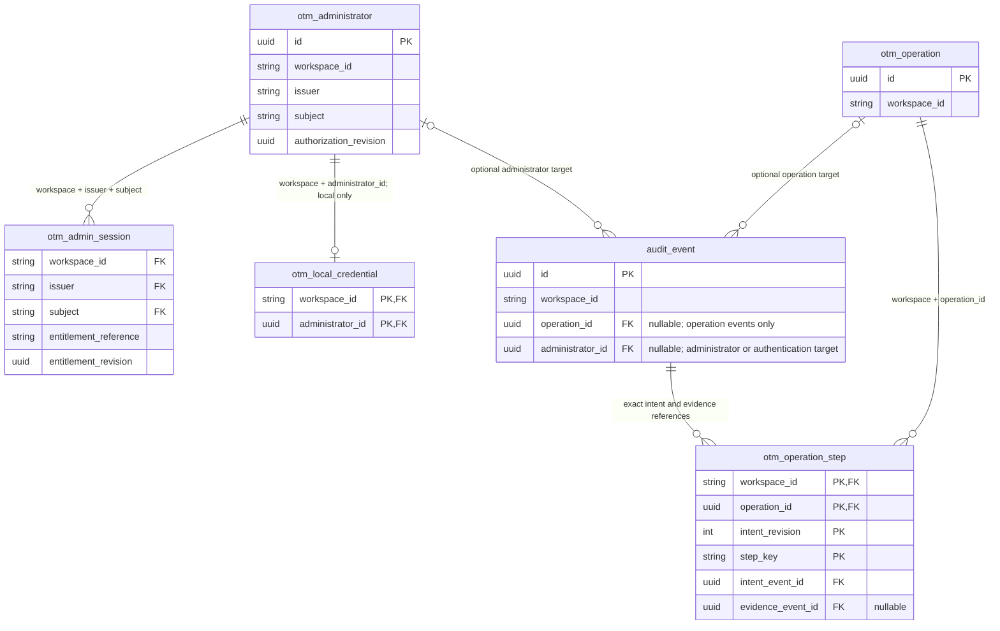

# Application administrator grants and revocation

29 October 2026 · D58 A1 internal implementation checkpoint

[Backend setup](../../backend/README.md) · [Session verification](authentication.md)
· [Accepted administrator design](../engineering-design/19-administrator-provisioning.md)
· [Production data model](../engineering-design/11-production-data-model.md)

## Implemented scope

OTM now stores its own administrator grants, resolves current authorization from those grants,
and provides an atomic service for revoking an ordinary corporate administrator grant, now exposed
through guarded HTTP and the local React administrator screen.
Sessions must match the exact current grant and authorization revision. Revocation changes that
revision, revokes the target's sessions and appends immutable administrative evidence in one commit.

The production model has six application tables: `otm_operation`, `otm_operation_step`,
`audit_event`, `otm_admin_session`, `otm_administrator` and `otm_local_credential`.
The last two are added here. Runner and migration infrastructure tables are outside that count.
The preserved organization prototype and the larger proposed production inventory remain separate.

The [local authentication slice](local-authentication.md) now implements operator bootstrap/reset,
Argon2id password and TOTP verification, immutable laptop secret custody, guarded local sign-in and
session issuance. The [local application](local-application.md) now exposes authenticated listing and
ordinary-grant revocation through HTTP and React. Add/regrant remain unimplemented. The default
application remains health-only; sign-in, administrator routes and the public shell require explicit composition.

`SqlAdministratorStore` checks current **OTM grant status**. It does not contact a corporate
identity provider or qualify corporate enabled/disabled status. A corporate SSO integration must
still establish the identity and compose the required current corporate-status checks. An active
OTM grant alone is not proof that a corporate account remains enabled.

## Relationships

This diagram shows all six current application tables with only relationship fields. The complete
new-table fields are listed below; session and operation details remain in their dedicated guides.

An event has the target required by its closed kind: current operation events require an operation
and forbid an administrator target; `administrator_revoked` requires an administrator and forbids
an operation or intent revision. The optional edges do not permit a target-free revocation event.
There is no fabricated OCI operation for an application-access change.

## Grant fields: `public.otm_administrator`

All fields are required unless marked nullable. Text storage bounds are 256 characters except
`identity_kind` (32) and `status` (16). The application contract validates UTC instants.

| Field | Meaning and enforced boundary |
| --- | --- |
| `id` | UUID primary key; stable grant identity. |
| `workspace_id` | Workspace scope; also unique together with `id`. |
| `identity_kind` | Exactly `local_recovery` or `corporate_sso`; protection follows this value. |
| `issuer` | Exact registered identity namespace; never inferred from an email domain. |
| `subject` | Stable subject within the issuer. A local recovery subject must equal `str(id)`. |
| `display_name` | Nonblank display text; does not establish identity or authority. |
| `email` | Nullable contact/display metadata; not an authentication key. |
| `status` | Exactly `active` or `revoked`. Local recovery grants must remain active. |
| `authorization_revision` | UUID compared with sessions; ordinary revocation replaces it. |
| `created_at` | Creation timestamp; protected against later identity-row updates. |
| `updated_at` | Last grant update; cannot precede `created_at`. |
| `revoked_at` | Nullable only while active; required while revoked and cannot precede creation. |

Unique `(workspace_id, issuer, subject)` prevents duplicate grants for an exact identity.
A partial unique index permits **at most one** local recovery grant per workspace. It does not
create that grant or guarantee that a workspace already has one. Ordinary revocation requires
an existing active protected row and fails unavailable if that anchor is absent.

The migration's row trigger prevents grant deletion and changes to `id`, workspace, identity kind,
issuer, subject or creation time. Status/revocation-time changes require a new authorization revision.
Inserting or updating a local recovery grant additionally requires membership in the grant table's
owning role. These are application-role protections, not protection against a privileged owner who
can alter schema or triggers. API roles must not receive broad DDL or `TRUNCATE` privileges.

## Reserved credential fields: `public.otm_local_credential`

This table has no implemented enrollment, verification or reset service. Its checks constrain row
shape; an `$argon2id$` prefix does not verify hash parameters, and a secret reference does not prove
that a secret exists or that enrollment has occurred. No plaintext password or TOTP seed belongs here.

| Field | Reserved meaning and current storage constraint |
| --- | --- |
| `workspace_id` | Composite primary key and same-workspace grant FK. |
| `administrator_id` | Other primary-key/FK component; trigger permits a local recovery grant only. |
| `password_hash` | Required encoded verifier, up to 2,048 characters, beginning `$argon2id$`. |
| `totp_secret_reference` | Required nonblank opaque reference, up to 1,024 characters; not the seed. |
| `last_totp_step` | Nonnegative bigint reserved for greatest consumed TOTP step. No consumption flow yet. |
| `mfa_enrolled_at` | Required timestamp reserved for successful enrollment. |
| `password_changed_at` | Required timestamp reserved for the latest password change. |
| `failed_attempts` | Nonnegative integer reserved for login throttling. |
| `failure_window_started_at` | Nullable when the failure count is zero; required when it is positive. |
| `retry_after` | Nullable cooldown deadline; if set, cannot precede the failure-window start. |

Zero failures require both throttle timestamps to be null. Positive failures require a window;
the cooldown remains optional. Credential updates cannot change the workspace/administrator key.
The referenced grant's immutable identity kind, FK and credential trigger prevent attaching a
credential to an ordinary corporate grant. They do not substitute for future restricted role grants
or the protected operator bootstrap/reset workflow.

## Current authorization and session binding

Construct `SqlAdministratorStore` with an explicit engine, UTC server clock, local issuer and
`frozenset` of trusted issuers that includes the local issuer. Construction creates no accounts.
`require_admin(issuer, subject, workspace_id)` queries that exact scoped identity, validates the
stored grant, requires active status and checks that the local issuer is used exactly for the
local recovery identity kind. Unknown/untrusted identities cannot authorize access.

The resulting `AdminEntitlement` contains the exact workspace, issuer and subject, plus:

| Entitlement field | Source |
| --- | --- |
| `reference` | `str(grant.id)` |
| `revision` | Current `grant.authorization_revision` |
| `checked_at` | Validated server clock after the grant read |
| `valid_until` | `checked_at + 5 seconds` |

`SessionService` requires fresh current entitlement and compares **both** reference and revision
against `otm_admin_session.entitlement_reference` and `entitlement_revision`, in addition to exact
workspace/issuer/subject and the entitlement validity window. It retains session expiry, idle and
revocation checks. The short entitlement interval is not a persisted authorization cache.
A later regrant must use a fresh revision; old sessions cannot be revived by restoring active status.
Regrant itself remains unimplemented.

The session FK now references `(workspace_id, issuer, subject)` on the grant table. Migration
`0005_administrator_grants` deletes existing pre-grant operational session rows before adding that
constraint. It infers no grants, creates no protected administrator and touches no operation/audit
history. This frozen, hash-checked migration is forward-only; deployment requires operator control
and deliberate provisioning of usable authority before exposing management functionality.

## Ordinary-grant revocation transaction

`SqlAdministratorStore.revoke(principal, target_id, expected_revision)` is an internal method.
It accepts only an internal `AdminPrincipal` and UUID command values. It does not accept a caller's
email, claimed role or arbitrary actor JSON as authority. The implementation:

1. Opens an explicit psycopg PostgreSQL `READ COMMITTED` transaction and locks the workspace's
   active local recovery grant with `FOR UPDATE`. This common anchor serializes ordinary revocations
   in that workspace; the implemented operator reset locks that same protected row, and future grant
   flows must deliberately use the same coordination policy.
2. Under that lock, reloads the exact presented session by ID, workspace and token digest. It checks
   idle/absolute expiry and revocation, verifies exact issuer/subject, then reloads the actor's active
   OTM grant and compares the stored session's exact entitlement reference/revision with it.
3. Locks the target grant in the same workspace. Missing targets fail 404; local recovery targets
   fail 403; an unexpected authorization revision fails 409 before mutation.
4. For an active ordinary target, creates a new authorization revision, soft-revokes the grant,
   revokes all its still-unrevoked sessions in that workspace and appends `administrator_revoked`.
   The actor may revoke their own ordinary grant; those sessions become revoked in the same commit.
5. Returns `AdministratorChange` only after the transaction context commits. It contains target ID,
   status `revoked`, committed revision and timestamp, without a credential or identity-provider claim.

An already-revoked target with its **current** expected revision returns its existing revocation
without another write/event. Retrying an old expected revision fails conflict, including after a
lost success response; refresh the guarded administrator directory and review its current revision
before retrying. The [local application guide](local-application.md#implemented-http-and-model-boundary)
lists the implemented directory fields, query controls and revocation request.

Unexpected storage/validation/commit failures become fixed 503 `ADMINISTRATOR_SERVICE_UNAVAILABLE`;
raw database/provider text is not exposed. A failed commit cannot produce a success result. An
uncertain connection failure around commit still requires state inspection before assuming rollback.
No independently committed partial grant/session/audit change is part of this flow.

The transaction rechecks OTM authority and a live session. It does not add a corporate-provider
status lookup. That limitation remains explicit even when this store is injected into session checks.

## Revocation evidence

The existing append-only `audit_event` table gains nullable `administrator_id` and permits null
`operation_id` for the closed administrator/authentication/logout family. Existing operation intent and
inspection event constraints retain their required operation references. Same-workspace FKs prevent
an event from targeting another workspace's grant.

A1 added `administrator_revoked`. Migration0006 now also enables the [closed local-authentication family](local-authentication.md#evidence-roles-and-remaining-qualification), including logout. This section describes revocation evidence: Its closed `administrator-revocation-1` data contains
`contract_version`, `administrator_id`, `prior_revision`, `authorization_revision` and an allowlisted
`ActorIdentity` snapshot. The event also stores its own UUID, workspace, timestamp, actor identity
key/snapshot and canonical data hash. The actor is the requesting principal's issuer/subject identity;
email and employee-feed membership do not identify the authorizer. A local recovery principal is not
proof of which human operated it.

The existing append-only audit protections still apply, with the documented privileged-DBA boundary.
Bootstrap, credential reset, local sign-in success/failure and session logout are implemented by
[the local authentication slice](local-authentication.md). Ordinary grant creation/regrant and their
events remain future work; migration0005 itself added only ordinary revocation.

## Role and qualification boundaries

Deployment still needs a dedicated, restricted API database role. The intended split permits the
reads and limited column updates needed for current grant/session revocation and audit insertion,
including the row-lock privileges required by PostgreSQL. It must not grant the API protected recovery-identity writes, bootstrap/reset capability, broad
table updates, DDL or table truncation. The implemented local login reads credential material server-side; the grant service does not.
The restricted test role includes credential SELECT and replay/throttle-only updates to exercise
that actual login read/write split;
password/seed-reference replacement remains operator-only. Deployment needs a reviewed privilege matrix. The migration does not install that deployment role configuration.

Real PostgreSQL checks, including restricted-role negative cases, must qualify the actual privileges,
constraints, transaction rollback and concurrent revocations. Unit fakes can check command decisions
and evidence construction but do not prove SQL locking, commit behavior or database isolation.
This guide records implementation boundaries without treating in-progress qualification as a result.
No OCI action, corporate SSO issuance, production credential provisioning or cluster deployment is
performed by this slice.
