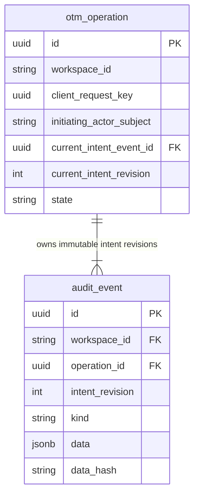

# Internal operation admission

29 October 2026 · P0.7 local implementation checkpoint

[Backend setup](../../backend/README.md) · [Production data dictionary](../engineering-design/11-production-data-model.md)
· [Execution design](../engineering-design/02-operations-and-provider.md)

## What works now

`AcceptInspection.accept` admits one internal `inspect_import` command. It authorizes the supplied
principal through a required injected authorizer, resolves trusted server policy, and freezes the
exact intended child, parent, organization and access-binding reference. One PostgreSQL transaction
writes `public.otm_operation`, the immutable `public.audit_event` intent, and a native Procrastinate
job containing only `operation_id`. The explicit sandbox uses a workspace-scoped native queue;
the internal default queue remains available for the earlier qualified composition. The caller receives a queued receipt only after COMMIT succeeds.
Admission accepts work; the [subsequent worker](worker.md) can now execute simulated inspection.
Neither admission nor that read imports a tenancy or establishes successful OCI access.

The [explicit local simulation composition](simulation.md) now exposes `POST /api/operations/inspect`
through current real session authority and registered virtual targets; a separate native worker
consumes the committed jobs. Browser actor/workspace/policy fields cannot substitute for that
composition. There is no SSO implementation, permissive authorizer, provider write or real OCI
adapter. Actual corporate policy and real credential composition remain qualification work.



These are **two production admission tables**; the [worker migration](worker.md) now adds the third
application table, `otm_operation_step`. The subsequent [session migration](authentication.md) adds
the fourth, `otm_admin_session`. The [administrator foundation](administrators.md) adds the grant and
reserved credential tables, for six application tables plus runner-owned tables and Alembic's version table. The preserved organization prototype has its separate ten-table schema; chapter 11's
30-table inventory remains the full proposed target. Neither that complete inventory nor the toy
runner experiment is silently created by this migration.

## Admission-time field map

The following lists every implemented application column. Closed Python contracts are authoritative
for the current JSON payload shapes; generated structural schemas are under `backend/contracts`.
Custom UTC/nonblank checks and cross-model pairing still require runtime validation.

| Table / fields | Purpose and source |
|---|---|
| Operation `id`, `workspace_id`, `kind` | Generated stable UUID, authorized request workspace, fixed `inspect_import` capability |
| `initiating_actor_subject`, `initiating_actor_snapshot` | Issuer-qualified subject key and allowlisted `{issuer, subject, display_name}` snapshot from trusted authorization; never raw claims or client-supplied admin fields |
| `responsible_actor_subject` | Initially the initiating actor; reassignment workflow is not implemented |
| `client_request_key`, `request_digest` | Caller UUID scoped by workspace and actor; canonical SHA-256 of bounded command version/kind/workspace/child, excluding the key |
| `current_intent_revision`, `current_intent_event_id` | Revision starts at 1; deferred composite FK requires the exact event, workspace, operation and revision |
| `state`, `stage`, `wait_reason` | Admission writes `queued`, `inspect_target`, null. Allowed states are queued/running/waiting/needs_attention/succeeded/cancelled/failed; the [simulated worker](worker.md) now implements bounded read transitions; broader workflows remain work |
| `effect_knowledge`, `revision` | `none` and 1 at acceptance; constrained effect values none/known/unknown; the [simulated worker](worker.md) now checks revision/attempt generations; broader dispatch/deployment remains work |
| `accepted_at`, `created_at`, `updated_at`, `completed_at` | UTC acceptance timestamps, with completion null. Database read receipts normalize timestamps to UTC |
| Audit `id`, `workspace_id`, `operation_id`, `intent_revision` | Stable event UUID and exact operation ownership for every operation kind; reverse scoped deferred FK prevents orphan operation events |
| Audit `administrator_id` | Null for operation kinds; administrator/authentication/logout kinds require this scoped grant target and a null operation/intent reference; see [grant evidence](administrators.md#revocation-evidence) |
| `actor`, `actor_subject`, `actor_snapshot` | Acting trusted administrator key and same allowlisted identity snapshot; compatibility actor label currently equals the qualified key |
| `kind`, `at`, `contract_version` | Fixed `operation_intent`, UTC acceptance time and `inspect-import-1` |
| `data`, `data_hash` | Immutable `{intent, actor}` with canonical SHA-256; integrity/correlation hash, not an authenticity signature |

The frozen intent contains `contract_version`, `kind`, `workspace_id`, `policy_revision`,
`access_binding_id`, and `target.{organization_id,parent_tenancy_ocid,tenancy_ocid}`. No credential
material or PEM is stored. The admission request allows only workspace, request key and child OCID;
policy revision, parent and binding come from trusted resolution. Syntax is not proof of child
membership: actual parentage/access verification belongs to execution.

## Replay, concurrency and audit protection

Authorization precedes even a replay lookup. A compatible committed retry returns its original
operation without resolving a changed policy or queuing again. A conflicting request under the same
workspace/issuer/subject/key is rejected. Different actors or workspaces cannot alias that receipt.
The unique request constraint handles concurrent writers; the losing INSERT reads the committed winner
under READ COMMITTED. Unsupported isolation, autocommit and non-psycopg connections fail before writes.
No adapter commits the raw driver connection or opens a separate queue pool.

Audit triggers reject ordinary UPDATE, DELETE and TRUNCATE. A migration owner can disable/drop
triggers using DDL; production runtime roles must not have that authority. Managed PostgreSQL grants
and owner/runtime separation remain deployment qualification. **Migration 0001 supports intent events only.** The implemented forward migration 0002 now adds
dispatch/outcome evidence with null revision, retaining positive revisions for intent and preserving
exact pointers. Existing NULLS DISTINCT uniqueness suffices without a partial index; see the
[worker schema](worker.md#actual-schema-and-field-map). The baseline is frozen; tests do not bypass
audit protection for cleanup.

Native deferral uses the caller's active psycopg transaction, a fixed queue/task name and operation
lock. It sets transaction-local `search_path = pg_catalog, public, pg_temp` so temporary relations do
not shadow the trusted queue schema. Runtime roles must lack CREATE on public. OCI/network work is
never performed inside admission's transaction. SQL atomicity does not imply exactly-once OCI effects.

## Migrations and deployment artifacts

`backend/migrations/versions/0001_operation_admission.py` verifies the SHA-256 of frozen application
DDL and the stock Procrastinate 3.10.0 schema before execution. The upstream MIT license and provenance
manifest accompany them. The initial slice shipped seven explicit assets under `otm_migrations/`.
Worker, session, idle-policy and [administrator](administrators.md) revisions now bring packaging to
17 migration assets across six frozen revisions, including `alembic.ini`, plus the settings sample.
The wheel never bundles local environments or credentials. Application tables use
explicit public schema. Alembic requires an externally supplied migration-owner connection; it has
no saved URL or API-startup migration hook. The baseline is forward-only to protect audit history.

Run through `alembic.config.Config` with `config.attributes["connection"]` set inside an explicitly
owned transaction, then `alembic.command.upgrade(config, "head")`. For an installed wheel, locate
`otm_migrations/alembic.ini` alongside the installed package. Deployment credential resolution and
the dedicated production migration command will be wired with the deployment slice, not hardcoded
here. Unit coverage measures all runtime modules under `backend/src/otm`; migration DDL/environment
files are separately exercised by the mandatory real PostgreSQL suite, rather than counted as
mock-driven unit application coverage. They remain subject to lint, inline documentation and review.

## Local validation

From the repository root:

```sh
uv run --project backend python scripts/check_unit_coverage.py
uv run --project backend python scripts/run_backend_postgres_tests.py
uv run --project backend python scripts/export_backend_contracts.py --check
uv build --project backend --no-sources
```

The database driver owns a fresh pinned PostgreSQL 16 Docker container, a random loopback port and
throwaway credentials, then removes only that container. It never uses the saved prototype database.
Tests verify real same-transaction IDs, concurrency, replay, authorization loss, conflicting input,
post-enqueue rollback, native insertion failure, COMMIT-time rejection, unsupported actual transaction
modes, temporary-table shadow resistance, append-only audit and exact deferred pointer constraints.
Schema comparison normalizes public/default spelling in a test-only metadata copy; a negative test
changes actual FK deferrability and requires a detected difference. No FK differences are filtered.

## Configured local submission

[The simulation guide](simulation.md#http-and-atomicity) documents the actual POST body/202 receipt,
virtual catalog, 400/409/503 distinctions and compatible committed replay before policy reload.
`SandboxAdmission` injects current session authorization and trusted file policy into this service;
it is not a parallel admission implementation. Queue names derive from the trusted workspace as
`otm.sim.<32 SHA-256 hex characters>`, bounded for native PostgreSQL NOTIFY channels. One transaction
still owns operation, immutable intent and native job. Browser uncertainty reuses the current modal's
key; after reload the UI must check recorded work because its key memory is not reload-durable.

## In-progress organization action admission

[Organization lifecycle admission](organization-workflows.md) reuses the existing operation/current
intent/audit/native-job authority. Same-transaction current administrator checks and exact org-head,
configuration and registry preview revisions precede acceptance; exact compatible request replay
is checked before stale-preview rejection. Pending reservations, organization review handoff, intent,
decision audit and native queue insertion commit together. Application-only decisions use an immutable
request receipt without inventing a job. No real OCI completion is implied by this acceptance.
