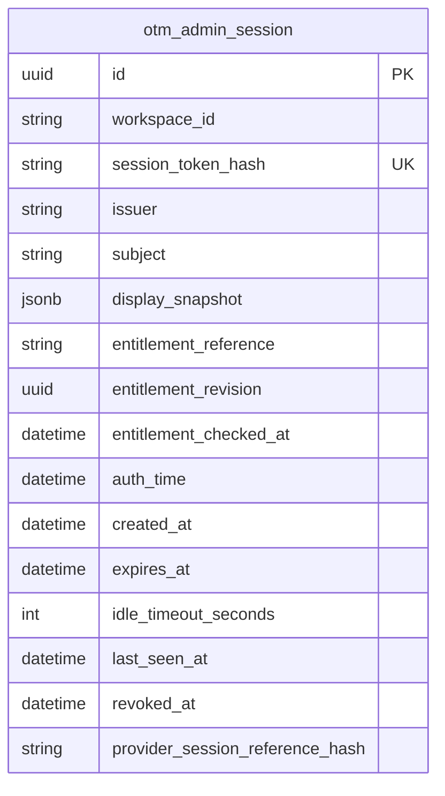

# Session verification and request authorization

29 October 2026 · P0.9 internal implementation checkpoint

[Backend setup](../../backend/README.md) · [Session data dictionary](../engineering-design/11-production-data-model.md)
· [Identity design](../engineering-design/04-identity-and-access.md)

## Scope: verification, not an SSO login

The production package now implements hashed server-session lookup, expiry/revocation checking,
current administrator authorization, scoped internal revocation and browser request guards.
It uses [Starlette AuthenticationMiddleware](https://starlette.dev/authentication/) for request
plumbing. That middleware is **not the maintained SSO/session-library integration** selected by the
design: the corporate provider/library, OIDC validation, state/nonce/PKCE handling, corporate issuance,
corporate logout and disable/revocation integration remain unimplemented and must be qualified.
Local OTM session logout is now implemented independently of IdP availability.
The real local password/TOTP issuer is separate; no custom OIDC protocol, temporary actor bypass,
trusted identity header or raw-token response is added.

`create_app()` still exposes only process liveness. Passing both an explicitly composed
`SessionService` and `BrowserSettings` adds `GET /api/session` plus the [activity/logout endpoints](application-settings.md), returning workspace,
optional display name and expiry. Passing only one dependency fails configuration. There is no
tenancy-management route, automatic default authority or permissive entitlement provider. The
[explicit laptop factory](local-application.md) additionally composes real local sign-in, the public
React shell and guarded administrator list/revoke routes. Tests use separate synthetic disposable
state; that fixture path is not a login bypass.

## Accepted next step: local recovery and administrator grants

The user has now selected [D58 application-managed grants and a local recovery administrator](../engineering-design/19-administrator-provisioning.md).
Implement local sign-in first for testing, then add corporate SSO while retaining independent
recovery. The initial local user must authenticate against a real protected credential and grant;
this authorizes a designed local authentication path, not a prototype actor/default-login bypass.
The user selected strong password plus independent MFA for production and local testing. The
[local authentication slice](local-authentication.md) now implements restricted operator bootstrap/reset
and explicitly composed password/TOTP sign-in. The local application now implements directory/revoke
routes and screens. Ordinary add/regrant and corporate SSO remain future work; the default
application factory remains liveness-only.

## Request and command flow

1. Keep `/health/live` process-only, even if a bad cookie arrives or the database/SSO provider is down.
2. For every non-health HTTP path, including logout, require configured HTTPS and exact Host.
   Do not infer transport/host trust from arbitrary forwarded headers. Deployment must separately
   configure trusted ingress/proxy peers and preserve the validated public origin.
3. For unsafe methods, require exactly one matching `Origin` and exactly one `X-OTM-Request: 1`.
   Reject missing/null/different/duplicate origins and duplicate security headers before lookup.
   No permissive CORS middleware is installed. The custom header forces cross-origin browser scripts
   to preflight; HTML forms cannot supply it. Content-type/file validation remains per route so the
   eventual organization CSV upload can use multipart without weakening this shared guard.
4. The explicitly mounted shell/assets are public nonsecret content under HTTPS/Host guards.
   Apart from those paths, guarded POST logout and explicitly composed POST local sign-in, parse one
   `__Host-otm_session` cookie with a bounded header and a 43-character base64url-compatible
   opaque value. Missing, malformed or duplicate handles are rejected before SQL/provider access.
   Hash the handle with SHA-256 and query the unique digest. Names/emails, feed membership, Bearer
   headers and caller-provided roles cannot authenticate a request.
5. Validate the stored trusted issuer, exact digest, creation/authentication time, expiry and
   revocation. Release the database connection before requiring current exact issuer/subject/workspace
   administrator entitlement. Recheck expiry after external verification. Stored entitlement metadata
   is provenance, not a substitute for this current check. Provider availability errors fail closed.
6. Attach an internal `AdminPrincipal`. `SessionService.require_admin(principal,workspace)` adapts
   to command admission, reloading session/revocation and requiring current entitlement again;
   a stale principal or another workspace cannot authorize work.

Response/error bodies are non-cacheable and vary by Cookie. API responses include nosniff,
no-referrer and restrictive JSON-oriented CSP headers. Public authentication diagnostics are limited
to three status/code pairs: 401 `AUTHENTICATION_REQUIRED`, 403 `ADMINISTRATOR_REQUIRED`, and
503 `AUTHENTICATION_UNAVAILABLE`. Raw cookies, claims and database/provider exception text do not
become those diagnostics. Session views expose no token, digest, subject, raw claim or grant details.
WebSocket authentication/origin behavior is not qualified; no WebSocket route is mounted.

A request lookup cannot retroactively revoke an already issued response. Corporate revocation and
upstream session validity still depend on the concrete authority/provider integration and its
qualified latency; this code does not promise instantaneous corporate logout. UI session expiry
also does not cancel accepted background operations: workers recheck their own current dispatch
entitlement and credentials against the frozen initiating identity, separately from browser sessions.

## Cookie and issuance obligations still to implement

The cookie parser cannot observe how a browser cookie was issued. The name `__Host-otm_session`
does not prove Secure/HttpOnly/SameSite flags on an incoming header. The eventual maintained flow
must generate at least 32 random bytes, prevent fixation by replacing pre-login handles, issue
Secure/HttpOnly cookies with Path=/ and no Domain, choose the qualified SameSite/lifetime policy,
and validate issuer/audience/signatures/state/nonce/redirects through the selected library. It must
never persist raw session, identity, access or refresh tokens in the session row or browser storage.
Format/length checks do not prove entropy. The [local sign-in path](local-authentication.md) now issues such a cookie after password/MFA/session/audit commit; corporate issuance remains future work. Expiration/logout now deletes its browser cookie using the same secure scope;
[session settings](application-settings.md) define the current lifecycle implementation.

Session lifetime is now selected by the [central settings](application-settings.md): initially
30-minute idle and eight-hour absolute limits, pinned at issuance. Entitlement decisions
require an explicit current provider; returning cached old group claims would violate that boundary.
CLI authentication and production entrypoint composition remain separate qualification work.
Do not enable real business routes by manually inserting sessions or installing a permissive provider.

## Session table and current production relationships

Migration `0003_admin_session` adds `public.otm_admin_session`, an existing proposed entity from
chapter 11. It does not add another employee directory, role table, OAuth-state table or SSO provider.
That migration established the fourth application table. The later [administrator foundation](administrators.md)
adds grants and the reserved local credential shape, bringing current production to six tables. The
prototype still has ten and the full proposed target is 30. Existing operation event rules remain intact.

| Implemented fields | Source and meaning |
|---|---|
| `id`, `workspace_id` | Stable session UUID and exact authorized workspace; no browser-selected role or person mapping |
| `session_token_hash` | Unique SHA-256 hex digest; no raw opaque browser handle. Fixed hash format is enforced by SQL |
| `issuer`, `subject` | Exact local or corporate issuer/subject namespace; local password/TOTP issuance is implemented; corporate protocol issuance remains future work; actor identity remains issuer-qualified |
| `display_snapshot` | Closed `{display_name}` object only, not raw identity/group claims |
| `entitlement_reference`, `entitlement_revision`, `entitlement_checked_at` | Grant UUID reference and issued authorization revision must equal the freshly resolved active OTM grant; checked_at is issuance provenance, not a cached permission |
| `auth_time`, `created_at`, `expires_at` | Explicit UTC authentication/session lifetime; expiry is enforced during reads without a cleanup job |
| `idle_timeout_seconds`, `last_seen_at` | Pinned issued idle limit and server-qualified activity time; polling does not update activity |
| `revoked_at` | Nullable first revocation time; revoke matches UUID, hash and workspace and never overwrites that first time |
| `provider_session_reference_hash` | Optional digest-only correlation reserved for future corporate logout integration; not proof such integration exists |

SQL requires hash format and coherent initial times. The unique digest index supports exact lookup;
no speculative reporting/cleanup indexes or cache were added. Lookups close their connection before
external checks. Revocation is a short guarded transaction. Backend projections normalize database
connection timezones to UTC and revalidate closed metadata; no secrets or raw claims enter JSONB.
The repository intentionally has no insert/mint method. Local OTM handle logout now uses scoped
revocation without requiring the corporate IdP. The internal [administrator revoke transaction](administrators.md#ordinary-grant-revocation-transaction)
now invalidates that administrator's sessions with grant/audit changes. Its directory/revocation
HTTP UI is implemented locally; corporate logout and restore commands remain future composition. Local login and first handle
logout now commit closed audit evidence atomically with their session changes. The logout exception waives session/entitlement verification only; HTTPS, Host, Origin
and custom-header checks still apply.

## Verification and remaining gates

Unit/ASGI tests cover forged headers, malformed/duplicate cookies, duplicate Host/Origin/custom
headers, cross-origin or plain-HTTP requests, unsafe HTML-form attempts, current role changes,
provider outages, expiry during verification, stale/cross-workspace principals and fixed diagnostics.
Real PostgreSQL cases cover all metadata constraints, uniqueness, parameterized lookup, scoped
idempotent revocation, release-before-provider, request revocation and current-session admission.
Those request/storage checks are backend ASGI/database tests, separate from the new frontend
Playwright suite and from live corporate SSO qualification.
The retained organization UI/fixtures and its laptop database are untouched.

The wheel includes 17 migration assets across six frozen revisions plus the nonsecret settings
sample. Runtime credentials, SSO registration, corporate issuance/logout integration,
proxy/TLS qualification, managed PostgreSQL roles,
real OCI and hosted CI/protected master remain work. The 95% complete-source unit gate continues to
cover every production module, including unimported code; real database tests are measured separately.
