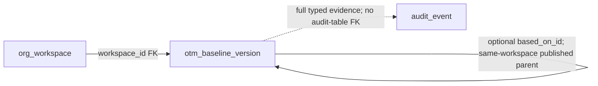

# Baseline authoring and publication history

P3.1/P3.2a/original P3.2b validated; latest-publication-only correction validated locally · No OCI application

[Build order](../engineering-design/18-database-ci-and-build-order.md#latest-publication-only-default-correction) ·
[Configuration design](../engineering-design/03-templates-and-drift.md) ·
[Audit History](audit-history.md) · [Organization setup](organization-mapping.md) ·
[Implemented baseline ER](../architecture/diagrams/baseline-authoring-implemented.mmd)

## Actual checkpoint boundary

A baseline is an authored recipe for child-tenancy policies, quotas, a monthly budget and static
OTM tag defaults. It is separate from organization mapping and operator-managed application.toml.
P3.2a added simulated publication, immutable published history, exact-version reads and derived
drafts. P3.2b captures the complete published recipe once in each newly accepted create/import
operation, retained through activation waits and retries. The user corrected the initial selectable
default design: only the latest published version is now the automatic default; older versions
remain historical views and accepted pins, never selectable defaults for new starts.

Publication freezes a saved recipe after the explicitly injected local qualifier checks structure
and its synthetic whole-unit USD profile. It does not check OCI policy/quota grammar, discover real
billing currency, compose protected required-access policies, verify provider objects or call OCI.
A published row is labeled Published · simulated. Latest published, ordered by version_number
descending in this workspace, is automatically the default for new create/import. There is no
separately editable default, Use for new action or older-version selection. This never means Applied
or OCI verified. Pinning records desired recipe context, not configuration deployment or verification.
The original authoring/pinning checkpoint added no rollout or retroactive assignments. The later
[baseline-only update slice](configuration-updates.md) now permits explicit individual/fleet simulated
updates and records desired versus last fully verified simulated values. Publication alone still never
changes existing assignments; real OCI verification, overrides, collection and drift remain separate.

The application accepts an optional BaselineQualifier dependency; absent means authoring only.
There is no implicit permissive/simulator fallback. The local runtime explicitly injects
SimulatedBaselineQualifier. Real-provider qualification is a separate, unimplemented capability.
P3.2a qualification and both saved-instance upgrades pass; its publication receipt (private historical evidence; not distributed)
retains the original scope. The original P3.2b selectable-default checkpoint also passed; its
pinning receipt (private historical evidence; not distributed) is historical.
The latest-only correction and0014 migration/runtime qualification remain pending.

## Read, save and publish flow

1. Save Organization Mapping so the authenticated workspace exists. An employee feed is not required
   for authoring. An empty unconfigured read returns configured=false; it never seeds a workspace.
2. Edit one policy block and one quota block, one complete statement per nonblank line, plus the
   whole-unit monthly budget/currency and optional static tags. The browser converts lines to ordered
   entries only on Save; API/history still preserve valid embedded-newline items.
3. The first draft sends null baseline_id, expected_revision and based_on_id. After a publication,
   New baseline copies the latest published content into the editor and freezes that version's UUID
   as based_on_id. The server requires that exact latest parent when creating the new draft; a
   stale parent conflicts. It validates the submitted recipe rather than silently copying/overwriting
   browser edits. An existing draft retains its own parent, identity and displayed revision.
4. Save commits changed content plus immutable before/after audit synchronously. It does not publish,
   enqueue a job or change a tenancy. Retain unsaved edits on conflict and review Reload saved draft.
5. Publish opens a native confirmation dialog for the saved draft, showing statement counts and budget.
   The request contains only exact baseline_id and expected_revision, never new recipe values or mode.
   Current authority, workspace lock, saved hash, revision and explicit qualifier are checked before
   publication. The row, registry-revision increment and complete publication audit commit together;
   the edit revision advances. The latest published lookup then supplies future admissions without
   storing a second default pointer. No already-started work changes.
6. The published recipe becomes read-only. Its creator provenance stays original; publisher identity,
   captured display name, server UTC time and simulated mode are frozen. Further edits require a new
   draft. Only the highest published version is used for new starts.
7. The same latest lookup includes publications already present before0014. No adoption command
   or additional publish is required. Opening an older history/detail does not choose it, while a
   previously accepted operation may legitimately retain that older version as its frozen pin.

### Screen and field flow

/configuration shows the sole editable draft separately alongside newest-first published history.
A draft has Open draft and Publish; publication is disabled with an explanation if no qualifier is
configured. Published rows show version, simulated status, UTC publication time and the captured
publisher name. The latest published version is also the default for new tenancies. Older rows
offer View version only; no default selector or Use for new confirmation is present.
The history uses SQL pagination with
10/25/50 published versions per page, Previous/Next and a published total; the optional draft does not
consume a published page slot. Changing page size resets the browser page to1.

View version opens /configuration?baseline=<UUID>. This reads the exact same-workspace saved version,
independently of the current page; a missing/foreign/invalid target is unavailable, not another
version. Published policy/quota blocks and budget/tags are read-only. The parent link opens its exact
published UUID. The matching editable draft can still be edited. Published detail has no edit,
restore, older-default or apply-to-existing control. Opening it never changes which version is latest;
a requested UUID is still exact and does not fall back to another saved version.

Editing freezes the draft ID/revision/parent; background reads do not rebase text. Cancel discards
local edits without deleting the draft. New baseline derives from latest published content, which
is also the only default for new create/import.
Reload saved draft replaces inputs only after a successful
read. If it was published meanwhile, reload leaves editing and explains that a new baseline is
needed. The two statement blocks, whole-unit input and tag controls retain P3.1 behavior below.

The Publish confirmation dialog initially focuses its heading. Escape/Cancel dismiss before a pending submission;
busy controls prevent duplicate UI dispatch. A stale edit returns a conflict requiring refresh;
local-profile rejection requests correction of the saved recipe. An uncertain publication response
instructs safe retry or refresh; closing never undoes a committed publication. After success, baseline
and audit caches are invalidated, the history page resets and the exact published detail is opened.
Private baselines cache entries are cleared on normal logout/expiry. No credentials are requested.

## Authoring values and limits

| Value | Meaning and executable limit |
| --- | --- |
| policy_statements | API/storage: one to50 complete strings, each1–2000characters, preserving item order and content (including legacy embedded newlines). Revised UI: one complete nonblank line becomes one item on Save. |
| quota_statements | The same API/storage list/item limits and revised UI line-to-item conversion as policies. No OCI grammar execution is implied. |
| monthly_budget_amount | New authoring requires a positive whole number of currency units (whole dollars for USD). Read/history BaselineContent and storage retain exact20-digit/four-place Decimal/NUMERIC(20,4), including existing fractions. Serialize as a canonical decimal string; never round through binary floats. |
| budget_currency | Exactly three uppercase ASCII letters. This is proposed authoring content, not a list of provider-qualified currencies. |
| budget_period | Fixed MONTHLY; other periods are rejected. No provider budget/start-date object is created here. |
| tag_namespace | Fixed OTM; this command does not select arbitrary namespaces. |
| tag_defaults | Optional list, default empty, at most100 static key/value pairs. Keys1–100characters and values1–1000characters; case-insensitive duplicate keys reject. No dynamic expression/provider object ID model is introduced. |

Blank/whitespace-only strings, NUL characters and obvious PEM BEGIN markers reject before persistence.
These checks are not a comprehensive secret scanner or semantic OCI policy validator. Authors must
not put credentials in statements/tags: current workspace administrators can read authored values
and their recorded changes in audit. No statement sorting, semantic equivalence or provider-side
availability is inferred. Identical normalized decimal spellings hash identically; other authored
ordering/content changes remain meaningful draft edits.

## Complete model and source map

Eleven closed DTOs have58effective fields, counting inherited fields in both retained BaselineDraft
and extended BaselineVersion, and counting nested TagDefault once as its own model. Unknown fields
reject. Scope, actor, server time, publication metadata and mode are not client command choices.

| Contract | Every field | Authority/defaults |
| --- | --- | --- |
| BaselineContent (7) | policy_statements, quota_statements, monthly_budget_amount, budget_currency, budget_period, tag_namespace, tag_defaults | Explicit seven recipe columns; fixed MONTHLY/OTM and empty tag list defaults; precise canonical decimal string. |
| TagDefault (2) | key, value | Static pair in tag_defaults JSON array; no independent table or provider binding. |
| SaveBaselineDraft (4) | baseline_id, expected_revision, based_on_id, content | First three default null. ID/revision must be paired, revision positive. Parent is exact latest publication for a new draft and unchanged for an existing draft. New content requires a positive whole-unit budget. |
| BaselineDraft (7) | id, version_number, edit_revision, created_by, created_at, content_hash, content | Retained draft projection base; IDs/version/hash/original creation provenance are server-owned. content reconstructs explicit columns. |
| BaselineVersion (12) | All seven BaselineDraft fields; based_on_id, published_by, published_by_name, published_at, publication_mode | Extension used for current responses/evidence. Parent defaults null. Four publication values default null and must be either all absent or all present; mode is only simulated. Publisher name is a captured snapshot, not today's directory label. |
| BaselineQuery (3) | page, page_size, baseline_id | Defaults1/10/null; page1–100000, size10/25/50; exact optional UUID selection, never workspace/mode selection. |
| BaselineDirectory (10) | configured, draft, publication_available, latest, selected, items, total, page, page_size, pages | configured is workspace existence. Nullable draft/latest/selected default null. latest is highest published version independently of history page and is the automatic default for new starts. Availability defaults false and means qualifier injected, not valid recipe. items defaults empty, at most50 published versions. SQL derives total/page/page-size/pages with empty pages=1 and requested page clamped. |
| PublishBaseline (2) | baseline_id, expected_revision | Required exact UUID and positive saved edit revision; no content/actor/time/mode input. |
| BaselineDraftEvidence (6) | based_on_id, baseline_id, version_number, edit_revision, before, after | Typed immutable changed-save audit; parent defaults null for old event compatibility; before is null on creation, otherwise complete content. |
| BaselinePublicationEvidence (3) | default_for_new, qualification_version, baseline | default_for_new defaults false for earlier audit compatibility and true for newer publication receipts; it is historical evidence, never a mutable selection source. Full BaselineVersion plus fixed baseline-structure-simulated-1 validates mode/content hash; audit read also checks publisher key/name/time against actor evidence. |
| BaselineSelectionEvidence (2; historical reader only) | previous_baseline_id, baseline | Retained required nullable previous UUID and complete published BaselineVersion snapshot for old baseline_default_changed events. Validates simulated mode/hash. There is no command, endpoint or new event writer for choosing an older default. |

### The fifteenth application table: otm_baseline_version

The [implemented ER](../architecture/diagrams/baseline-authoring-implemented.mmd) adds one table to the
[fourteen-table foundation](../architecture/diagrams/organization-workflows-implemented.mmd), for15application
tables. Migration0011_baseline_drafts originally added18columns; forward0012_baseline_publication
adds published_by_name and publication_mode, making20. The broader30-table target is still separate.
P3.2b added two nullable columns through0013_baseline_pinning. Both physical columns remain;
current_baseline_id is deprecated historical metadata and no longer controls new starts. Migration0014
only increments registry_revision once; it drops no column, FK, guard, table or recorded value.
No full tenancy-configuration revision/binding or second audit store is introduced.

- org_workspace.id scopes each row by workspace_id; verified session authority chooses that key.
- based_on_id is an optional same-workspace published-parent FK. First baseline has no parent;
  later new drafts bind the exact latest publication. The parent stays fixed during edits/publication.
- The partial unique index allows one unpublished draft per workspace. Publication frees that slot;
  a subsequent draft gets a new UUID and increasing version_number, beginning at edit_revision1.
- org_workspace.current_baseline_id remains physically stored with its scoped FK/guard to preserve
  old data. It is deprecated historical metadata, ignored by runtime default selection and no longer
  updated by publication. It is separate from organizational configuration_id and applied/proposed heads.
- otm_tenancy.baseline_version_id is a nullable same-workspace baseline FK for the newly reserved
  tenancy. It records the admission pin, not an applied/verified configuration head.
- Existing audit_event.data carries typed save/publication/selection evidence and baseline correlation IDs,
  not a relational FK. Audit can outlive a deliberately reset local test workspace.

| Column | Stored type and meaning |
| --- | --- |
| id | UUID primary key, generated for a new draft; stable across edits and publication. |
| workspace_id | Required VARCHAR(256); FK to org_workspace.id and scope for every read/write. |
| version_number | Required positive integer; workspace max+1 under lock; retained through edits/publication. |
| based_on_id | Nullable UUID; same-workspace self-FK to a published parent, frozen after creation. |
| schema_version | Required VARCHAR(32), fixed baseline-1; recipe interpretation version. |
| policy_statements | Required ordered JSONB array; application validates1–50 complete strings. |
| quota_statements | Required ordered JSONB array with the same list/item bounds. |
| monthly_budget_amount | Required positive NUMERIC(20,4); precise historical representation. New Save and Publish require whole units; no old-row rounding. |
| budget_currency | Required VARCHAR(3), uppercase-three-letter check. Saving remains structural; current simulated publication permits USD only. |
| budget_period | Required VARCHAR(16), fixed MONTHLY. |
| tag_namespace | Required VARCHAR(16), fixed OTM. |
| tag_defaults | Required JSONB array of static pairs, empty when omitted. |
| content_hash | Required VARCHAR(64), canonical SHA256 of BaselineContent JSON; no provider-verification signature. |
| edit_revision | Required positive integer;1on creation, advances for changed edits and successful publication. |
| created_by | Required VARCHAR(256), original verified actor.key; publication preserves it. |
| created_at | Required aware server timestamp of original creation; publication preserves it. |
| published_by | Nullable VARCHAR(256), verified publishing actor.key. |
| published_at | Nullable aware server publication timestamp; null means editable draft. |
| published_by_name | Nullable VARCHAR(256), publisher display-name snapshot with Administrator fallback. |
| publication_mode | Nullable VARCHAR(16), only simulated when published; not supplied by browser. |

Unique(workspace_id,id) and Unique(workspace_id,version_number) retain scope/version identity.
The guard rejects UPDATE/DELETE on published rows and preserves identity/parent/schema/creator
fields on draft updates, requiring the next edit revision. Publication columns must be populated
together with simulated mode. Guarded no-TRUNCATE protection remains. The local runtime API role
now receives narrow UPDATE on the four publication columns alongside existing recipe/hash/revision
privileges; it receives no DELETE/TRUNCATE. These application/trigger checks do not protect against
a database owner intentionally altering schema. Prior installed-role/migration qualification covered the0013 source. Latest-only correction and
0014 qualification remain pending; no new permission to choose a default is introduced.

Migration0012 stops for explicit review if any publication already exists before adding metadata.
It does not invent publisher names, modes or qualifications for manually published old rows.
Existing drafts are preserved with null new columns; no recipe/hash/decimal-format rewrite is needed.
Migration0013 leaves both new default/pin columns null for all pre-existing rows. It selects no old
publication and backfills no tenancy assignment. Its scoped FKs prevent cross-workspace references;
the retained historical workspace-pointer trigger still requires a published simulated version.
Current runtime does not use/write that field to select a default. The tenancy FK
alone is not a proof of application or a separate provider-verification constraint.

| Added column on existing table | Source and meaning |
| --- | --- |
| org_workspace.current_baseline_id | Deprecated nullable UUID retained with composite FK (id,current_baseline_id) → baseline(workspace_id,id) and published-target guard. Historical values are preserved; no runtime default-selection reads/writes. Current default is derived from published rows. |
| otm_tenancy.baseline_version_id | Nullable UUID; composite FK (workspace_id,baseline_version_id) → baseline(workspace_id,id). New create/import reservation stores the server-selected version; all legacy rows retain null. |

## Concurrency, unchanged saves and transaction boundaries

Save and Publish reuse live administrator/session command checks and serialize under the workspace
row lock. New-draft allocation also checks based_on_id against the exact latest publication; an old
browser editor cannot silently derive from a replaced parent. Existing draft edits require the same
stored parent. Reads and both commands reconstruct recipe values and check their canonical hash;
corrupt evidence fails before no-op/replay shortcuts.

A same-content Save is a no-op after parent and nonnull identity checks: no UPDATE, edit increment
or duplicate audit. A matching stale revision or first-save null identity can recover an unchanged
saved draft, but a foreign ID/changed parent conflicts. Whole-unit Save validation runs first; an
old fractional draft stays readable and cannot bypass correction through unchanged-content replay.
Changed content requires the exact draft ID/current revision and records before/after in the same
transaction. This remains content-based recovery, not a new durable request-token coordinator.

Publish requires an exact saved draft and revision. It rechecks positive whole units, then the
injected qualifier checks the local USD profile and returns baseline-structure-simulated-1. Row
publication metadata, edit_revision+1, registry_revision+1 and the complete typed baseline_published
event with default_for_new=true commit together. No stored default pointer is updated.
Any validation, qualifier, authority, SQL/audit or commit failure rolls back local changes; there is
no OCI/network effect to compensate. A repeated exact Publish request returns the immutable version
without another UPDATE/audit only when stored published edit_revision equals expected_revision+1.
It still passes current authority and requires an available qualifier; changing the expected revision
is not an arbitrary replay shortcut. Replaying an old publish request cannot change latest version
order, increment registry_revision again or make an older version the default. Read exact detail
after an uncertain response before proceeding.

The latest published version_number in this workspace is the only default. Publication order and
immutable versions supply that fact; there is no SelectBaseline command, selection endpoint, clear
command or mutable pointer authority. A previously chosen old value in current_baseline_id is kept
as historical data and ignored. Existing publications automatically participate in the lookup.
New drafts do not change latest until published. Publication never enqueues rollout or updates
existing tenancies; only a later create/import admission reserves a new tenancy with a frozen pin.

## HTTP and authority boundary

| Route | Result and bounds |
| --- | --- |
| GET /api/configuration/baselines | Scoped BaselineDirectory with sole draft, latest publication/default, optional exact selected version and SQL-paged published history. Query: page, page_size, baseline_id. One read-only REPEATABLE READ snapshot; no seeding. |
| POST /api/configuration/baselines/draft | Closed SaveBaselineDraft, synchronous BaselineVersion result; no implicit publication. |
| POST /api/configuration/baselines/publish | Closed PublishBaseline, synchronous BaselineVersion result with simulated provenance; advances derived latest for future admissions, without queued application. |

Both commands require application/json and stream-limit bodies to2MiB (2097152bytes) before parsing.
The explicitly configured organization application composes these routes; default create_app() stays
health-only. Workspace/actor come from the verified principal. Existing HTTPS/Host, unsafe Origin/
custom-header and live-grant checks remain required; no API request supplies workspace or qualifier.
Invalid command/query values return400INVALID_BASELINE_DRAFT, media type415BASELINE_JSON_REQUIRED,
oversize413BASELINE_TOO_LARGE, absent workspace409BASELINE_ORGANIZATION_REQUIRED, stale/changed target
409BASELINE_DRAFT_CHANGED. Missing qualifier returns503BASELINE_PUBLICATION_UNAVAILABLE; unexpected
storage failure503BASELINE_UNAVAILABLE. Diagnostics do not echo content, SQL or private exceptions.
Session denial retains normal authentication failure semantics. Publication availability on reads
is dependency presence, not successful qualification or permission to bypass command checks.

## Immutable administrative change evidence

baseline_draft_saved and baseline_published are current Administration event writers. Historical
baseline_default_changed records remain in the same immutable store and stay readable, with no new
selection command/event writer.
Save uses contract_version=baseline-draft-1 with six-field evidence; optional parent defaults null
when parsing older records. Publication uses baseline-publication-1 with fixed qualification version
and a complete BaselineVersion snapshot; default_for_new defaults false for earlier payloads and
is true for new publications. Historical explicit selection used baseline-selection-1 with previous
UUID and full published snapshot. Its optional/typed reader is retained without reinterpreting it as
a live choice. These event families record actor snapshot, workspace, server time and
canonical data_hash. operation_id, administrator_id and intent_revision remain null: these are
baseline administration, not a queued lifecycle action or administrator-grant target.

Audit reads validate the typed recipe hash/mode and publication actor key/name/time against the
enclosing event. The readable publication summary explicitly says simulated validation; View changes
states local structure/USD checked and OCI application/validation pending. Save changes continue
using historical before/after values; selection details identify the previous default and version.
AuditEntry.baseline_id derives from these three evidence families,
not a new audit column. Its exact-UUID link opens draft or published detail. AuditEntry remains13fields;
CSV remains12columns with summary/changes and its existing formula protection. No raw JSON editor,
new audit store or history mutation is introduced. Authored values are visible to authorized admins;
credentials remain outside this content model.

## Local development reset and instance boundaries

The owner-only, opted-in local organization reset explicitly includes otm_baseline_version with the
eight organization/registry tables, for nine reset tables without CASCADE. It destroys test drafts
and published test versions in that chosen installation while retaining auth/session, Operations and
immutable audit. This exceptional local test command is not an application Delete/Unpublish action;
historical audit baseline IDs may outlive the rows. Its target/owned-database/unsettled-work guards
remain required.

Primary https://localhost:8443 and parallel https://127.0.0.1:8444 have separate databases/workspaces/
credentials but share source and frontend builds. P3.2a upgrades to0012 completed with private backups
and old-column fingerprints unchanged. P3.2b migration0013/runtime upgrades and qualification pass, with both new pointer columns left
NULL for existing records and all pre-migration values preserved. Every operator action must name the intended instance directory; this guide authorizes no
reset, bootstrap, credential read, deployment or OCI call. Automated tests use disposable synthetic
installations separately from saved human workspaces.

## Create/import pinning and compatibility

PersonWorkflow.current_baseline retains its public name but now displays the derived latest published
BaselineVersion before an admin starts create/import. The existing organization/registry context
fences the preview; publication increments registry_revision, making an older preview stale. New
admission reads latest under that same workspace lock, freezes the full BaselineVersion in
OrganizationIntent.baseline and stores its UUID on the pending tenancy. No published version means
PUBLISHED_BASELINE_REQUIRED before operation, audit, registry reservation or job writes. An existing
publication already suffices; no selector/adoption/new publication is required after upgrade. Cleanup,
shared membership and application-only decisions retain their independent guards.

The public OrganizationAction command is unchanged: the browser never chooses a baseline UUID or
recipe for an operation. Existing request digests/replay keys therefore retain their original shape.
After live authorization, an existing matching operation replay is returned before new preview/
current-default checks, so a later publication cannot create a duplicate or retarget accepted work.

Worker execution validates the exact same-workspace published row/hash/mode and complete frozen
snapshot and matching pending registry pin before a facade call, never the latest default. A later
publication is not a reason to substitute latest
or reject an otherwise valid old pin. Existing live administrator, parent/target and runtime-policy
checks still apply. A missing/corrupt/changed pinned version blocks safely; the snapshot is historical
evidence, not permission to trust contradictory storage or bypass revocation.

OnboardingView.baseline returns the immutable snapshot. TenancyView.baseline_version_id returns the
recorded registry pin. The setup panel links to the exact version and says it is retained through
activation/retries. Both fields default null for old payloads/rows: legacy accepted operations keep
their previous behavior, with explicit no-retroactive-baseline text. Original audit hashes are checked
against original stored JSON before typed parsing; no prior intent/history is rewritten.

At the original pinning checkpoint these values established selection only. The required-access
steps still do not themselves apply authored configuration; newly accepted onboarding version 2
now adds separate simulated baseline-application and post-configuration access checks, documented
in the [onboarding guide](tenancy-onboarding.md#version-2-configure-the-pinned-baseline-before-retiring-temporary-access).
Successful local onboarding is not proof that the pinned baseline was applied or verified in OCI.
P3.2b introduced no desired/applied revision table, object binding, override or rollout. The subsequent
[configuration update](configuration-updates.md) uses existing operation/step/audit storage plus three
nullable tenancy fields for last verification and partial simulated observations; this does not change
what the required-access checks alone prove. The new version 2 application path reuses that same
category simulator against the frozen pin; it does not select a newer publication during setup.

## Latest-publication-only correction status

The user superseded the original selectable-default behavior. Remove the SelectBaseline command,
its route and UI; keep historical selection evidence read-only. BaselineDirectory no longer has a
redundant current field; latest is the sole default authority. The current source dictionary maps
11DTOs/58effective fields, including historical BaselineSelectionEvidence.

To preserve stored data, current_baseline_id and its scoped FK/guard remain unused historical
metadata. Forward0014 only increments registry_revision once so old selection-era previews refresh.
It does not remove recorded values or change tenancy pins, accepted intents, publications or history.
Both saved-instance upgrades and full unit/PostgreSQL/browser/review qualification pass for
this correction. Cover automatic latest from pre-existing publications, absent selector API/UI,
no-publication rejection without writes, preview fencing, pinned waits/replay after publication,
legacy/null preservation and old metadata ignored despite an older stored value.

## Historical original P3.2b qualification

The original selectable-default checkpoint passed934backend units at96.4141% and1,135combined
backend/PostgreSQL/browser cases with independent reviews and saved0013upgrades. Its receipt records
the exact frontend results and source scope. It preserved15tables' old-column values and left new
columns null for prior rows. Those results do not qualify the latest-only correction. See the
pinning receipt (private historical evidence; not distributed).

## Historical P3.2a qualification

P3.2a passed920backend units at96.3838%,216frontend units at97.67% and1,114combined backend/
PostgreSQL/browser tests, with independent reviews complete. Both saved instances upgraded to0012
with all15application tables' pre-migration column fingerprints unchanged. Its publication-only
boundary had no current-for-new pointer or onboarding pins. See the publication receipt (private historical evidence; not distributed).

## Historical P3.1 validation and later slices

The following results cover the original P3.1 draft authoring checkpoint and its per-entry editor,
before the approved statement-block UI refinement. Later editor refinements and their separate receipts are recorded below; these original counts do not
qualify the new P3.2a publication/history checkpoint.

Validation passed:898backend units at96.3234%,195frontend units at97.47%, and1,083combined
backend/PostgreSQL/browser tests with zero failures/errors/skips. Actual HTTPS browser cases cover
save/edit/reload, stable saved-statement labels, unavailable IDs and responsive1280/390/320layouts.
Concurrency, unchanged retries, stale revisions, failed-audit rollback, stored-hash corruption,
immutable publication reservation, restricted-role grants and nonempty-draft local reset are covered.
Documentation/security/UI reviews,48generated schemas, Ruff and above-declaration comments pass.
See the checkpoint receipt (private historical evidence; not distributed).

Publication and draft derivation were later validated by P3.2a; current-for-new selection and
create/import pinning are the in-progress P3.2b checkpoint above. Effective overlays, tenancy rollout, real
provider grammar/currency qualification, object bindings and drift/repair remain later milestones.
The broader30-table production design remains a target, not a declaration that these services exist.

## Statement-block editor decision

The user selected one policy text block and one quota text block, with complete statements separated
by hard newlines. There are no Add/Remove controls for individual statements. Soft visual wrapping
inside a textarea does not create another entry. This supersedes the original per-entry textarea UI;
it does not add a TEXT column, a table per statement, or a new API content shape.

While editing, keep the raw block text intact. On explicit Save, split LF, CRLF or CR line endings,
drop empty/whitespace-only lines and preserve the order and exact whitespace of each remaining line.
Do not trim or join nonblank statements. The resulting ordered JSON arrays remain policy_statements
and quota_statements. Current minimum1/maximum50 items per list and maximum2000characters per item apply.
Each browser block has a105000-character raw-input cap. Save rejects all-blank blocks or
item/count violations instead of truncating the resulting nonblank statement list. Budget, currency,
tags, expected revision, hash, audit and no-op rules are unchanged.

Opening an existing draft joins stored items with newline separators for display. Legacy API items
may themselves contain newlines; the backend still accepts and preserves those values. Merely
reading, reopening or cancelling does not rewrite rows, change hashes/revisions or append audit.
An explicit edit/save through the revised UI normalizes all visible newline boundaries into separate
items, including legacy embedded newlines. Even without other text edits this can be a real content
change; normal limits and optimistic revision/audit rules apply. There is no migration or background
cleanup of legacy arrays. Review the block before Save rather than assuming old embedded boundaries
will remain separate hidden UI state.

The foundation's earlier validation receipt/counts remain unchanged and apply only to that source
checkpoint. This editor refinement passed201frontend unit tests at97.48%complete-source coverage
and2actual HTTPS/PostgreSQL browser integration cases. Documentation/security/UI reviews pass.
See the block-editor receipt (private historical evidence; not distributed).
At that earlier editor checkpoint, publication/provider qualification remained deferred independently
of the UI change; the current simulated publication boundary is described above.

## Whole-unit budget authoring

The user selected whole-dollar budgets: the editor requires positive whole units in the proposed
currency, with no cents. New input uses numeric-keyboard guidance, digits-only validation and at most
16digits, matching the whole-part capacity of NUMERIC(20,4). UI validation rejects fractional values,
separators, signs and exponent input rather than silently turning them into another amount. This does
not make USD mandatory or qualify any currency against OCI; currency selection remains structural.

For display, only a zero-only decimal suffix is removed:250.0000 opens as250. The server still
canonicalizes an equivalent accepted whole amount to250.0000 for hashing/storage. This presentation
change alone does not modify a row, content hash, edit revision or audit. SaveBaselineDraft.content
rejects a mathematically fractional amount after ordinary positive/bounds validation; equivalent whole
encodings such as250 and250.0000 remain acceptable to API callers. No rounding/truncation is used to
make an invalid amount pass.

BaselineContent remains a precise four-place read/canonical/history model. Existing fractional rows
and typed before/after audit evidence stay readable with their original values and valid hashes.
The UI does not strip a nonzero fractional suffix or choose a replacement amount. An administrator
must explicitly enter a whole value before saving an older fractional draft, including a save that
changes only policy/quota/tags. That deliberate change uses the normal revision and before/after
audit rules. Merely opening, cancelling, reading or upgrading performs no conversion.

There is no migration, integer-column replacement, background data rewrite or changed archival
precision. The existing database check still permits positive four-place values because it protects
historical/read representation; the narrower rule belongs to new Save commands and the editor.
The26model fields,18table columns, ordered statement arrays and fixed-scale hash encoding remain
unchanged. Earlier foundation/block-editor receipts retain their original scope. This refinement
passed904backend units at96.3274%and203frontend units at97.49%, plus1,090combined backend/
PostgreSQL/browser tests. Documentation, security and responsive UI reviews pass.
See the whole-budget receipt (private historical evidence; not distributed).

## Fifty statements per policy/quota list

The user increased each authored list from20to50 statements. Policy and quota counts are independent:
up to50policy statements and50quota statements, with the existing minimum1per list. The51st item
rejects; the per-statement2000-character maximum is unchanged. The two-block editor, LF/CRLF/CR
conversion, blank-line omission and nonblank whitespace/order preservation remain as documented.
Each raw browser block now permits105000characters instead of42000; it does not create additional
array fields or per-statement rows.

The draft Save route raises its streamed request limit from256KiB to2MiB (2097152bytes) before JSON
parsing. The larger bound accommodates two large UTF8statement lists plus existing static tags;
it is still a hard body limit, independent of character/item validation. Oversized input returns the
same safe BASELINE_TOO_LARGE diagnostic. Static tags remain capped at100pairs, and whole-unit budget,
exact archival money, authority/revision/no-op and audit rules are unchanged.

The public statement-list value bounds/generated maxItems change, not contract field names or
physical JSONB schema. No SQL migration, hash-format change, legacy rewrite, publication or OCI
operation is introduced. Earlier foundation/block/whole-budget receipts retain their original
counts and20-statement source scope. The new limits passed906backend units at96.3274%,205frontend units at97.49%and1,092combined
backend/PostgreSQL/browser tests. Boundary/body checks and real50+50statement round trips pass,
with independent documentation/security/UI reviews complete. See the limit refinement receipt (private historical evidence; not distributed).

## P3.2a validation and installed checkpoint

920backend unit tests pass at96.3838% complete-source line coverage;216frontend units pass at97.67%.
All1,114combined backend/PostgreSQL/HTTPS-browser tests pass with no failures, errors or skips.
Lint/format,212-file purpose comments,51generated schemas and design links pass; scoped Bandit and
Gitleaks report zero findings. Independent documentation, security and actual-screen UI reviews pass.

Both saved local installations are healthy on8443and8444 with schema0012,20baseline columns and
all15application tables preserved. Private backups precede migration; all pre-migration columns'
row fingerprints are unchanged, including the primary saved draft. No baseline was published by
the upgrade, no workspace was reset or seeded, and no OCI or Git publishing action occurred.
Create/import pinning and real-provider qualification remain the next separate gates.

### Confirmation and registry consistency

The earlier selectable-default modal has been removed. Publication still requires exact saved
identity/revision and confirms that existing tenancies/accepted operations are unchanged. The worker
requires the pending registry baseline_version_id to match the frozen intent before any facade call;
it validates exact published content without substituting latest into old work.

Latest-only qualification:929backend units96.4001%,219frontend units97.38%,1,130combined
backend/PostgreSQL/HTTPS-browser cases, all required results passed without failures/errors/skips.
Independent documentation/security/UI reviews pass. Both saved instances are0014, with private
backups, preserved metadata/pins and all15tables unchanged except the verified registry_revision+1.
Restricted runtime roles resolve latest publication automatically; no adoption or republish is needed.
Correction receipt (private historical evidence; not distributed).
