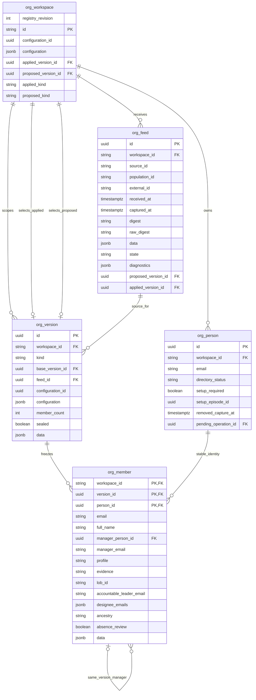

# Production organization snapshot storage

30 October 2026 · Authorized persistence with production Organization UI integration

[Pure domain rules](organization-domain.md) · [Production field inventory](../engineering-design/11-production-data-model.md) ·
[Implemented ER source](../architecture/diagrams/organization-snapshots-implemented.mmd) · [Prototype reference](../../prototype/docs/organization-er-diagram.md)

## Scope and authority

`SqlOrganizationStore` persists feeds, stable identities and complete proposed/applied snapshots in
five production tables. It requires an injected `SessionService`, verified `AdminPrincipal` and
server-owned UTC clock; no default actor, local actor header, permissive authorizer or raw-candidate
publication method exists. Every command rechecks current grants, then locks the same protected
administrator/session boundary used by CSV export before locking its workspace. Expiry is checked
after waiting for the administrator/session locks; the workspace lock follows. Service attribution records automatic metadata computation; it grants
no alternative access. Read methods recheck authority and use coherent read-only snapshots.

**Authentication workspace and source population are independent.** `org_workspace.id` comes from
the verified application session. The configured `policy.source_id`/`population_id` qualify the
intake envelope. Neither a CSV cell nor its population can select another authentication workspace.
IDs, joins, original-email uniqueness and manager/head references remain workspace-scoped.

The production [Organization screens and intake guide](organization-screens.md) now covers authenticated
CSV upload and employee views. The local runtime infrastructure-services column-scoped organization grants and an explicit private initial profile. The in-progress [parity guide](organization-workflows.md) adds durable review/history and registered simulated lifecycle work; no synchronous prototype fake-success endpoint or destructive reset HTTP route is mounted.

## Implemented organization ER

## Tables and field sources

`org_person` holds the immutable original email anchor, not another mutable reporting tree.
The full frozen `PersonState` lives in `org_member.data`; named columns are readable projections
from that same state. The repository checks their agreement when reconstructing a revision.
`org_version.data` contains the canonical Revision header **without people**, avoiding a second
independently mutable people collection. Each version freezes its own configuration.

| Table | Stored fields and purpose |
| --- | --- |
| `org_workspace` | `id`: authenticated workspace. `configuration_id`/`configuration`: exact trusted organization configuration. `applied_version_id`/`proposed_version_id`: selected heads; fixed `applied_kind`/`proposed_kind` permit scoped correct-kind foreign keys. |
| `org_person` | `id`: stable UUID. `workspace_id`: authority scope. `email`: immutable original normalized identity email, unique inside that workspace. Current email/name are revision fields; explicit merges preserve the survivor. |
| `org_feed` | `id`: acquisition UUID. `workspace_id`: auth scope. `source_id`/`population_id`: qualified source scope. `external_id`: caller delivery identity retained on transport retry. `received_at`: server receipt, distinct from nullable source `captured_at`. `digest`: canonical intake SHA-256. Nullable `raw_digest`: separate source-byte SHA-256. `data`: immutable envelope and rows. `state`/`diagnostics`: processing result including nonfatal accepted warnings. Nullable `proposed_version_id`/`applied_version_id`: this delivery's sealed versions. |
| `org_version` | `id`/`workspace_id`: scoped version. `kind`: proposed/applied. Nullable `base_version_id`: preceding sealed applied version. `feed_id`: same-workspace receipt. `configuration_id`/`configuration`: pinned settings. `member_count`: complete expected member cardinality (1–10000). `sealed`: irreversible completion boundary. `data`: Revision header including IDs, source population/capture, publication clock, declared/assessed completeness and absence eligibility. |
| `org_member` | Composite `workspace_id`/`version_id`/`person_id`: scoped snapshot membership. `email`/`full_name`, `manager_person_id`/`manager_email`, `profile`/`evidence`, `lob_id`/`accountable_leader_email`/`designee_emails`, `ancestry`/`absence_review`: readable frozen attributes. `data`: all PersonState facts, including source values/record key, manager provenance/path/known-manager flag, observation clocks, reported top-manager hint, territory and sticky absence episode. |

The current/proposed SQL views join the selected sealed version. They show `workspace_id`,
`version_id`, `person_id`, `full_name`, `email`, `manager_email`, derived `manager_name`, `profile`,
`evidence`, `lob_id`, `accountable_leader_email`, derived `accountable_leader_name`/`lob_name`,
`designee_emails`/derived `designee_names`, `ancestry`, `absence_review`, and `known_manager`.
Names and LOB labels derive from the selected **frozen** revision/configuration, not later settings.
The parity migration extends current_organization with live managed controls and registered active/removing association counts; proposed source evidence remains a separate frozen graph preview.

Internal input bounds are64KiB for configuration JSON,4MiB for canonical intake JSON,1–5000
source employee rows, at most256characters for source/population IDs and512for delivery identity.
These service bounds supplement the CSV parser's2MiB raw-file cap. Public upload body/stream
controls are not implemented by this private repository.

Stored code values are closed: feed state is `received`, `staged`, `published`, `rejected` or
`superseded`; an outcome adds `duplicate` while `original_state` records the existing feed state.
Version kind is `proposed` or `applied`. Member profile is `employee`/`reference`/`configured`,
evidence is `feed_row`/`retained`/`reference`/`configured`, and ancestry is
`root`/`resolved`/`incomplete`. An absence review is a persistent flag, not a deletion instruction.

## Delivery, staging and publication

1. `configure_initial` creates a workspace once, or accepts only an exact identical retry. It cannot
   overwrite existing settings or reseed accounts. Source IDs are not inferred from auth scope.
2. `ingest` binds the source to that configuration, stores immutable canonical evidence and its
   separate receive/capture clocks, and records the initiating administrator. Known delivery keys
   replay only identical canonical data and raw digest; changed content/capture/completeness under
   that key conflicts. A deliberate new upload uses a new envelope even if employee bytes repeat.
3. Staging evaluates both raw-source and override-effective candidates against the current applied
   head. Neither a correction nor retained historical profiles can rescue fatal source corruption
   or qualify missing incoming census coverage. Source ordering also checks the latest proposal,
   so an older feed cannot replace a newer staged census. Nonfatal diagnostics remain on the feed.
4. Valid raw facts create a complete proposed version. Normal ingestion automatically recomputes
   and applies valid effective metadata in the same transaction. Internal `stage_only` supports
   qualified staging/tests; no production UI presents routine metadata as an approval queue.
5. Explicit staged `apply` requires the exact current proposed ID, applied base and configuration
   ID, then recomputes from immutable source. A known already-applied proposal replays its result.
   Version/member writes, head movement, feed status and shared immutable audit commit together.

Proposed and applied versions have different UUIDs even when their metadata agrees. Stable person
UUIDs are reused in both. Original identities survive history/alias remaps. Rejected/superseded feeds
remain inspectable but do not replace either head. Unknown/stale/partial/unconfirmed source evidence
cannot manufacture departures. An absence flag remains a human review, not deletion authorization.
The original storage milestone generated no recommendation/association rows; parity coordination now reconciles durable review/history and managed transitions in the same publication transaction, while provider-facing association changes use accepted simulated operations.

## Immutability, constraints and indexes

Forward migration0008 creates the five empty tables and two views; it does not migrate prototype
rows or seed employees. Versions must be inserted unsealed, collect their full declared membership,
then seal once. Sealing checks member count/root presence. Sealed headers and their members reject
updates/deletion, and insertion into sealed versions fails. Original person anchors are immutable;
feeds cannot rewrite canonical source evidence and terminal status cannot be reopened. Table
TRUNCATE is blocked. Correct-kind/scoped heads select only sealed versions; deferred same-version
manager FKs permit arbitrary insertion order without cross-version reporting edges.

Scoped original email/delivery/member-email uniqueness supports identity resolution and idempotency.
`ix_org_feed_received(workspace_id,received_at,id)` supports receipt browsing;
`ix_org_manager_children(workspace_id,version_id,manager_person_id)` supports reporting traversal.
Existing native runner, sessions, grants and audit remain separate; no second audit table is added.
These guards constrain runtime DML, not a database owner who can change DDL/triggers.

## Shared administrative history

Closed kinds are `organization_configured`, `organization_feed_received`,
`organization_feed_rejected`, and `organization_published`. Their category is **Organization**.
Configuration/receipt use the verified administrator actor; computed publication/rejection use the
closed **Organization synchronization** service identity after the same authorized command boundary.
History labels the target **Workspace organization**, without inventing an organization detail route.

`OrganizationEvidence` contains `contract_version=organization-1`, `source_id`, `population_id`,
`configuration_id`, nullable `feed_id`/`proposed_version_id`/`applied_version_id`, `person_count` and
`diagnostic_count`. Existing audit rows retain workspace, verified actor snapshot, server clock and
canonical evidence hash. Operation/admin target IDs are null for this closed family. History and
CSV validate this typed evidence before exposing only their usual safe projection; no raw CSV,
employee profile or configuration document is disclosed by the history API. Before/after snapshots
are recoverable through the immutable predecessor/version links; a richer org change queue follows.

`OrganizationOutcome` returns `snapshot_id`, processing `state`, nullable `proposed_version_id`/`revision_id` (the applied version ID),
nullable `original_state` for duplicate delivery, and typed diagnostics. The internal repository has
no HTTP error mapping yet; future adapters must return fixed safe errors, not raw database content.

## Verification and remaining work

Unit tests cover authority/scope, typed evidence, configuration initialization, stable identities,
reconstruction, stage/apply/replay and corruption guards. Disposable PostgreSQL tests exercise actual
migrations, view names, source ordering, separate heads, concurrency, immutable guards, scoped FKs,
accepted warnings and atomic rollback. Existing HTTPS/Playwright checks keep prior authentication,
branding, audit exports and simulation behavior working; no test uses the human's live database.
Production complete-source unit coverage remains independently measured at95% or greater.

The in-progress [parity field guide](organization-workflows.md) documents the new persisted review
and registered-association coordination. Source snapshots remain the same immutable foundation;
managed status belongs to the stable person. Full OCI/SSO/OKE/email/managed-role qualification
remains separate. No synchronous prototype fake-success bypass is ported.

### Accepted manual-upload source time

30 October2026. The production upload screen will require the administrator to confirm an
**Organization data as of** date/time, defaulting to current server UTC. This is an explicit
administrator attestation, not a timestamp inferred from a filename, CSV cell, browser clock or
receipt time. It maps to `Envelope.captured_at`, `org_feed.captured_at` and the revision source
capture time. `received_at` remains the independent server receipt clock. Normal scope, freshness,
census authority/completeness, incoming-profile coverage and source-order checks still apply;
the field does not authorize automatic deletion or turn partial data into a complete census.
The four-column CSV format is unchanged. This design decision is captured now; the upload UI
is implemented by the authenticated screen adapter; the source-time decision does not qualify actual corporate feed authority.

## Migration0009 control extensions

The [implemented workflow ER](../architecture/diagrams/organization-workflows-implemented.mmd) supersedes the
five-table snapshot subset for whole-organization queries. `org_workspace.registry_revision` adds a
registry/decision preview fence. `org_person.directory_status`, `setup_required`, `setup_episode_id`,
`removed_capture_at`, `pending_operation_id` are live managed controls; only the original UUID,
workspace and email anchor remain immutable. Full member/feed/version source evidence is unchanged.
See the workflow guide for every extension/new-table field and the in-progress qualification scope.
