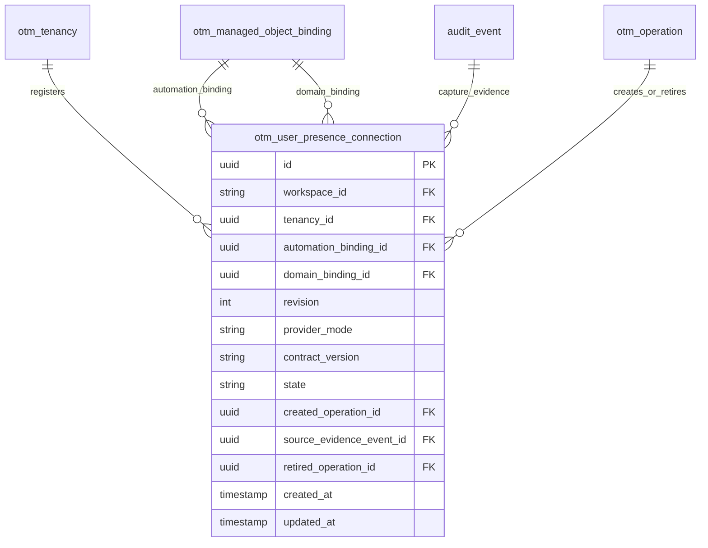

# Simulated automation connections for user-presence checks

This is the implemented foundation for the approved presence-only model. It records one selected
**simulated automation connection**, not a real API credential, verified signing authority,
permission profile or healthy account. The Required users screen is unchanged and still says
Not checked at that earlier checkpoint. The later [manual check pipeline](user-presence-checks.md) now adds explicit API/worker acquisition and independent result display. No scheduled scan, repair or password action is added.

## Accepted simplification

The first presence check needs exact canonical user/domain identities and one current automation
connection revision. It does not need access-assignment/profile tables, separate access/context/
credential generation heads, or recovery/parent credential fallback. Failure to authenticate must
remain Unable to verify, never Missing. Privilege checks, repairs and credential custody retain their
separate design and qualification work. This supersedes their earlier inclusion as prerequisites
for the first presence-only check; it does not remove their future security requirements.

The internal boundary is now `required-user-presence-2`. No version 1 presence API or durable result
was deployed, so no saved presence evidence is rewritten. Version 1 payloads and obsolete assignment/
credential fields are rejected rather than silently interpreted. The ordinary operation inspection
ExecutionContext remains unchanged.

## Physical model: all 14 columns

`otm_user_presence_connection` is added by frozen migration 0024. Canonical bindings own identity;
this table duplicates no usernames, OCIDs, SCIM IDs, endpoints or secrets.

| Field | Meaning |
| --- | --- |
| id | UUID of this connection record; not an OCI or credential identifier. |
| workspace_id | Workspace scope for every reference and read. |
| tenancy_id | Same-workspace registered child. |
| automation_binding_id | Same-child canonical automation-user binding; recovery/owner accounts cannot substitute. |
| domain_binding_id | Same-child canonical identity-domain binding referenced by that automation user. |
| revision | Initially 1, immutable. A future replacement/connection-change flow must introduce a new qualified revision; none is implemented here. |
| provider_mode | Exactly simulated in this implementation; there is no live-OCI or automatic fallback branch. |
| contract_version | Exactly simulated-user-presence-1, identifying the accepted connection-capture capability. |
| state | active or retired. Active selects a local simulated connection; it does not prove signing, account presence, privileges or recovery readiness. |
| created_operation_id | Same-workspace create/import operation that accepted the capability and captured these identities. |
| source_evidence_event_id | That operation's immutable verified capture outcome; scoped jointly with the operation. |
| retired_operation_id | Null while active; the exact verified termination-initiation operation when retired. |
| created_at | UTC capture-evidence time; not a later independent presence-check time. |
| updated_at | Initial capture time, advancing only for retirement. |

[Editable ER source](../architecture/diagrams/user-presence-connections-implemented.mmd).



## Capture, replay and retirement

Fresh create/import admission explicitly freezes the optional
`presence_connection_contract="simulated-user-presence-1"` in OrganizationIntent. Absent values are
excluded from serialization to preserve historical bytes. The marker requires version 3 onboarding;
older graphs and previously accepted version 3 operations retain their original behavior.

The capture step's audit/step evidence, three canonical identities and connection now share one
savepoint. A failed connection insert rolls back the complete capture set, blocks temporary-account
retirement and allows the ordinary setup retry to acquire fresh evidence. Earlier verified setup
steps remain available. No read/startup/redelivery creates missing historical connection records.

The database independently checks canonical automation/domain roles, same-child scope, exact source
operation/event, current verified capture step, accepted marker, pending simulated child and capture
timestamp. Identical replay retains the connection ID; conflicting evidence is not adopted. One
active connection per child is enforced by a partial unique index. Immutable fields cannot change;
delete/truncate are denied. Verified termination retires canonical identities and then the connection
in the same transaction, preserving provenance. Both whole-tenancy and employee-driven deletion
entry points are supported. Failed initiation preserves the active connection.

API credentials have SELECT only. The worker can INSERT and update only state, retired_operation_id
and updated_at. The reviewed owner-only local reset includes this table and its trigger inventory,
retaining administrator, operation and audit history. No production reset endpoint is added.

## Revised internal messages and later dispatch

RequiredUserTarget retains exact registered child/parent/organization, workspace, purpose, canonical
subject binding/generation, domain binding/OCID, SCIM ID, nullable user OCID and observed-name label.
RequiredUserReadContext contains workspace_id, operation_id, step_key, attempt_id, intent_revision,
execution_generation, connection_id and connection_revision. There are no invented credential or
assignment identifiers. SimulatedUserReadAccess uses workspace, connection ID/revision, explicit
permitted flag and allowed-child set; independent domain/user fixtures still determine read results.

A later worker must resolve and recheck active child lifecycle, both current canonical bindings,
active connection/revision, current explicit simulated provider configuration and current
administrator entitlement before and after acquisition. A matching echoed context or active record
alone cannot authorize a read or certify a result as current. Historical/unconfigured connections
stay unverified. Real OCI requires a separately qualified credential resolver and adapter; neither
is implemented or silently simulated here. Presence never proves administrator grants or usable
password/API access.

## Qualification and manual review

Units cover exact references, replay/conflict, legacy serialization, strict removed-field/version
rejection, independent fixture state and normalized failures. PostgreSQL tests exercise actual
create/import capture, atomic rollback/retry, old captures remaining unbound, both termination
paths, failed termination, direct forged inserts during a valid pending capture, unaccepted markers,
immutability, scoped foreign keys and installed API/worker privileges. Existing native HTTPS browser
flows remain regression gates; this checkpoint adds no UI controls.

The connection foundation itself added no manual screen controls. The later [manual check pipeline](user-presence-checks.md) now implements scoped acquisition and result publication through the existing worker, Refresh user data and per-user Present/Missing/Unable to verify display. Its local qualification and main-preview installation now pass; the parallel preview remains unchanged. Actual live connection/signing qualification remains Pending in the [real OCI manifest](../how-to/real-oci-test-manifest.md).


For an optional database review after the updated revision is installed, complete a new simulated
create/import using the [existing setup runbook](../how-to/required-users-runbook.md). In pgAdmin:

```sql
SELECT t.name AS tenancy, c.revision, c.state, c.provider_mode,
       b.user_name AS automation_user, c.created_at
FROM public.otm_user_presence_connection AS c
JOIN public.otm_tenancy AS t
  ON t.workspace_id = c.workspace_id AND t.id = c.tenancy_id
JOIN public.otm_managed_object_binding AS b
  ON b.workspace_id = c.workspace_id AND b.tenancy_id = c.tenancy_id
 AND b.id = c.automation_binding_id
ORDER BY c.created_at DESC;
```

Expect one active simulated connection for the new setup, pointing to its canonical automation user.
Older setups may have no row. Do not insert or edit rows to make a tenancy appear configured. On
successful simulated termination initiation, the existing connection becomes retired and is retained.
There is still no Check now action or independent observation timestamp in this checkpoint.

## Manual presence checks — 6 November 2026 source checkpoint

The [manual check implementation](user-presence-checks.md) now connects the selected simulated
connection and exact bound automation/recovery identities to explicit authenticated Refresh user data,
existing native operations/worker/audit and independent dated presence results. This supersedes
no-check/no-result/no-UI statements from the preceding foundation only for this presence-only path.
The [screen map](required-users-screen.md) has 22 effective display fields; Permissions remains
Not checked. Legacy unbound/unconfigured children cannot check. Simulation reconstructs authenticated
producer fixtures and does not verify live OCI. Assignments/profiles are deferred until separately
needed for privileges/repair; no credential IDs are fabricated. Daily scheduling, emails, credential
custody, readiness and repair remain outside this checkpoint. Local simulation qualification and the main-preview upgrade pass; the parallel preview is unchanged. [Final receipt](../history/manual-presence-checkpoint-2026-11-06.md).
