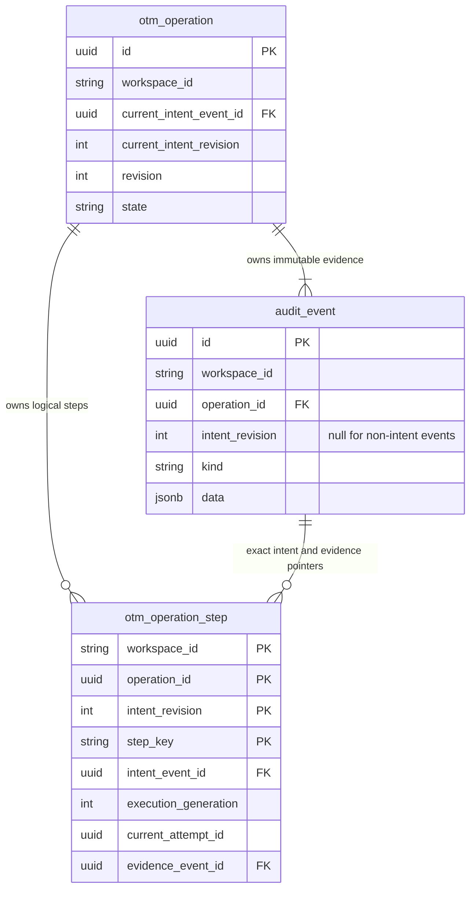

# Durable simulated inspection worker

29 October 2026 · P0.8 implementation checkpoint

[Backend setup](../../backend/README.md) · [Admission](admission.md) ·
[Full production dictionary](../engineering-design/11-production-data-model.md)

## One complete read workflow

The original P0.8 package provided a registered Procrastinate task for the accepted
`inspect_import` operation. This original slice implemented **simulated inspection only**, without OCI calls,
credentials, registry adoption, configuration writes or tenancy-operation HTTP routes. A verified inspection
confirms only the expected child/parent/organization read; it cannot claim successful import/setup.

`register_inspection_task(app, worker)` takes an explicitly supplied native app and
`SimulatedInspectionWorker`. It registers fixed `otm.inspect_import`, accepts only `operation_id`
and enables no automatic retry. Its internal default queue is `otm.operations`; the explicit local
sandbox overrides it with the same workspace-scoped queue used by admission. Constructing/registering
opens no pool and reads no saved environment configuration. The [local foreground worker](simulation.md)
now composes the real native consumer and current OTM grants/configuration. Real OCI/corporate
policy/credential adapters and production deployment remain qualification work; no permissive
callback is a substitute.

The application owns business status. Native job success means the handler returned, including when
it safely recorded **Needs attention**; it does not mean inspection or onboarding succeeded.

## Execution flow

1. Load the exact runnable operation/current intent. Revalidate closed data, canonical hash,
   workspace and original issuer-qualified actor snapshot. Terminal/absent deliveries are no-ops.
2. Require current authority through `DispatchAuthority.require_inspection`. Its implementation
   must check current administrator entitlement, the execution/restore pause, and scoped active
   access. The returned grant contains workspace, actor key, frozen policy revision, runtime-policy
   revision, selected binding and current credential generation. Scope changes cannot retarget intent.
3. Claim in a short READ COMMITTED transaction: lock the operation, compare its revision and exact
   intent, create/update one logical `inspect_target` step, advance attempt/generation, append the
   dispatch event, and update Running. A lost claim writes nothing. The dispatch event records a
   **claim**, not proof that the provider was contacted.
4. Release the transaction, recheck the current grant, and call `TenancyInspection` against the
   simulator. It validates fresh capture times, exact attempt, child, parent and organization.
   Recheck authority after the read; changed/revoked grants discard confirmed data.
5. In another short transaction, require the same operation revision, exact intent, step state,
   attempt ID and execution generation. Publish normalized outcome, step/evidence pointer and
   operation status together. A superseded result writes nothing. Independently validate nested
   result attempt/code/target before opening this write transaction; typed models alone do not
   establish cross-model pairing. Clock values must be explicit UTC.

These checks do not make an already-issued read revocable or establish atomic revocation against a
future external identity provider. The current-authority seam is required, explicitly injected and
tested; the actual SSO/policy/credential composition and its revocation semantics remain qualification
work. No mutation workflow should be inferred from this limited read worker.

## Outcomes and interrupted reads

| Read outcome | Operation / logical step | Durable evidence and follow-up |
|---|---|---|
| Confirmed exact child | Succeeded / Verified | Full normalized simulated facts and correlations in the immutable outcome, linked by the step; no active tenancy association is published |
| Denied, delayed, timeout, unobservable or unsupported | Needs attention / Needs attention | Preserve safe code and normalized unknown result; never infer deletion/absence or retry indefinitely |
| Authority denied before claim | Needs attention / no step created | One safe pre-dispatch outcome; no provider read or dispatch event |
| Grant changed during attempt, invalid provider result | Needs attention / Needs attention | Fixed diagnostic; no raw exception text or confirmed facts |
| Superseded attempt | Newer state retained | No stale outcome overwrites or closes newer work |
| Database error during claim/publication | Transaction rolls back | Native job can fail while operation remains at its last committed state; no false completion |

Each attempt uses the original immutable target and inputs. An explicitly redelivered **read-only**
operation left Running can claim a new generation; late results from the old one cannot publish.
A terminal duplicate is a no-op. This is not permission to repeat a create/delete call. Native stalled
job discovery and an owned retry action remain necessary after an abrupt worker death; restart alone
does not reschedule stalled jobs. The earlier runner qualification covers worker signals/heartbeats;
this slice separately proves actual task registration, read dispatch and durable publication.
There is no new auto-retry scheduler, manual-resume UI, notification outbox or generic mutation engine.

## Actual schema and field map

Migration `0002_inspection_worker` adds the third production application table,
`public.otm_operation_step`. The separate prototype schema still has ten tables; the full proposed
application inventory is 30. These are staged implementations of existing approved entities,
not a new parallel operation or observation model.

| Implemented step fields | Source and meaning |
|---|---|
| `workspace_id`, `operation_id`, `intent_revision`, `step_key` | Composite logical key; fixed `inspect_target`, same exact operation/intent scope |
| `intent_event_id` | Explicit exact-intent FK together with workspace/operation/revision; not an outcome event |
| `command_kind`, `contract_version`, `inputs` | Fixed `inspect_tenancy` / `execution-1-draft` and immutable resolved inspection intent; retries check, never replace these inputs |
| `state` | Current subset Running, Verified or Needs attention; pending/dependencies and other workflows are future migrations |
| `execution_generation`, `attempt_number`, `current_attempt_id` | Incremented claim generation/count and new UUID per read attempt; guard late publication |
| `effect_knowledge` | Always `none`: this capability only reads provider state |
| `last_outcome` | Closed versioned `InspectionOutcome`, including simulated provenance, exact context, intent event ID, safe code and nullable normalized result |
| `verified_at`, `evidence_event_id` | UTC successful read verification time and same-workspace/same-operation durable audit event reference; otherwise verification time remains null |

Outcome and dispatch audit rows have **null `intent_revision`**; their closed JSON context preserves
its positive revision and attempt. Intent rows must have a non-null positive revision. The CHECK
explicitly rejects SQL NULL/UNKNOWN for intent, and rejects non-null outcome/dispatch revisions.
Existing NULLS DISTINCT uniqueness therefore allows multiple worker events while retaining one
intent per revision. The positive current-intent FK cannot point at a null-revision outcome: no new
kind pointer column, coordinator or partial index is required. All audit rewrite/delete/truncate
protection from migration 0001 remains active.

The normalized outcome stores actual observed name, child/parent/organization, raw home-region key,
nullable qualified region identifier, capture times and safe provider correlations. Simulator
`evidence_ref` UUIDs are simulator correlations; the full facts survive in the audit JSON and the
step points at that durable audit event. No private key, password, raw SDK response or error enters
these records. Old/superseded dispatch events remain immutable history.

## Verification and deployment limits

Real PostgreSQL tests cover native task fetching/completion, unknown/denied reads, revoked authority,
concurrent claims, interrupted-read supersession, failed outcome publication rollback and explicit
read redelivery. Direct SQL negatives prove the revised audit CHECK and current-intent FK. Session
setup writes an actual accepted intent/job under 0001 before upgrading to head, preserving that data.
Metadata comparison now includes all six application tables after the later [administrator migration](administrators.md),
retaining real FK-difference detection.

The worker slice contributed nine explicit migration assets; later session, idle-policy and
administrator migrations now make 17 across six revisions. All SQL revisions are frozen/hash-checked;
no API-startup schema creation, implicit migration or credential-bearing Alembic URL was introduced.
The separate local launcher applies migrations only through its explicit operator setup command.
Production role grants, managed PostgreSQL behavior, corporate SSO, secret resolution, real OCI
integration, operational retry UI and process-level production deployment remain unimplemented or
unqualified. No claim of full application readiness follows from this internal simulated workflow.

## Separate local worker process

`otm-local worker` launches the long-lived `otm-simulation-worker` with separate restricted worker
credentials for the owned IPv4 loopback database. It polls `otm.sim.<32 workspace-hash characters>`
with concurrency 1; API startup does not launch it. The lower-level `--once` option drains available
jobs with no waiting, rather than limiting execution to one job. The API can enqueue with its own
credential but receives no worker update/delete grants. No MFA custody or owner DSN is passed to the
worker; same-OS-user local file access still prevents a production-isolation claim.

`SandboxAuthority` rechecks the original actor's current OTM grant and current pause/policy/binding/
parent/organization/child scope at worker boundaries. A whole-config runtime revision prevents stale
publication across edits. `SandboxProvider` uses the existing simulator for configured healthy,
denied, timeout, unsupported and unobservable reads, with virtual credential generation 1. No OCI
signer/network call or adoption is introduced. [Configuration/field and lifecycle details](simulation.md)
keep accepted intent, business result, native completion and uncertain retry distinct.

## In-progress simulated organization worker

The [workflow guide](organization-workflows.md) describes the new `otm.organization_action` task,
registered on the same scoped native queue as inspection. It accepts only operation identity and has
no automatic retry. `OrganizationLifecycleWorker` verifies original authorization revision, current
policy/pause and frozen person/registered-child/recipient context; the local facade and registry
publication are one database unit of work. Its outcome, logical `apply_lifecycle` step and operation
state commit together. Exceptions roll back that local simulation and attempt safe failure evidence.
This bounded simulation is not the network-outside-transaction contract required of a future OCI
adapter. The inspection algorithm/guards above retain their original distinct read capability.
Final new worker tests/security evidence remain in progress.
