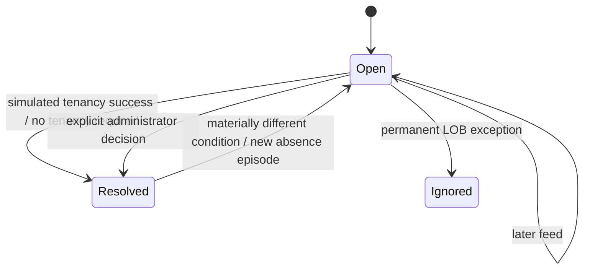

# Exception lifecycle and remediation design

> Run lab commands from the repository’s `prototype/` directory. See [setup](../README.md).

Updated 19 October 2026 · executable organization prototype

The Exceptions page has two tabs. **Actionable** contains administrator decisions, with open
work as its default view. **Informational & history** contains active source warnings, their
automatic resolutions, rejected feeds, metadata changes and completed administrator decisions.
The navigation count is actionable work only. Search, category filtering, dates and pagination
work independently in each tab. No security-findings tracking is introduced.

## Status meanings

| Status | Category | Meaning / transition |
|---|---|---|
| Open / Needs review | Actionable | A decision is pending. Daily feeds refresh evidence without closing it. |
| Acknowledged | Legacy actionable state | An earlier prototype or CLI recorded investigation without completing the review. New tenancy simulations close it instead. |
| Simulated success | Informational history | A selected tenancy operation was simulated successfully and its organizational review closed. No OCI operation occurred. |
| Resolved | History | An administrator explicitly completed the review; the same resolved condition stays closed. |
| Ignored | History | A permanent person + review-type exemption, such as an executive assistant's LOB mapping. Other review types remain enabled. |
| Active warning | Informational | Source data needs correction. It requires no Resolve button. |
| Auto-resolved | Informational history | Corrected source evidence cleared the warning; first/last/resolved dates remain visible. |
| Applied | Informational history | A baseline or metadata update was applied automatically. |
| Rejected | Informational history | Feed parsing/validation failed. The prior current organization remains intact. |
| Merged | History | An administrator confirmed a one-way identity merge. Original versions and retired identity anchors remain historical evidence. |



A resolved review is not a blanket waiver. New employee completion is permanent for that current
identity; absence completion applies to its episode; other review completions apply to a stable
fingerprint of the relevant facts. Name-only changes do not reopen unrelated branch reviews.
Override-conflict fingerprints include the actual conflicting source and effective values, so a
later different conflicting name/manager is not accidentally waived. Ignore deliberately survives
future changes to the same person's same review type until the test lab is cleaned.

### LOB mapping action labels — decision recorded 19 October 2026

**Dismiss current condition** records a condition-scoped resolution (`resolve`). Identical feeds
keep it closed; relevant changes to reporting or organizational mapping may create another review.
**Always exempt from LOB mapping** records a person + type exemption (`ignore`) that survives
future organizational changes. Other review types, including absence reviews, remain enabled.
Neither action assigns an LOB or removes the employee. Both retain a factual server-generated description and action history; no free-text Reason prompt is required.
Use generic guidance in the UI; actual employee names appear only as the affected record.

## Complete review catalogue

There are eight stored exception kinds plus the derived new-employee setup review.

| Review | Tab | Persistence / closure | Current controls | Planned production remediation |
|---|---|---|---|---|
| New employee (`TENANCY_SETUP_REVIEW`) | Actionable | Persists until a tenancy choice, No tenancy required, or identity merge. First census is a baseline, not an assertion that all employees are new hires. | Create tenancy, Import tenancy, Add to shared tenancy, No tenancy required; Merge name/email change. | Choose individual provision, existing-tenancy adoption, shared membership, or no tenancy required. Atomically hand off accepted work to a durable tenancy workflow and close the organization review. Track provisioning state separately. |
| Absence (`PERSON_ABSENCE_REVIEW`) | Actionable | Persists until an explicit offboarding/disposition decision, including across partial feeds and reappearance. | Offboard person with a per-association delete/remove/transfer/keep plan; keep returned employee where applicable; Merge. | Close the org review on durable workflow acceptance. Complete offboarding only after the last association is removed; preserve source/reporting and audit history. |
| LOB mapping (`LOB_MAPPING_REVIEW`) | Actionable | Persists until explicit Resolve or permanent Ignore. | Dismiss current condition, Always exempt from LOB mapping. | Correct mapping/configuration, or record an intentional person-specific exception. An intentional exemption survives repeated feeds without inventing an LOB. No-tenancy decisions can separately exclude people from the managed directory. |
| LOB leader (`LOB_LEADER_REVIEW`) | Actionable | Persists until explicit resolution. Same facts remain closed; changed accountability facts can reopen it. | Resolve with automatically recorded action description. | Review moved/absent top-level leader, LOB mapping, affected people and designee nominations. Configuration editor is a future UI flow; local CLI/configuration API is the current configuration mechanism. |
| Designee (`DESIGNEE_INVALID`) | Actionable | Persists until explicit resolution. Different relevant facts can reopen it. | Resolve with automatically recorded action description. | Replace/reconfirm designees under the appropriate LOB using trusted administrator configuration. |
| Override (`OVERRIDE_CONFLICT`) | Actionable | Persists until explicit resolution. A different source/effective conflict reopens it. | Resolve with automatically recorded action description. | Verify source versus administrator correction, fix source or update/remove the override. Resolving records review completion; it does not fabricate a corrected source value. |
| Top manager (`TOP_MANAGER_MISMATCH`) | Informational | Automatically resolves after the manager chain / `TOP_MGR` is corrected. Historical warning remains dated. | View only. | Source correction. The feed hint never silently replaces derived accountability. Direct reports to the configured root may report that root as their top manager; this is a valid boundary convention. |
| Missing manager profile (`MANAGER_PROFILE_MISSING`) | Informational | Clears on adequate source correction; historical warning remains. Partial absence alone cannot prove it corrected. | View only. | Add the manager's employee row or correct the referring relationship. Census-based absence inference stays blocked while required profiles are missing. |
| Incomplete chain (`ANCESTRY_UNRESOLVED`) | Informational | Clears when corrected edges reach the configured root. | View only. | Complete/correct the source hierarchy. No person is assumed departed merely because ancestry is incomplete. |

The existing absence and branch metadata remain visible while decisions are pending. An absence
is not proof of departure. Reappearance is evidence for **Resolve / keep returned employee**;
it is deliberately not permission to close the absence review automatically.

## Action buttons versus real effects

The prototype has a real local registry of simulated tenancies and person associations. Create,
import and shared membership record that relationship, simulate success and close onboarding.
**No tenancy required** closes onboarding and hides a profile only when it has no active
associations. Additional associations can be managed from the person panel after onboarding.
All results clearly state that no OCI operation occurred.

**Offboard person** replaces the ambiguous separate delete/resolve/remove sequence. The administrator
selects delete, membership removal, ownership transfer or keep for each active association. Shared
ownership must be transferred unless retained; member removal never deletes the shared tenancy.
An individual tenancy with other active members cannot be deleted as individual cleanup. An empty
registry requires explicit confirmation that no associations exist; it is not proof about OCI.

After the simulated plan succeeds, zero remaining associations automatically hides the person from
the managed directory. Keeping an association retains the person, marked as outside the source
organization when absent. There is no redundant Resolve step. Source profiles, reporting edges,
immutable feeds and audit history remain intact. Initial baseline profiles and pending new employees
are not silently hidden just because they start with zero tracked associations.

Registry writes, the directory decision, review closure and audit commit together. A failed
transaction changes none of them. Commands retain a factual server-generated action description and exact current
workspace/applied/proposed/configuration context. Repeated feeds preserve a pending review or deliberate exemption; qualified absence followed by
a qualified full-feed return can reopen onboarding after completed zero-association offboarding.
Managed-person absence and LOB-mapping work is suppressed for unmanaged profiles; source warnings
and configuration-level leader/designee issues remain visible. A qualified full-feed return after
qualified absence automatically opens fresh onboarding for a fully offboarded zero-association
person, with durable pending state and no tenancy restoration. No tenancy required remains an
explicit exemption; manual Re-onboard is available for source-present unmanaged people without
active associations. Unchanged-present uploads alone do not constitute an absence/return cycle.
A retained outside employee with existing associations instead uses Mark returned to organization;
feed reappearance alone does not clear the explicit outside status or grant new association actions.

LOB/configuration reviews retain their specific dismissal/resolution controls. Name/email merge
remains explicit. See [Tenancy associations and offboarding](tenancy-associations.md) for registry
semantics, ownership guards, legacy history conversion and a multi-association walkthrough.

### Absence example

1. An employee is absent from a qualified full feed; one review episode opens.
2. Subsequent feeds retain that episode and its first-seen date until an administrator acts.
3. The administrator offboards the person, deleting an individually owned tenancy but keeping a
   shared membership. The review closes; the person remains visible with that retained association.
4. A later offboarding pass removes the membership. The shared tenancy survives and the person
   automatically leaves the managed directory because no associations remain.
5. A later qualified full-feed return after qualified absence automatically opens new onboarding
   for that zero-association person. Original history remains; old tenancy associations stay retired.
   A No tenancy required exemption instead remains excluded until manual Re-onboard.

Production deletion must enforce registry/child-parent checks: never delete a parent, an
unregistered tenancy or an ineligible/non-child tenancy. Warn for manager/shared ownership using
last-known roles. Imported and newly provisioned children have equivalent eligibility. Offline
value-preservation checks remain the administrator's responsibility. OCI termination/recovery timing
is not simulated by this prototype. Production directory removal waits for workflow success;
the organization review closes earlier, at durable workflow acceptance.

### New employee example

Choose Create tenancy, Import tenancy, Add to shared tenancy or No tenancy required. The confirmed
choice closes the review immediately. The first three choices add a local simulated association;
No tenancy required hides the zero-association profile from the managed directory. Existing source
and reporting evidence remains available. A completed offboarding can later enter new onboarding after qualified absence and a qualified
full-feed return. No tenancy required remains excluded until explicit Re-onboard; ordinary
unchanged-present uploads do not reset that exemption or fabricate a return.

## One-way name/email merge

A name change with unchanged email is normal automatic metadata. When email also changes, the
prototype initially creates a new profile and a retained absent profile. An administrator can
open either review and choose **Merge name / email change**, explicitly selecting its counterpart.
The UI shows which absent identity survives and which new email/name is adopted; there is no
automatic name matching.

The server verifies an unresolved absent identity and an unresolved new employee in the same
workspace, with old email absent and new email present in the latest source. The configured root
cannot participate. The old person's stable `person_id` survives, while current name/email,
reporting relationships and derived LOB metadata come from the new source profile. Manager edges,
trusted LOB/designee references, supplemental edges and corrections are rebased atomically.
Both identity-related reviews close. Repeated name/email changes retain the original survivor ID.

Historical versions keep their original names/emails/IDs. The immutable `org_person.email` becomes
an original identity anchor; current email is the versioned member's email. Explicit old-to-new
aliases prevent recreating a retired identity. A later changed source file containing a retired
employee email is rejected with `RETIRED_EMAIL_IN_FEED`; stale manager references may be normalized
through the verified alias. Two rows collapsing to one identity are rejected, not silently deduped.

The local tenancy registry links ownership and membership to stable person IDs. A verified merge
preserves the survivor's sole/shared associations and reconciles those on the provisional new
identity, rather than abandoning relationships. Historical association records and prior action
history remain attached to their original evidence. Production OCI identity/access updates still
require their own implementation; a local registry merge is not proof of external access changes.
Merges are one way in this prototype; reversal requires a future audited correction workflow.

## Informational and change history

Each warning episode has first-seen, last-seen and, when corrected, resolved dates. Recurrence
after correction opens a new dated episode. Employee metadata changes are grouped into one row
per employee per applied revision, with expandable before/after fields (name, email, manager,
LOB, accountable leader and designees). The initial census is one baseline row. No-op feeds do
not produce fake metadata changes. This history uses the existing immutable administrative events;
it is not an editable security findings tracker.

Administrator resolutions, ignores, merges and simulated tenancy successes are dated history.
Earlier acknowledgment-only events remain historical evidence of that earlier behavior.
Actionable rows disappear from the work queue once resolved/ignored/merged; their decisions do
not disappear from history. The UI does not require pgAdmin to inspect these events.

### Intake/validation diagnostics

These are informational processing failures/coverage facts, not administrator approval items:

| Diagnostic group | Codes / examples | Behavior |
|---|---|---|
| CSV shape | Invalid/missing/duplicated headers, malformed UTF-8/quotes, duplicate normalized email, empty/oversized file, incorrect row width | Reject upload; show understandable error. Parsing failures are retained in informational history. |
| Scope/authority | `SOURCE_SCOPE_MISMATCH`, `SOURCE_NOT_CONFIGURED_FOR_METADATA` | Reject; correct trusted binding/configuration. |
| Capture order/freshness | `CAPTURE_TIME_REQUIRED`, `CAPTURE_ORDER_UNKNOWN`, `FUTURE_CAPTURE`, `STALE_CAPTURE`, `SUPERSEDED_CAPTURE` | Reject/supersede; preserve the applied org. Local CSV receipt clock remains a demo contract, not proof of real export freshness. |
| Identity | `DUPLICATE_EMAIL`, `DUPLICATE_SOURCE_RECORD_ID`, `AMBIGUOUS_SOURCE_ID_EMAIL`, `SOURCE_ID_CHANGED`, `RETIRED_EMAIL_IN_FEED` | Reject unsafe ambiguity. An explicit merge is the supported rare rename workflow. |
| Graph/configuration | `MANAGER_REQUIRED`, `REPORTING_CYCLE`, `SUPPLEMENTAL_EDGE_CONFLICT`, `OVERRIDE_PERSON_UNKNOWN` | Reject unsafe graph/configuration; fix evidence/configuration. |
| Coverage | `MANAGER_PROFILE_MISSING`, `INCOMING_ROOT_PATH_INCOMPLETE` | Valid metadata may apply; new absence inference is blocked. Corresponding manager/ancestry warnings appear in Informational. |
| Snapshot integrity | `SNAPSHOT_CONTENT_CONFLICT` | Reject reused source identity with conflicting content; never overwrite original input. |

Every CSV upload now creates a fresh observation, even if its bytes match a previous file.
The content hash remains evidence; it is not the snapshot identity. Loading an older CSV again
can therefore trigger absence reviews for employees added since its earlier upload. Identified
transport retries reuse the same canonical envelope and remain idempotent. Future API/object
storage pulls follow the same per-observation rule. Cleaning clears review decisions, exclusions
and merge rules for that run while retaining ordinary LOB configuration and archived history.

## Planned tenancy action flows

The production organization queue tracks decisions to initiate work. Job/workflow state belongs
in a separate tenancy operations view. Once a validated administrator request is **durably
accepted**, the organization review closes and links to that workflow; it must not remain pending
through activation or provisioning. Request validation or enqueue failure leaves the review open.
Creation of the job, review closure and audit must be one transaction, or use an equivalent
transactional outbox with an idempotent job identity, so work cannot be lost between queues.

The separate workflow tracks Pending, Running, Awaiting administrator activation, Succeeded,
Failed and Awaiting outcome verification, with retry/recovery and clear ownership. Failed or
ambiguous jobs remain visible there and do not silently disappear or recreate duplicate org work.
No separate Resolve step is required after successful onboarding. This prototype simulates the
successful end state directly; it does not implement the production workflow/job view yet.

| Flow | Inputs and preview | Processing and human pauses | Completion / failure behavior |
|---|---|---|---|
| Create tenancy | Stable employee ID, proposed tenancy name, configured parent, current manager/LOB and baseline configuration version. Check existing associations first; multiple legitimate tenancies remain allowed. | Admin starts a durable provisioning job. Record external request identity, await OCI activation if a human email/web/MFA step is required, then resume baseline identity/policy/configuration setup through the OCI adapter. Verify required access and parent relationship before recording a managed child. | Record tenancy association and job result in the linked workflow; org review closed at durable acceptance. Retry known-safe steps; reconcile uncertain external outcomes before resubmitting creation. |
| Import tenancy | Tenancy OCID, stable owner ID, parent-membership proof and temporary bootstrap identity reference stored through the secret-management flow. Preview intended baseline changes. | The operator first detaches/attaches the tenancy to the approved parent through the required OCI process. Validate parent membership, establish the permanent automation/emergency access and baseline configuration, verify it, then retire temporary access only after permanent access works. | Register imported child with the same lifecycle eligibility as a newly created child. Preflight rejection leaves the org review open; failures after durable acceptance stay in the linked workflow. Never log bootstrap credentials. |
| Add to shared tenancy | Managed shared tenancy, stable member ID, accountable owner, intended compartment/access mapping and role. Preview existing membership to avoid duplicate grants. | Admin confirms the target; apply or record membership/access/compartment setup according to the eventual identity integration. Retain a separate owner relationship and explicit per-person shared membership. | Record membership and the result in the linked workflow. A member's later departure prompts their access/compartment cleanup; it does not automatically delete the shared tenancy. Detailed service-specific grant automation remains to be designed. |
| Delete tenancy | Registry-selected tenancy/tenancies for the person, current parent eligibility, last-known manager/shared status and offline preservation confirmation. Show shared memberships separately from individually owned tenancies. | Enforce registry/child checks before starting the durable deletion workflow. Warn for manager/shared ownership. Track external termination state and ambiguous outcomes rather than declaring success at submission time. | Close the organization review on durable workflow acceptance. Complete managed-directory removal automatically when all required association cleanup succeeds. Failed/retained associations keep the person visible in offboarding/retained state. OCI termination and association history remain separate facts. |

A production job can be Pending, Running, Awaiting administrator activation, Succeeded, Failed
or Awaiting outcome verification. These are planned operational statuses, not simulated states
or guarantees supplied by the current simulated-success controls. Parent access, per-child credentials,
versioned baseline configuration and the OCI facade follow the existing engineering design.

## Try the workflows

Generate editable scenarios:

```bash
uv run python scripts/review_demo_scenarios.py
```

Use a fresh/clean lab, then upload files from `.local-dev/review-scenarios` in order:

1. `01-baseline.csv`: real export plus fictional Karen Smith. Ignore the real executive
   assistant's LOB-mapping review; she remains in the directory.
2. `02-new-and-renamed.csv`: Smith is absent, fictional Karen Jones and New Engineer are new,
   and one real employee's top-manager hint is intentionally inconsistent. The inconsistent hint
   is informational. For New Engineer, confirm Create/Import/Add shared or No tenancy required; the review closes.
   For Jones, choose Merge and explicitly match the absent Smith identity.
3. `03-top-manager-fixed.csv`: the hint is corrected. Its active warning auto-resolves, while
   its dates and prior metadata changes remain in the informational tab.
4. `04-departure.csv`: New Engineer is absent. Open Offboard person;
   inspect the association plan. Remove all associations to hide the person automatically, or keep one to retain them for later cleanup.
5. `05-removed-person-repeated.csv`: after qualified absence and completed zero-association
   offboarding, the returning fictional person automatically opens a fresh onboarding review.
   Previous tenancies remain retired. If No tenancy required was chosen instead, that explicit
   exemption remains excluded until manual Re-onboard. Source history is retained in both cases.

Names marked demo and `example.test` addresses are fictional. The unchanged original export
remains in `data/root-leader_org_261015_clean.csv`. The scenarios do not call OCI or change another lab.

## Future application alerts to retain in the engineering design

These are design entries for later application slices, not additional implemented org-lab
exceptions or a change to the deferred security-findings scope:

| Condition | Intended handling |
|---|---|
| Required automation/emergency identity missing | Actionable access repair. Verify through working automation access, offer repair, then verify again. If automation access itself is unavailable, require manual recovery rather than a repair button that cannot work. Notify accountable contacts under the existing access-health design. |
| Required access cannot be checked | Informational verification failure distinguished from confirmed missing access. Retry transient reads; promote persistent loss of access to an administrator recovery task. Never label unknown as healthy or missing without evidence. |
| Baseline policy/quota/budget configuration missing or changed | Actionable configuration drift: show desired/observed difference and baseline version, then explicit repair or an approved exception. Verification closes the technical drift; the administrator disposition/history remains visible. |
| Provision/import/delete job failed or outcome unknown | Actionable resume/retry/reconcile task. Safe transient retries may run automatically, but uncertain external creation/deletion outcomes require discovery before replay. |
| Managed tenancy has no active accountable owner, or child is unregistered | Actionable owner reassignment/adoption/offboarding review. Preserve stable historical ownership. An unregistered tenancy is never eligible for app deletion. |
| Feed overdue or rejected | Informational health/history with last good applied state. Block fresh absence inference; a persistent delivery failure needs administrator investigation under a threshold still to be agreed. |
| LOB has no designee nomination | Administrator configuration task at the LOB level. The lab currently exposes `designee_status=not_configured` rather than generating one task per employee. |
| Spending/projection above configured threshold | Informational spending attention in the future consumption slice. Alert thresholds and escalation are separate design decisions; do not silently add resource shutdown or quota changes. |

## Prototype boundaries

Two business tables now hold local simulated tenancies and associations: `org_tenancy` and
`org_tenancy_association`. The original organization tables retain source and reconciliation state.
Trusted decisions/identity merges and managed-directory exclusions remain frozen in versioned
administrator configuration; recommendation episodes and immutable events retain dated history.
See [the registry design](tenancy-associations.md) for the new relationships and compatibility rules.

Production still needs OCI-backed workflows, SSO identity for action authors, configuration editors
and merge reversal. The current action author is `local:admin`. Administrator decisions may
recompute already-published source evidence after its freshness window expires. Its original
capture timestamp is preserved, the revision is marked `STALE_SOURCE_REVIEW_ONLY`, and no new
absence inference is allowed from that old evidence. Freshness requirements for ordinary incoming
feeds remain unchanged.

## Audit descriptions without Reason prompts — 19 October 2026

The prototype no longer requests free-text Reason input for review, identity, registry or
offboarding UI actions. The server records a factual description of the selected action together
with actor, target, version/configuration context and outcome. HTTP commands accept an optional
reason for API/CLI callers; absence of user-entered prose does not remove audit evidence. This
supersedes earlier prototype instructions requiring a manually supplied reason for every click.
