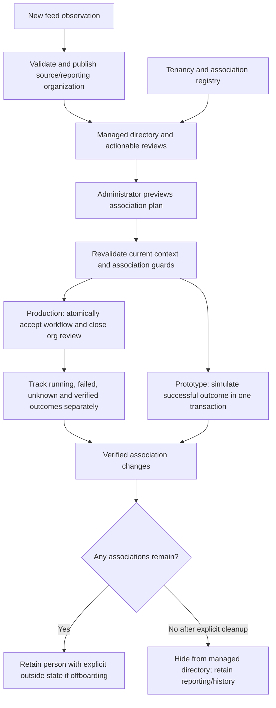

# Organization model and information flow

Current implementation: [the simpler working model](organization-working-model.md) and [executable contract](organization-m1-contract.md). Earlier proposed normalized tables/layouts below are historical design context, not the current physical schema.

12 October 2026 | D15 storage and D17 coverage disposition accepted; field/state/API details remain a design draft

This draft develops the accepted D5/D14/D15/D17 behavior in the [specification](../../docs/product/oci-tenancy-manager-spec.md) and [feed contract](organizational-feed-contract.md). It is the design basis for the [executed local M1 prototype and concrete contracts](organization-m1-contract.md), not a qualified production migration or complete application API. Exact prototype fields/DDL and validation are available there; remaining administration/intake/UI boundaries are explicit. Production source authority remains unresolved. The user accepted complete immutable effective revisions and eligible partial publication for required manager-profile gaps; exact fields, DTOs and migration details still require review.

## Adopted current model — 19 October 2026

This section records the user-approved model implemented in the current local prototype. It is
a current design decision, not a reclassification of the earlier normalized-table proposal below
as implemented storage. It also supersedes the earlier separate Delete/Resolve/Remove-person
interaction. [Current ten-table ER model](organization-er-diagram.md) ·
[Association contract and walkthrough](tenancy-associations.md) ·
[Current exception rules](exception-workflows.md).

### Applied/source structure and managed directory

The current local intake accepts `EMPLOYEE_FULL_NAME,EMAIL,MGR,TOP_MGR` CSV and converts it to
the canonical internal records/envelope. No stable employee ID is guaranteed. Each deliberate
upload is a fresh observation even when its bytes match an older file; retries of one identified
canonical delivery remain idempotent. The earlier XLSX examples below remain historical source
analysis rather than the current CSV UI contract.

The existing eight-table organization engine remains the source/reporting authority: stable
`org_person`, immutable `org_feed`/`org_version`/`org_member`, `org_workspace`, reconciliation
`org_recommendation`, append-only `audit_event` and intent-only `notification_outbox`. Applied
and proposed views retain people/reporting graphs and diagnostics independently of the managed
directory. The SQL view's legacy `tenancy_association_status=not_tracked` and source-derived setup
flags are not the registry projection; callers needing current managed scope use the web registry
API and its association counts/status.

Two physical tables add simulated operational relationships:

| Table | Relationships and invariants |
|---|---|
| `org_tenancy` | Stable workspace-scoped UUID, display name, individual/shared kind, active/deleted status, legacy marker and timestamps. Local UUID is not a real OCI OCID. |
| `org_tenancy_association` | Workspace, registered tenancy, stable person UUID, owner/member role, active/removed status and timestamps. Composite tenancy/workspace FK; one active person/tenancy relationship and at most one active owner; no hard delete required for retirement. |

A person can own multiple tenancies and have several shared memberships. Reorgs update derived
accountability without altering ownership. Explicit identity merges retain the survivor UUID and
reconcile both identities' associations; historical source and relationship evidence is retained.
Unknown legacy shared ownership is shown as unassigned and repaired explicitly, not fabricated.

Versioned configuration adds `managed_exclusions`, `pending_onboarding_person_ids`,
`outside_person_ids` and `registry_initialized`. Stable UUIDs separate deliberate directory
eligibility from source presence. New/initial baseline zero-association people remain visible
until an explicit decision. No tenancy required hides only a zero-association person. Explicit
unmanaged profiles no longer generate person-level absence/LOB-mapping work, but source warnings
and configuration-level leader/designee problems remain visible.

The local UI exposes Tenancies first, then Employees and Exceptions as three main-menu screens. The active
Tenancies inventory at `/tenancies` reads `GET /api/local/tenancies`, with search, owner-derived LOB
filter, sortable tenancy/type/owner/LOB/member columns and pagination. Member counts include the owner, and tenancy-specific summary cards distinguish total active,
individual, shared and unassigned owners. Employees sorts its Tenancies association count.
Existing dialogs provide linked tenancy/owner detail. This is a read projection over the two registry tables and current
organization mapping, not another table or ownership rewrite; retired tenancies remain historical.

### Commands and information flow



Offboarding requires exactly one delete/remove/transfer/keep disposition for every active link.
Individual deletion refuses other active members. Shared-owner exit transfers ownership unless
retained. Shared-member removal changes only that member's link. Empty-registry offboarding
requires explicit confirmation because local absence of links does not prove OCI absence.

When the final association is removed successfully, automatically hide the person from the
managed directory. Kept links retain a visible outside-organization case. Repeated missing feeds
do not undo offboarding; source return does not silently clear retained-association outside status. Mark returned to
organization requires a present retained person and preserves existing links. Re-onboard instead
requires a source-present unmanaged person with zero links and opens an explicit setup review,
including for someone who originally came from the baseline. The later adopted rule also
automatically opens onboarding after qualified absence and qualified full applied-feed return
following completed zero-link offboarding. It never restores old associations. No tenancy required
exemptions remain excluded until manual Re-onboard; retained links require Mark returned. An
unchanged-present upload without genuine absence and partial/staged/rejected feeds cannot qualify.
Store publication persists the cleared exclusion and pending setup configuration in the same feed
transaction, so repeat or later missing feeds cannot lose the pending review. This supersedes the
earlier manual-return-only rule while retaining deliberate no-tenancy and retained-link decisions.

Prototype registry writes, configuration publication, review closure and audit commit atomically
under the workspace lock and exact revision/configuration context. Retire old active relationships
before inserting replacements to preserve partial unique indexes. Reads reconstruct legacy
simulations without writing; the first explicit mutation persists bootstrap rows. Ambiguous
historical deletion preserves associations, and shared unknown ownership blocks new members until
Assign owner chooses an eligible present managed person. Existing member promotion retires its old
member association before recording ownership. No OCI operation is performed by this local slice.

### Engineering design topics before production development

Retain the tested relationship semantics while finalizing:

1. Production schema/migrations and API DTOs for tenancy identity, active association history,
   offboarding cases, workflow correlation and cross-version managed-directory reads.
2. Durable acceptance transaction joining operation intent, queue insertion, org review closure and
   initial audit; verified provider completion controls association retirement and final hiding.
3. Multi-association partial failure/retry/unknown outcomes, per-tenancy mutation coordination and
   recovery without re-deleting or losing the remaining work.
4. Explicit membership/access/compartment cleanup versus ownership transfer, including service
   coverage and verification; a database relationship change is not proof of revoked OCI access.
5. Guarded return/re-onboard and identity merge during active workflows, including deterministic
   reconciliation of provisional-identity associations and external identity updates.
6. UI detail for linked operation progress, retained outside profiles, hidden-profile inspection,
   stale confirmations, protected-child deletion and audit evidence.

These are the next design contracts, not missing prototype behaviors silently claimed as production
implementation. The historical D15/D17 analysis and initial table proposals below remain useful
rationale; the current physical schema is the linked ten-table ER model.

## Design slice and boundaries

M1 must answer: which people are known, how each reporting path is supported, whether it reaches the configured root, which LOB/designees apply, and whether a qualified census establishes absence. It must publish these answers consistently and retain their evidence. Tenancy ownership uses stable person references; a reorg changes derived accountability without transferring ownership or OCI resources.

Production lifecycle/access/configuration/finance schemas follow their own milestone design. The adopted local registry above already establishes prototype tenancy associations; this organization slice supplies their stable person/revision references. Missing people trigger investigation and notifications, never automated tenancy deletion or user revocation.

## Accepted storage representation

Engineering decision D15, accepted A on 12 October 2026: retain stable identity records plus a complete immutable effective organization state for each successful publication. A single head points to the applied revision. Historical reads select that revision directly instead of reconstructing it from temporal per-record intervals. Store the corresponding effective people, reporting edges and accountability mappings together; reference exact immutable configuration inputs. Measure storage/query behavior during M1 rather than claim a benchmark from this design.

Every published state includes retained trusted people/relationships as well as eligible new evidence. Absence is a recorded review condition, not a reason to remove a person's identity/history from the state. A later source capture with identical metadata can still publish refreshed observation evidence. Duplicate delivery of the same source snapshot does not create another revision. A configuration change affecting LOB/designee routing must use the same stage/validate/publish path to produce a coherent new effective revision; editing configuration cannot mutate old published routing.

| Proposed table | Keys and important fields | Relationships and invariants |
|---|---|---|
| `person` | UUID primary key; creation time | Stable identity referenced by future tenancy owners/members; never delete it merely because a feed omits a row |
| `person_email_binding` | Normalized email; person ID; original address; binding/reconciliation history | One active binding per normalized email; trim/case-insensitive matching only; old bindings remain evidence. Conflicting or reused identities require explicit resolution |
| `organization_source` | Source ID; adapter/schema; configured root and population; authority/freshness rules | Source trust comes from configured authority, not the uploaded file's own claim |
| `feed_receipt` | Receipt ID; source; received time; byte digest; snapshot linkage; intake outcome | Every delivery is inspectable, including duplicate/rejected receipts; receipt time does not substitute for source capture time |
| `feed_snapshot` | Snapshot ID; source-scoped external ID when available; captured time/order; population; completeness claim/assessment; normalized digest; processing state | Same-source snapshot identity is immutable; later capture with equal content is fresh presence evidence. Missing capture/authority restricts eligibility |
| `person_observation` | Snapshot + row/reference identity; person/email; full name; source record ID; raw territory/top-manager; evidence kind | Preserve supplied versus referenced evidence; source IDs are source-scoped strings and do not authorize email-change merges |
| `feed_diagnostic` | Snapshot; code/severity; affected row/people; safe detail | Cycles, duplicate identity, missing profiles, coverage and source-order issues remain visible; no guessed edges |
| `organization_configuration_revision` | Revision ID; root/population/LOB mappings; administrator/service provenance | Immutable input configuration used to compute an effective organization; configurations cannot silently alter an already published revision |
| `lob_configuration` / `designee_assignment` | Configuration revision + stable LOB ID; leader; designee person IDs; validity evidence | One or more admin-assigned designees; source territory is separate. Invalid assignments raise review, not invented replacements |
| `organization_revision` | Revision ID; predecessor; source snapshot; configuration revision; published time; change reason/actor | Immutable successful publication; references exact inputs. Feed intake and effective publication are different records |
| `person_revision` | Revision + person composite key; effective full name/email; profile completeness; manager-role evidence; last profile/reference/census times; presence/ancestry state; resolved LOB | No inferred first/last split; unresolved ancestry/LOB explicit; absence never means confirmed Oracle departure |
| `reporting_edge_revision` | Revision + employee composite key; manager; provenance/source observation | At most one effective direct manager per employee; both endpoints in the same revision; no self-edge/cycle. Retained versus newly supplied edges distinguishable |
| `organization_exception` / `exception_event` | Exception ID; type/person/branch; first/last evidence; resolution history | Stable incident identity for repeated detections, historical manager/role evidence and D14 alert deduplication; recovery then renewed loss creates a new incident |
| `organization_change` | Revision + change ID; person/field; before/after; evidence/actor | Names, relationships and derived-accountability changes auditable; no fabricated admin approval |
| `organization_head` | Managed population key; current revision | Compare-and-swap publication target; only advances atomically with complete effective state, changes and required notification intent |

Use database primary/foreign/unique keys for local constraints and candidate-graph validation for cycle/root/coverage properties. For same-revision edges, composite foreign keys prevent crossing revisions. Canonical enum/code sets, exact nullable fields, email-binding reconciliation and migration/index definitions still need review before coding.

No graph database or additional cache service is proposed. For a few hundred people, build an email map and adjacency lists, validate cycles and memoize root/LOB resolution in memory. Diff canonical values by stable person ID. This is linear graph work apart from deterministic ordering/serialization; measure implementation rather than claim latency. Do not compare workbook row positions or use content digest alone to suppress presence updates.

## Canonical feed input

The adapter emits a source-independent envelope and records:

- Envelope: source identity/schema, external snapshot identity/order when available, source capture time, declared root/population, declared completeness, receipt/checksums and assessed trust/coverage diagnostics.
- Person record: source-scoped record ID, normalized/original email, full display name, direct-manager email and reported name, reported top-manager email and nullable territory.
- Optional future structured first/last names are separate supplied fields; do not derive them from `ECA_NAME`.

The initial XLSX adapter maps the seven sample columns. Adapters cannot assign designees, tenancy ownership or OCI permissions. An administrator's local upload is not an authoritative full census by default. Root manager edges outside the configured boundary are retained as source observations without extending the managed tree.

## Ingestion and publication flow

```text
delivery -> receipt -> normalize snapshot -> classify freshness/trust
                                         |-> duplicate: link prior outcome
                                         |-> stale/invalid: diagnostics, preserve head
                                         `-> eligible full/partial candidate
                                              |
                       load head + input configuration revisions
                                              |
                       match identities; enrich reference-only people
                       construct candidate effective graph and evidence
                       validate graph; derive ancestry/LOB/designees
                       compute field changes and qualified absence incidents
                                              |
                                    short PostgreSQL transaction
                       recheck head/config/source order; persist revision,
                       state, changes, exceptions + D14 notification intents;
                       advance head; commit
                                              |
                       UI/API reads published revision; alerts deliver later
```

Candidate construction must include the retained trusted state: partial input may update eligible unambiguous supplied metadata without erasing unspecified fields/edges or concluding absence. Contradictions with administrator-supplemented edges remain explicit. A top-manager hint is never a substitute direct-manager edge. Validate the resulting effective graph, not just incoming rows.

If another publication/configuration change wins before commit, rebuild against the new inputs. Do not apply a stale computed diff. Commit failure exposes no new head or deliverable alert. After a lost post-commit response, lookup the snapshot/application outcome rather than publish again. Identity enrichment must not generate two person IDs under concurrent intake; finalize bindings with the publication transaction's uniqueness/conflict checks.

Proposed processing labels: received, normalizing, validated, staging, published, rejected, superseded, duplicate. A partially eligible publication is a published revision with explicit coverage/eligibility facts, not an overall healthy census. Exact transition/retry semantics must be fixed in the M1 contract, including how duplicate receipts reference the original snapshot.

Presence dimensions remain separate: last employee-row observation, last reference observation, and last qualified population census. Reference-only profile status and absence-review status are different facts. No absence conclusion follows from a partial/failed/stale/unconfirmed feed. Manager profiles missing despite expected full coverage block unsupported census conclusions. The sample is a partial development fixture, not a departure detector.

## Initial field and constraint design

These are the next proposed concrete contracts, not migrations or a finalized enum set. UUIDs identify durable records; UTC timestamps represent source capture, receipt, observation and publication separately. A revision sequence is useful for display/ordering, but the revision ID is the identity used by queries and relationships.

| Relation | Proposed constraints and indexes | Read/write purpose |
|---|---|---|
| Stable person/email binding | Primary person ID; one active normalized-email binding; historical bindings retained; foreign keys never cascade-delete owners/history | Match by agreed email rules while preserving person IDs through reviewed corrections; source ID does not bypass ambiguity |
| Snapshot/receipt | Unique configured source/population/external snapshot identity where authoritative; indexed source capture/order; each receipt has its own ID | Duplicate lookup is independent of payload equality; conflicting content for an existing source snapshot is an integrity diagnostic |
| Organization revision/head | Unique population + publication sequence; predecessor/configuration/snapshot references; one head per population | Publication compares the expected head and configuration inputs, then advances the head only in the successful transaction |
| Person revision | Primary `(revision_id, person_id)`; email/name/profile/presence/role evidence; source/profile/reference/census timestamps; LOB and ancestry result | Complete effective state, including retained absent/reference-only people; list/filter indexes start with revision ID |
| Reporting edge revision | Primary `(revision_id, employee_person_id)`; employee/manager composite foreign keys to that revision; self-edge prohibited | One effective manager; manager lookup/child-expansion index `(revision_id, manager_person_id, employee_person_id)`; graph validation rejects cycles |
| Effective accountability | Revision + person/LOB/designee links, or fields derived from the exact immutable configuration revision | Historical leader/designee resolution cannot join against current mutable configuration; materialized representation chosen with the migration design |
| Change/exception evidence | Revision/event linkage, target person/branch and before/after facts; open-incident identity separate from immutable evidence | Efficient history and deduplication; resolving an incident adds evidence rather than rewriting historical revision facts |

Enforce immutable published content through application interfaces and database privileges/triggers qualified during implementation. Historical correction creates a new revision/change event. Do not expose update/delete endpoints for published revisions. Operational exception delivery/resolution state may advance separately, with immutable event history; its live status is not falsely presented as an old revision's frozen state.

## Proposed ingestion state contract

Separate a delivery receipt's intake outcome, a source snapshot's processing state and a published revision's eligibility facts. This avoids assigning a second processing state to an already published snapshot when it is delivered again.

| Proposed snapshot state | Meaning and permitted next step |
|---|---|
| Received | Identity/evidence recorded; normalization may start |
| Normalizing | Adapter parsing/normalization in progress; interruption retries the same snapshot attempt |
| Validated | Structural/identity/source diagnostics recorded; eligible candidate can stage; coverage may still be partial/unconfirmed |
| Staging | Effective state built against recorded organization/configuration inputs; graph validation and publication attempt follow |
| Published | Successful applied revision exists; terminal for this snapshot application; duplicate receipts reference the outcome |
| Rejected | Invalid or ineligible evidence, including stale/integrity failures, preserved with reason; no head advance |
| Superseded | Valid work displaced by a newer authoritative source snapshot; no obsolete publication |

Duplicate is a receipt disposition linking the original snapshot, not another immutable snapshot state. Execution failure/retry evidence is separate from semantic rejection: a database outage cannot make a valid employee feed intrinsically invalid. An interrupted staging attempt may rebuild against new head/configuration inputs; supersession requires a source-order decision, not merely a concurrent administrator edit. Exact leases/retry limits and DTO enum spellings remain to be specified.

Persist original diagnostics and candidate-attempt inputs even when an attempt fails. On recovery, check whether publication already committed before rebuilding/retrying. No worker heartbeat or processing label can replace the authoritative published revision/head.

## D17: accepted manager-profile coverage disposition

The expected production census includes manager employee rows. Missing required manager profiles are a coverage defect even if all supplied identity fields/edges are structurally valid. They do not prove a departure. D17 A was accepted on 12 October 2026: apply eligible metadata under D5 partial-feed rules while blocking absence conclusions for that census/population.

Retain the source's declared-complete claim as evidence, assess the input as incomplete, and publish only eligible unambiguous supplied metadata under the existing partial-feed rules after validating the effective graph. Create a feed-quality exception and D14 administrator alert; block absence conclusions for that census/population. Missing profiles remain reference-only or retain trusted prior profile facts with provenance. Existing owner/membership links and unresolved-incident evidence remain intact. Never claim complete coverage because retained data fills a missing row.

Once a later configured authoritative snapshot satisfies the complete-population contract, evaluate absence from that snapshot's own evidence. The earlier incomplete input is retained in history; it is not retrospectively promoted to a complete census. Ordinary metadata updates remain automatic, and any resulting tenancy deletion remains separately initiated and confirmed by an administrator.

This disposition concerns required manager-profile omissions in a configured source contract, not untrusted uploads, identity ambiguity, stale ordering, cycles or malformed rows. Those remain subject to their existing eligibility/rejection rules. Explicit source-boundary exceptions require a qualified source contract; none is inferred from the sample. D17 does not make the sample an authoritative complete census.

### Coverage assessment contract

Keep input claims, assessed evidence and allowed effects distinct:

| Contract fact | Required meaning |
|---|---|
| Declared completeness | Immutable source claim: complete, partial or unconfirmed; a claim alone cannot authorize census processing |
| Required manager coverage | Manager references requiring rows under the configured scope minus the snapshot's employee-row emails; include IDs/counts and explicit boundary-rule evidence |
| Assessed coverage | Complete only after the population/source/manager-coverage checks pass; otherwise incomplete or unconfirmed with structured reasons |
| Metadata publication eligibility | Eligible supplied fields/relationships from configured, fresh, unambiguous input after effective-graph validation; independent of absence eligibility |
| Absence eligibility | Requires qualified authoritative complete same-population census; false for D17 profile gaps even if retained old profiles resolve all paths |
| Application outcome | Published effective revision, diagnostic-only rejection/supersession or duplicate reference; publication success does not imply census completeness |

Calculate missing required profiles from the incoming snapshot's employee rows and manager references, not from the resulting effective state or database identity inventory. Preserve supplied source names, retained prior profile/edge facts and unresolved manager placeholders as distinct provenance. Persist coverage diagnostics, feed-quality incidents and required administrator notification intent with the publication. Repeated unchanged incidents follow D14 deduplication rather than creating another initial alert for every daily capture.

Proposed initial diagnostic: `MANAGER_PROFILE_MISSING`, with affected manager emails/person references, referenced-by employee IDs and scope/boundary evidence. Exact wire names remain DTO review work. Feed status should present both "Declared complete" and "Assessed incomplete; metadata applied; absence detection blocked". A green successful-publication icon cannot conceal the coverage warning.

## Read and mutation contracts to finalize

| Contract slice | Required shape/behavior |
|---|---|
| Source intake/status | Receipt/snapshot IDs, source/capture/population facts, processing outcome, structured diagnostics; replay returns original application evidence |
| People/hierarchy | Applied revision token, stable person IDs, direct manager, ancestry/LOB/profile/presence facts and provenance; deterministic ordering/pagination |
| Organization exceptions | Incident ID/type, current and last-known evidence, affected tenancy references when registry exists, alert delivery state; no bulk deletion command |
| LOB/designee configuration | Explicit administrator edit with expected configuration/revision token; recompute coherent routing before publication; no guessed source mapping |
| History | Before/after source/configuration/revision evidence, actor and published time; bounded filtered reads |

Each response containing hierarchy/routing data uses one applied revision throughout its database reads. For multi-page traversal, use a revision token or an explicit refresh-required response; do not mix managers from one revision with LOB/designees from another. API paths and cursor/error DTOs are proposals for the next contract review, not finalized endpoints.

## M1 evidence before expansion

Test the unchanged sample plus synthetic manager completion, reorg, partial/full/stale/duplicate captures, later identical content, identity conflicts, self/cyclic edges, unresolved root/LOB, invalid designees, reference-only enrichment and qualified absence/reappearance. Include competing publications/configuration edits and pre/post-commit interruption. Compare all effective graph/routing facts, stable owner references and D14 intent behavior.

The D15 storage approach is accepted. Before implementation, review exact feed-state/diagnostic DTOs, identity-binding rules, effective-accountability tables and source-authority configuration. Feed-owner confirmation remains necessary for production completeness/order/ID semantics, but synthetic fixtures permit local implementation after the internal contract is reviewed.

## UI action audit descriptions — adopted 19 October 2026

Remove free-text Reason prompts from local UI commands. The service generates a factual action
description and retains authenticated/local actor provenance, selected target, expected context,
before/after facts and outcome; optional API/CLI reasons remain accepted. This does not relax
stale-context checks, explicit action confirmations or append-only history. No additional table is
needed. Historical examples requiring user-entered reasons describe the prior interaction.
