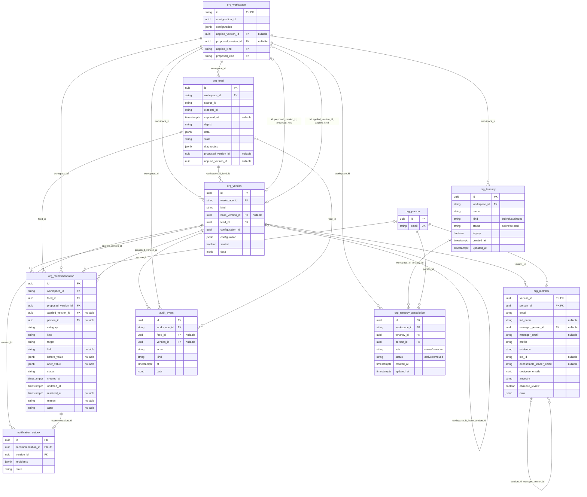

# Organization database: ER diagram and table guide

19 October 2026 | Implemented local ten-table model

The running prototype still uses the ten-table model below. A separate [candidate production operation model](../../docs/engineering-design/02-operations-and-provider.md#candidate-operation-persistence-review-draft) is under review; it has not created or changed database tables.

The [unified proposed production model](../../docs/engineering-design/11-production-data-model.md) and its
[configuration field guide](../../docs/engineering-design/10-configuration-data-model.md) now cover planned
production extensions; their diagrams are separate. Name/OCID/home-region and managed-object binding
fields there must not be mistaken for already migrated prototype columns.

D40 (24 October 2026) simplifies the **proposed production** human-access model to persistent
per-tenancy recovery-account credential retrieval and four-hour rotation. Temporary named support
is deferred. The proposed disclosure-request table retains exact credential/version/window and audit
references; it no longer owns temporary-user access assignments or cleanup/check heads. Rotation
remains on the credential head plus C2 operations. The proposed total stays28 application tables;
none of these changes alters the implemented ten-table model below. See the
[current production-model decision](../../docs/engineering-design/11-production-data-model.md#current-model-decision-d40--24-october-2026).

The current ten-table diagram is below. Open the [zoomable SVG](../diagrams/organization-schema.svg)
or [PNG](../diagrams/organization-schema.png); both were regenerated from the current
[editable Mermaid source](../diagrams/organization-schema.mmd) on 19 October 2026 and visually checked.
The [Excalidraw file](../diagrams/organization-schema.excalidraw) contains the rendered ER diagram
as one movable/annotatable image; its table boxes are not individually editable. Edit table fields
and relationships in Mermaid, then regenerate the exports. The inline model, source and rendered
exports describe the same ten-table schema; the executable SQLAlchemy model and generated DDL
remain the authority for exact constraints.

The diagram follows the actual [SQLAlchemy schema](../backend/otm/organization/schema.py) and
[generated DDL](contracts/organization-schema.sql). `PK` is primary key, `FK` foreign key,
`UK` unique key; crow's feet mean many, circles mean optional. Composite scope/type constraints
and application graph validation supplement these relationships.

See [the complete field-value reference](organization-field-reference.md) and
[DIY name/add-person steps](organization-diy-feed-changes.md).

## Three understandable views

- **Applied organization:** `current_organization` follows the workspace's applied pointer.
- **Proposed organization:** `proposed_organization` follows its latest eligible proposed pointer.
- **Reconciliation:** `organization_reconciliation` shows metadata changes and review episodes;
  `pending_organization_reviews` selects open/acknowledged exceptions.

Both organization views use the same person-row shape. Versions beneath them preserve history
and consistent browsing; they are not multiple competing live organizations. The proposal reflects
source plus explicit supplemental/LOB configuration, excluding person overrides. Applied state
honors audited overrides. Retained source gaps are labeled and cannot establish departures.

## Tables

| Table | Purpose | Change behavior |
|---|---|---|
| `org_person` | Stable UUID and original normalized-email identity anchor, referenced by tenancy owners/members. | Immutable; feed omission never deletes it. Explicit verified name/email merges retain the survivor UUID while the current member address changes. |
| `org_feed` | Canonical source identity/payload/digest/capture and processing result. | Source evidence frozen; diagnostics, status and resulting version pointers may advance. Repeated receipts become immutable audit events. |
| `org_version` | Complete proposed or applied publication, base/feed references, frozen trusted configuration and coverage evidence. | Content immutable after sealing; history stays available. Kind/workspace constraints protect current pointers. |
| `org_member` | Person facts in one version. Readable name/email/manager/profile/evidence/LOB/leader/designees/ancestry/review columns plus full typed state JSON. | Immutable, composite `(version_id, person_id)` key. Manager FK must remain in the same version; insertion into sealed versions is blocked. |
| `org_workspace` | Scope ID, current applied/proposed pointers and trusted settings/configuration generation. | Mutable coordination row; updates are locked, checked against expected context and audited. |
| `org_recommendation` | Before/after metadata deltas and deduplicated exception episodes, with source/version/person evidence and review state. | Source/before-after evidence frozen; operational status, acknowledgment and last applied evidence advance. Continued issue updates the same episode; recovery/recurrence opens a new episode. |
| `audit_event` | System/admin action history, source receipts, configuration corrections and publications. | Append-only evidence. This local prototype does not authenticate actor labels; production requires SSO-derived identity. |
| `notification_outbox` | One frozen initial notification intent/recipient set per exception episode. | Immutable `intent_only` evidence; no messages are sent. Delivery/retry processing is future work. |
| `org_tenancy` | Workspace-scoped simulated individual/shared tenancy registry; UUID, name, kind, status, legacy marker and timestamps. | Mutable local operational state; retirement sets `deleted`, not hard deletion. No real OCI OCID or resource is implied. |
| `org_tenancy_association` | Stable person linked to a registry tenancy as owner/member, with status and timestamps. | Removal/transfer retires old relationships using `removed`. Partial unique indexes enforce one active association per tenancy/person and at most one active owner per tenancy. Composite workspace/tenancy FK prevents cross-workspace tenancy references. |

`org_member.data` preserves profile/reference/capture/census times, source record ID, manager
provenance, derived manager path, territory/top-manager hints and other typed `PersonState` facts.
Common inspection fields no longer require JSON extraction.

## Workflow and safeguards

A feed is registered once, with every delivery auditable. Source identity conflicts, stale input,
duplicate identities and cycles cannot replace usable current pointers. Reconciliation reads stored
input, stages an inspectable proposed version and field deltas, then automatically applies valid
metadata and exception/history/intent changes atomically. The compatibility candidate API verifies
all source-derived facts, closing the earlier mismatched-feed publication gap.

Admin corrections revalidate and reapply the same source under a new immutable configuration
snapshot. Expected applied/proposed/configuration IDs prevent stale edits. Overrides remain visible
as intentional source differences, rather than silently disappearing on the next feed.

Database triggers protect ordinary immutable writes; they do not defend against a privileged DBA
modifying safeguards. Whole graph/cycle/source-coverage properties are validated by domain logic.

## Inspect and experiment

The active local schema is **`otm_sample_demo_v2`**, database `otm_org_dev` on `127.0.0.1:55432`,
user `otm_dev`. Filter earlier experiments by `root-leader-sample` or `synthetic-lab`; for the web lab use
the active run workspace from `/api/local/summary`, since Clean workspace archives prior runs. The old `otm_sample_demo` schema
is preserved; migrated identities, applied-version IDs and immutable evidence were checked.
Historical proposed versions reconstructed by migration are copies of previously applied history,
not claims that a legacy staging screen existed.

Start with [the working-model pgAdmin walkthrough](organization-working-model.md) and
[inspection queries](local-db-inspection.sql). See [the executable contract](organization-m1-contract.md)
and [validation record](organization-prototype-validation.md) for implementation boundaries.

These tables are a tested organization-subsystem prototype and production foundation, not the full
application schema. Tenancy lifecycle/access/configuration/spend, authenticated APIs, deployment and
production migrations still require subsequent implementation and qualification.

## Identity, registry and directory separation (19 October)

The original eight organization tables remain, with two additional local registry tables. Trusted
configuration includes review decisions,
soft org exclusions and explicit identity merge aliases. After a verified email merge,
`org_person.email` is an immutable original anchor, while `org_member.email` is the current
versioned address and the old stable UUID survives. Original feeds and snapshots stay intact.
See [exception lifecycle](exception-workflows.md) for the current rules and action/history views.

`current_organization` and `proposed_organization` remain source/reporting views. The web managed
directory separately filters explicitly unmanaged profiles and adds current registry counts/status.
Versioned configuration fields `managed_exclusions`, `pending_onboarding_person_ids`,
`outside_person_ids` and `registry_initialized` preserve deliberate directory/registry decisions.
Neither a feed omission nor an empty registry alone deletes source profiles. Offboarding removes
someone from the managed directory automatically only after an explicit command removes their last
association (or confirms none exist). [Registry walkthrough](tenancy-associations.md).
