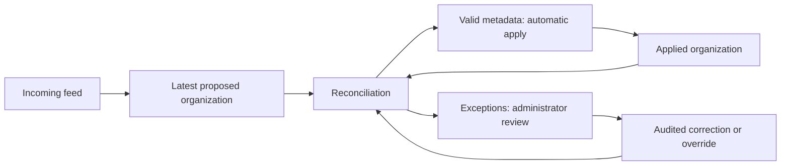

# Organization implementation audit and simplification proposal

13 October 2026 | Assessment and proposed redesign; not an approved schema migration

## Recommendation

Expose three clear concepts: **Applied organization**, **Latest proposed organization**,
and **Reconciliation** (changes already applied plus exceptions requiring administrator action).
Keep automatic application of valid metadata, as the user confirmed on 13 October.
Administrators resolve exceptions; feed reconciliation never creates or deletes OCI tenancies.

The current implementation has useful safeguards, but its storage vocabulary and interfaces
make the product harder to follow than necessary. It persists applied state and source
payloads, builds a proposed effective state only in memory, and buries deltas in publication
events. There is no persistent, inspectable recommendation list. That is the principal gap.

Simplify the representation and expose readable fields. Do not remove stable person identities,
source evidence, immutable history, validation, concurrency control or durable notification intent
merely to reach a smaller table count. This proposal requires detailed schema review before
implementation; the existing application and sample database have not been migrated.

## What the existing implementation actually does

| User's concept | Current implementation | Problem |
|---|---|---|
| Real/applied organization | `org_population.head_id` selects `org_revision` plus `org_state` | Correct historical consistency, but several names/joins and JSONB are needed to understand the current organization. |
| Latest incoming/proposed organization | `org_snapshot.data` holds source rows; `prepare()` builds an in-memory `Candidate` | No persisted proposed tree or explicit latest-proposed pointer. Source observations and retained effective state are easy to confuse. |
| Changes/recommendations | `publish()` computes changes in `org_event.data`; `_incidents()` records selected issues | Changes are recorded at publication, rather than exposed as an inspectable reconciliation result before/after application. There is no administrator recommendation API. |
| Administrator resolution | Supplemental edges/LOB/designees are bootstrapped in immutable configuration | No live correction/override/configuration-publication workflow exists in this slice. |
| Readable data | Most person facts are in `org_state.data`; key relationships also appear as columns | A database browser cannot readily display name, manager, LOB and review state without JSON extraction. |

Eleven tables do not mean eleven different organization structures. Three describe identity/
applied organization; others describe feed processing, coordination, configuration, history and
alerts. Those responsibilities are legitimate. The problem is that bookkeeping dominates the
explanation while proposed state and recommendations are not first-class application concepts.

## Findings

### 1. Persist the proposed view and reconciliation result

`Store.ingest()` registers, prepares and immediately publishes valid metadata
([store.py](../backend/otm/organization/store.py), lines 700–735). `Candidate` is transient.
The local API exposes head/list/detail reads of applied revisions only
([api.py](../backend/otm/organization/api.py)).

Add a visible proposed organization and reconciliation result bound to an exact feed,
applied baseline and configuration version. Applying automatic changes must not erase the
ability to see what the feed proposed, what changed, and what remains unresolved.

### 2. Make human-readable columns the normal inspection path

Names, role/profile evidence, source observation times, LOB and designees currently sit inside
JSONB. Prefer named columns for routinely displayed/filterable fields such as full name,
manager person ID, profile type, presence/review status and LOB ID. Keep the original feed
payload and detailed diagnostics as typed JSON; they are evidence, not the default people view.

Use explicit immutable configuration snapshots for historical leader/designee derivation.
Whether those assignments also need normalized association tables is a later detailed decision;
do not silently store relationship arrays without considering referential integrity.

### 3. Reduce pipeline-specific tables without mixing evidence with mutable state

`org_snapshot` + `org_result` can become one feed aggregate: immutable source identity/payload
columns plus separately controlled processing/status columns. Immutability applies to the source
columns, not a blanket trigger blocking processing updates.

Repeated delivery receipts can be append-only records in the shared audit facility, linked to
the canonical feed and recording receipt time, byte digest and duplicate/conflict disposition.
This preserves delivery evidence without a separate organization-only receipt table.

Current configuration can live in the workspace settings, with a configuration generation
checked during apply and its exact immutable contents copied into each resulting version.
This can eliminate the separate configuration table, but it must not eliminate configuration
history, trusted-source boundaries or concurrency checks. Storing a live pointer alone is insufficient.

Organization incidents can become explicit recommendation/exception records. They must retain
stable issue episodes, deduplication, last-seen evidence, resolution and recurrence; replacing
incidents with a daily unversioned diff that loses those facts would be a regression.

### 4. Decompose services around the user-visible flow

`prepare()` currently mixes source validation, identity matching, effective graph construction,
coverage, absence, accountability and incident classification in one function. `Store` mixes DDL/
triggers, intake, reads, publication, diffing and alerts. Comments help, but the boundaries remain broad.

Prefer named stages: `validate_feed`, `build_proposed_organization`, `compare_organizations`,
`classify_changes`, `apply_safe_changes`, `refresh_recommendations` and `resolve_exception`.
Keep graph/identity comparison pure; keep database writes in explicit transactions. Separate
schema/migrations, organization reads and publication orchestration into focused modules.
Do not introduce a generic rules engine or plugin framework for this small organization.

### 5. Close the feed-to-candidate provenance gap before adding mutation interfaces

The internal `publish(snapshot_id, candidate)` checks current head/configuration and the
snapshot result, but does not verify that the candidate was derived from that snapshot's
stored envelope and records (store.py, lines 467–525).

A disposable-database probe registered feed A, built a candidate from different feed B with a
changed name, then published it under A's snapshot ID. Publication succeeded while the immutable
source evidence still contained A's original name. The current read-only API does not expose
this as a public mutation endpoint; normal `ingest()` supplies matching input. It remains a
correctness gap in the internal interface that a staging/admin workflow should not inherit.

Prefer `reconcile(feed_id)` / `apply(reconciliation_id)` where persisted source input and frozen
configuration are loaded server-side. Check expected applied version, proposed version/configuration
and validated graph at commit. Do not trust caller-supplied candidate contents or an ID alone.

## Proposed understandable model

“Applied” means what the tool currently uses for tenancy ownership/accountability. It is not a
claim that the tool independently knows the real-world organization. “Proposed” means what the
latest accepted source evidence supports. Invalid or stale deliveries remain inspectable but
cannot replace the applied organization or the newer eligible proposed state.

### Storage target to review

Six organization-specific tables plus shared audit/notification facilities is a reasonable
initial target for this slice. This is a design proposal, not a promise that the whole tenancy
manager will have eight tables or that later integrity requirements cannot justify another table.

| Table | Plain-language role |
|---|---|
| `org_person` | Stable identity anchor for owners/members. Identity is independent of being in today's feed. |
| `org_feed` | One source capture, normalized source evidence, capture/receipt provenance, coverage and processing result. |
| `org_version` | One immutable proposed or applied organization version, with source/base/configuration evidence. |
| `org_member` | People and reporting relationships in each version, using readable columns and same-version manager FKs. |
| `org_workspace` | One managed organization's current applied/proposed pointers and trusted settings/configuration generation. |
| `org_recommendation` | Reconciliation changes and exceptions, with before/after evidence, linked versions and processing/resolution state. |
| Shared `audit_event` | Immutable system/admin history, including delivery receipts, automatic metadata changes and administrator decisions. |
| Shared `notification_outbox` | Frozen notification intent/recipients and separately controlled delivery progress. Future retries/attempt history must remain auditable. |

Expose **`current_organization`** and **`proposed_organization`** SQL views so people can inspect
two parallel structures directly, without learning version-pointer joins or JSON extraction.
Both can use the same person-row shape and version tables underneath. Historical versions remain
available; retaining them is necessary for stable navigation, audit and prior manager-chain evidence.

Only one applied and one eligible proposed version are current in the workspace. Older versions
are history, not competing live organizations. Derived candidate state retained from earlier evidence
must distinguish that provenance from rows actually present in this feed. Invalid raw input remains
in feed evidence even when it cannot form a valid proposed hierarchy.

## Behavior as new feeds arrive

1. Record delivery evidence. Deduplicate by configured source snapshot identity; conflicting content
   is an integrity issue. Compare capture order, not merely arrival time. Preserve failed inputs.
2. Build the latest eligible proposed organization with source coverage and reference-only profiles
   explicit. A stale/broken feed must not quietly replace a newer usable proposed view.
3. Compare it with the applied organization by stable person identity, against frozen trusted settings.
4. Automatically apply valid names, manager changes and derived accountability atomically. Record
   the reconciliation and resulting applied version. Unchanged metadata can still refresh presence evidence.
5. Retain unresolved exceptions for administrators. A new feed supersedes obsolete proposals and
   refreshes continuing ones without repeatedly notifying for the same issue episode.
6. An administrator correction revalidates/recomputes against the latest feed and applied version,
   then commits audited changes. Stale recommendations cannot overwrite a newer feed or correction.

Examples:

| Hypothetical situation | Applied/proposed result | Administrator work |
|---|---|---|
| Grant's direct manager changes from Pete to Allen in a valid feed | Manager and derived accountability update automatically; change history shows before/after. | None for ordinary metadata. |
| A new employee appears | Organization profile is represented; tenancy count remains zero until provisioning. | Decide whether to create/import a tenancy. |
| An employee is absent from a qualified full feed | Keep identity, ownership and last-known role/manager evidence; open absence review. | Investigate transfer/departure and choose guarded tenancy action. |
| Pete's own manager row is missing | Show the source gap; retain explicitly supported prior/supplemental edges separately; block absence inference. | Investigate feed quality or maintain an audited supplemental correction. |
| A LOB leader/designee assignment no longer fits the hierarchy | Show assignment-review exception; do not invent a replacement or preserve invalid routing as valid. | Update the admin-controlled assignment. |

Manual corrections must be explicit overrides with reason, author and scope, not invisible edits
silently overwritten by tomorrow's feed. When a later feed disagrees, show the conflict; do not
force convergence by discarding trusted corrections. Convergence means **no unexplained differences**,
not byte-identical source/applied rows or deletion of retained identities. A partial feed and a
confirmed out-of-scope person can legitimately differ from retained history.

Tenancy ownership continues to point to `org_person`. Updating manager/LOB/designee metadata never
transfers a tenancy or changes OCI parentage. Departure/transfer investigations, owner reassignment,
shared-member cleanup and actual tenancy deletion remain distinct guarded workflows.

## Safeguards and verification to retain

- Stable identities; conservative email/source-ID conflicts and explicit future binding correction.
- Source authority/freshness/capture/completeness checks; missing manager profiles block absence.
- Whole effective graph validation, including retained edges; no cycles or fabricated reporting paths.
- Complete immutable applied versions, same-version manager constraints and pinned historical reads.
- Duplicate/conflicting/out-of-order input handling; later equal-content capture can refresh evidence.
- Atomic applied version/state/history/intent/head; rollback leaves no partial changes.
- Expected-version/configuration checks and recomputation after competing publication.
- Last-known ownership/manager/shared-status evidence; no deletion or access revocation from a feed.
- Durable issue episodes, alert deduplication/recurrence and separation of immutable intent from delivery.

Executed audit evidence: the existing **36 tests passed**. One additional temporary probe also
passed by reproducing the currently accepted mismatched candidate/source condition described above;
that is evidence of a gap, not evidence that mismatch handling is correct. Total run: 37 passed,
2 known warnings, 2.80 seconds for pytest, on a disposable PostgreSQL container. The populated
inspection database was not changed. No implementation code or canonical accepted design was rewritten.

Before migrating, extend tests for persisted proposed/current views, pending recommendation refresh,
admin overrides and source conflicts, stale admin action, issue recurrence across new feeds,
configuration changes using the same feed, and rejection of mismatched source/candidate provenance.
Carry the existing correctness tests forward, preserve data/identities/history with reviewed migrations,
and verify the two SQL views and review screen with the real sample.

## Suggested implementation sequence

1. Agree on the three concepts and annotate the schema/flow with actual fields and examples.
2. Define current/proposed/recommendation APIs and the review screen; make them readable before another implementation expansion.
3. Refactor pure comparison/orchestration boundaries, retaining existing behavior and tests.
4. Add persisted proposed/reconciliation state and fix provenance binding.
5. Migrate bookkeeping consolidation and readable columns with explicit preservation checks.
6. Rebuild the ER diagram, database inspection examples and tests from the reviewed implementation.
